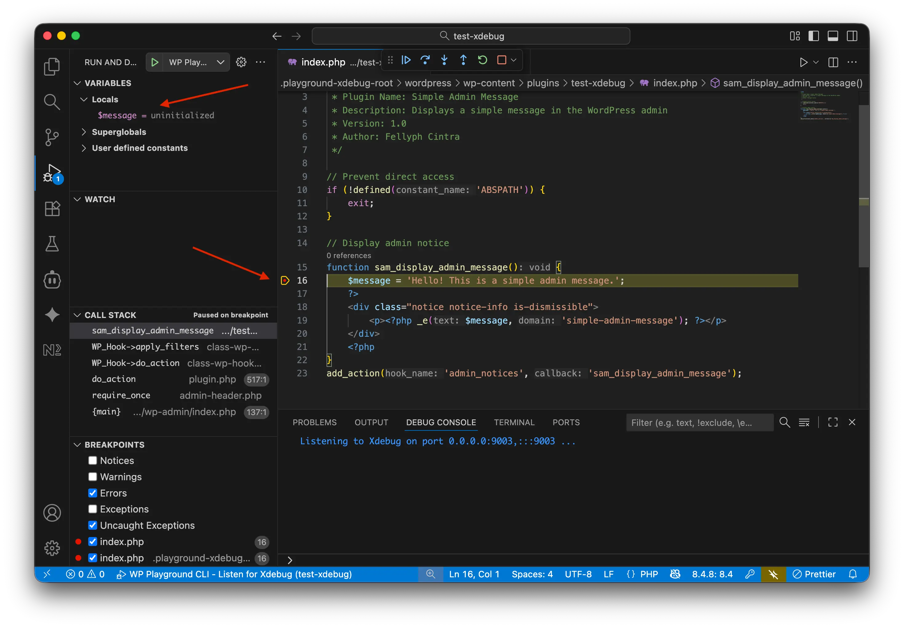
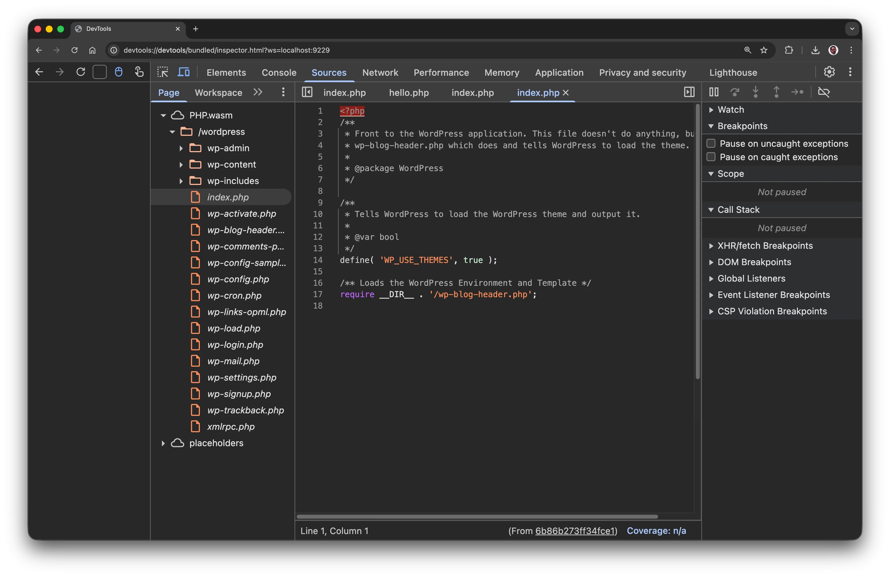
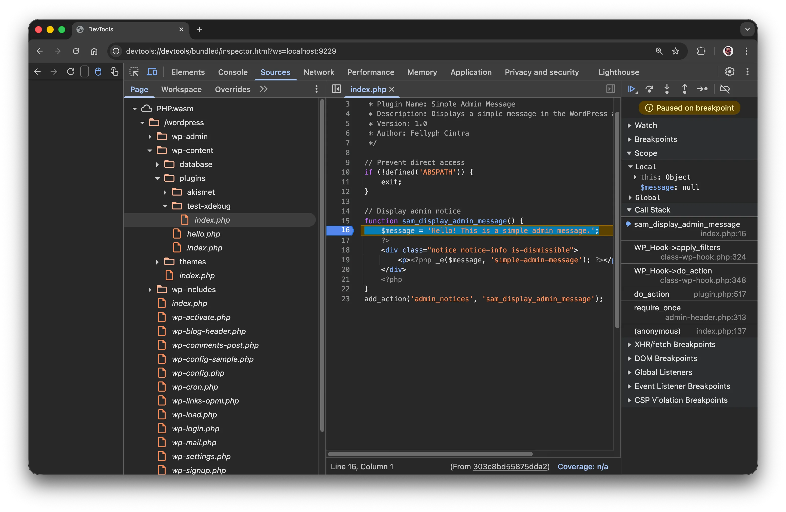

# Getting Started with Xdebug

This guide shows you how to enable Xdebug in WordPress Playground and start debugging your code.

## PHP WASM CLI vs Playground CLI

First, Xdebug is present in two different CLIs:

- **`@php-wasm/cli`**: Run standalone PHP scripts. Use this when debugging PHP code without needing a WordPress environment.
- **`@wp-playground/cli`**: Run a full WordPress installation. Useful for debugging WordPress plugins, themes, or core functionality.

For this guide, we'll use `@wp-playground/cli`. If you're not familiar with the tool, we recommend reading the [`@wp-playground/cli` guide](/developers/local-development/wp-playground-cli), but the same process can also be applied to debugging PHP applications with `@php-wasm/cli`.

## Quick start with `npx`

The fastest way to get started is using npx, which doesn't require installation:

```bash
npx @wp-playground/cli@latest server --xdebug
```

The CLI prints the WordPress URL after starting the server with Xdebug enabled. You can now connect a debugger.

Before starting another example, stop the previous Playground server with `Ctrl+C` and disconnect its debugger.

## Create the sample plugin

Create a directory named `test-xdebug` and save the following code as `test-xdebug.php` inside it. Both walkthroughs use this plugin.

```PHP
<?php
/**
 * Plugin Name: Simple Admin Message
 * Description: Displays a simple message in the WordPress admin
 * Version: 1.0
 * Author: Playground Team
 */

// Prevent direct access
if (!defined('ABSPATH')) {
    exit;
}

// Display admin notice
function sam_display_admin_message() {
    $message = 'Hello! This is a simple admin message.';
    ?>
    <div class="notice notice-info is-dismissible">
        <p><?php _e($message, 'simple-admin-message'); ?></p>
    </div>
    <?php
}
add_action('admin_notices', 'sam_display_admin_message');
```

## Starting with IDE integration

To debug the sample plugin with VS Code, use the `--experimental-unsafe-ide-integration=vscode` flag. For PhpStorm, open `test-xdebug` as a PhpStorm project first and make sure it contains an `.idea/` directory. In the command below, replace the VS Code flag with `--experimental-unsafe-ide-integration=phpstorm`.

<div class="callout callout-info">

This flag is marked as `unsafe` because it edits the IDE config files to set Xdebug path mappings and web server details. **CAUTION:** If there are bugs, this feature may cause your IDE configuration files to break. Please consider backing up your IDE configs before using this feature.

</div>

To debug in VS Code, you'll need the following prerequisites:

1. Install a PHP debugger extension that supports Xdebug, such as [PHP Debug](https://marketplace.visualstudio.com/items?itemName=xdebug.php-debug).
2. Have a `.vscode/` folder.
3. Enable breakpoints in your IDE. Some IDEs come with this feature disabled, so be aware of this detail.

Run the following command from the plugin directory.

```bash
npx @wp-playground/cli@latest server --xdebug --experimental-unsafe-ide-integration=vscode --auto-mount
```

If you don't have a `.vscode/launch.json` file, the terminal will create a file similar to this:

```JSON
{
    "configurations": [
        {
            "name": "WP Playground CLI - Listen for Xdebug",
            "type": "php",
            "request": "launch",
            "port": 9003,
            "pathMappings": {
                "/": "${workspaceFolder}/.playground-xdebug-root",
                "/wordpress/wp-content/plugins/test-xdebug": "${workspaceFolder}/"
            }
        }
    ]
}
```

Start the **WP Playground CLI - Listen for Xdebug** configuration in your IDE and set a breakpoint inside `sam_display_admin_message()`. Append `/wp-admin/plugins.php` to the WordPress URL printed by the CLI and open the resulting URL in your browser to hit the breakpoint. If WordPress asks you to sign in, use `admin` as the username and `password` as the password.



### PhpStorm troubleshooting

If PhpStorm pauses on the first line of unmapped files or scripts outside your project, you can disable these optional settings under **Settings > PHP > Debug > Xdebug**:

- **Force break at first line when no path mapping specified**.
- **Force break at first line when a script is outside the project**.

If requests that do not hit a breakpoint produce unwanted notifications, disable **Notify if debug session was finished without being paused** under **Settings > PHP > Debug > Settings** (called **Advanced settings** in the current JetBrains documentation). When this setting is disabled and no breakpoint is hit, PhpStorm runs the script without pausing or establishing a debugging session.

These options suppress unwanted pauses or notifications. They do not fix path mappings or configure breakpoints: you still need correct path mappings and enabled breakpoints in the code you want to debug.

For more details, see [JetBrains' debug settings reference](https://www.jetbrains.com/help/phpstorm/debug.html) and the [PhpStorm examples](https://github.com/WordPress/wordpress-playground/blob/trunk/examples/xdebug/ide/README.md#phpstorm).

## Early Access: DevTools debugger

Playground CLI ships an **unstable, highly exploratory** workflow that enables debugging PHP programs using Chrome DevTools.

To try it, use the `--experimental-devtools` flag:

```bash
npx @wp-playground/cli@latest server --xdebug --experimental-devtools
```

Open the URL printed by the bridge in Chrome on the same computer. DevTools connects to the Chrome DevTools Protocol (CDP) listener at `127.0.0.1:9229`.

```text
Starting XDebug Bridge...
Connect Chrome DevTools to CDP at:
devtools://devtools/bundled/inspector.html?ws=127.0.0.1:9229
```

Once DevTools connects, the bridge starts listening for Xdebug (DBGp) connections at `127.0.0.1:9003`. Both listeners use IPv4 loopback by default.

```text
Chrome connected! Initializing Xdebug receiver...
XDebug receiver running on 127.0.0.1:9003
Running a PHP script with Xdebug enabled...
```



If you ran the previous command, close its DevTools window and stop the server with `Ctrl+C`. Run the following command from the `test-xdebug` directory.

```bash
npx @wp-playground/cli@latest server --xdebug --experimental-devtools --auto-mount
```

The Playground CLI automatically mounts and activates the plugin. Open the DevTools URL from the terminal and set a breakpoint inside `sam_display_admin_message()`. Append `/wp-admin/plugins.php` to the WordPress URL printed by the CLI and open the resulting URL in your browser to hit the breakpoint. If WordPress asks you to sign in, use `admin` as the username and `password` as the password.



This feature is in experimental mode. Until it's finished, we'll need your feedback. Please connect with us in the [#playground Slack channel](https://wordpress.slack.com/archives/C04EWKGDJ0K) and share your thoughts.
