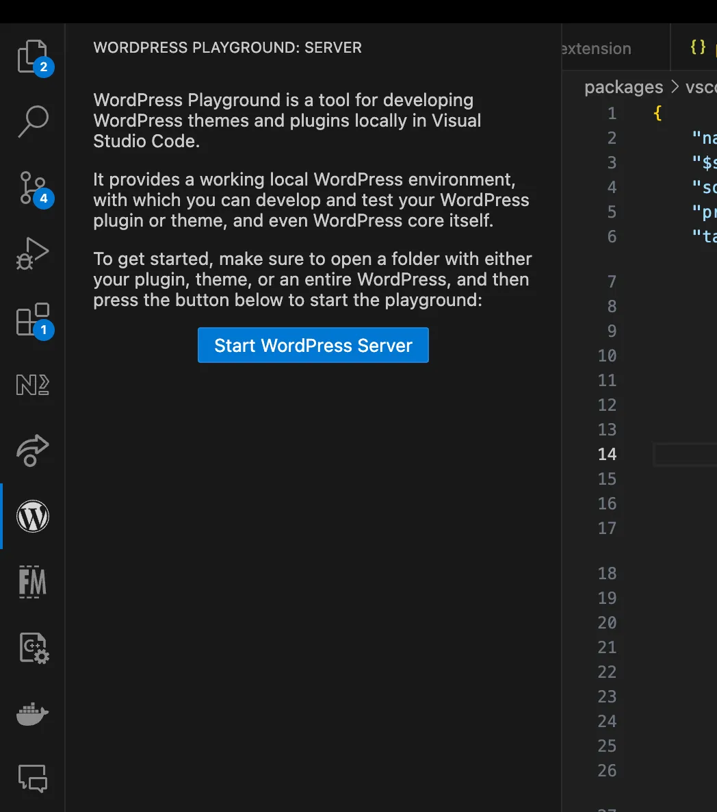

<!--
# VS Code extension
-->

# ভিএস কোড (VS Code) এক্সটেনশন

<!--
Start a zero-setup development environment using the [VS Code extension](https://marketplace.visualstudio.com/items?itemName=WordPressPlayground.wordpress-playground), and develop your plugin or theme locally without installing Apache or MySQL.
-->

[VS Code এক্সটেনশন](https://marketplace.visualstudio.com/items?itemName=WordPressPlayground.wordpress-playground) ব্যবহার করে কোনো জটিল সেটআপ ছাড়াই একটি ডেভেলপমেন্ট এনভায়রনমেন্ট শুরু করুন, এবং Apache বা MySQL ইনস্টল না করেই লোকালভাবে আপনার প্লাগইন বা থিম তৈরি করুন।

<!--
Key Features:
-->

মূল বৈশিষ্ট্যসমূহ:

<!--
- **Integrated Development**: Develop WordPress sites directly within VS Code.
- **Ease of Use**: Simplifies the development workflow with integrated tools.
-->

- **সমন্বিত ডেভেলপমেন্ট (Integrated Development)**: সরাসরি VS Code-এর ভেতরেই ওয়ার্ডপ্রেস সাইট তৈরি ও পরিচালনা করুন।
- **ব্যবহারে সহজ**: সমন্বিত টুলসের মাধ্যমে ডেভেলপমেন্টের কাজের প্রক্রিয়াকে সহজ করে তোলে।

<!--

**Documentation**

The VS Code extension is maintained in a different GitHub repository, [Playground Tools](https://github.com/WordPress/playground-tools/). You can find the latest documentation in the [dedicated README file](https://github.com/WordPress/playground-tools/blob/trunk/packages/vscode-extension/README.md).

-->

**ডকুমেন্টেশন**

VS Code এক্সটেনশনটি একটি ভিন্ন গিটহাব রেপোজিটরিতে রক্ষণাবেক্ষণ করা হয়, যা হলো [Playground Tools](https://github.com/WordPress/playground-tools/)। আপনি এর [নির্দিষ্ট README ফাইলে](https://github.com/WordPress/playground-tools/blob/trunk/packages/vscode-extension/README.md) সর্বশেষ ডকুমেন্টেশন দেখতে পাবেন।

<!--
## Installation and Usage:
-->

## ইনস্টলেশন এবং ব্যবহার:

<!--
1.  **Install the Extension**: Search for “WordPress Playground” in the VS Code extensions marketplace and install it.
2.  **Setup**: Follow the setup instructions provided in the extension to configure your development environment.
3.  **Develop and Debug**: Use the integrated tools to develop and debug your WordPress site.
-->

১. **এক্সটেনশনটি ইনস্টল করুন**: VS Code-এর এক্সটেনশন মার্কেটপ্লেসে "WordPress Playground" লিখে অনুসন্ধান করুন এবং এটি ইনস্টল করুন।
২. **সেটআপ**: আপনার ডেভেলপমেন্ট এনভায়রনমেন্ট কনফিগার করতে এক্সটেনশনে দেওয়া সেটআপ নির্দেশিকা অনুসরণ করুন।
৩. **ডেভেলপ এবং ডিবাগ**: আপনার ওয়ার্ডপ্রেস সাইট ডেভেলপ ও ডিবাগ করতে ইন্টিগ্রেটেড টুলস ব্যবহার করুন।

<!--
The extension ships with a portable WebAssembly version of PHP and sets up WordPress to use SQLite. Once installed, all you have to do is click the **Start WordPress Server** button in VS Code:
-->

এই এক্সটেনশনটিতে PHP-এর একটি পোর্টেবল WebAssembly সংস্করণ অন্তর্ভুক্ত রয়েছে এবং এটি SQLite ব্যবহার করার জন্য ওয়ার্ডপ্রেস কনফিগার করে নেয়। একবার ইনস্টল করা হলে, আপনাকে কেবল VS Code-এ **Start WordPress Server** বোতামে ক্লিক করতে হবে:

