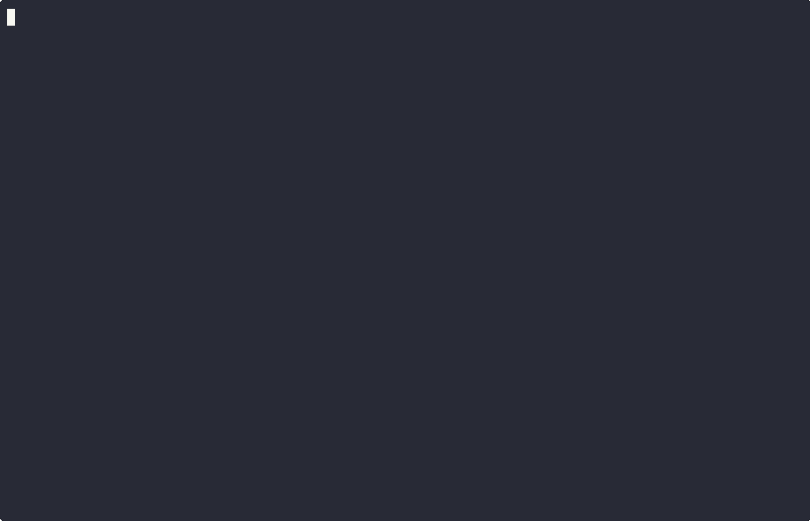

<!--
# Playground CLI

[@wp-playground/cli](https://www.npmjs.com/package/@wp-playground/cli) is a command-line tool that simplifies the WordPress development and testing flow.
Playground CLI supports auto-mounting a directory with a plugin, theme, or WordPress installation. But if you need flexibility, the CLI supports mounting commands to personalize your local environment.

**Key features:**

- **Quick Setup**: Set up a local WordPress environment in seconds.
- **Flexibility**: Allows for configuration to adapt to different scenarios.
- **Simple Environment**: No extra configuration, just a compatible Node version, and you are ready to use it.

The Playground CLI includes two main commands for running WordPress locally:

- **`start`** (Simplified): Auto-detects your project type, persists sites between sessions, and opens a browser automatically.
- **`server`** (Advanced): Provides full manual control over configuration. Best for custom setups, CI/CD pipelines, or when you need fine-grained control.
-->

# প্লেগ্রাউন্ড সিএলআই (Playground CLI)

[@wp-playground/cli](https://www.npmjs.com/package/@wp-playground/cli) হলো একটি কমান্ড-লাইন টুল যা ওয়ার্ডপ্রেস ডেভেলপমেন্ট এবং টেস্টিং প্রক্রিয়াকে সহজতর করে তোলে।
প্লেগ্রাউন্ড সিএলআই কোনো প্লাগইন, থিম বা ওয়ার্ডপ্রেস ইনস্টলেশন যুক্ত ডিরেক্টরি স্বয়ংক্রিয়ভাবে মাউন্ট (auto-mount) সমর্থন করে। তবে আপনার যদি আরও নমনীয়তার প্রয়োজন হয়, তবে স্থানীয় পরিবেশকে নিজের মতো সাজিয়ে নিতে সিএলআই বিভিন্ন মাউন্টিং কমান্ড সমর্থন করে।

**মূল বৈশিষ্ট্যসমূহ:**

- **দ্রুত সেটআপ**: কয়েক সেকেন্ডের মধ্যে একটি লোকাল ওয়ার্ডপ্রেস এনভায়রনমেন্ট প্রস্তুত করুন।
- **নমনীয়তা**: বিভিন্ন পরিস্থিতির সাথে মানিয়ে নিতে কনফিগারেশন করার সুবিধা দেয়।
- **সহজ পরিবেশ**: বাড়তি কোনো কনফিগারেশনের প্রয়োজন নেই; কেবল একটি উপযুক্ত নোড (Node) সংস্করণ থাকলেই এটি ব্যবহার শুরু করা যায়।

স্থানীয়ভাবে ওয়ার্ডপ্রেস চালানোর জন্য প্লেগ্রাউন্ড সিএলআই দুটি প্রধান কমান্ড সরবরাহ করে:

- **`start`** (সহজ পদ্ধতি): স্বয়ংক্রিয়ভাবে আপনার প্রজেক্টের ধরন শনাক্ত করে, সেশনগুলোর মাঝে সাইটের পরিবর্তন সংরক্ষণ করে এবং ব্রাউজারে সাইটটি স্বয়ংক্রিয়ভাবে চালু করে।
- **`server`** (উন্নত পদ্ধতি): কনফিগারেশনের ওপর সম্পূর্ণ ম্যানুয়াল নিয়ন্ত্রণ প্রদান করে। কাস্টম সেটআপ, CI/CD পাইপলাইন কিংবা সূক্ষ্ম নিয়ন্ত্রণের জন্য এটি সবচেয়ে কার্যকর।

<!--
## Requirements

The Playground CLI requires Node.js 20.18 or higher, which is the recommended Long-Term Support (LTS) version. You can download it from the [Node.js website](https://nodejs.org/en/download).
-->

## প্রয়োজনীয় শর্তাবলী (Requirements)

প্লেগ্রাউন্ড সিএলআই ব্যবহারের জন্য Node.js 20.18 বা তার পরবর্তী সংস্করণ প্রয়োজন, যা প্রস্তাবিত লং-টার্ম সাপোর্ট (LTS) সংস্করণ। আপনি [Node.js ওয়েবসাইট](https://nodejs.org/en/download) থেকে এটি ডাউনলোড করতে পারেন।

<!--
## Quickstart

To run the Playground CLI, open a command line and use one of the following commands:

### Using `start` (Simplified)

The `start` command is the easiest way to get started. It automatically detects your project type, persists your site, and opens the browser:

```bash
npx @wp-playground/cli@latest start
```

When run inside a plugin or theme directory, `start` automatically mounts your project:

```bash
cd my-plugin
npx @wp-playground/cli@latest start
```

**Key differences from `server`:**

- Auto-login is enabled by default
- Opens browser automatically
- Auto-mounts the project by default
-->

## দ্রুত শুরু (Quickstart)

প্লেগ্রাউন্ড সিএলআই চালাতে আপনার কমান্ড লাইন ওপেন করুন এবং নিচের যেকোনো একটি কমান্ড ব্যবহার করুন:

### `start` ব্যবহার করা (সহজ পদ্ধতি)

শুরু করার জন্য `start` কমান্ডটি সবচেয়ে সহজ মাধ্যম। এটি স্বয়ংক্রিয়ভাবে আপনার প্রজেক্টের ধরন শনাক্ত করে, সাইট সংরক্ষণ করে এবং ব্রাউজার খুলে দেয়:

```bash
npx @wp-playground/cli@latest start
```

কোনো প্লাগইন বা থিম ডিরেক্টরির ভেতরে চালানো হলে, `start` স্বয়ংক্রিয়ভাবে আপনার প্রজেক্টটি মাউন্ট করে নেয়:

```bash
cd my-plugin
npx @wp-playground/cli@latest start
```

**`server` এর সাথে মূল পার্থক্যসমূহ:**

- ডিফল্টভাবেই অটো-লগইন সক্রিয় থাকে
- ব্রাউজারে স্বয়ংক্রিয়ভাবে সাইট ওপেন হয়
- ডিফল্টভাবে প্রজেক্ট অটো-মাউন্ট হয়

<!--
## Migrating from wp-now

The deprecated `@wp-now/wp-now` package maps most directly to the `start`
command:

| wp-now                                                  | Playground CLI                                                     |
| ------------------------------------------------------- | ------------------------------------------------------------------ |
| `npx @wp-now/wp-now start`                              | `npx @wp-playground/cli@latest start`                              |
| `npx @wp-now/wp-now start --path=./plugin`              | `cd ./plugin && npx @wp-playground/cli@latest start`               |
| `npx @wp-now/wp-now start --wp=6.8 --php=8.3`           | `npx @wp-playground/cli@latest start --wp=6.8 --php=8.3`           |
| `npx @wp-now/wp-now start --blueprint=./blueprint.json` | `npx @wp-playground/cli@latest start --blueprint=./blueprint.json` |
| `npx @wp-now/wp-now start --skip-browser`               | `npx @wp-playground/cli@latest start --skip-browser`               |
| `npx @wp-now/wp-now start --reset`                      | `npx @wp-playground/cli@latest start --reset`                      |

The main workflow change is where the saved site lives:

- With `wp-now`, `--path=./plugin` picked the project and the saved site.
- With Playground CLI, `start` saves the site for the current directory. For
  the closest match, `cd` into the project first, then run `start`.
- When Playground CLI creates WordPress for you, it keeps the WordPress files
  in `~/.wordpress-playground/sites/<path-hash>/`.
- If you run it on a full WordPress directory, or mount a directory at
  `/wordpress`, that directory is the WordPress site. Changes are written
  there.
- `start --path=./plugin` still mounts that folder, but it does not make
  `./plugin` the saved site. The saved site still belongs to the directory
  where you ran the command.

Use `start` for the familiar wp-now-style flow. Use `server` only when you want
to spell out mounts, storage, or automation yourself.
-->

## wp-now থেকে মাইগ্রেশন করা

বর্তমানে অপ্রচলিত (deprecated) `@wp-now/wp-now` প্যাকেজটি সরাসরি `start` কমান্ডের সাথে তুলনীয়:

| wp-now                                                  | Playground CLI                                                     |
| ------------------------------------------------------- | ------------------------------------------------------------------ |
| `npx @wp-now/wp-now start`                              | `npx @wp-playground/cli@latest start`                              |
| `npx @wp-now/wp-now start --path=./plugin`              | `cd ./plugin && npx @wp-playground/cli@latest start`               |
| `npx @wp-now/wp-now start --wp=6.8 --php=8.3`           | `npx @wp-playground/cli@latest start --wp=6.8 --php=8.3`           |
| `npx @wp-now/wp-now start --blueprint=./blueprint.json` | `npx @wp-playground/cli@latest start --blueprint=./blueprint.json` |
| `npx @wp-now/wp-now start --skip-browser`               | `npx @wp-playground/cli@latest start --skip-browser`               |
| `npx @wp-now/wp-now start --reset`                      | `npx @wp-playground/cli@latest start --reset`                      |

কাজের ধারায় মূল পরিবর্তনটি হলো সংরক্ষিত সাইট কোথায় থাকে:

- `wp-now`-এ `--path=./plugin` প্রজেক্ট এবং সংরক্ষিত সাইট উভয়ই নির্বাচন করত।
- প্লেগ্রাউন্ড সিএলআই-তে `start` কমান্ড বর্তমান ডিরেক্টরির জন্য সাইটটি সংরক্ষণ করে। যথাযথ কার্যপদ্ধতির জন্য প্রথমে প্রজেক্টে `cd` করে প্রবেশ করুন, তারপর `start` চালান।
- প্লেগ্রাউন্ড সিএলআই যখন আপনার জন্য ওয়ার্ডপ্রেস তৈরি করে, তখন এটি ওয়ার্ডপ্রেস ফাইলগুলো `~/.wordpress-playground/sites/<path-hash>/` ডিরেক্টরিতে রাখে।
- আপনি যদি এটি সম্পূর্ণ কোনো ওয়ার্ডপ্রেস ডিরেক্টরিতে চালান বা `/wordpress` এ কোনো ডিরেক্টরি মাউন্ট করেন, তবে সেই ডিরেক্টরিই ওয়ার্ডপ্রেস সাইট হিসেবে গণ্য হয় এবং পরিবর্তনগুলো সেখানেই সংরক্ষিত হয়।
- `start --path=./plugin` কমান্ড এখনও সেই ফোল্ডারটিকে মাউন্ট করে, তবে এটি `./plugin` ফোল্ডারকে সংরক্ষিত সাইটে রূপান্তর করে না। সংরক্ষিত সাইটটি সবসময় কমান্ড চালানোর ডিরেক্টরির সাথেই যুক্ত থাকে।

পূর্বের wp-now ধাঁচের পরিচিত অভিজ্ঞতার জন্য `start` ব্যবহার করুন। শুধুমাত্র মাউন্ট, স্টোরেজ বা অটোমেশন সম্পূর্ণ নিজের মতো নির্দিষ্ট করার প্রয়োজন হলেই `server` ব্যবহার করুন।

<!--
### Using `server` (Advanced)

The `server` command provides full control over configuration:

```bash
npx @wp-playground/cli@latest server
```



**Automatic site persistence:** When the `start` command manages the WordPress
root directory, it keeps your WordPress site persistent across sessions. Your
files and database are stored in `~/.wordpress-playground/sites/<path-hash>/`,
where `<path-hash>` is derived from the command's current working directory. If
you start from a full WordPress installation, or explicitly mount `/wordpress`,
that mounted directory becomes the persistent store instead.

This is useful when:

- You want a clean WordPress installation
- Testing fresh installation scenarios
- Your site data became corrupted or inconsistent

<div class="callout callout-info">

The `--reset` flag works only with `start`. For `server`, manually delete the persisted site directory at `~/.wordpress-playground/sites/<path-hash>/`.

</div>
-->

### `server` ব্যবহার করা (উন্নত পদ্ধতি)

`server` কমান্ড কনফিগারেশনের ওপর পূর্ণ নিয়ন্ত্রণ প্রদান করে:

```bash
npx @wp-playground/cli@latest server
```


**স্বয়ংক্রিয় সাইট সংরক্ষণ (Automatic site persistence):** যখন `start` কমান্ড ওয়ার্ডপ্রেসের রুট ডিরেক্টরি পরিচালনা করে, তখন এটি বিভিন্ন সেশনের মাঝে আপনার ওয়ার্ডপ্রেস সাইটটি অক্ষুণ্ণ রাখে। আপনার ফাইল এবং ডাটাবেস `~/.wordpress-playground/sites/<path-hash>/` ডিরেক্টরিতে সংরক্ষিত থাকে, যেখানে `<path-hash>` নির্ধারিত হয় বর্তমান ওয়ার্কিং ডিরেক্টরির ওপর ভিত্তি করে। আপনি যদি সম্পূর্ণ কোনো ওয়ার্ডপ্রেস ইনস্টলেশন থেকে শুরু করেন অথবা স্পষ্টভাবে `/wordpress` মাউন্ট করেন, তবে সেই মাউন্ট করা ডিরেক্টরিটিই স্থায়ী স্টোরেজে পরিণত হয়।

এটি বিশেষভাবে কার্যকর যখন:

- আপনি একটি পরিষ্কার ও নতুন ওয়ার্ডপ্রেস ইনস্টলেশন চান
- নতুন ইনস্টলেশন সম্পর্কিত পরিস্থিতি পরীক্ষা করছেন
- আপনার সাইটের ডেটা ক্ষতিগ্রস্ত বা অসঙ্গতিপূর্ণ হয়ে গেছে

<div class="callout callout-info">

`--reset` ফ্ল্যাগটি শুধুমাত্র `start` এর সাথে কাজ করে। `server` কমান্ডের ক্ষেত্রে ব্যবহৃত সাময়িক বা সংরক্ষিত সাইট ডিরেক্টরিটি ম্যানুয়ালি মুছে ফেলতে হয়।

</div>

<!--
### Choosing a WordPress and PHP Version

By default, the CLI loads the latest stable version of WordPress and PHP 8.3 due to its improved performance. To specify your preferred versions, you can use the flag `--wp=<version>` and `--php=<version>`:

```bash
npx @wp-playground/cli@latest server --wp=6.8 --php=8.4
```
-->

### ওয়ার্ডপ্রেস এবং পিএইচপি সংস্করণ নির্বাচন করা

উন্নত পারফরম্যান্স নিশ্চিত করতে সিএলআই ডিফল্টভাবে ওয়ার্ডপ্রেসের সর্বশেষ স্থিতিশীল সংস্করণ এবং পিএইচপি 8.3 লোড করে। আপনার পছন্দসই সংস্করণ নির্দিষ্ট করতে `--wp=<version>` এবং `--php=<version>` ফ্ল্যাগ ব্যবহার করতে পারেন:

```bash
npx @wp-playground/cli@latest server --wp=6.8 --php=8.4
```

<!--
### Loading Blueprints

One way to take your Playground CLI development experience to the next level is to integrate with [Blueprints](/blueprints/getting-started/). For those unfamiliar with this technology, it allows developers to configure the initial state for their WordPress Playground instances.

Using the `--blueprint=<blueprint-address>` flag, developers can run a Playground with a custom initial state. We’ll use the example below to do this.

**(my-blueprint.json)**

```bash
{
  "landingPage": "/wp-admin/options-general.php?page=akismet-key-config",
  "login": true,
  "plugins": [
    "hello-dolly",
    "https://raw.githubusercontent.com/adamziel/blueprints/trunk/docs/assets/hello-from-the-dashboard.zip"
  ]
}
```

CLI command loading a blueprint:

```bash
npx @wp-playground/cli@latest server --blueprint=my-blueprint.json
```
-->

### ব্লুপ্রিন্ট লোড করা (Loading Blueprints)

প্লেগ্রাউন্ড সিএলআই-তে আপনার ডেভেলপমেন্ট অভিজ্ঞতা আরও সমৃদ্ধ করার একটি চমৎকার উপায় হলো [ব্লুপ্রিন্ট](/blueprints/getting-started/) যুক্ত করা। যারা এই প্রযুক্তির সাথে পরিচিত নন, তাদের সুবিধার্থে বলা যায়—এটি ডেভেলপারদের তাদের ওয়ার্ডপ্রেস প্লেগ্রাউন্ড ইন্সট্যান্সের প্রাথমিক অবস্থা (initial state) কনফিগার করতে দেয়।

`--blueprint=<blueprint-address>` ফ্ল্যাগ ব্যবহার করে ডেভেলপাররা কাস্টম প্রাথমিক অবস্থায় একটি প্লেগ্রাউন্ড চালাতে পারেন। এটি করার জন্য নিচের উদাহরণটি লক্ষ্য করুন।

**(my-blueprint.json)**

```bash
{
  "landingPage": "/wp-admin/options-general.php?page=akismet-key-config",
  "login": true,
  "plugins": [
    "hello-dolly",
    "https://raw.githubusercontent.com/adamziel/blueprints/trunk/docs/assets/hello-from-the-dashboard.zip"
  ]
}
```

ব্লুপ্রিন্ট লোড করার সিএলআই কমান্ড:

```bash
npx @wp-playground/cli@latest server --blueprint=my-blueprint.json
```

<!--
### Mounting folders manually

Some projects have a specific structure that requires a custom configuration; for example, your repository contains all the files in the `/wp-content/` folder. So in this scenario, you can specify to the Playground CLI that it will mount your project from that folder using the `--mount` flag.

```bash
npx @wp-playground/cli@latest server --mount=.:/wordpress/wp-content/plugins/MY-PLUGIN-DIRECTORY
```
-->

### ফোল্ডার ম্যানুয়ালি মাউন্ট করা

কিছু প্রজেক্টের নির্দিষ্ট কাঠামো থাকে যার জন্য কাস্টম কনফিগারেশন প্রয়োজন; উদাহরণস্বরূপ, আপনার রিপোজিটরিতে হয়তো সমস্ত ফাইল `/wp-content/` ফোল্ডারের অধীনে রয়েছে। এমন পরিস্থিতিতে আপনি `--mount` ফ্ল্যাগ ব্যবহার করে প্লেগ্রাউন্ড সিএলআই-কে নির্দিষ্ট ফোল্ডার থেকে প্রজেক্ট মাউন্ট করার নির্দেশ দিতে পারেন।

```bash
npx @wp-playground/cli@latest server --mount=.:/wordpress/wp-content/plugins/MY-PLUGIN-DIRECTORY
```

<!--
### Mounting before WordPress installation

Consider mounting your WordPress project files before the WordPress installation begins. This approach is beneficial if you want to override the Playground boot process, as it can help connect Playground with `WP-CLI`. The `--mount-before-install` flag supports this process.

```bash
npx @wp-playground/cli@latest server --mount-before-install=.:/wordpress/
```

<div class="callout callout-info">

On Windows, the path format `/host/path:/vfs/path` can cause issues. To resolve this, use the flags `--mount-dir` and `--mount-dir-before-install`. These flags let you specify host and virtual file system paths in an alternative format: `"/host/path"` `"/vfs/path"`.

</div>
-->

### ওয়ার্ডপ্রেস ইনস্টলেশনের পূর্বে মাউন্ট করা

ওয়ার্ডপ্রেস ইনস্টলেশন শুরু হওয়ার আগেই আপনার প্রজেক্ট ফাইলগুলো মাউন্ট করার বিষয়টি বিবেচনা করতে পারেন। আপনি যদি প্লেগ্রাউন্ডের বুট প্রক্রিয়া ওভাররাইড করতে চান তবে এই পদ্ধতিটি অত্যন্ত সুবিধাজনক, কারণ এটি প্লেগ্রাউন্ডের সাথে `WP-CLI` যুক্ত করতে সহায়তা করে। `--mount-before-install` ফ্ল্যাগ এই প্রক্রিয়া সমর্থন করে।

```bash
npx @wp-playground/cli@latest server --mount-before-install=.:/wordpress/
```

<div class="callout callout-info">

উইন্ডোজ (Windows) অপারেটিং সিস্টেমে `/host/path:/vfs/path` পাথ ফরম্যাটটি সমস্যার সৃষ্টি করতে পারে। এর সমাধানের জন্য `--mount-dir` এবং `--mount-dir-before-install` ফ্ল্যাগ ব্যবহার করুন। এই ফ্ল্যাগগুলো আপনাকে বিকল্প ফরম্যাটে হোস্ট এবং ভার্চুয়াল ফাইল সিস্টেম পাথ উল্লেখ করার সুযোগ দেয়: `"/host/path"` `"/vfs/path"`।

</div>

<!--
### Understanding Data Persistence and SQLite Location in `server` mode

By default, Playground CLI stores WordPress files and the SQLite database in **temporary directories on your operating system**:

```
<OS-TEMP-DIR>/playground-<random-id>/
├── wordpress/          # WordPress installation
├── internal/          # Playground runtime config
└── tmp/              # Temporary PHP files
```

**Finding Your Temp Directory:**

The actual location depends on your OS (these are examples or common possibilities):

- **macOS/Linux**: May be under `/tmp/` or `/private/var/folders/` (varies by system)
- **Windows**: `C:\Users\<username>\AppData\Local\Temp\`

To see the exact temp directory path being used, run the CLI with the `--verbosity=debug` flag:

```bash
npx @wp-playground/cli@latest server --verbosity=debug
```

This will output something like:

```
Native temp dir for VFS root:
/private/var/folders/c8/mwz12ycx4s509056kby3hk180000gn/T/node-playground-cli-site-62926--62926-yQNOdvJVIgYC
Mount before WP install: /home ->
/private/var/folders/c8/mwz12ycx4s509056kby3hk180000gn/T/node-playground-cli-site-62926--62926-yQNOdvJVIgYC/home
Mount before WP install: /tmp ->
/private/var/folders/c8/mwz12ycx4s509056kby3hk180000gn/T/node-playground-cli-site-62926--62926-yQNOdvJVIgYC/tmp
Mount before WP install: /wordpress ->
/private/var/folders/c8/mwz12ycx4s509056kby3hk180000gn/T/node-playground-cli-site-62926--62926-yQNOdvJVIgYC/wordpress
```
-->

### `server` মোডে ডেটা পারসিস্টেন্স এবং SQLite এর অবস্থান বুঝা

ডিফল্টভাবে প্লেগ্রাউন্ড সিএলআই ওয়ার্ডপ্রেস ফাইল এবং SQLite ডাটাবেস **আপনার অপারেটিং সিস্টেমের অস্থায়ী (temporary) ডিরেক্টরিতে** সংরক্ষণ করে:

```
<OS-TEMP-DIR>/playground-<random-id>/
├── wordpress/          # WordPress installation
├── internal/          # Playground runtime config
└── tmp/              # Temporary PHP files
```

**আপনার টেম্প ডিরেক্টরি খুঁজে বের করা:**

প্রকৃত অবস্থান আপনার ওএস-এর ওপর নির্ভর করে (নিচে প্রচলিত কিছু উদাহরণ দেওয়া হলো):

- **macOS/Linux**: সাধারণত `/tmp/` বা `/private/var/folders/` এর অধীনে থাকে (সিস্টেমভেদে ভিন্ন হতে পারে)
- **Windows**: `C:\Users\<username>\AppData\Local\Temp\`

ব্যবহৃত নির্দিষ্ট টেম্প ডিরেক্টরি পাথটি দেখতে `--verbosity=debug` ফ্ল্যাগ সহ সিএলআই চালান:

```bash
npx @wp-playground/cli@latest server --verbosity=debug
```

এর আউটপুট সাধারণত এরকম দেখায়:

```
Native temp dir for VFS root:
/private/var/folders/c8/mwz12ycx4s509056kby3hk180000gn/T/node-playground-cli-site-62926--62926-yQNOdvJVIgYC
Mount before WP install: /home ->
/private/var/folders/c8/mwz12ycx4s509056kby3hk180000gn/T/node-playground-cli-site-62926--62926-yQNOdvJVIgYC/home
Mount before WP install: /tmp ->
/private/var/folders/c8/mwz12ycx4s509056kby3hk180000gn/T/node-playground-cli-site-62926--62926-yQNOdvJVIgYC/tmp
Mount before WP install: /wordpress ->
/private/var/folders/c8/mwz12ycx4s509056kby3hk180000gn/T/node-playground-cli-site-62926--62926-yQNOdvJVIgYC/wordpress
```

<!--
**Where is the SQLite Database Stored?**

The database location depends on what you mount:

- **Auto-mounting wp-content or full WordPress**:
    - Database directory: `<your-local-project>/wp-content/database/`
    - ✅ **Persisted locally** in your project folder

- **Auto-mounting plugin/theme only**:
    - Database directory: `<OS-TEMP-DIR>/playground-<id>/wordpress/wp-content/database/`
    - ⚠️ **Lost when server stops** (temp directories are cleaned up)

- **Custom mounts**: Database location follows your mount configuration

**Automatic Cleanup:**
Playground CLI automatically removes temp directories that are:

- Older than 2 days
- No longer associated with a running process

**Recommendation:** To persist both your code and database when developing plugins or themes, mount the entire `wp-content` directory instead of just the plugin/theme folder.

**Example: Mounting wp-content for persistence**

```bash
# Mount your entire wp-content directory
cd my-wordpress-project
npx @wp-playground/cli@latest server --mount=./wp-content:/wordpress/wp-content
```
-->

**SQLite ডাটাবেস কোথায় সংরক্ষিত হয়?**

আপনি কী মাউন্ট করছেন তার ওপর ডাটাবেসের অবস্থান নির্ভর করে:

- **wp-content বা সম্পূর্ণ ওয়ার্ডপ্রেস অটো-মাউন্ট করলে**:
    - ডাটাবেস ডিরেক্টরি: `<your-local-project>/wp-content/database/`
    - ✅ আপনার প্রজেক্ট ফোল্ডারে **স্থানীয়ভাবে সংরক্ষিত থাকে**

- **কেবলমাত্র প্লাগইন/থিম অটো-মাউন্ট করলে**:
    - ডাটাবেস ডিরেক্টরি: `<OS-TEMP-DIR>/playground-<id>/wordpress/wp-content/database/`
    - ⚠️ **পরবর্তীকালে টেম্প ডিরেক্টরি ক্লিনআপের সময় মুছে যেতে পারে** (সার্ভার প্রসেস নিষ্ক্রিয় বা পুরোনো ডিরেক্টরি পরিষ্কারের সময়)

- **কাস্টম মাউন্ট**: আপনার মাউন্ট কনফিগারেশন অনুযায়ী ডাটাবেসের অবস্থান নির্ধারিত হয়

**স্বয়ংক্রিয় পরিচ্ছন্নতা (Automatic Cleanup):**
প্লেগ্রাউন্ড সিএলআই স্বয়ংক্রিয়ভাবে এমন সব টেম্প ডিরেক্টরি মুছে ফেলে যা:

- ২ দিনের বেশি পুরোনো
- চলমান কোনো প্রসেসের সাথে আর যুক্ত নেই

**সুপারিশ (Recommendation):** প্লাগইন বা থিম ডেভেলপ করার সময় কোড এবং ডাটাবেস উভয়ই স্থায়ীভাবে সংরক্ষণ করতে শুধু প্লাগইন/থিম ফোল্ডারের পরিবর্তে সম্পূর্ণ `wp-content` ডিরেক্টরি মাউন্ট করুন।

**উদাহরণ: স্থায়ী সংরক্ষণের জন্য wp-content মাউন্ট করা**

```bash
# আপনার সম্পূর্ণ wp-content ডিরেক্টরি মাউন্ট করুন
cd my-wordpress-project
npx @wp-playground/cli@latest server --mount=./wp-content:/wordpress/wp-content
```

<!--
### Data Persistence in `start` mode

When `start` manages the WordPress root directory, Playground CLI
**automatically persists** your WordPress site in a dedicated directory:

```
~/.wordpress-playground/sites/<path-hash>/
├── wordpress/          # WordPress installation
├── internal/          # Playground runtime config
└── tmp/              # Temporary PHP files
```

The `<path-hash>` is derived from the command's current working directory.
This ensures isolation between different projects when you run `start` from each
project directory.

#### Persistence behavior

- **Default (no WordPress root mount)**: WordPress files and database persist in `~/.wordpress-playground/sites/<path-hash>/`. Changes survive between CLI restarts.
- **Full WordPress directory or explicit `/wordpress` mount**: Automatic persistence in `~/.wordpress-playground/sites/<path-hash>/` is skipped. The mounted WordPress directory is the persistent store.

The database location depends on your configuration:

- **Default (automatic persistence)**:
    - Database directory: `~/.wordpress-playground/sites/<path-hash>/wordpress/wp-content/database/`
    - **Persisted automatically** between sessions
- **Full WordPress directory or explicit `/wordpress` mount**:
    - Database: Follows the mounted WordPress directory
    - **Persisted in that mounted directory**

#### Resetting a persisted site

To start fresh, use the `--reset` flag with the `start` command:

```bash
npx @wp-playground/cli@latest start --reset
```
-->

### `start` মোডে ডেটা পারসিস্টেন্স (Data Persistence)

যখন `start` ওয়ার্ডপ্রেসের রুট ডিরেক্টরি পরিচালনা করে, তখন প্লেগ্রাউন্ড সিএলআই একটি নির্ধারিত ডিরেক্টরিতে আপনার ওয়ার্ডপ্রেস সাইটটি **স্বয়ংক্রিয়ভাবে সংরক্ষণ করে**:

```
~/.wordpress-playground/sites/<path-hash>/
├── wordpress/          # WordPress installation
├── internal/          # Playground runtime config
└── tmp/              # Temporary PHP files
```

এই `<path-hash>` তৈরি হয় কমান্ডটি চালানোর বর্তমান ডিরেক্টরির ওপর ভিত্তি করে। এর ফলে আপনি যখন প্রতিটি ভিন্ন প্রজেক্ট ডিরেক্টরি থেকে `start` চালান, তখন প্রজেক্টগুলোর মাঝে সম্পূর্ণ বিচ্ছিন্নতা (isolation) বজায় থাকে।

#### পারসিস্টেন্স আচরণ (Persistence behavior)

- **ডিফল্ট (ওয়ার্ডপ্রেস রুট মাউন্ট ছাড়া)**: ওয়ার্ডপ্রেস ফাইল এবং ডাটাবেস `~/.wordpress-playground/sites/<path-hash>/` এ স্থায়ী হয়। সিএলআই রিস্টার্ট করলেও পরিবর্তনগুলো সংরক্ষিত থাকে।
- **সম্পূর্ণ ওয়ার্ডপ্রেস ডিরেক্টরি বা সুনির্দিষ্ট `/wordpress` মাউন্ট**: `~/.wordpress-playground/sites/<path-hash>/` এ স্বয়ংক্রিয় সংরক্ষণ এড়িয়ে চলা হয়। মাউন্ট করা ওয়ার্ডপ্রেস ডিরেক্টরিই স্থায়ী স্টোরেজ হিসেবে কাজ করে।

ডাটাবেসের অবস্থান আপনার কনফিগারেশনের ওপর নির্ভর করে:

- **ডিফল্ট (স্বয়ংক্রিয় সংরক্ষণ)**:
    - ডাটাবেস ডিরেক্টরি: `~/.wordpress-playground/sites/<path-hash>/wordpress/wp-content/database/`
    - সেশনগুলোর মাঝে **স্বয়ংক্রিয়ভাবে সংরক্ষিত থাকে**
- **সম্পূর্ণ ওয়ার্ডপ্রেস ডিরেক্টরি বা সুনির্দিষ্ট `/wordpress` মাউন্ট**:
    - ডাটাবেস: মাউন্ট করা ওয়ার্ডপ্রেস ডিরেক্টরি অনুসরণ করে
    - **মাউন্ট করা ডিরেক্টরির ভেতরে সংরক্ষিত থাকে**

#### সংরক্ষিত সাইট রিসেট করা

নতুনভাবে শুরু করতে `start` কমান্ডের সাথে `--reset` ফ্ল্যাগ ব্যবহার করুন:

```bash
npx @wp-playground/cli@latest start --reset
```

<!--
## Command and Arguments

Playground CLI is simple, configurable, and unopinionated. You can set it up according
to your unique WordPress setup. With the Playground CLI, you can use the following top-level commands:

- **`start`**: (Simplified) Starts a local WordPress server with automatic project detection, site persistence, and browser opening.
- **`server`**: (Advanced) Starts a local WordPress server with full manual control over configuration.
- **`run-blueprint`**: Executes a Blueprint file without starting a web server.
- **`build-snapshot`**: Builds a ZIP snapshot of a WordPress site based on a Blueprint.

The `start` command supports these common optional arguments. Run
`npx @wp-playground/cli@latest start --help` for the full list:

- `--path=<path>`: Path to the project directory. Defaults to the current working directory.
- `--wp=<version>`: WordPress version to use. Defaults to the latest.
- `--php=<version>`: PHP version to use. Defaults to PHP 8.3.
- `--port=<port>`: The port number for the server to listen on. Defaults to 9400 when available.
- `--blueprint=<path>`: The path to a JSON Blueprint file to execute.
- `--login`: Automatically log the user in as an administrator. Defaults to true.
- `--skip-browser`: Do not open the site in your default browser.
- `--reset`: Delete the stored site and start fresh. Defaults to false.
- `--no-auto-mount`: Disable automatic project detection.
-->

## কমান্ড এবং আর্গুমেন্টসমূহ (Command and Arguments)

প্লেগ্রাউন্ড সিএলআই অত্যন্ত সহজ, কনফিগারযোগ্য এবং সুনির্দিষ্ট বিধিনিষেধমুক্ত। আপনি আপনার ওয়ার্ডপ্রেস সেটআপ অনুযায়ী এটি সাজিয়ে নিতে পারেন। প্লেগ্রাউন্ড সিএলআই-এর মাধ্যমে আপনি নিচের শীর্ষ-স্তরের কমান্ডগুলো ব্যবহার করতে পারেন:

- **`start`**: (সহজ পদ্ধতি) স্বয়ংক্রিয় প্রজেক্ট শনাক্তকরণ, সাইট সংরক্ষণ এবং ব্রাউজার ওপেন সুবিধাসহ একটি লোকাল ওয়ার্ডপ্রেস সার্ভার চালু করে।
- **`server`**: (উন্নত পদ্ধতি) কনফিগারেশনের ওপর সম্পূর্ণ ম্যানুয়াল নিয়ন্ত্রণসহ একটি লোকাল ওয়ার্ডপ্রেস সার্ভার শুরু করে।
- **`run-blueprint`**: ওয়েব সার্ভার চালু না করেই সরাসরি একটি ব্লুপ্রিন্ট ফাইল কার্যকর করে।
- **`build-snapshot`**: ব্লুপ্রিন্টের ওপর ভিত্তি করে ওয়ার্ডপ্রেস সাইটের একটি জিপ (ZIP) স্ন্যাপশট তৈরি করে।

`start` কমান্ড এই সাধারণ ঐচ্ছিক আর্গুমেন্টগুলো সমর্থন করে। সম্পূর্ণ তালিকা দেখতে `npx @wp-playground/cli@latest start --help` চালান:

- `--path=<path>`: প্রজেক্ট ডিরেক্টরির পাথ। ডিফল্ট হিসেবে বর্তমান ওয়ার্কিং ডিরেক্টরি ব্যবহার করে।
- `--wp=<version>`: ব্যবহার করার জন্য ওয়ার্ডপ্রেস সংস্করণ। ডিফল্টভাবে সর্বশেষ সংস্করণ ব্যবহার করে।
- `--php=<version>`: ব্যবহার করার জন্য পিএইচপি সংস্করণ। ডিফল্টভাবে পিএইচপি 8.3 নির্ধারণ করে।
- `--port=<port>`: সার্ভার শোনার জন্য পোর্ট নম্বর। উপলব্ধ থাকলে ডিফল্ট হিসেবে 9400 ব্যবহার করে।
- `--blueprint=<path>`: কার্যকর করার জন্য JSON ব্লুপ্রিন্ট ফাইলের পাথ।
- `--login`: স্বয়ংক্রিয়ভাবে প্রশাসক (administrator) হিসেবে ব্যবহারকারীকে লগইন করায়। ডিফল্টভাবে true থাকে।
- `--skip-browser`: ডিফল্ট ব্রাউজারে সাইটটি ওপেন হওয়া বন্ধ করে।
- `--reset`: সংরক্ষিত সাইট মুছে ফেলে একদম নতুনভাবে শুরু করে। ডিফল্টভাবে false থাকে।
- `--no-auto-mount`: স্বয়ংক্রিয় প্রজেক্ট শনাক্তকরণ নিষ্ক্রিয় করে।

<!--
The `server` command supports these common optional arguments. Run `npx @wp-playground/cli@latest server --help` for the full list:

- `--port=<port>`: The port number for the server to listen on. Defaults to 9400.
- `--version`: Show version number.
- `--site-url=<url>`: Site URL to use for WordPress. Defaults to `http://127.0.0.1:{port}`.
- `--wp=<version>`: The version of WordPress to use. Defaults to the latest.
- `--php=<version>`: PHP version to use. Choices: `8.5`, `8.4`, `8.3`, `8.2`, `8.1`, `8.0`, `7.4`. Defaults to `8.3`.
- `--auto-mount[=<path>]`: Automatically mount a directory. If no path is provided, mounts the current working directory. You can mount a WordPress directory, a plugin directory, a theme directory, a wp-content directory, or any directory containing PHP and HTML files.
- `--mount=<mapping>`: Manually mount a directory (can be used multiple times). Format: `"/host/path:/vfs/path"`.
- `--mount-before-install`: Mount a directory to the PHP runtime before WordPress installation (can be used multiple times). Format: `"/host/path:/vfs/path"`.
- `--mount-dir`: Mount a directory to the PHP runtime (can be used multiple times). Format: `"/host/path"` `"/vfs/path"`.
- `--mount-dir-before-install`: Mount a directory before WordPress installation (can be used multiple times). Format: `"/host/path"` `"/vfs/path"`
- `--blueprint=<path>`: The path to a JSON Blueprint file to execute.
- `--blueprint-may-read-adjacent-files`: Consent flag: Allow "bundled" resources in a local blueprint to read files in the same directory as the blueprint file.
- `--login`: Automatically log the user in as an administrator.
- `--wordpress-install-mode <mode>`: Control how Playground prepares WordPress before booting. Defaults to `download-and-install`. Other options: `install-from-existing-files` (install using files you've mounted), `install-from-existing-files-if-needed` (skip setup when an existing site is detected), and `do-not-attempt-installing` (never download or install WordPress).
- `--skip-sqlite-setup`: Do not set up the SQLite database integration.
- `--verbosity=<level>`: Output logs and progress messages. Choices: `quiet`, `normal`, `debug`. Defaults to `normal`.
- `--debug`: Print the PHP error log if an error occurs during boot.
- `--follow-symlinks`: Allow Playground to follow symlinks by automatically mounting symlinked directories and files encountered in mounted directories.
- `--internal-cookie-store`: Enable internal cookie handling. When enabled, Playground will manage cookies internally using an HttpCookieStore that persists cookies across requests. When disabled, cookies are handled externally (e.g., by a browser in Node.js environments). Defaults to false.
- `--phpmyadmin[=<path>]`: Install phpMyAdmin for database management. The phpMyAdmin URL will be printed after boot. Optionally specify a custom URL path (default: `/phpmyadmin`).
- `--xdebug`: Enable Xdebug. Defaults to false.
- `--php-extension=<manifest>`: Load a PHP.wasm extension manifest before PHP starts. Accepts local paths, `file:` URLs, and HTTP(S) URLs. Can be used multiple times.
- `--experimental-devtools`: Enable experimental browser development tools. Defaults to false.
- `--experimental-unsafe-ide-integration=<ide>`: Set up the Xdebug integration on VS Code (`vscode`) and PhpStorm (`phpstorm`).
- `--workers=<n|auto>`: Number of request-handling worker threads. Pass a positive integer, or `auto` to use one worker per CPU core (minus one). Defaults to `min(6, cpus-1)`. Useful for multi-client workloads (e.g. parallel e2e suites) that need more than 6 in-flight requests.
- `--experimental-multi-worker=<number>`: Deprecated. Use `--workers=<n|auto>` instead. The value of this flag is ignored.
-->

`server` কমান্ড এই সাধারণ ঐচ্ছিক আর্গুমেন্টগুলো সমর্থন করে। সম্পূর্ণ তালিকা জানতে `npx @wp-playground/cli@latest server --help` চালান:

- `--port=<port>`: সার্ভার শোনার জন্য পোর্ট নম্বর। ডিফল্ট হিসেবে 9400 থাকে।
- `--version`: সংস্করণ নম্বর প্রদর্শন করে।
- `--site-url=<url>`: ওয়ার্ডপ্রেসের জন্য ব্যবহারের সাইট ইউআরএল। ডিফল্ট হিসেবে `http://127.0.0.1:{port}` থাকে।
- `--wp=<version>`: ব্যবহারের জন্য ওয়ার্ডপ্রেসের সংস্করণ। ডিফল্টভাবে সর্বশেষ সংস্করণ ব্যবহার করে।
- `--php=<version>`: ব্যবহারের জন্য পিএইচপি সংস্করণ। বিকল্পসমূহ: `8.5`, `8.4`, `8.3`, `8.2`, `8.1`, `8.0`, `7.4`। ডিফল্ট হিসেবে `8.3` থাকে।
- `--auto-mount[=<path>]`: স্বয়ংক্রিয়ভাবে একটি ডিরেক্টরি মাউন্ট করে। কোনো পাথ না দেওয়া হলে বর্তমান ওয়ার্কিং ডিরেক্টরি মাউন্ট করে। আপনি ওয়ার্ডপ্রেস ডিরেক্টরি, প্লাগইন ডিরেক্টরি, থিম ডিরেক্টরি, wp-content ডিরেক্টরি কিংবা পিএইচপি ও এইচটিএমএল ফাইলযুক্ত যেকোনো ডিরেক্টরি মাউন্ট করতে পারেন।
- `--mount=<mapping>`: ম্যানুয়ালি একটি ডিরেক্টরি মাউন্ট করে (একাধিকবার ব্যবহার করা যায়)। ফরম্যাট: `"/host/path:/vfs/path"`।
- `--mount-before-install`: ওয়ার্ডপ্রেস ইনস্টলেশনের পূর্বে পিএইচপি রানটাইমে একটি ডিরেক্টরি মাউন্ট করে (একাধিকবার ব্যবহার করা যায়)। ফরম্যাট: `"/host/path:/vfs/path"`।
- `--mount-dir`: পিএইচপি রানটাইমে একটি ডিরেক্টরি মাউন্ট করে (একাধিকবার ব্যবহার করা যায়)। ফরম্যাট: `"/host/path"` `"/vfs/path"`।
- `--mount-dir-before-install`: ওয়ার্ডপ্রেস ইনস্টলেশনের পূর্বে একটি ডিরেক্টরি মাউন্ট করে (একাধিকবার ব্যবহার করা যায়)। ফরম্যাট: `"/host/path"` `"/vfs/path"`।
- `--blueprint=<path>`: কার্যকর করার জন্য JSON ব্লুপ্রিন্ট ফাইলের পাথ।
- `--blueprint-may-read-adjacent-files`: সম্মতি ফ্ল্যাগ: লোকাল ব্লুপ্রিন্টের "বান্ডিল্ড" রিসোর্সগুলোকে ব্লুপ্রিন্ট ফাইলের একই ডিরেক্টরিতে থাকা ফাইল পড়ার অনুমতি দেয়।
- `--login`: প্রশাসক হিসেবে স্বয়ংক্রিয়ভাবে ব্যবহারকারীকে লগইন করায়।
- `--wordpress-install-mode <mode>`: বুট করার আগে প্লেগ্রাউন্ড কীভাবে ওয়ার্ডপ্রেস প্রস্তুত করবে তা নিয়ন্ত্রণ করে। ডিফল্ট হিসেবে `download-and-install` থাকে। অন্যান্য বিকল্প: `install-from-existing-files` (আপনার মাউন্ট করা ফাইল ব্যবহার করে ইনস্টল করা), `install-from-existing-files-if-needed` (বিদ্যমান সাইট শনাক্ত হলে সেটআপ এড়িয়ে যাওয়া) এবং `do-not-attempt-installing` (কখনও ওয়ার্ডপ্রেস ডাউনলোড বা ইনস্টল না করা)।
- `--skip-sqlite-setup`: SQLite ডাটাবেস ইন্টিগ্রেশন সেটআপ এড়িয়ে যায়।
- `--verbosity=<level>`: লগ এবং অগ্রগতির বার্তা আউটপুট করে। বিকল্পসমূহ: `quiet`, `normal`, `debug`। ডিফল্ট হিসেবে `normal` থাকে।
- `--debug`: বুট চলাকালীন কোনো ত্রুটি ঘটলে পিএইচপি এরর লগ প্রিন্ট করে।
- `--follow-symlinks`: মাউন্ট করা ডিরেক্টরিতে সিমলিংকযুক্ত ডিরেক্টরি ও ফাইলগুলো স্বয়ংক্রিয়ভাবে মাউন্ট করার মাধ্যমে প্লেগ্রাউন্ডকে সিমলিংক অনুসরণের অনুমতি দেয়।
- `--internal-cookie-store`: অভ্যন্তরীণ কুকি ব্যবস্থাপনা সক্রিয় করে। সক্রিয় থাকলে প্লেগ্রাউন্ড একটি HttpCookieStore ব্যবহার করে রিকোয়েস্ট জুড়ে কুকি সংরক্ষণ করে। নিষ্ক্রিয় থাকলে কুকিগুলো বাহ্যিকভাবে পরিচালিত হয় (যেমন Node.js এনভায়রনমেন্টে ব্রাউজার দ্বারা)। ডিফল্টভাবে false থাকে।
- `--phpmyadmin[=<path>]`: ডাটাবেস ব্যবস্থাপনার জন্য phpMyAdmin ইনস্টল করে। বুটের পর phpMyAdmin এর ইউআরএল প্রিন্ট হবে। ঐচ্ছিকভাবে একটি কাস্টম ইউআরএল পাথ উল্লেখ করা যায় (ডিফল্ট: `/phpmyadmin`)।
- `--xdebug`: Xdebug সক্রিয় করে। ডিফল্টভাবে false থাকে।
- `--php-extension=<manifest>`: পিএইচপি শুরু হওয়ার আগে একটি PHP.wasm এক্সটেনশন ম্যানিফেস্ট লোড করে। স্থানীয় পাথ, `file:` ইউআরএল এবং HTTP(S) ইউআরএল গ্রহণ করে। একাধিকবার ব্যবহার করা যায়।
- `--experimental-devtools`: পরীক্ষামূলক ব্রাউজার ডেভেলপমেন্ট টুল সক্রিয় করে। ডিফল্টভাবে false থাকে।
- `--experimental-unsafe-ide-integration=<ide>`: VS Code (`vscode`) এবং PhpStorm (`phpstorm`) এ Xdebug ইন্টিগ্রেশন সেটআপ করে।
- `--workers=<n|auto>`: রিকোয়েস্ট প্রক্রিয়াকরণকারী কর্মী থ্রেডের (worker threads) সংখ্যা। একটি ধনাত্মক পূর্ণসংখ্যা অথবা প্রতিটি সিপিইউ কোরের জন্য একটি করে কর্মী ব্যবহার করতে `auto` দিন (একটি বাদ দিয়ে)। ডিফল্ট হলো `min(6, cpus-1)`। এটি মাল্টি-ক্লায়েন্ট ওয়ার্কলোডের জন্য কার্যকর (যেমন সমান্তরাল e2e টেস্ট) যেখানে ৬টির বেশি সমসাময়িক রিকোয়েস্ট প্রয়োজন হয়।
- `--experimental-multi-worker=<number>`: অপ্রচলিত (deprecated)। এর পরিবর্তে `--workers=<n|auto>` ব্যবহার করুন। এই ফ্ল্যাগের মান উপেক্ষা করা হয়।

<!--
### Loading PHP.wasm extensions

Playground CLI can load external PHP.wasm extensions before PHP starts. Pass a
manifest produced by `@php-wasm/compile-extension`, or a published manifest such
as the SQLite Database Integration native parser:

```bash
npx @wp-playground/cli@latest server \
	--php=8.5 \
	--php-extension=https://wordpress.github.io/sqlite-database-integration/wp_mysql_parser-wasm-extension/latest/manifest.json \
	--blueprint=https://wordpress.github.io/sqlite-database-integration/blueprint.json
```

For local development, point the flag at a local manifest:

```bash
npx @wp-playground/cli@latest server \
	--php=8.5 \
	--php-extension=./dist/wp_mysql_parser/manifest.json
```

`--php-extension` is repeatable. The manifest selects the `.so` artifact
matching the active PHP version and can also stage sidecar files, `.ini`
settings, and environment variables before startup.

External extensions are JSPI side modules. If your Node.js build does not expose
JSPI, the CLI rejects the extension request during startup. Use a Node.js build
with JSPI support when testing custom extensions locally.

See [Loading PHP extensions](/developers/apis/javascript-api/php-extensions)
and
[Building PHP extensions](/developers/apis/javascript-api/build-php-extensions)
for manifest format, compiler helpers, and dependency notes.

<div class="callout callout-warning">

With the flag `--follow-symlinks`, the following symlinks will expose files outside mounted directories to Playground and could be a security risk.

</div>
-->

### PHP.wasm এক্সটেনশন লোড করা

প্লেগ্রাউন্ড সিএলআই পিএইচপি শুরু হওয়ার আগে বাহ্যিক PHP.wasm এক্সটেনশন লোড করতে পারে। `@php-wasm/compile-extension` দ্বারা তৈরি কোনো ম্যানিফেস্ট কিংবা প্রকাশিত কোনো ম্যানিফেস্ট (যেমন SQLite Database Integration এর নেটিভ পার্সার) পাস করুন:

```bash
npx @wp-playground/cli@latest server \
	--php=8.5 \
	--php-extension=https://wordpress.github.io/sqlite-database-integration/wp_mysql_parser-wasm-extension/latest/manifest.json \
	--blueprint=https://wordpress.github.io/sqlite-database-integration/blueprint.json
```

লোকাল ডেভেলপমেন্টের জন্য এই ফ্ল্যাগটিকে স্থানীয় একটি ম্যানিফেস্টে নির্দেশ করুন:

```bash
npx @wp-playground/cli@latest server \
	--php=8.5 \
	--php-extension=./dist/wp_mysql_parser/manifest.json
```

`--php-extension` একাধিকবার ব্যবহার করা যায়। সক্রিয় পিএইচপি সংস্করণের সাথে মিল রেখে ম্যানিফেস্টটি সঠিক `.so` আর্টিফ্যাক্ট নির্বাচন করে এবং স্টার্টআপের আগে সাইডকার ফাইল, `.ini` সেটিংস ও এনভায়রনমেন্ট ভেরিয়েবল প্রস্তুত করতে পারে।

বাহ্যিক এক্সটেনশনগুলো হলো JSPI সাইড মডিউল। আপনার Node.js সংস্করণে যদি JSPI সমর্থিত না থাকে, তবে স্টার্টআপের সময় সিএলআই এক্সটেনশন রিকোয়েস্ট বাতিল করবে। স্থানীয়ভাবে কাস্টম এক্সটেনশন পরীক্ষা করার সময় JSPI সমর্থনযুক্ত Node.js সংস্করণ ব্যবহার করুন।

ম্যানিফেস্ট ফরম্যাট, কম্পাইলার হেল্পার এবং ডিপেনডেন্সির তথ্যের জন্য [পিএইচপি এক্সটেনশন লোড করা](/developers/apis/javascript-api/php-extensions) এবং [পিএইচপি এক্সটেনশন তৈরি করা](/developers/apis/javascript-api/build-php-extensions) দেখুন।

<div class="callout callout-warning">

`--follow-symlinks` ফ্ল্যাগের সাথে সিমলিংক অনুসরণ করলে মাউন্ট করা ডিরেক্টরির বাইরের ফাইলগুলোও প্লেগ্রাউন্ডের সামনে উন্মুক্ত হয়ে যেতে পারে, যা একটি নিরাপত্তা ঝুঁকি হতে পারে।

</div>

<!--
## Need some help with the CLI?

With the Playground CLI, you can use the `--help` flag to get the full list of available commands and arguments.

```bash
npx @wp-playground/cli@latest --help
```

## Programmatic usage

The Playground CLI can also be controlled programmatically from JavaScript/TypeScript
using the `runCLI` function. See the [Programmatic Usage guide](/guides/programmatic-playground-cli)
for details on automation and testing.
-->

## সিএলআই নিয়ে সাহায্য প্রয়োজন?

প্লেগ্রাউন্ড সিএলআই-তে উপলব্ধ সমস্ত কমান্ড এবং আর্গুমেন্টের তালিকা দেখতে আপনি `--help` ফ্ল্যাগ ব্যবহার করতে পারেন।

```bash
npx @wp-playground/cli@latest --help
```

## প্রোগ্রামেটিক ব্যবহার (Programmatic usage)

`runCLI` ফাংশন ব্যবহার করে JavaScript/TypeScript থেকেও প্রোগ্রামেটিকভাবে প্লেগ্রাউন্ড সিএলআই নিয়ন্ত্রণ করা যায়। অটোমেশন এবং টেস্টিং সংক্রান্ত বিস্তারিত তথ্যের জন্য [প্রোগ্রামেটিক ব্যবহারের গাইড](/guides/programmatic-playground-cli) দেখুন।
