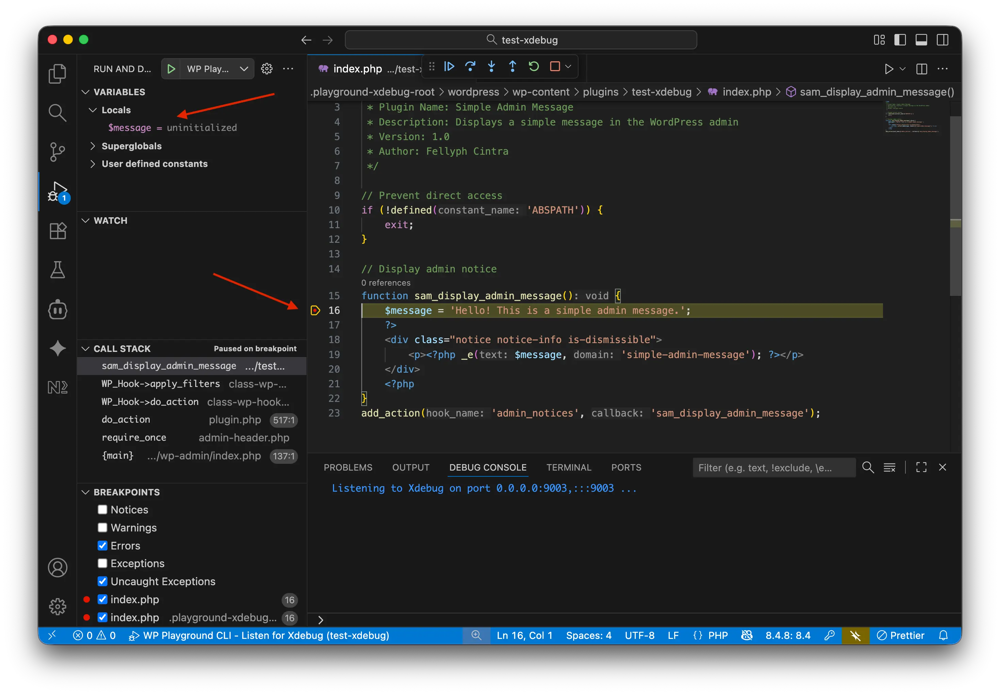
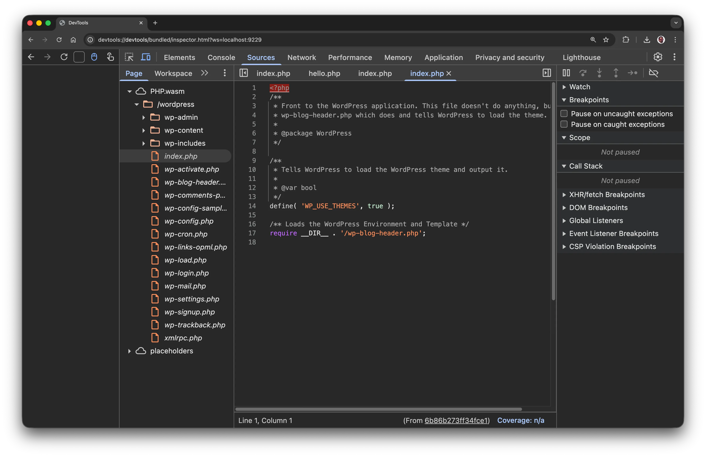
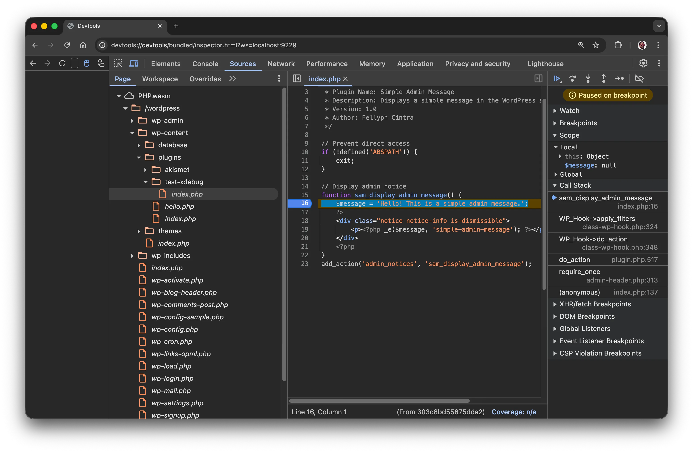

<!--
# Getting Started with Xdebug
-->

# Xdebug দিয়ে শুরু করা

<!--
This guide shows you how to enable Xdebug in WordPress Playground and start debugging your code.
-->

ওয়ার্ডপ্রেস প্লেগ্রাউন্ডে কীভাবে Xdebug চালু করবেন আর কোড ডিবাগ করা শুরু করবেন, এই গাইডে তা-ই দেখানো হয়েছে।

<!--
## PHP WASM CLI vs Playground CLI
-->

## PHP WASM CLI বনাম Playground CLI

<!--
First, Xdebug is present in two different CLIs:

- **`@php-wasm/cli`**: Run standalone PHP scripts. Use this when debugging PHP code without needing a WordPress environment.
- **`@wp-playground/cli`**: Run a full WordPress installation. Useful for debugging WordPress plugins, themes, or core functionality.
-->

প্রথমেই জেনে নিন, Xdebug দুটি আলাদা CLI-তে আছে:

- **`@php-wasm/cli`**: আলাদাভাবে শুধু PHP স্ক্রিপ্ট চালায়। ওয়ার্ডপ্রেস এনভায়রনমেন্ট ছাড়াই PHP কোড ডিবাগ করতে চাইলে এটি ব্যবহার করুন।
- **`@wp-playground/cli`**: পুরো একটি ওয়ার্ডপ্রেস ইনস্টলেশন চালায়। ওয়ার্ডপ্রেস প্লাগইন, থিম বা কোরের কোনো ফিচার ডিবাগ করতে এটি কাজে লাগে।

<!--
For this guide, we'll use `@wp-playground/cli`. If you're not familiar with the tool, we recommend reading the [`@wp-playground/cli` guide](/developers/local-development/wp-playground-cli), but the same process can also be applied to debugging PHP applications with `@php-wasm/cli`.
-->

এই গাইডে আমরা `@wp-playground/cli` ব্যবহার করব। টুলটির সাথে পরিচিত না থাকলে [`@wp-playground/cli` গাইডটি](/developers/local-development/wp-playground-cli) আগে পড়ে নিলে ভালো হয়। তবে `@php-wasm/cli` দিয়ে PHP অ্যাপ্লিকেশন ডিবাগ করতেও একই ধাপগুলো কাজ করে।

<!--
## Quick start with `npx`
-->

## `npx` দিয়ে দ্রুত শুরু

<!--
The fastest way to get started is using npx, which doesn't require installation:
-->

শুরু করার সবচেয়ে দ্রুত উপায় হলো npx ব্যবহার করা, এর জন্য কিছু ইনস্টল করতে হয় না:

```bash
npx @wp-playground/cli@latest server --xdebug
```

<!--
This starts WordPress on `http://127.0.0.1:9400` with Xdebug enabled. Now you can connect a debugger.
-->

এতে Xdebug চালু অবস্থায় `http://127.0.0.1:9400`-এ ওয়ার্ডপ্রেস চালু হবে। এবার একটি ডিবাগার কানেক্ট করতে পারেন।

<!--
<div class="callout callout-info">

Only one project can be debugged at a time.

</div>
-->

<div class="callout callout-info">

একবারে শুধু একটি প্রজেক্ট ডিবাগ করা যায়।

</div>

<!--
## Starting with IDE integration
-->

## IDE ইন্টিগ্রেশন দিয়ে শুরু

<!--
Similar to the process with DevTools, let's use the same plugin code from before to debug with VS Code, and add the `--experimental-unsafe-ide-integration=vscode` flag. This flag will optimize the setup process for VS Code. If you're working with PhpStorm, add the `--experimental-unsafe-ide-integration=phpstorm` flag.
-->

DevTools-এর মতোই, VS Code দিয়ে ডিবাগ করতে আগের প্লাগইন কোডটিই ব্যবহার করব, সাথে `--experimental-unsafe-ide-integration=vscode` ফ্ল্যাগটি যোগ করব। এই ফ্ল্যাগ VS Code-এর সেটআপ অনেকটা সহজ করে দেয়। PhpStorm ব্যবহার করলে `--experimental-unsafe-ide-integration=phpstorm` ফ্ল্যাগটি দিন।

<!--
<div class="callout callout-info">

This flag is marked as `unsafe` because it edits the IDE config files to set Xdebug path mappings and web server details. **CAUTION:** If there are bugs, this feature may cause your IDE configuration files to break. Please consider backing up your IDE configs before using this feature.

</div>
-->

<div class="callout callout-info">

এই ফ্ল্যাগটিকে `unsafe` বলা হয়েছে, কারণ এটি Xdebug-এর পাথ ম্যাপিং এবং ওয়েব সার্ভারের তথ্য সেট করতে IDE-এর কনফিগ ফাইল এডিট করে। **সতর্কতা:** কোনো বাগ থাকলে এই ফিচারের কারণে আপনার IDE-এর কনফিগারেশন ফাইল নষ্ট হয়ে যেতে পারে। তাই এটি ব্যবহারের আগে IDE কনফিগের একটি ব্যাকআপ রেখে দিন।

</div>

<!--
To debug in VS Code, you'll need the following prerequisites:

1. An extension to add PHP profiling support, for example, [PHP Debug](https://marketplace.visualstudio.com/items?itemName=xdebug.php-debug) or another debugger extension to your preference.
2. Have a `.vscode/` folder.
3. Enable breakpoints in your IDE. Some IDEs come with this feature disabled, so be aware of this detail.
-->

VS Code-এ ডিবাগ করার আগে এগুলো রেডি রাখুন:

1. PHP প্রোফাইলিং সাপোর্ট যোগ করার একটি এক্সটেনশন, যেমন [PHP Debug](https://marketplace.visualstudio.com/items?itemName=xdebug.php-debug) অথবা আপনার পছন্দের অন্য কোনো ডিবাগার এক্সটেনশন।
2. একটি `.vscode/` ফোল্ডার।
3. IDE-তে ব্রেকপয়েন্ট চালু করা। কিছু IDE-তে এটি ডিফল্টভাবে বন্ধ থাকে, তাই খেয়াল রাখুন।

<!--
If everything is ready, you run the command:
-->

সব রেডি হলে কমান্ডটি চালান:

```bash
npx @wp-playground/cli@latest server --xdebug --experimental-unsafe-ide-integration=vscode --auto-mount
```

<!--
If you don't have a `.vscode/launch.json` file, the terminal will create a file similar to this:
-->

`.vscode/launch.json` ফাইল না থাকলে টার্মিনাল নিচের মতো একটি ফাইল বানিয়ে দেবে:

```JSON
{
    "configurations": [
        {
            "name": "WP Playground CLI - Listen for Xdebug",
            "type": "php",
            "request": "launch",
            "port": 9003,
            "pathMappings": {
                "/": "${workspaceFolder}/.playground-xdebug-root",
                "/wordpress/wp-content/plugins/test-xdebug": "${workspaceFolder}/"
            }
        }
    ]
}
```

<!--
Now, you can go to your code, add the breakpoints, start the debugging session named by your IDE, and happy testing.
-->

এবার কোডে গিয়ে ব্রেকপয়েন্ট বসান, তারপর IDE-তে ওই নামের ডিবাগিং সেশনটি চালু করুন। ব্যস, এবার টেস্ট শুরু করুন!

<!--

-->


<!--
### PhpStorm troubleshooting
-->

### PhpStorm-এ সমস্যা হলে

<!--
If PhpStorm pauses on the first line of unmapped files or scripts outside your project, you can disable these optional settings under **Settings > PHP > Debug > Xdebug**:

- **Force break at first line when no path mapping specified**.
- **Force break at first line when a script is outside the project**.
-->

PhpStorm যদি ম্যাপ না করা ফাইল বা আপনার প্রজেক্টের বাইরের স্ক্রিপ্টের প্রথম লাইনে থেমে যায়, তাহলে **Settings > PHP > Debug > Xdebug**-এ গিয়ে এই অপশনাল সেটিংসগুলো বন্ধ করে দিতে পারেন:

- **Force break at first line when no path mapping specified**।
- **Force break at first line when a script is outside the project**।

<!--
If requests that do not hit a breakpoint produce unwanted notifications, disable **Notify if debug session was finished without being paused** under **Settings > PHP > Debug > Settings** (called **Advanced settings** in the current JetBrains documentation). When this setting is disabled and no breakpoint is hit, PhpStorm runs the script without pausing or establishing a debugging session.
-->

যেসব রিকোয়েস্ট কোনো ব্রেকপয়েন্টে থামে না, সেগুলোর জন্যও অদরকারি নোটিফিকেশন এলে **Settings > PHP > Debug > Settings**-এ গিয়ে (এখনকার JetBrains ডকুমেন্টেশনে এর নাম **Advanced settings**) **Notify if debug session was finished without being paused** বন্ধ করে দিন। এটি বন্ধ থাকলে আর কোনো ব্রেকপয়েন্টে না থামলে PhpStorm না থেমে, ডিবাগিং সেশন না খুলেই স্ক্রিপ্টটি চালিয়ে দেয়।

<!--
These options suppress unwanted pauses or notifications. They do not fix path mappings or configure breakpoints: you still need correct path mappings and enabled breakpoints in the code you want to debug.
-->

এই অপশনগুলো শুধু অদরকারি থেমে যাওয়া আর নোটিফিকেশন বন্ধ করে। এগুলো পাথ ম্যাপিং ঠিক করে না, ব্রেকপয়েন্টও সেট করে না। যে কোড ডিবাগ করবেন, তার জন্য ঠিকঠাক পাথ ম্যাপিং আর চালু করা ব্রেকপয়েন্ট লাগবেই।

<!--
For more details, see [JetBrains' debug settings reference](https://www.jetbrains.com/help/phpstorm/debug.html) and the [PhpStorm examples](https://github.com/WordPress/wordpress-playground/blob/trunk/examples/xdebug/ide/README.md#phpstorm).
-->

আরও বিস্তারিত জানতে [JetBrains-এর ডিবাগ সেটিংসের রেফারেন্স](https://www.jetbrains.com/help/phpstorm/debug.html) এবং [PhpStorm-এর উদাহরণগুলো](https://github.com/WordPress/wordpress-playground/blob/trunk/examples/xdebug/ide/README.md#phpstorm) দেখুন।

<!--
## Early Access: DevTools debugger
-->

## আর্লি অ্যাক্সেস: DevTools ডিবাগার

<!--
Playground CLI ships an **unstable, highly exploratory** workflow that enables debugging PHP programs using Chrome DevTools.
-->

Playground CLI-তে একটি **আনস্টেবল, পুরোপুরি এক্সপেরিমেন্টাল** ওয়ার্কফ্লো আছে, যা দিয়ে Chrome DevTools ব্যবহার করে PHP প্রোগ্রাম ডিবাগ করা যায়।

<!--
To try it, use the `--experimental-devtools` flag:
-->

চালিয়ে দেখতে চাইলে `--experimental-devtools` ফ্ল্যাগটি দিন:

```bash
npx @wp-playground/cli@latest server --xdebug --experimental-devtools
```

<!--
The terminal will display a URL to connect to Chrome DevTools:
-->

Chrome DevTools-এ কানেক্ট করার জন্য টার্মিনাল একটি URL দেখাবে:

```bash
Starting a PHP server...
Setting up WordPress latest
Resolved WordPress release URL: https://downloads.w.org/release/wordpress-6.8.3.zip
Fetching SQLite integration plugin...
Booting WordPress...
WordPress is running on http://127.0.0.1:9400 with 1 worker(s)
Starting XDebug Bridge...
Connect Chrome DevTools to CDP at:
devtools://devtools/bundled/inspector.html?ws=127.0.0.1:9229

Chrome connected! Initializing Xdebug receiver...
XDebug receiver running on port 9003
Running a PHP script with Xdebug enabled...
```

<!--
By clicking on the provided URL, for example, `devtools://devtools/bundled/inspector.html?ws=127.0.0.1:9229`, you can access DevTools connected to your application, with the ability to inspect all files of a WordPress instance.
-->

দেওয়া URL-টিতে (যেমন `devtools://devtools/bundled/inspector.html?ws=127.0.0.1:9229`) ক্লিক করলে আপনার অ্যাপ্লিকেশনের সাথে কানেক্টেড DevTools খুলে যাবে, সেখানে ওয়ার্ডপ্রেস ইনস্ট্যান্সের সব ফাইল ঘেঁটে দেখতে পারবেন।

<!--

-->


<!--
For a more practical example, let's debug a plugin that has the following code:
-->

এবার একটি বাস্তব উদাহরণ দেখি। নিচের কোডের একটি প্লাগইন ডিবাগ করা যাক:

```PHP
<?php
/**
 * Plugin Name: Simple Admin Message
 * Description: Displays a simple message in the WordPress admin
 * Version: 1.0
 * Author: Playground Team
 */

// Prevent direct access
if (!defined('ABSPATH')) {
    exit;
}

// Display admin notice
function sam_display_admin_message() {
    $message = 'Hello! This is a simple admin message.';
    ?>
    <div class="notice notice-info is-dismissible">
        <p><?php _e($message, 'simple-admin-message'); ?></p>
    </div>
    <?php
}
add_action('admin_notices', 'sam_display_admin_message');
```

<!--
In the folder where the plugin is located, let's run the command in our terminal:
-->

প্লাগইনের ফোল্ডারে গিয়ে টার্মিনালে এই কমান্ডটি চালাই:

```bash
npx @wp-playground/cli@latest server --xdebug --experimental-devtools --auto-mount
```

<!--
The Playground CLI(`@wp-playground/cli`) will automatically detect the plugin folder and mount it. Opening the project in your browser and DevTools, you'll be able to add breakpoints in your plugin's code and test it line by line.
-->

Playground CLI (`@wp-playground/cli`) নিজে থেকেই প্লাগইন ফোল্ডারটি খুঁজে নিয়ে মাউন্ট করবে। ব্রাউজার আর DevTools-এ প্রজেক্টটি খুললে প্লাগইনের কোডে ব্রেকপয়েন্ট বসিয়ে লাইন বাই লাইন টেস্ট করতে পারবেন।

<!--

-->


<!--
This feature is in experimental mode. Until it's finished, we'll need your feedback. Please connect with us in the [#playground Slack channel](https://wordpress.slack.com/archives/C04EWKGDJ0K) and share your thoughts.
-->

এই ফিচারটি এখনো এক্সপেরিমেন্টাল। কাজ শেষ না হওয়া পর্যন্ত আপনার ফিডব্যাক আমাদের খুব দরকার। [#playground Slack চ্যানেলে](https://wordpress.slack.com/archives/C04EWKGDJ0K) এসে আপনার মতামত জানান।
