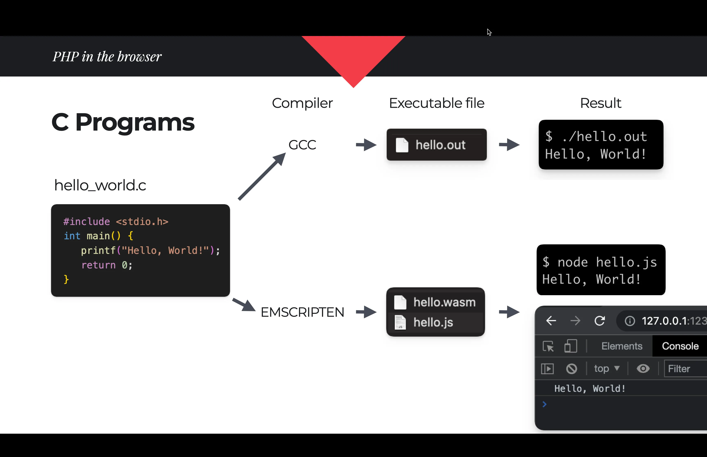
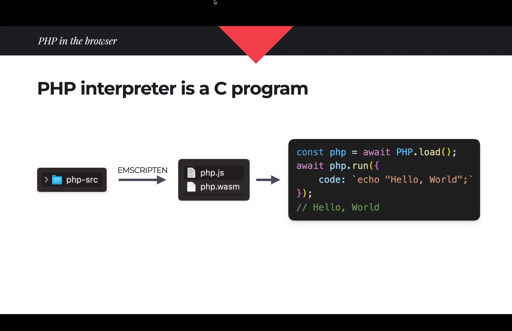
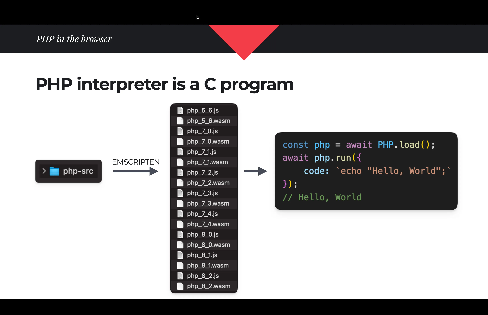

<!--
# WebAssembly PHP
-->

# WebAssembly PHP {#webassembly-php}

<!--
WordPress Playground build [the PHP interpreter](https://github.com/php/php-src) to WebAssembly using [Emscripten](https://emscripten.org/docs/porting/networking.html) and a [dedicated pipeline](https://github.com/WordPress/wordpress-playground/blob/0d451c33936a8db5b7a158fa8aad288c19370a7d/packages/php-wasm/compile/Dockerfile).
-->

ওয়ার্ডপ্রেস প্লেগ্রাউন্ড [Emscripten](https://emscripten.org/docs/porting/networking.html) এবং একটি [ডেডিকেটেড পাইপলাইন](https://github.com/WordPress/wordpress-playground/blob/0d451c33936a8db5b7a158fa8aad288c19370a7d/packages/php-wasm/compile/Dockerfile) ব্যবহার করে [PHP ইন্টারপ্রেটারকে](https://github.com/php/php-src) WebAssembly-তে বিল্ড করে।

<!--

-->

<!--
Building PHP to WebAssembly is very similar to building vanilla PHP. The wasm build required [adjusting a function signature here](https://github.com/WordPress/wordpress-playground/blob/0d451c33936a8db5b7a158fa8aad288c19370a7d/packages/php-wasm/compile/build-assets/php7.1.patch#L8-L9), [forcing a config variable there](https://github.com/WordPress/wordpress-playground/blob/0d451c33936a8db5b7a158fa8aad288c19370a7d/packages/php-wasm/compile/Dockerfile#L495), and applying [a few small patches](https://github.com/WordPress/wordpress-playground/tree/0d451c33936a8db5b7a158fa8aad288c19370a7d/packages/php-wasm/compile/build-assets), but there's relatively few adjustments involved.
-->

PHP-কে WebAssembly-তে বিল্ড করা সাধারণ ভ্যানিলা PHP বিল্ড করার মতোই। wasm বিল্ডের জন্য [এখানে একটি ফাংশন সিগনেচার সমন্বয়](https://github.com/WordPress/wordpress-playground/blob/0d451c33936a8db5b7a158fa8aad288c19370a7d/packages/php-wasm/compile/build-assets/php7.1.patch#L8-L9), [সেখানে একটি কনফিগ ভেরিয়েবল নির্দিষ্ট করা](https://github.com/WordPress/wordpress-playground/blob/0d451c33936a8db5b7a158fa8aad288c19370a7d/packages/php-wasm/compile/Dockerfile#L495) এবং [কয়েকটি ছোট প্যাচ প্রয়োগের](https://github.com/WordPress/wordpress-playground/tree/0d451c33936a8db5b7a158fa8aad288c19370a7d/packages/php-wasm/compile/build-assets) প্রয়োজন হয়েছে, তবে এতে তুলনামূলকভাবে খুব কম পরিবর্তনই করতে হয়েছে।

<!--

-->

<!--
However, vanilla PHP builds aren't very useful in the browser. As a server software, PHP doesn't have a JavaScript API to pass the request body, upload files, or populate the `php://stdin` stream. WordPress Playground had to build one from scratch. The WebAssembly binary comes with a [dedicated PHP API module](https://github.com/WordPress/wordpress-playground/blob/0d451c33936a8db5b7a158fa8aad288c19370a7d/packages/php-wasm/compile/build-assets/php_wasm.c) written in C and a [JavaScript PHP class](https://github.com/WordPress/wordpress-playground/blob/da38192af57a95699d8731c855b82ac0222df61b/packages/php-wasm/common/src/lib/php.ts) that exposes methods like writeFile() or run().
-->

তবে ব্রাউজারে ভ্যানিলা PHP বিল্ড খুব একটা কার্যকর নয়। সার্ভার সফটওয়্যার হিসেবে PHP-তে রিকোয়েস্ট বডি পাঠানো, ফাইল আপলোড করা কিংবা `php://stdin` স্ট্রিম পূরণ করার কোনো JavaScript API নেই। ওয়ার্ডপ্রেস প্লেগ্রাউন্ডকে এটি শুরু থেকেই তৈরি করতে হয়েছে। WebAssembly বাইনারির সাথে C ভাষায় লেখা একটি [ডেডিকেটেড PHP API মডিউল](https://github.com/WordPress/wordpress-playground/blob/0d451c33936a8db5b7a158fa8aad288c19370a7d/packages/php-wasm/compile/build-assets/php_wasm.c) এবং একটি [JavaScript PHP ক্লাস](https://github.com/WordPress/wordpress-playground/blob/da38192af57a95699d8731c855b82ac0222df61b/packages/php-wasm/common/src/lib/php.ts) যুক্ত রয়েছে, যা writeFile() বা run()-এর মতো মেথডগুলো প্রদান করে।

<!--
Because every PHP version is just a static .wasm file, the PHP version switcher is actually pretty boring. It simply tells the browser to download, for example, `php_7_3.wasm` instead of, say, `php_8_2.wasm`.
-->

যেহেতু প্রতিটি PHP ভার্সন কেবল একটি স্ট্যাটিক .wasm ফাইল, তাই PHP ভার্সন সুইচারটি আসলে বেশ সাদামাটা। এটি ব্রাউজারকে কেবল নির্দেশ দেয় যেন উদাহরণস্বরূপ `php_8_2.wasm`-এর পরিবর্তে `php_7_3.wasm` ডাউনলোড করা হয়।

<!--

-->

<!--
### Networking support varies between platforms
-->

### বিভিন্ন প্ল্যাটফর্মের মধ্যে নেটওয়ার্কিং সমর্থনের ভিন্নতা {#networking-support-varies-between-platforms}

<!--
When it comes to networking, WebAssembly programs are limited to calling JavaScript APIs. It is a safety feature, but also presents a challenge. How do you support low-level, synchronous networking code used by PHP with the high-level asynchronous APIs available in JavaScript?
-->

নেটওয়ার্কিংয়ের ক্ষেত্রে WebAssembly প্রোগ্রামগুলো কেবল JavaScript API কল করার মধ্যেই সীমাবদ্ধ থাকে। এটি একটি নিরাপত্তা বৈশিষ্ট্য, তবে পাশাপাশি একটি চ্যালেঞ্জও তৈরি করে। কীভাবে আপনি PHP-র ব্যবহৃত লো-লেভেল, সিনক্রোনাস নেটওয়ার্কিং কোডকে JavaScript-এ বিদ্যমান হাই-লেভেল অ্যাসিনক্রোনাস API-এর সাথে সমন্বয় করবেন?

<!--
In Node.js, the answer involves a WebSocket to TCP socket proxy, [Asyncify](https://emscripten.org/docs/porting/asyncify.html), and patching deep PHP internals like php_select. It's complex, but there's a reward. The Node.js-targeted PHP build can request web APIs, install composer packages, and even connect to a MySQL server.
-->

Node.js-এ এর সমাধানের মধ্যে রয়েছে একটি WebSocket থেকে TCP সকেট প্রক্সি, [Asyncify](https://emscripten.org/docs/porting/asyncify.html), এবং php_select-এর মতো গভীর PHP ইন্টারনালসগুলোতে প্যাচ প্রয়োগ করা। এটি জটিল, তবে এর সুফলও রয়েছে। Node.js-কে লক্ষ্য করে তৈরি PHP বিল্ড ওয়েব API-তে রিকোয়েস্ট পাঠাতে পারে, composer প্যাকেজ ইনস্টল করতে পারে এবং এমনকি একটি MySQL সার্ভারের সাথেও সংযোগ স্থাপন করতে পারে।

<!--
In the browser, networking is supported in two ways:
-->

ব্রাউজারে দুটি উপায়ে নেটওয়ার্কিং সমর্থিত হয়:

<!--
- A fast transport for `wp_safe_remote_get` to translate them into `fetch()` calls.
- A slower transport for all other network calls that [parses the TLS transmission](https://github.com/WordPress/wordpress-playground/pull/1926) initiated by PHP and translates it to a `fetch()` call.
-->

- `wp_safe_remote_get`-এর জন্য একটি দ্রুতগতির ট্রান্সপোর্ট, যা এগুলোকে `fetch()` কলে রূপান্তর করে।
- অন্যান্য সমস্ত নেটওয়ার্ক কলের জন্য তুলনামূলক ধীরগতির একটি ট্রান্সপোর্ট, যা PHP কর্তৃক শুরু করা [TLS ট্রান্সমিশন পার্স করে](https://github.com/WordPress/wordpress-playground/pull/1926) এবং সেটিকে `fetch()` কলে রূপান্তর করে।
