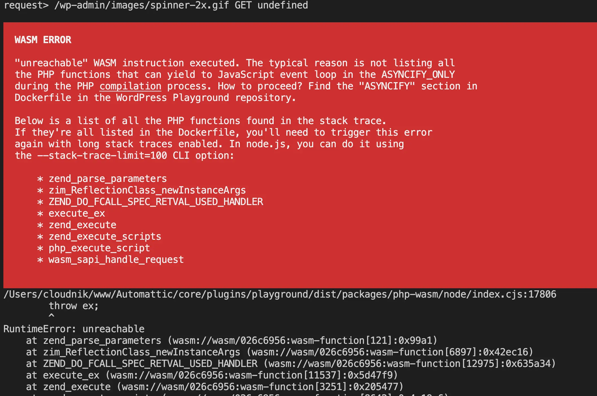

<!--
# Asyncify and JSPI: Stack Switching in PHP WebAssembly
-->

# Asyncify এবং JSPI: PHP WebAssembly-তে স্ট্যাক সুইচিং {#asyncify-and-jspi-stack-switching-in-php-webassembly}

<!--
[Asyncify](https://emscripten.org/docs/porting/asyncify.html) lets synchronous C or C++ code interact with asynchronous JavaScript. Technically, it saves the entire C call stack before yielding control back to JavaScript, and then restores it when the asynchronous call is finished. This is called **stack switching**.
-->

[Asyncify](https://emscripten.org/docs/porting/asyncify.html) সিঙ্ক্রোনাস C বা C++ কোডকে অ্যাসিঙ্ক্রোনাস JavaScript-এর সাথে কাজ করতে দেয়। কারিগরি দিক থেকে, এটি JavaScript-এর কাছে নিয়ন্ত্রণ ফিরিয়ে দেওয়ার আগে পুরো C কল স্ট্যাকটি সংরক্ষণ করে এবং অ্যাসিঙ্ক্রোনাস কল শেষ হলে সেটি আবার পুনরুদ্ধার করে। একে **স্ট্যাক সুইচিং** (stack switching) বলা হয়।

<!--
Networking support in the WebAssembly PHP build is implemented using Asyncify. When PHP makes a network request, it yields control back to JavaScript, which makes the request, and then resumes PHP when the response is ready. It works well enough that PHP build can request web APIs, install composer packages, and even connect to a MySQL server.
-->

WebAssembly PHP বিল্ডে নেটওয়ার্কিং সমর্থন Asyncify ব্যবহার করে বাস্তবায়ন করা হয়েছে। যখন PHP কোনো নেটওয়ার্ক রিকোয়েস্ট পাঠায়, তখন এটি JavaScript-এর কাছে নিয়ন্ত্রণ ফিরিয়ে দেয়; JavaScript রিকোয়েস্টটি সম্পন্ন করে এবং রেসপন্স প্রস্তুত হলে পুনরায় PHP চালু করে। এটি এতটাই ভালোভাবে কাজ করে যে এই PHP বিল্ড ওয়েব API-তে রিকোয়েস্ট পাঠাতে পারে, composer প্যাকেজ ইনস্টল করতে পারে এবং এমনকি একটি MySQL সার্ভারের সাথেও সংযুক্ত হতে পারে।

<!--
## Asyncify crashes
-->

## Asyncify ক্র্যাশ {#asyncify-crashes}

<!--
Stack switching requires wrapping all C functions that may be found at a call stack at a time of making an asynchronous call. Blanket-wrapping of every single C function adds a **significant** overhead, which is why we maintain a list of specific function names:
-->

স্ট্যাক সুইচিংয়ের জন্য এমন সব C ফাংশনকে র‍্যাপ করতে হয়, যেগুলো কোনো অ্যাসিঙ্ক্রোনাস কল করার সময় কল স্ট্যাকে উপস্থিত থাকতে পারে। প্রতিটি C ফাংশনকে ঢালাওভাবে র‍্যাপ করলে **উল্লেখযোগ্য** ওভারহেড তৈরি হয়—এ কারণেই আমরা নির্দিষ্ট কিছু ফাংশনের নামের একটি তালিকা সংরক্ষণ করি:

https://github.com/WordPress/wordpress-playground/blob/15a660940ee9b4a332965ba2a987f6fda0c159b1/packages/php-wasm/compile/Dockerfile#L624-L632

<!--
Unfortunately, missing even a single item from that list results in a WebAssembly crash whenever that function is a part of the call stack when an asynchronous call is made. It looks like this:
-->

দুর্ভাগ্যবশত, অ্যাসিঙ্ক্রোনাস কল করার সময় কল স্ট্যাকে থাকা কোনো ফাংশনের নাম ওই তালিকা থেকে বাদ পড়লে—এমনকি একটি আইটেম বাদ পড়লেও—WebAssembly ক্র্যাশ করে। ক্র্যাশটি দেখতে এরকম হয়:

<!--

-->

<!--
Asyncify can auto-list all the required C functions when built without `ASYNCIFY_ONLY`, but that auto-detection is overeager and ends up listing about 70,000 C functions which increases the startup time to 4.5s. That's why we maintain the list manually.
-->

`ASYNCIFY_ONLY` ছাড়া বিল্ড করলে Asyncify প্রয়োজনীয় সব C ফাংশনের তালিকা স্বয়ংক্রিয়ভাবে তৈরি করতে পারে, কিন্তু সেই স্বয়ংক্রিয় শনাক্তকরণ অতিরিক্ত ফাংশন ধরে ফেলে এবং প্রায় 70,000টি C ফাংশন তালিকাভুক্ত করে, যা স্টার্টআপ সময়কে 4.5s পর্যন্ত বাড়িয়ে দেয়। এ কারণেই আমরা তালিকাটি ম্যানুয়ালি রক্ষণাবেক্ষণ করি।

<!--
If you are interested in more details, [see GitHub issue 251](https://github.com/WordPress/wordpress-playground/issues/251).
-->

আপনি আরও বিস্তারিত জানতে চাইলে [GitHub ইস্যু 251 দেখুন](https://github.com/WordPress/wordpress-playground/issues/251)।

<!--
## Fixing Asyncify crashes
-->

## Asyncify ক্র্যাশ সমাধান {#fixing-asyncify-crashes}

<!--
[Pull Request 253](https://github.com/WordPress/wordpress-playground/pull/253) adds a `fix-asyncify` command that runs a specialized test suite and automatically adds any identified missing C functions to the `ASYNCIFY_ONLY` list.
-->

[পুল রিকোয়েস্ট 253](https://github.com/WordPress/wordpress-playground/pull/253)-এ একটি `fix-asyncify` কমান্ড যুক্ত করা হয়েছে, যা একটি বিশেষায়িত টেস্ট স্যুট চালায় এবং শনাক্ত হওয়া অনুপস্থিত C ফাংশনগুলোকে স্বয়ংক্রিয়ভাবে `ASYNCIFY_ONLY` তালিকায় যুক্ত করে।

<!--
If you run into a crash like the one above, you can fix it by:

1. Identifying a PHP code path that triggers the crash – the stack trace in the terminal should help with that.
2. Adding a test case that triggers a crash to `packages/php-wasm/node/src/test/php-asyncify.spec.ts`
3. Running: `npm run fix-asyncify`
4. Committing the test case, the updated `Dockerfile`, and the rebuilt `PHP.wasm`
-->

আপনি যদি উপরের মতো কোনো ক্র্যাশের সম্মুখীন হন, তবে নিচের ধাপগুলো অনুসরণ করে তা সমাধান করতে পারেন:

1. ক্র্যাশ ঘটায় এমন একটি PHP কোড পাথ শনাক্ত করা – টার্মিনালের স্ট্যাক ট্রেস এক্ষেত্রে সাহায্য করবে।
2. `packages/php-wasm/node/src/test/php-asyncify.spec.ts` ফাইলে ক্র্যাশ ঘটানোর একটি টেস্ট কেস যুক্ত করা
3. `npm run fix-asyncify` চালানো
4. টেস্ট কেস, আপডেট করা `Dockerfile` এবং পুনর্নির্মিত `PHP.wasm` কমিট করা

<!--
## JSPI: The Modern Alternative to Asyncify
-->

## JSPI: Asyncify-এর আধুনিক বিকল্প {#jspi-the-modern-alternative-to-asyncify}

<!--
The [JavaScript Promise Integration (JSPI)](https://v8.dev/blog/jspi) API handles stack switching natively in V8, eliminating the need for Asyncify's function wrapping. WordPress Playground now ships JSPI builds alongside Asyncify builds for all PHP versions (7.4–8.5).
-->

[JavaScript Promise Integration (JSPI)](https://v8.dev/blog/jspi) API সরাসরি V8 ইঞ্জিনের ভেতরেই স্ট্যাক সুইচিং পরিচালনা করে, ফলে Asyncify-এর ফাংশন র‍্যাপিংয়ের আর প্রয়োজন হয় না। ওয়ার্ডপ্রেস প্লেগ্রাউন্ড এখন সব PHP ভার্সনের (7.4–8.5) জন্য Asyncify বিল্ডের পাশাপাশি JSPI বিল্ডও সরবরাহ করে।

<!--
**Current status:**

- The Playground CLI **auto-detects JSPI support** and enables it automatically — no manual flags needed
- Node.js 23+ supports JSPI natively; Node.js 22 requires the `--experimental-wasm-jspi` flag (handled automatically by the CLI)
- Node.js 24+ is expected to have JSPI unflagged
- Browser support varies: JSPI is available in Chrome/Chromium-based browsers behind flags
-->

**বর্তমান অবস্থা:**

- Playground CLI **স্বয়ংক্রিয়ভাবে JSPI সমর্থন শনাক্ত করে** এবং সক্রিয় করে — কোনো ম্যানুয়াল ফ্ল্যাগের প্রয়োজন হয় না
- Node.js 23+ নেটিভভাবে JSPI সমর্থন করে; Node.js 22-তে `--experimental-wasm-jspi` ফ্ল্যাগ প্রয়োজন হয় (CLI এটি স্বয়ংক্রিয়ভাবে সামলায়)
- Node.js 24+-এ কোনো ফ্ল্যাগ ছাড়াই JSPI সমর্থিত থাকবে বলে আশা করা হচ্ছে
- ব্রাউজার সমর্থনে ভিন্নতা রয়েছে: Chrome/Chromium-ভিত্তিক ব্রাউজারগুলোতে ফ্ল্যাগের পেছনে JSPI উপলব্ধ রয়েছে

<!--
## Binary Size Optimization with MAIN_MODULE=2
-->

## MAIN_MODULE=2 ব্যবহার করে বাইনারি আকার অপ্টিমাইজেশন {#binary-size-optimization-with-main_module2}

<!--
Both Asyncify and JSPI builds are compiled with Emscripten's `MAIN_MODULE=2` flag, which performs dead code elimination on exported symbols. Only symbols that dynamic extensions actually need are exported.
-->

Asyncify এবং JSPI উভয় বিল্ডই Emscripten-এর `MAIN_MODULE=2` ফ্ল্যাগ ব্যবহার করে কম্পাইল করা হয়, যা এক্সপোর্ট করা সিম্বলগুলোর ওপর ডেড কোড এলিমিনেশন চালায়। কেবল ডাইনামিক এক্সটেনশনগুলোর সত্যিকারের প্রয়োজনীয় সিম্বলগুলোই এক্সপোর্ট করা হয়।

<!--
**Impact:**

- Total binary size reduced by **122 MB** (13.7%)
- `.wasm` files reduced by **109 MB** (16%)
- JavaScript glue code reduced by **14.5 MB** (63%)
-->

**প্রভাব:**

- মোট বাইনারি আকার কমেছে **122 MB** (13.7%)
- `.wasm` ফাইলের আকার কমেছে **109 MB** (16%)
- JavaScript গ্লু কোড কমেছে **14.5 MB** (63%)

<!--
This optimization applies across all PHP versions (7.4–8.5) for both Node.js and Web targets. The exported symbol list is centrally managed in the Dockerfile, with conditional exports for specific extensions (e.g., `__c_longjmp` for Xdebug, `_wasm_recv` for Memcached).
-->

এই অপ্টিমাইজেশনটি Node.js এবং ওয়েব—উভয় টার্গেটের সব PHP ভার্সনেই (7.4–8.5) প্রযোজ্য। এক্সপোর্ট করা সিম্বলের তালিকাটি Dockerfile-এ কেন্দ্রীয়ভাবে পরিচালিত হয়, যেখানে নির্দিষ্ট এক্সটেনশনগুলোর জন্য শর্তসাপেক্ষ এক্সপোর্ট থাকে (যেমন, Xdebug-এর জন্য `__c_longjmp`, Memcached-এর জন্য `_wasm_recv`)।
