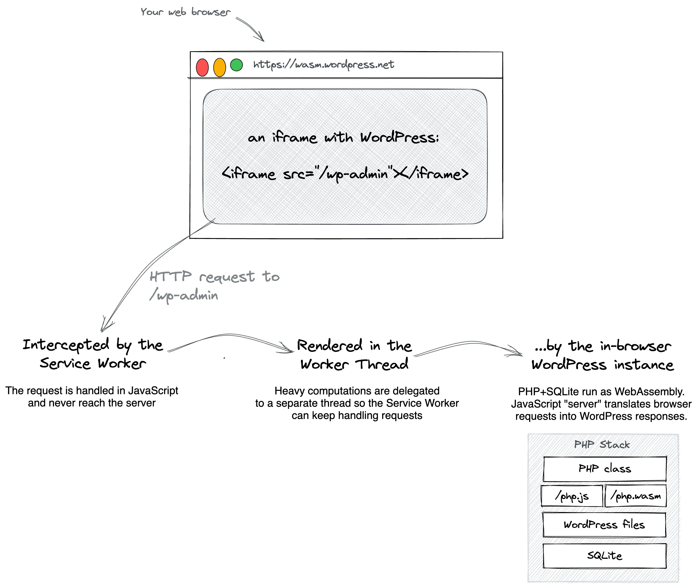

<!--
# Running PHP apps in the browser with ServiceWorkers and Worker Threads
-->

# ServiceWorker এবং Worker Thread দিয়ে ব্রাউজারে PHP অ্যাপ চালানো

<!--
On a high level, WordPress Playground works in web browsers as follows:

- The `index.html` file on playground.wordpress.net loads the `remote.html` file via an `<iframe src="/remote.html">`.
- `remote.html` starts a Worker Thread and a ServiceWorker and sends back the download progress information.
- The Worker Thread starts PHP and populates the filesystem with a WordPress patched to run on SQLite.
- The ServiceWorker starts intercepting all HTTP requests and forwarding them to the Worker Thread.
- `remote.html` creates an `<iframe src="/index.php">`, and the Service Worker forwards the `index.php` request to the Worker Thread where the WordPress homepage is rendered.
-->

মোটা দাগে, ওয়ার্ডপ্রেস প্লেগ্রাউন্ড ব্রাউজারে এভাবে কাজ করে:

- playground.wordpress.net-এর `index.html` ফাইলটি একটি `<iframe src="/remote.html">`-এর মাধ্যমে `remote.html` ফাইলটি লোড করে।
- `remote.html` একটি Worker Thread এবং একটি ServiceWorker চালু করে এবং ডাউনলোডের প্রোগ্রেস ফেরত পাঠায়।
- Worker Thread PHP চালু করে, তারপর SQLite-এ চলার মতো প্যাচ করা একটি ওয়ার্ডপ্রেস ফাইলসিস্টেমে বসিয়ে দেয়।
- ServiceWorker সব HTTP রিকোয়েস্ট ইন্টারসেপ্ট করে Worker Thread-এ পাঠাতে শুরু করে।
- `remote.html` একটি `<iframe src="/index.php">` তৈরি করে, এবং Service Worker `index.php` রিকোয়েস্টটি Worker Thread-এ পাঠায়, যেখানে ওয়ার্ডপ্রেসের হোমপেজ রেন্ডার হয়।

<!--
Visually, it looks like this:
-->

ছবিতে দেখলে ব্যাপারটা এমন:

<!--

-->

<!--
## High-level ideas
-->

## মূল ধারণাগুলো

<!--
The [`@php-wasm/web`](https://github.com/WordPress/wordpress-playground/blob/trunk/packages/php-wasm/web/) is built on top of the following ideas:

- [**Browser tab orchestrates everything**](/developers/architecture/browser-tab-orchestrates-execution) – The browser tab is the main program. Closing or reloading it means destroying the entire execution environment.
- [**Iframe-based rendering**](/developers/architecture/browser-iframe-rendering) – Every response produced by the PHP server must be rendered in an iframe to avoid reloading the browser tab when the user clicks on a link.
- [**PHP Worker Thread**](/developers/architecture/browser-php-worker-threads) – The PHP server is slow and must run in a web worker, otherwise handling requests freezes the website UI.
- [**Service Worker routing**](/developers/architecture/browser-service-workers) – All HTTP requests originating in that iframe must be intercepted by a Service worker and passed on to the PHP worker thread for rendering.
-->

[`@php-wasm/web`](https://github.com/WordPress/wordpress-playground/blob/trunk/packages/php-wasm/web/) নিচের কয়েকটি ধারণার ওপর দাঁড়িয়ে আছে:

- [**ব্রাউজার ট্যাবই সবকিছু চালায়**](/developers/architecture/browser-tab-orchestrates-execution) – ব্রাউজার ট্যাবটিই মূল প্রোগ্রাম। ট্যাবটি বন্ধ বা রিলোড করলে পুরো এক্সিকিউশন এনভায়রনমেন্টই শেষ হয়ে যায়।
- [**Iframe-ভিত্তিক রেন্ডারিং**](/developers/architecture/browser-iframe-rendering) – ব্যবহারকারী কোনো লিংকে ক্লিক করলে যেন ব্রাউজার ট্যাব রিলোড না হয়, সেজন্য PHP সার্ভারের তৈরি প্রতিটি রেসপন্স একটি iframe-এর ভেতরে রেন্ডার করতে হয়।
- [**PHP Worker Thread**](/developers/architecture/browser-php-worker-threads) – PHP সার্ভার স্লো, তাই এটিকে একটি web worker-এ চালাতে হয়। তা না হলে রিকোয়েস্ট সামলানোর সময় ওয়েবসাইটের UI ফ্রিজ হয়ে যায়।
- [**Service Worker রাউটিং**](/developers/architecture/browser-service-workers) – ওই iframe থেকে আসা সব HTTP রিকোয়েস্ট একটি Service worker-কে ইন্টারসেপ্ট করে রেন্ডারিংয়ের জন্য PHP worker thread-এ পাঠাতে হয়।
