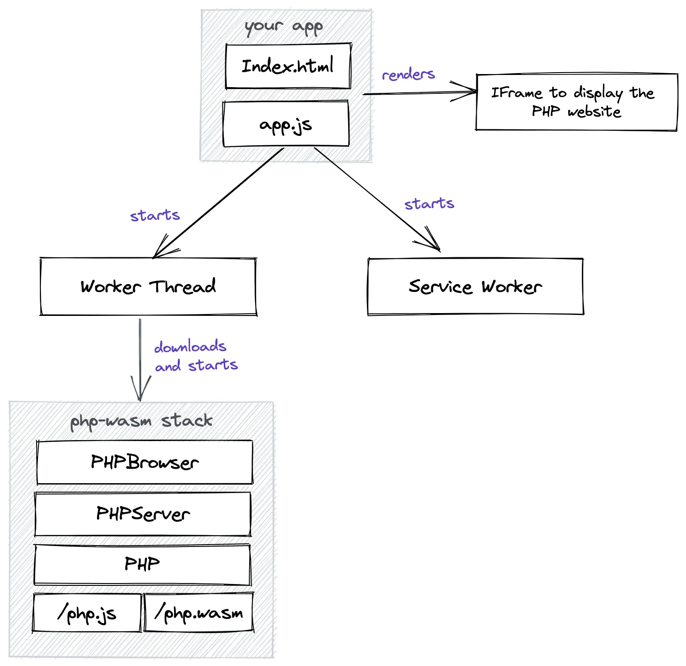
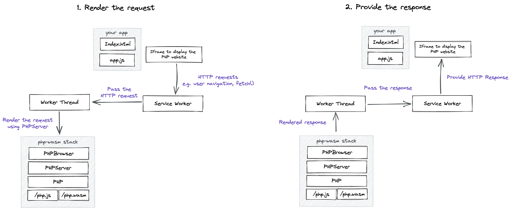

<!--
# Browser tab orchestrates the execution
-->

# ব্রাউজার ট্যাব এক্সিকিউশন পরিচালনা করে {#browser-tab-orchestrates-the-execution}

<!--
The main `index.html` ties the entire application together. It starts all the concurrent processes and displays the PHP responses. The app only lives as long as the main `index.html`.

Keep this point in mind as you read through the rest of the docs. At this point it may seem obvious, by the lines may get blurry later on. This package runs code outside of the browser tab using Web Workers, Service Workers, and, in the future, Shared Workers. Some of these workers may keep running even after the browser tab with `index.html` is closed.
-->

মূল `index.html` পুরো অ্যাপ্লিকেশনটিকে একসাথে ধরে রাখে। এটি সব সমান্তরাল (concurrent) প্রসেস শুরু করে এবং PHP রেসপন্সগুলো প্রদর্শন করে। মূল `index.html` যতক্ষণ খোলা থাকে, অ্যাপটিও ঠিক ততক্ষণই সচল থাকে।

বাকি ডকুমেন্টেশন পড়ার সময় এই বিষয়টি মাথায় রাখুন। এই মুহূর্তে এটি খুব সহজ মনে হতে পারে, কিন্তু পরে গিয়ে সীমারেখাগুলো কিছুটা ঝাপসা হয়ে যেতে পারে। এই প্যাকেজটি Web Workers, Service Workers এবং ভবিষ্যতে Shared Workers ব্যবহার করে ব্রাউজার ট্যাবের বাইরে কোড চালায়। এর মধ্যে কিছু ওয়ার্কার `index.html`-যুক্ত ব্রাউজার ট্যাবটি বন্ধ করে দেওয়ার পরও চলতে থাকতে পারে।

<!--
## Boot sequence
-->

## বুট সিকোয়েন্স {#boot-sequence}

<!--
Here's what a boot sequence for a minimal app looks like:
-->

একটি মিনিমাল অ্যাপের বুট সিকোয়েন্স দেখতে এমন হয়:

<!--

-->


<!--
The main app initiates the Iframe, the Service Worker, and the Worker Thread. Note how the main app doesn't use the PHP stack directly – it's all handled in the Worker Thread.

Here's what that boot sequence looks like in code:
-->

মূল অ্যাপটি Iframe, Service Worker এবং Worker Thread চালু করে। লক্ষ্য করুন, মূল অ্যাপটি সরাসরি PHP স্ট্যাক ব্যবহার করে না – পুরো কাজটিই Worker Thread-এর ভেতরে সামলানো হয়।

কোডে এই বুট সিকোয়েন্সটি দেখতে এরকম:

**/index.html**:

```js
<script src="/app.ts"></script>
<iframe id="my-app"></iframe>
```

**/app.ts**:

```ts
import { consumeAPI, PHPClient, registerServiceWorker, spawnPHPWorkerThread } from '@php-wasm/web';

const workerUrl = '/worker-thread.js';

export async function startApp() {
	const phpClient = consumeAPI<PlaygroundWorkerEndpoint>(
		await spawnPHPWorkerThread(
			workerUrl, // Valid Worker script URL
			{
				wpVersion: 'latest',
				phpVersion: '8.3', // Startup options
			}
		)
	);

	// Await the two-way communication channel
	await phpClient.isReady();

	// Must point to a valid Service Worker script:
	await registerServiceWorker(
		phpClient,
		'default', // PHP instance scope, keep reading to learn more.
		'/sw.js', // Valid Service Worker script URL.
		'1' // Service worker version, used for reloading the script.
	);

	// Create a few PHP files to browse:
	await workerThread.writeFile('/index.php', '<a href="page.php">Go to page.php</a>');
	await workerThread.writeFile('/page.php', '<?php echo "Hello from PHP!"; ?>');

	// Navigate to index.php:
	document.getElementById('my-app').src = playground.pathToInternalUrl('/index.php');
}
startApp();
```

<!--
Keep reading to learn how all these pieces fit together.
-->

এই অংশগুলো কীভাবে একসাথে কাজ করে তা জানতে পড়তে থাকুন।

<!--
### Data flow
-->

### ডেটা ফ্লো {#data-flow}

<!--
Here's what happens whenever the iframe issues a same-domain request:
-->

যখনই iframe একটি same-domain রিকোয়েস্ট পাঠায়, তখন যা ঘটে:

<!--

-->


<!--
A step-by-step breakdown:

1.  The request is intercepted by the Service Worker
2.  The Service Worker passes it to the Worker Thread
3.  The Worker Thread calls `PHP.request` to convert that request to a response
4.  The Worker Thread passes the response to the Service Worker
5.  The Service Worker provides the browser with a response
-->

ধাপে ধাপে বিবরণ:

1. রিকোয়েস্টটি Service Worker দ্বারা ইন্টারসেপ্ট হয়
2. Service Worker সেটি Worker Thread-এ পাঠায়
3. Worker Thread সেই রিকোয়েস্টটিকে রেসপন্সে রূপান্তর করতে `PHP.request` কল করে
4. Worker Thread রেসপন্সটি Service Worker-এ ফেরত পাঠায়
5. Service Worker ব্রাউজারকে রেসপন্সটি সরবরাহ করে

<!--
At this point, if the request was triggered by user clicking on a link, the browser will render PHPRequestHandler's response inside the iframe.
-->

এই পর্যায়ে, রিকোয়েস্টটি যদি কোনো ব্যবহারকারীর লিংকে ক্লিক করার ফলে তৈরি হয়ে থাকে, তাহলে ব্রাউজার iframe-এর ভেতরে PHPRequestHandler-এর রেসপন্স রেন্ডার করবে।
