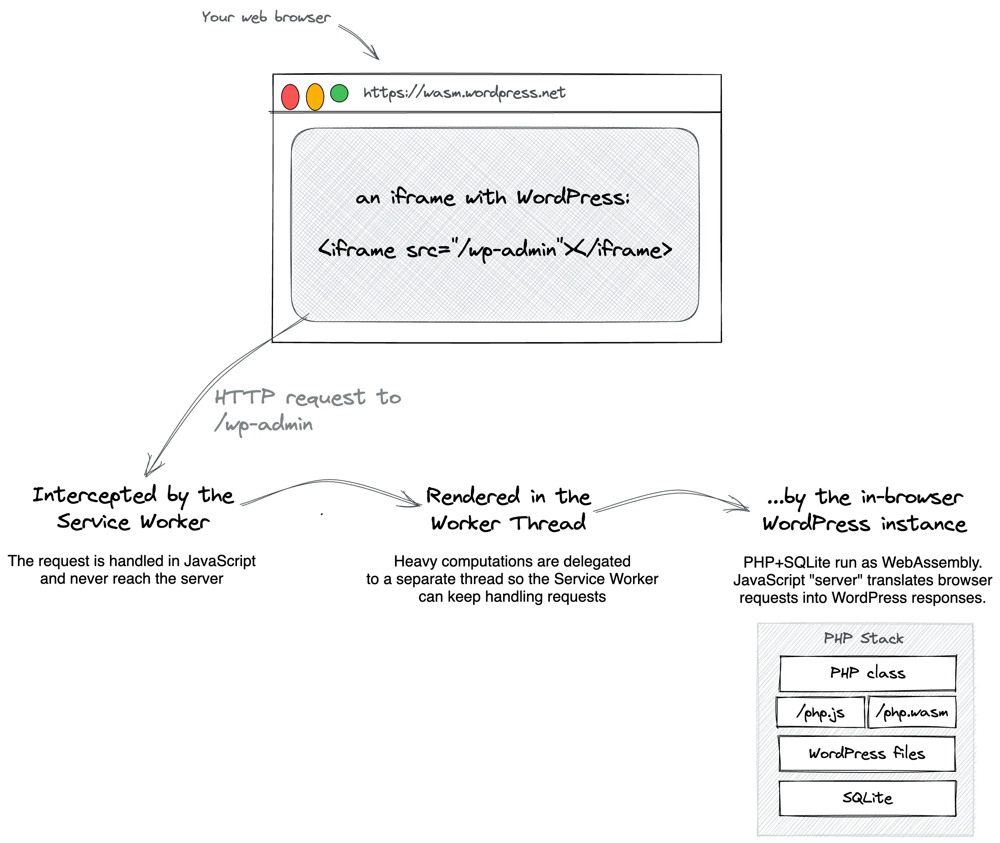

<!--
# Service Workers
-->

# Service Workers {#service-workers}

<!--
[A Service Worker](https://developer.mozilla.org/en-US/docs/Web/API/Service_Worker_API/Using_Service_Workers) is used to handle the HTTP traffic using the in-browser [`PHPRequestHandler`](/developers/architecture/browser-concepts).

Imagine your PHP script renders the following page [in the iframe viewport](/developers/architecture/browser-iframe-rendering):
-->

[একটি Service Worker](https://developer.mozilla.org/en-US/docs/Web/API/Service_Worker_API/Using_Service_Workers) ব্যবহার করে ব্রাউজারের ভেতর থাকা [`PHPRequestHandler`](/developers/architecture/browser-concepts)-এর মাধ্যমে HTTP ট্র্যাফিক সামলানো হয়।

ধরুন, আপনার PHP স্ক্রিপ্ট [iframe ভিউপোর্টের ভেতরে](/developers/architecture/browser-iframe-rendering) নিচের পেজটি রেন্ডার করে:

```html
<html>
	<head>
		<title>John's Website</title>
	</head>
	<body>
		<a href="/">Homepage</a>
		<a href="/blog">Blog</a>
		<a href="/contact">Contact</a>
	</body>
</html>
```

<!--
When the user clicks, say the `Blog` link, the browser would normally send a HTTP request to the remote server to fetch the `/blog` page and then display it instead of the current iframe contents. However, our app isn't running on the remote server. The browser would just display a 404 page.

Enter [Service Workers](https://developer.mozilla.org/en-US/docs/Web/API/Service_Worker_API/Using_Service_Workers) – a tool to intercept the HTTP requests and handle them inside the browser:
-->

ব্যবহারকারী যখন ধরুন `Blog` লিংকে ক্লিক করেন, তখন ব্রাউজার সাধারণত `/blog` পেজটি আনার জন্য রিমোট সার্ভারে একটি HTTP রিকোয়েস্ট পাঠায় এবং বর্তমান iframe-এর কনটেন্ট বদলে সেটি দেখায়। কিন্তু আমাদের অ্যাপ তো কোনো রিমোট সার্ভারে চলছে না। ফলে ব্রাউজার কেবল একটি 404 পেজ দেখাবে।

এখানেই আসে [Service Workers](https://developer.mozilla.org/en-US/docs/Web/API/Service_Worker_API/Using_Service_Workers) – HTTP রিকোয়েস্ট ইন্টারসেপ্ট করে ব্রাউজারের ভেতরেই সেগুলো প্রসেস করার একটি উপায়:

<!--

-->


<!--
### Service Worker setup
-->

### Service Worker সেটআপ {#service-worker-setup}

<!--
The main application living in `/index.html` is responsible for registering the service worker.

Here's the minimal setup:
-->

মূল অ্যাপ্লিকেশনটি থাকে `/index.html`-এ, আর সেটিই Service Worker রেজিস্টার করার কাজটি করে।

ন্যূনতম সেটআপটি দেখতে এমন:

**/app.js:**

```js
import { registerServiceWorker } from '@php-wasm/web';

function main() {
	await registerServiceWorker(
		phpClient,
		"default", // PHP instance scope
		"/sw.js",  // Must point to a valid Service Worker implementation.
		"1"        // Service worker version, used for reloading the script.
	);

}
```

<!--
You will also need a separate `/service-worker.js` file that actually intercepts and routes the HTTP requests. Here's what a minimal implementation looks like:
-->

আপনার একটি আলাদা `/service-worker.js` ফাইলও লাগবে, যা প্রকৃতপক্ষে HTTP রিকোয়েস্টগুলো ইন্টারসেপ্ট করে রাউট করবে। একটি ন্যূনতম ইমপ্লিমেন্টেশন দেখতে এমন:

**/service-worker.js**:

```js
import { initializeServiceWorker } from '@php-wasm/web';

// Intercepts all HTTP traffic on the current domain and
// passes it to the Worker Thread.
initializeServiceWorker();
```
