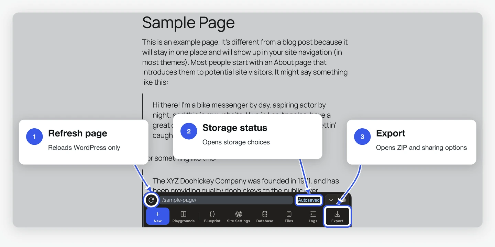
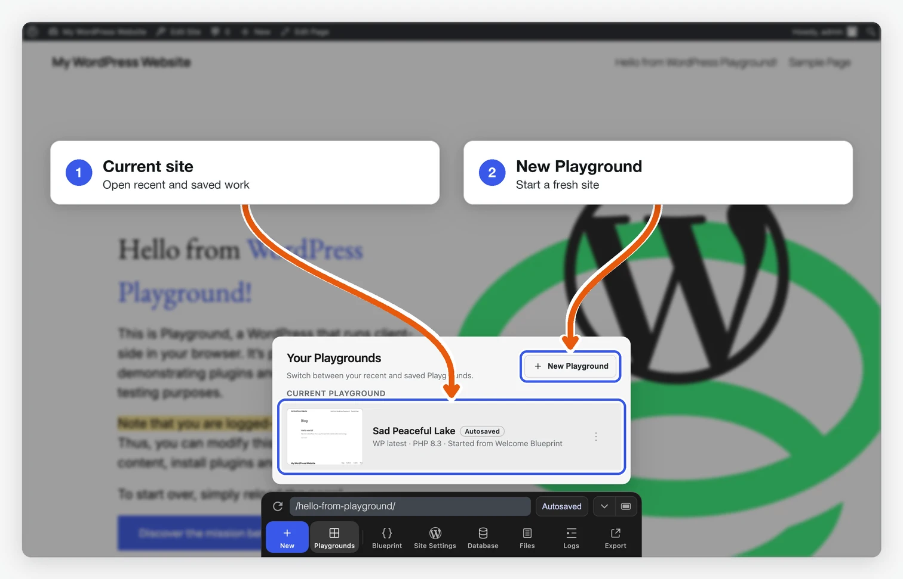
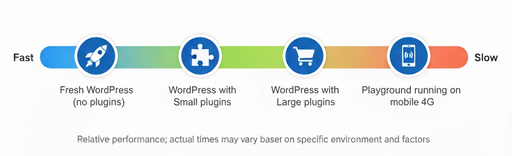

<!--
# Limitations
-->

# সীমাবদ্ধতা

<!--
WordPress Playground is under active development and has some limitations you should keep in mind when running it and developing with it.
-->

ওয়ার্ডপ্রেস প্লেগ্রাউন্ড এখনো সক্রিয়ভাবে ডেভেলপ করা হচ্ছে, এবং এর কিছু সীমাবদ্ধতা আছে যা এটি চালানো ও এটি দিয়ে ডেভেলপ করার সময় আপনার মনে রাখা উচিত।

<!--
You can track the status of these issues on the [Playground Project board](https://github.com/orgs/WordPress/projects/180).
-->

এই ইস্যুগুলোর স্ট্যাটাস আপনি [Playground Project board](https://github.com/orgs/WordPress/projects/180)-এ ট্র্যাক করতে পারেন।

<!--
## In the browser
-->

## ব্রাউজারে

<!--
### Browser storage and recovery
-->

### ব্রাউজার স্টোরেজ এবং পুনরুদ্ধার

<!--
Playground runs WordPress in the browser. New Playgrounds are autosaved when
browser storage and saving are available, and they appear in **Your
Playgrounds**. Playground keeps up to five recent autosaves. After five exist,
creating another deletes the oldest one. Autosaves are recovery points, not
long-term backups. Store an autosave permanently or export a ZIP when you want
to keep it.
-->

প্লেগ্রাউন্ড ব্রাউজারে ওয়ার্ডপ্রেস চালায়। ব্রাউজার স্টোরেজ এবং সেভ করার সুবিধা থাকলে নতুন প্লেগ্রাউন্ডগুলো অটোসেভ হয় এবং **Your Playgrounds**-এ দেখা যায়। প্লেগ্রাউন্ড সাম্প্রতিক সর্বোচ্চ পাঁচটি অটোসেভ রাখে। পাঁচটি হয়ে যাওয়ার পর নতুন আরেকটি তৈরি করলে সবচেয়ে পুরোনোটি মুছে যায়। অটোসেভ হলো পুনরুদ্ধারের পয়েন্ট, দীর্ঘমেয়াদি ব্যাকআপ নয়। কোনো অটোসেভ রেখে দিতে চাইলে সেটি স্থায়ীভাবে সংরক্ষণ করুন অথবা একটি ZIP এক্সপোর্ট করুন।

<!--
Use these storage modes deliberately:

- **Autosaved**: stored in browser storage and retained only while it is one of up to five recent autosaves.
- **Saved**: stored permanently in browser storage or saved to a local directory.
- **Temporary**: created with `?storage=temp` or when saving is unavailable. It is discarded when the tab closes or the browser page refreshes.
-->

এই স্টোরেজ মোডগুলো ভেবেচিন্তে ব্যবহার করুন:

- **Autosaved (অটোসেভড)**: ব্রাউজার স্টোরেজে রাখা হয় এবং যতক্ষণ এটি সাম্প্রতিক সর্বোচ্চ পাঁচটি অটোসেভের একটি থাকে, শুধু ততক্ষণই রাখা হয়।
- **Saved (সেভড)**: ব্রাউজার স্টোরেজে স্থায়ীভাবে রাখা হয় অথবা একটি লোকাল ডিরেক্টরিতে সেভ করা হয়।
- **Temporary (অস্থায়ী)**: `?storage=temp` দিয়ে অথবা সেভ করার সুবিধা না থাকলে তৈরি হয়। ট্যাব বন্ধ করলে বা ব্রাউজারের পেজ রিফ্রেশ করলে এটি মুছে যায়।

<!--
The Playground **Refresh page** button reloads the WordPress page inside the current Playground. Browser refresh (Cmd+R or F5) reloads the whole Playground app. A stored or autosaved Playground can recover after that reload, but a temporary Playground cannot.
-->

প্লেগ্রাউন্ডের **Refresh page** বাটনটি বর্তমান প্লেগ্রাউন্ডের ভেতরের ওয়ার্ডপ্রেস পেজটি রিলোড করে। ব্রাউজার রিফ্রেশ (Cmd+R বা F5) পুরো প্লেগ্রাউন্ড অ্যাপটি রিলোড করে। সংরক্ষিত বা অটোসেভড প্লেগ্রাউন্ড এই রিলোডের পরে পুনরুদ্ধার হতে পারে, কিন্তু অস্থায়ী প্লেগ্রাউন্ড পারে না।

<!--

-->


<!--
Browser storage still belongs to the browser. Storage pressure, private browsing, profile changes, or clearing site data can remove it. Export a ZIP when you need a portable backup.
-->

তবুও ব্রাউজার স্টোরেজ ব্রাউজারেরই নিয়ন্ত্রণে থাকে। স্টোরেজে জায়গার চাপ, প্রাইভেট ব্রাউজিং, প্রোফাইল পরিবর্তন বা সাইট ডেটা মুছে ফেলার কারণে এটি মুছে যেতে পারে। সহজে সরিয়ে নেওয়া যায় এমন ব্যাকআপ দরকার হলে একটি ZIP এক্সপোর্ট করুন।

<!--

-->


<!--
### Browser support
-->

### ব্রাউজার সাপোর্ট

<!--
WordPress Playground is designed to work across all major desktop and mobile browsers. This includes:

- **Desktop browsers**: Chrome, Firefox, Safari, Edge, and other Chromium-based browsers
- **Mobile browsers**: Safari (iOS), Chrome (Android), and other mobile browser variants
-->

ওয়ার্ডপ্রেস প্লেগ্রাউন্ড সব প্রধান ডেস্কটপ ও মোবাইল ব্রাউজারে কাজ করার জন্য তৈরি। এর মধ্যে রয়েছে:

- **ডেস্কটপ ব্রাউজার**: Chrome, Firefox, Safari, Edge এবং অন্যান্য Chromium-ভিত্তিক ব্রাউজার
- **মোবাইল ব্রাউজার**: Safari (iOS), Chrome (Android) এবং অন্যান্য মোবাইল ব্রাউজার

<!--
Playground leverages modern web technologies and should function consistently across these browser environments. However, some advanced features may have varying levels of support depending on the specific browser and its version.
-->

প্লেগ্রাউন্ড আধুনিক ওয়েব প্রযুক্তি ব্যবহার করে, তাই এই ব্রাউজারগুলোতে এটি একইভাবে কাজ করার কথা। তবে নির্দিষ্ট ব্রাউজার ও তার ভার্সনের ওপর নির্ভর করে কিছু অ্যাডভান্সড ফিচারের সাপোর্ট কমবেশি হতে পারে।

<!--
### Performance expectations
-->

### পারফরম্যান্স থেকে যা আশা করবেন

<!--
Loading times vary based on what Playground needs to set up:

| Scenario                               | Typical Load Time          |
| -------------------------------------- | -------------------------- |
| Fresh WordPress (no plugins)           | 5-10 seconds               |
| With small plugins                     | 10-20 seconds              |
| With large plugins (e.g., WooCommerce) | 30-60 seconds              |
| On mobile devices                      | 1.5-2x slower than desktop |
-->

প্লেগ্রাউন্ডকে কী কী সেটআপ করতে হবে তার ওপর লোড হওয়ার সময় নির্ভর করে:

| পরিস্থিতি                              | সাধারণ লোড টাইম               |
| -------------------------------------- | ----------------------------- |
| নতুন ওয়ার্ডপ্রেস (কোনো প্লাগইন ছাড়া) | ৫-১০ সেকেন্ড                  |
| ছোট প্লাগইনসহ                          | ১০-২০ সেকেন্ড                 |
| বড় প্লাগইনসহ (যেমন WooCommerce)       | ৩০-৬০ সেকেন্ড                 |
| মোবাইল ডিভাইসে                         | ডেস্কটপের চেয়ে ১.৫-২ গুণ ধীর |

<!--

-->


<!--
**Factors that affect performance:**

- **Plugin size**: Large plugins take longer to install at runtime
- **Network speed**: WASM files are 15-30MB
- **Device memory**: Low-memory devices may experience slowdowns
- **Browser**: Chrome/Edge perform best; Safari slightly slower
-->

**যেসব বিষয় পারফরম্যান্সে প্রভাব ফেলে:**

- **প্লাগইনের সাইজ**: রানটাইমে বড় প্লাগইন ইনস্টল হতে বেশি সময় লাগে
- **নেটওয়ার্কের গতি**: WASM ফাইলগুলোর সাইজ ১৫-৩০MB
- **ডিভাইসের মেমরি**: কম মেমরির ডিভাইসে ধীরগতি দেখা দিতে পারে
- **ব্রাউজার**: Chrome/Edge সবচেয়ে ভালো পারফর্ম করে; Safari একটু ধীর

<!--
<blockquote>
<strong>Note:</strong> Opera Mini support is not currently confirmed.
</blockquote>
-->

<blockquote>
<strong>নোট:</strong> Opera Mini-এর সাপোর্ট বর্তমানে নিশ্চিত নয়।
</blockquote>

<!--
## When developing with Playground
-->

## প্লেগ্রাউন্ড দিয়ে ডেভেলপ করার সময়

<!--
### Iframe quirks
-->

### Iframe-এর অদ্ভুত আচরণ

<!--
Playground renders WordPress in an [`iframe`](/developers/architecture/browser-iframe-rendering) so clicking links with `target="_top"` will reload the page you’re working on.
Also, JavaScript popups originating in the `iframe` may not always display.
-->

প্লেগ্রাউন্ড ওয়ার্ডপ্রেসকে একটি [`iframe`](/developers/architecture/browser-iframe-rendering)-এর ভেতরে রেন্ডার করে, তাই `target="_top"` থাকা লিংকে ক্লিক করলে আপনি যে পেজে কাজ করছেন সেটি রিলোড হয়ে যাবে।
এছাড়া `iframe` থেকে আসা JavaScript পপআপ সবসময় নাও দেখা যেতে পারে।

<!--
### Run WordPress PHP functions
-->

### ওয়ার্ডপ্রেসের PHP ফাংশন চালানো

<!--
Playground supports running PHP code in Blueprints using the [`runPHP` step](/blueprints/steps#RunPHPStep). To run WordPress-specific PHP functions, you’d need to first require [wp-load.php](https://github.com/WordPress/WordPress/blob/master/wp-load.php):
-->

প্লেগ্রাউন্ড [`runPHP` স্টেপ](/blueprints/steps#RunPHPStep) ব্যবহার করে ব্লুপ্রিন্টে PHP কোড চালানো সাপোর্ট করে। ওয়ার্ডপ্রেস-নির্দিষ্ট PHP ফাংশন চালাতে হলে আগে [wp-load.php](https://github.com/WordPress/WordPress/blob/master/wp-load.php) require করে নিতে হবে:

```json
{
	"step": "runPHP",
	"code": "<?php require_once('wordpress/wp-load.php'); OTHER_CODE ?>"
}
```

<!--
### Using WP-CLI
-->

### WP-CLI ব্যবহার

<!--
You can execute `wp-cli` commands via the Blueprints [`wp-cli`](/blueprints/steps#WPCLIStep) step. However, since Playground runs in the browser, it doesn't support the [full array](https://developer.wordpress.org/cli/commands/) of available commands. While there is no definite list of supported commands, experimenting in [the online demo](https://playground.wordpress.net/demos/wp-cli.html) will help you assess what's possible.
-->

ব্লুপ্রিন্টের [`wp-cli`](/blueprints/steps#WPCLIStep) স্টেপের মাধ্যমে আপনি `wp-cli` কমান্ড চালাতে পারেন। তবে প্লেগ্রাউন্ড ব্রাউজারে চলে বলে এটি উপলব্ধ [সব কমান্ড](https://developer.wordpress.org/cli/commands/) সাপোর্ট করে না। সাপোর্টেড কমান্ডের কোনো নির্দিষ্ট লিস্ট না থাকলেও, [অনলাইন ডেমোতে](https://playground.wordpress.net/demos/wp-cli.html) পরীক্ষা করে দেখলে কী কী করা সম্ভব তা বুঝতে পারবেন।
