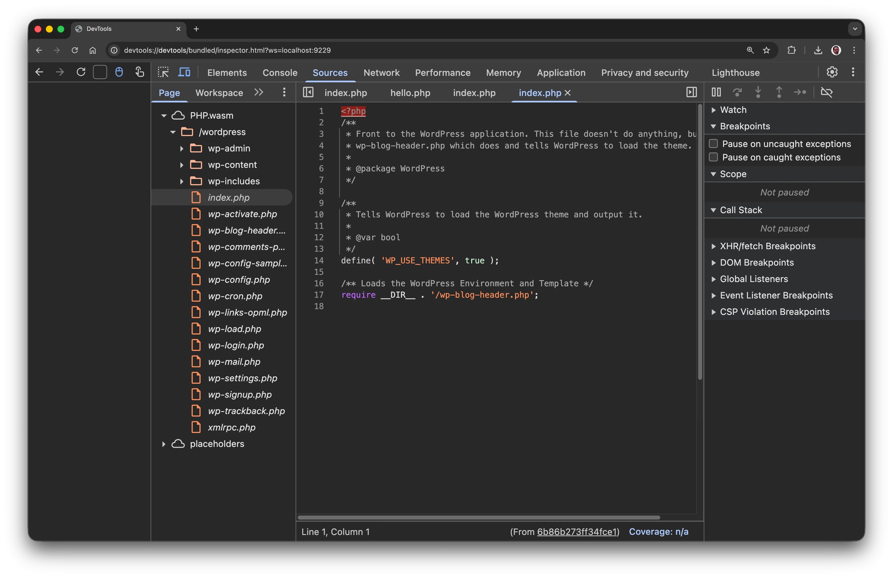
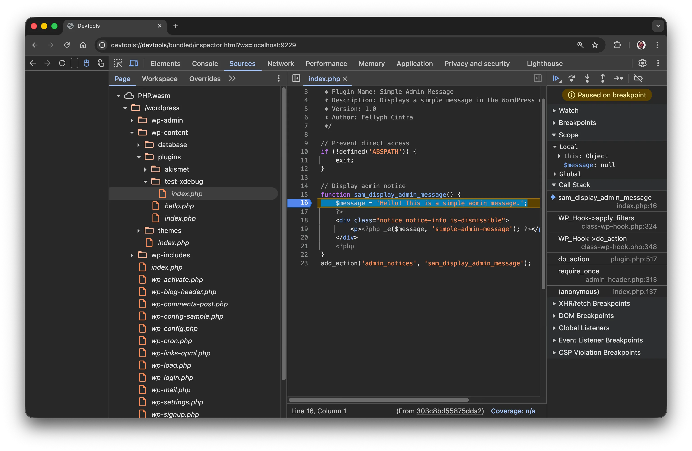
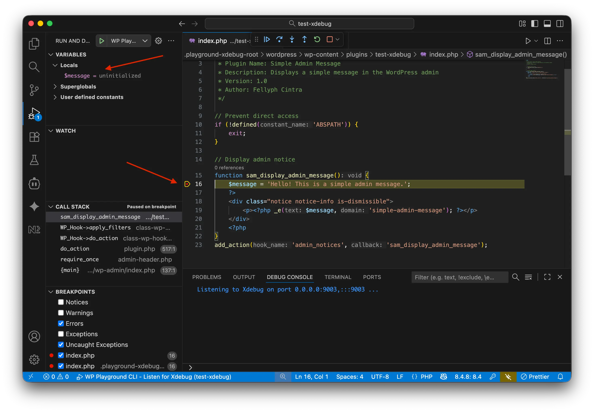

<!-- # Getting Started with Xdebug -->

# Primeros Pasos con Xdebug

<!-- This guide shows you how to enable Xdebug in WordPress Playground and start debugging your code. -->

Esta guía te muestra cómo habilitar Xdebug en WordPress Playground y comenzar a depurar tu código.

<!-- ## PHP WASM CLI vs Playground CLI -->

## PHP WASM CLI vs Playground CLI

<!-- First, Xdebug is present in two different CLIs: -->

Primero, Xdebug está presente en dos CLI diferentes:

- **`@php-wasm/cli`**: Ejecuta scripts PHP independientes. Úsalo cuando estés depurando código PHP sin necesidad de un entorno WordPress.
- **`@wp-playground/cli`**: Ejecuta una instalación completa de WordPress. Útil para depurar plugins de WordPress, temas o funcionalidades del núcleo.

<!-- For this guide, we'll use `@wp-playground/cli`. If you're not familiar with the tool, we recommend reading the [`@wp-playground/cli` guide](/developers/local-development/wp-playground-cli), but the same process can also be applied to debugging PHP applications with `@php-wasm/cli`. -->

Para esta guía, utilizaremos `@wp-playground/cli`. Si no estás familiarizado con la herramienta, recomendamos leer la guía de [`@wp-playground/cli`](/developers/local-development/wp-playground-cli), pero el mismo proceso también puede aplicarse a la depuración de aplicaciones PHP con `@php-wasm/cli`.

<!-- ## Quick start with `npx` -->

## Inicio rápido con `npx`

<!-- The fastest way to get started is using npx, which doesn't require installation: -->

La forma más rápida de comenzar es usar npx, que no requiere instalación:

```bash
npx @wp-playground/cli@latest server --xdebug
```

<!-- The CLI prints the WordPress URL after starting the server with Xdebug enabled. You can now connect a debugger. -->

La CLI muestra la URL de WordPress después de iniciar el servidor con Xdebug habilitado. Ya puedes conectar un depurador.

<!-- Before starting another example, stop the previous Playground server with `Ctrl+C` and disconnect its debugger. -->

Antes de empezar otro ejemplo, detén el servidor de Playground anterior con `Ctrl+C` y desconecta su depurador.

<!-- ## Create the sample plugin -->

## Crear el plugin de ejemplo

<!-- Create a directory named `test-xdebug` and save the following code as `test-xdebug.php` inside it. Both walkthroughs use this plugin. -->

Crea una carpeta llamada `test-xdebug` y guarda el siguiente código dentro de ella en un archivo llamado `test-xdebug.php`. Los dos ejemplos de depuración usan este plugin.

```PHP
<?php
/**
 * Plugin Name: Simple Admin Message
 * Description: Displays a simple message in the WordPress admin
 * Version: 1.0
 * Author: Playground Team
 */

// Prevent direct access
if (!defined('ABSPATH')) {
    exit;
}

// Display admin notice
function sam_display_admin_message() {
    $message = 'Hello! This is a simple admin message.';
    ?>
    <div class="notice notice-info is-dismissible">
        <p><?php _e($message, 'simple-admin-message'); ?></p>
    </div>
    <?php
}
add_action('admin_notices', 'sam_display_admin_message');
```

<!-- ## Starting with DevTools -->

## Iniciando con DevTools

<!-- To debug with Chrome DevTools, add the `--experimental-devtools` flag: -->

Para depurar con Chrome DevTools, agrega la bandera `--experimental-devtools`:

```bash
npx @wp-playground/cli@latest server --xdebug --experimental-devtools
```

<!-- Open the URL printed by the bridge in Chrome on the same computer. DevTools connects to the Chrome DevTools Protocol (CDP) listener at `127.0.0.1:9229`. -->

En el mismo equipo, abre en Chrome la URL que muestra el puente de Xdebug. DevTools se conecta a `127.0.0.1:9229` mediante el protocolo CDP (Chrome DevTools Protocol).

```text
Starting XDebug Bridge...
Connect Chrome DevTools to CDP at:
devtools://devtools/bundled/inspector.html?ws=127.0.0.1:9229
```

<!-- Once DevTools connects, the bridge starts listening for Xdebug (DBGp) connections at `127.0.0.1:9003`. Both listeners use IPv4 loopback by default. -->

Una vez que DevTools se conecta, el puente empieza a escuchar conexiones de Xdebug (DBGp) en `127.0.0.1:9003`. De forma predeterminada, el puente escucha en la dirección IPv4 de bucle invertido para ambos protocolos.

```text
Chrome connected! Initializing Xdebug receiver...
XDebug receiver running on 127.0.0.1:9003
Running a PHP script with Xdebug enabled...
```



<!-- If you ran the previous command, close its DevTools window and stop the server with `Ctrl+C`. Run the following command from the `test-xdebug` directory. -->

Si ejecutaste el comando anterior, cierra su ventana de DevTools y detén el servidor con `Ctrl+C`. Ejecuta el siguiente comando desde la carpeta `test-xdebug`.

```bash
npx @wp-playground/cli@latest server --xdebug --experimental-devtools --auto-mount
```

<!-- The Playground CLI automatically mounts and activates the plugin. Open the DevTools URL from the terminal and set a breakpoint inside `sam_display_admin_message()`. Append `/wp-admin/plugins.php` to the WordPress URL printed by the CLI and open the resulting URL in your browser to hit the breakpoint. If WordPress asks you to sign in, use `admin` as the username and `password` as the password. -->

La CLI de Playground monta y activa el plugin automáticamente. Abre la URL de DevTools que aparece en la terminal y coloca un punto de interrupción en `sam_display_admin_message()`. Añade `/wp-admin/plugins.php` a la URL de WordPress que muestra la CLI y abre la dirección resultante en tu navegador para que la ejecución se detenga en el punto de interrupción. Si WordPress te pide iniciar sesión, usa `admin` como nombre de usuario y `password` como contraseña.



<!-- ## Starting with IDE integration -->

## Iniciando con integración IDE

<!-- To debug the sample plugin with VS Code, use the `--experimental-unsafe-ide-integration=vscode` flag. For PhpStorm, open `test-xdebug` as a PhpStorm project first and make sure it contains an `.idea/` directory. In the command below, replace the VS Code flag with `--experimental-unsafe-ide-integration=phpstorm`. -->

Para depurar el plugin de ejemplo con VS Code, usa la opción `--experimental-unsafe-ide-integration=vscode`. Si usas PhpStorm, primero abre `test-xdebug` como proyecto de PhpStorm y comprueba que contiene una carpeta `.idea/`. En el siguiente comando, sustituye la opción de VS Code por `--experimental-unsafe-ide-integration=phpstorm`.

<!-- To debug in VSCode you'll need the following prerequisites: -->

Para depurar en VSCode necesitarás los siguientes prerrequisitos:

1. Instala una extensión de depuración de PHP compatible con Xdebug, como [PHP Debug](https://marketplace.visualstudio.com/items?itemName=xdebug.php-debug).
2. Una carpeta `.vscode/`. Si el archivo `launch.json` no existe, no te preocupes, `@wp-playground/cli` lo creará.
3. Habilita los puntos de interrupción (breakpoints) en tu IDE. Algunos IDEs vienen con esta característica desactivada, así que presta atención a este detalle.

<!-- Run the following command from the plugin directory. -->

Ejecuta el siguiente comando desde la carpeta del plugin.

```bash
npx @wp-playground/cli@latest server --xdebug --experimental-unsafe-ide-integration=vscode --auto-mount
```

<!-- Start the **WP Playground CLI - Listen for Xdebug** configuration in your IDE and set a breakpoint inside `sam_display_admin_message()`. Append `/wp-admin/plugins.php` to the WordPress URL printed by the CLI and open the resulting URL in your browser to hit the breakpoint. If WordPress asks you to sign in, use `admin` as the username and `password` as the password. -->

Inicia la configuración **WP Playground CLI - Listen for Xdebug** en tu IDE y coloca un punto de interrupción en `sam_display_admin_message()`. Añade `/wp-admin/plugins.php` a la URL de WordPress que muestra la CLI y abre la dirección resultante en tu navegador para que la ejecución se detenga en el punto de interrupción. Si WordPress te pide iniciar sesión, usa `admin` como nombre de usuario y `password` como contraseña.



<!-- ### PhpStorm troubleshooting -->

### Solución de problemas en PhpStorm

<!-- If PhpStorm pauses on the first line of unmapped files or scripts outside your project, you can disable these optional settings under **Settings > PHP > Debug > Xdebug**: -->

Si PhpStorm se detiene en la primera línea de archivos sin asignación de rutas o de scripts fuera de tu proyecto, puedes desactivar estas opciones en **Settings > PHP > Debug > Xdebug**:

- **Force break at first line when no path mapping specified**.
- **Force break at first line when a script is outside the project**.

<!-- If requests that do not hit a breakpoint produce unwanted notifications, disable **Notify if debug session was finished without being paused** under **Settings > PHP > Debug > Settings** (called **Advanced settings** in the current JetBrains documentation). When this setting is disabled and no breakpoint is hit, PhpStorm runs the script without pausing or establishing a debugging session. -->

Si las solicitudes que no alcanzan ningún punto de interrupción generan notificaciones no deseadas, desactiva **Notify if debug session was finished without being paused** en **Settings > PHP > Debug > Settings** (denominado **Advanced settings** en la documentación actual de JetBrains). Cuando esta opción está desactivada y no se alcanza ningún punto de interrupción, PhpStorm ejecuta el script sin detenerse ni iniciar una sesión de depuración.

<!-- These options suppress unwanted pauses or notifications. They do not fix path mappings or configure breakpoints: you still need correct path mappings and enabled breakpoints in the code you want to debug. -->

Estas opciones evitan pausas o notificaciones no deseadas. No corrigen las asignaciones de rutas ni configuran los puntos de interrupción: sigues necesitando asignaciones de rutas correctas y puntos de interrupción activados en el código que quieres depurar.

<!-- For more details, see [JetBrains' debug settings reference](https://www.jetbrains.com/help/phpstorm/debug.html) and the [PhpStorm examples](https://github.com/WordPress/wordpress-playground/blob/trunk/examples/xdebug/ide/README.md#phpstorm). -->

Para más detalles, consulta la [referencia de configuración de depuración de JetBrains](https://www.jetbrains.com/help/phpstorm/debug.html) y los [ejemplos para PhpStorm](https://github.com/WordPress/wordpress-playground/blob/trunk/examples/xdebug/ide/README.md#phpstorm).

<!-- This feature is in experimental mode. Until it is completed, we will need your feedback. Please connect with us in the [#playground Slack channel](https://wordpress.slack.com/archives/C04EWKGDJ0K) and share your thoughts. -->

Esta característica está en modo experimental. Hasta que se complete, necesitaremos tu retroalimentación. Por favor, conéctate con nosotros en el [canal Slack #playground](https://wordpress.slack.com/archives/C04EWKGDJ0K) y comparte tus pensamientos.
