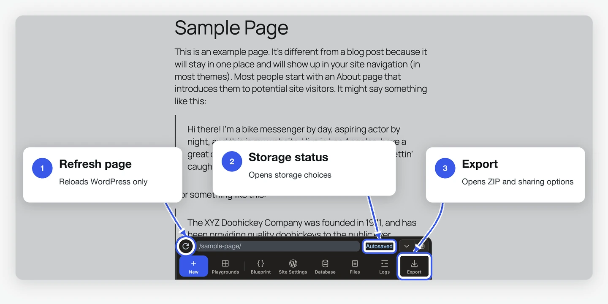
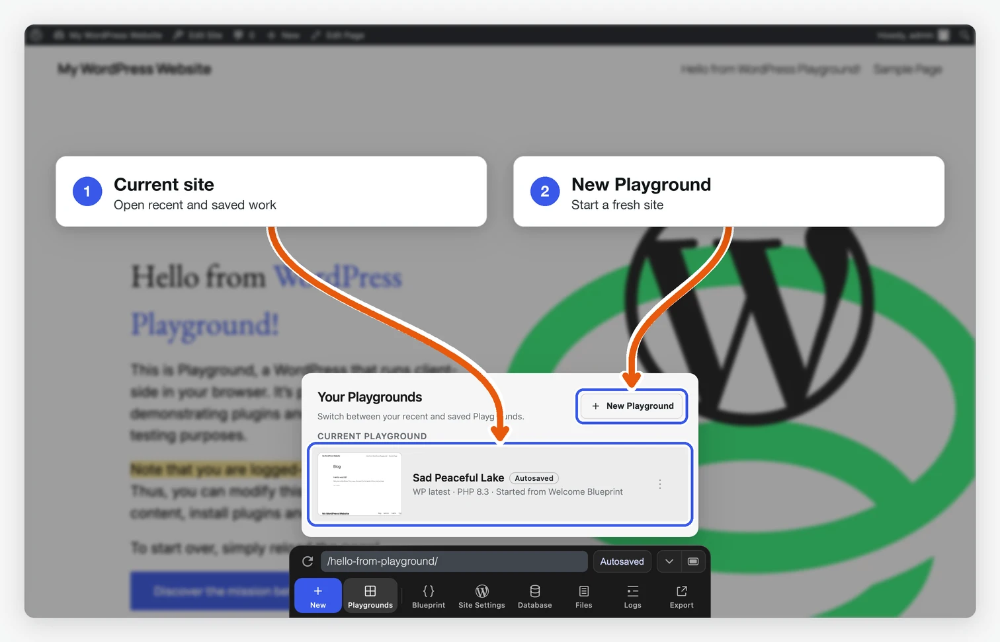
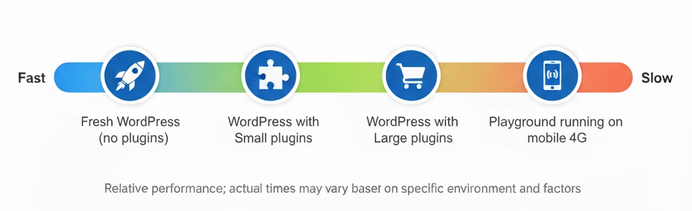

<!--
description: Learn about the current limitations of WordPress Playground, including browser-specific behaviors, browser persistence and recovery constraints, iframe quirks, and WP-CLI support.
-->

# Limitaciones

<!--
# Limitations
-->

WordPress Playground está en desarrollo activo y tiene algunas limitaciones que conviene tener en cuenta al ejecutarlo y al desarrollar con él.

<!--
WordPress Playground is under active development and has some limitations you should keep in mind when running it and developing with it.
-->

Puedes seguir el estado de estos temas en el [tablero del proyecto Playground](https://github.com/orgs/WordPress/projects/180).

<!--
You can track the status of these issues on the [Playground Project board](https://github.com/orgs/WordPress/projects/180).
-->

## En el navegador

<!--
## In the browser
-->

### Almacenamiento y recuperación en el navegador

<!--
### Browser storage and recovery
-->

Playground ejecuta WordPress en el navegador. Cuando se puede guardar en el navegador, los nuevos Playgrounds se guardan automáticamente y aparecen en **Your Playgrounds**. Se conservan los cinco más recientes. Al crear un sexto, se elimina el más antiguo. Si quieres conservar un sitio a largo plazo, guárdalo de forma permanente o expórtalo como archivo ZIP.

<!--
Playground runs WordPress in the browser. New Playgrounds are autosaved when
browser storage and saving are available, and they appear in **Your
Playgrounds**. Playground keeps up to five recent autosaves. After five exist,
creating another deletes the oldest one. Autosaves are recovery points, not
long-term backups. Store an autosave permanently or export a ZIP when you want
to keep it.
-->

Hay tres modos de almacenamiento:

<!--
Use these storage modes deliberately:
-->

- **Guardado automático**: el sitio se conserva en el navegador mientras sea uno de los cinco sitios guardados automáticamente más recientes.
- **Guardado permanente**: el sitio se guarda en el navegador o en un directorio local.
- **Temporal**: el sitio se crea con `?storage=temp` o cuando no se puede guardar. Se pierde al cerrar la pestaña o al recargar la página del navegador.

<!--
- **Autosaved**: stored in browser storage and retained only while it is one of up to five recent autosaves.
- **Saved**: stored permanently in browser storage or saved to a local directory.
- **Temporary**: created with `?storage=temp` or when saving is unavailable. It is discarded when the tab closes or the browser page refreshes.
-->

El botón **Refresh page** de Playground recarga la página de WordPress dentro del sitio actual. Al pulsar Cmd+R o F5, el navegador recarga toda la aplicación. Después puedes recuperar los sitios guardados de forma permanente o automática. Los sitios temporales se pierden.

<!--
The Playground **Refresh page** button reloads the WordPress page inside the current Playground. Browser refresh (Cmd+R or F5) reloads the whole Playground app. A stored or autosaved Playground can recover after that reload, but a temporary Playground cannot.
-->



<!--

-->

El navegador gestiona los datos almacenados. Pueden perderse si queda poco espacio, si usas la navegación privada, si cambias de perfil o si borras los datos del sitio. Exporta un ZIP si necesitas una copia de seguridad que puedas llevar a otro equipo.

<!--
Browser storage still belongs to the browser. Storage pressure, private browsing, profile changes, or clearing site data can remove it. Export a ZIP when you need a portable backup.
-->



<!--

-->

### Compatibilidad con navegadores

<!--
### Browser support
-->

WordPress Playground está pensado para funcionar en los principales navegadores de escritorio y móviles. Esto incluye:

<!--
WordPress Playground is designed to work across all major desktop and mobile browsers. This includes:
-->

- **Navegadores de escritorio**: Chrome, Firefox, Safari, Edge y otros basados en Chromium
- **Navegadores móviles**: Safari (iOS), Chrome (Android) y otras variantes

<!--
- **Desktop browsers**: Chrome, Firefox, Safari, Edge, and other Chromium-based browsers
- **Mobile browsers**: Safari (iOS), Chrome (Android), and other mobile browser variants
-->

Playground aprovecha tecnologías web modernas y debería comportarse de forma coherente en estos entornos. No obstante, algunas funciones avanzadas pueden tener distinto nivel de soporte según el navegador y su versión.

<!--
Playground leverages modern web technologies and should function consistently across these browser environments. However, some advanced features may have varying levels of support depending on the specific browser and its version.
-->

### Expectativas de rendimiento

<!--
### Performance expectations
-->

Los tiempos de carga dependen de lo que Playground necesite preparar:

<!--
Loading times vary based on what Playground needs to set up:
-->

| Escenario                                | Tiempo de carga típico             |
| ---------------------------------------- | ---------------------------------- |
| WordPress nuevo (sin plugins)            | 5-10 segundos                      |
| Con plugins pequeños                     | 10-20 segundos                     |
| Con plugins grandes (p. ej. WooCommerce) | 30-60 segundos                     |
| En dispositivos móviles                  | 1,5-2× más lento que en escritorio |

<!--
| Scenario                               | Typical Load Time          |
| -------------------------------------- | -------------------------- |
| Fresh WordPress (no plugins)           | 5-10 seconds               |
| With small plugins                     | 10-20 seconds              |
| With large plugins (e.g., WooCommerce) | 30-60 seconds              |
| On mobile devices                      | 1.5-2x slower than desktop |
-->



**Factores que influyen en el rendimiento:**

<!--
**Factors that affect performance:**
-->

- **Tamaño del plugin**: los plugins grandes tardan más en instalarse en tiempo de ejecución
- **Velocidad de red**: en la primera carga se descarga el entorno de ejecución PHP en WebAssembly. El tamaño de la descarga depende de la versión de PHP y de la compilación
- **Memoria del dispositivo**: la asignación inicial de memoria WASM es de 64 MB y crece dinámicamente si hace falta. Los dispositivos con poca memoria pueden ir más lentos
- **Navegador**: Chrome y Edge suelen ir mejor; Safari, un poco más lento

<!--
- **Plugin size**: Large plugins take longer to install at runtime
- **Network speed**: The first load downloads the PHP WebAssembly runtime. Download size varies by PHP version and build
- **Device memory**: Initial WASM memory allocation is 64MB, growing dynamically as needed. Low-memory devices may experience slowdowns
- **Browser**: Chrome/Edge perform best; Safari slightly slower
-->

<blockquote>
<strong>Nota:</strong> el soporte de Opera Mini no está confirmado por ahora.
</blockquote>

<!--
<blockquote>
<strong>Note:</strong> Opera Mini support is not currently confirmed.
</blockquote>
-->

## Al desarrollar con Playground

<!-- ### Iframe quirks -->

### Peculiaridades del iframe

<!--
### Iframe quirks
-->

Playground muestra WordPress en un [`iframe`](/developers/architecture/browser-iframe-rendering), así que al hacer clic en enlaces con `target="_top"` se recarga la página en la que trabajas.

<!--
Playground renders WordPress in an [`iframe`](/developers/architecture/browser-iframe-rendering) so clicking links with `target="_top"` will reload the page you're working on.
-->

Además, las ventanas emergentes de JavaScript que se originan en el `iframe` no siempre se muestran.

<!-- ### Run WordPress PHP functions -->

### Ejecutar funciones PHP de WordPress

<!--
### Run WordPress PHP functions
-->

Playground permite ejecutar código PHP en Blueprints con el [paso `runPHP`](/blueprints/steps#RunPHPStep). Para usar funciones PHP de WordPress, primero hay que cargar [wp-load.php](https://github.com/WordPress/WordPress/blob/master/wp-load.php):

<!--
Playground supports running PHP code in Blueprints using the [`runPHP` step](/blueprints/steps#RunPHPStep). To run WordPress-specific PHP functions, you'd need to first require [wp-load.php](https://github.com/WordPress/WordPress/blob/master/wp-load.php):
-->

```json
{
	"step": "runPHP",
	"code": "<?php require_once('wordpress/wp-load.php'); OTHER_CODE ?>"
}
```

<!-- ### Using WP-CLI -->

### Usando WP-CLI

Puedes ejecutar comandos de `wp-cli` mediante el paso [`wp-cli`](/blueprints/steps#WPCLIStep) de Blueprints. Sin embargo, como Playground se ejecuta en el navegador, no admite la [lista completa](https://developer.wordpress.org/cli/commands/) de comandos disponibles. No existe una lista definitiva de comandos compatibles, así que experimentar en [la demo en línea](https://playground.wordpress.net/demos/wp-cli.html) te ayudará a evaluar qué es posible.

<!--
You can execute `wp-cli` commands via the Blueprints [`wp-cli`](/blueprints/steps#WPCLIStep) step. However, since Playground runs in the browser, it doesn't support the [full array](https://developer.wordpress.org/cli/commands/) of available commands. While there is no definite list of supported commands, experimenting in [the online demo](https://playground.wordpress.net/demos/wp-cli.html) will help you assess what's possible.
-->

Al usar [Playground CLI](/developers/local-development/wp-playground-cli), el comando `php` puede ejecutar scripts PHP, incluido un archivo `wp-cli.phar` montado, directamente en el entorno de ejecución PHP en WASM.

<!--
When using the [Playground CLI](/developers/local-development/wp-playground-cli), the `php` command can run PHP scripts, including a mounted `wp-cli.phar`, directly in the WASM PHP runtime.
-->

## Mejoras recientes {#recent-improvements}

Se han resuelto varias limitaciones anteriores:

- **Descargas de archivos grandes en Playground CLI (>2 GB)**: la CLI ahora puede transmitir las respuestas directamente en lugar de almacenarlas en memoria, lo que permite exportar sitios grandes (por ejemplo, copias de All-in-One WP Migration) que antes fallaban.
- **Subidas de archivos mediante cURL en PHP**: las subidas de formularios multipart con `CURLFile` ahora funcionan correctamente en el navegador. Se han resuelto el bloqueo de `Expect: 100-continue` y los problemas de reenvío multipart del proxy CORS.
- **Respuestas PHP de larga duración**: el service worker ahora transmite el cuerpo de la respuesta después de recibir las cabeceras, en lugar de almacenar en memoria la respuesta completa. De este modo, el cuerpo queda fuera del tiempo de espera de 25 segundos de los mensajes, por lo que las importaciones de sitios y otras operaciones largas pueden continuar después de recibir las cabeceras.
- **Gestión de errores de descarga**: cuando falla una descarga necesaria de WASM o de un script por un problema de red, un bloqueador de anuncios o una causa similar, Playground muestra un modal de error útil en lugar de una página en blanco.

<!--
## Recent improvements {#recent-improvements}

Several previous limitations have been addressed:

- **Large file downloads in Playground CLI (>2 GB)**: The CLI can now stream responses directly instead of buffering them in memory, enabling large site exports (e.g., All-in-One WP Migration backups) that previously failed.
- **PHP cURL file uploads**: Multipart form uploads via `CURLFile` now work correctly in the browser. The `Expect: 100-continue` deadlock and CORS proxy multipart forwarding issues have been resolved.
- **Long-running PHP responses**: The service worker now streams the response body after receiving the headers instead of buffering the entire response. This keeps the response body outside the 25-second message timeout, so site imports and other long-running operations can continue after the headers are received.
- **Download error handling**: When a required WASM or script download fails because of a network issue, an ad blocker, or a similar problem, Playground displays a helpful error modal instead of a blank page.
-->
