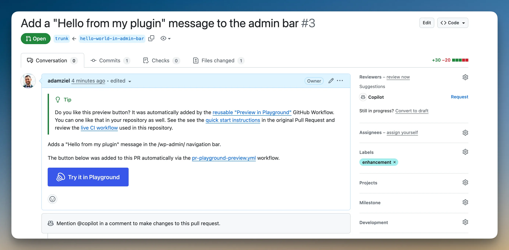

<!--
The Playground PR Preview action adds a preview button to your pull requests. Clicking the button launches Playground with your plugin or theme installed from the PR branch:
-->

La acción Playground PR Preview añade un botón de vista previa a tus pull requests. Al pulsarlo, Playground se inicia con tu plugin o tema instalado desde la rama de la PR:

<!--

-->


<!--
Start with the setup that matches your repository:
-->

Empieza por la configuración que corresponda a tu repositorio:

<!--
| Your repository                                                           | Use this setup                                                                  |
| ------------------------------------------------------------------------- | ------------------------------------------------------------------------------- |
| Plugin or theme works directly from the repository checkout               | [No build step](#no-build-step)                                                 |
| Plugin or theme needs Composer, npm, Vite, or another build command first | [With a build step](#with-a-build-step)                                         |
| Public fork PRs need working previews                                     | [With a build step](#with-a-build-step)                                         |
| Private repository                                                        | The default setup is not enough; Playground needs public, unauthenticated URLs. |
-->

| Tu repositorio                                                                               | Usa esta configuración                                                                                     |
| -------------------------------------------------------------------------------------------- | ---------------------------------------------------------------------------------------------------------- |
| El plugin o tema funciona directamente con los archivos del repositorio                      | [Sin paso de compilación](#no-build-step)                                                                  |
| El plugin o tema necesita ejecutar Composer, npm, Vite u otro comando de compilación primero | [Con un paso de compilación](#with-a-build-step)                                                           |
| Las PR de forks públicos necesitan vistas previas funcionales                                | [Con un paso de compilación](#with-a-build-step)                                                           |
| Repositorio privado                                                                          | La configuración predeterminada no basta; Playground necesita URL públicas que no requieran autenticación. |

<!--
If you are not sure, use the no-build setup only when the files committed to the pull request are exactly the files WordPress should run. If CI must generate anything first, use the build-step setup.
-->

Si tienes dudas, usa la configuración sin compilación solo cuando los archivos incluidos en la pull request sean exactamente los que WordPress debe ejecutar. Si la integración continua (CI) debe generar algún archivo antes, usa la configuración con compilación.

<!--
For complete configuration options, recipes, and reference tables, see the [action-wp-playground-pr-preview documentation](https://wordpress.github.io/action-wp-playground-pr-preview/).
-->

Para consultar todas las opciones de configuración, recetas y tablas de referencia, visita la [documentación de action-wp-playground-pr-preview](https://wordpress.github.io/action-wp-playground-pr-preview/).

<!--
## How it works
-->

## Cómo funciona

<!--
Playground runs WordPress in the browser. Anything Playground installs, such as a plugin ZIP, theme ZIP, or WXR file, must be available at a public URL when someone clicks the preview button.
-->

Playground ejecuta WordPress en el navegador. Todo lo que instala, como un ZIP de plugin, un ZIP de tema o un archivo WXR, debe estar disponible en una URL pública cuando alguien pulse el botón de vista previa.

<!--
The action uses two URL strategies:
-->

La acción utiliza dos estrategias de URL:

<!--
- `git:directory`: Playground fetches the repository at the pull request ref. Use this for the no-build setup.
- Release assets: CI builds ZIP files and uploads them to a public `ci-artifacts` prerelease. Use this when the preview needs Composer dependencies, npm output, compiled assets, or any other generated files.
-->

- `git:directory`: Playground obtiene el repositorio en la referencia de la pull request. Usa esta opción para la configuración sin compilación.
- Archivos de versiones: la CI genera archivos ZIP y los sube a una versión preliminar pública llamada `ci-artifacts`. Usa esta opción cuando la vista previa necesite dependencias de Composer, archivos generados por npm, recursos compilados u otros archivos generados.

<div class="callout callout-warning">

<!--
**Use the action and reusable workflows in different places**
-->

**Usa la acción y los flujos de trabajo reutilizables en lugares diferentes**

<!--
The direct action, `WordPress/action-wp-playground-pr-preview@v4`, is a regular GitHub Action. Reference it as a step under `jobs.<job_id>.steps[].uses`.
-->

La acción directa, `WordPress/action-wp-playground-pr-preview@v4`, es una acción normal de GitHub. Inclúyela como un paso en `jobs.<job_id>.steps[].uses`.

<!--
The build-step setup uses reusable workflows, `preview-build.yml@v4` and `preview-publish.yml@v4`. Reference those at the job level under `jobs.<job_id>.uses`.
-->

La configuración con compilación utiliza los flujos de trabajo reutilizables `preview-build.yml@v4` y `preview-publish.yml@v4`. Inclúyelos en el nivel del job, en `jobs.<job_id>.uses`.

</div>

<!--
## No build step
-->

## Sin paso de compilación {#no-build-step}

<!--
Use this setup when your plugin or theme can run directly from the repository checkout, with no Composer install, npm build, or asset pipeline.
-->

Usa esta configuración cuando tu plugin o tema pueda funcionar directamente con los archivos del repositorio, sin instalar dependencias de Composer, compilar con npm ni procesar recursos.

<!--
Create `.github/workflows/pr-preview.yml`:
-->

Crea `.github/workflows/pr-preview.yml`:

```yaml
name: PR Preview
on:
    pull_request:
        types: [opened, synchronize, reopened, edited]

jobs:
    preview:
        runs-on: ubuntu-latest
        permissions:
            contents: read
            pull-requests: write
        steps:
            - uses: WordPress/action-wp-playground-pr-preview@v4
              with:
                  plugin-path: .
                  github-token: ${{ secrets.GITHUB_TOKEN }}
```

<!--
Use `theme-path: .` instead of `plugin-path: .` for a theme:
-->

Para un tema, usa `theme-path: .` en lugar de `plugin-path: .`:

```yaml
with:
    theme-path: .
    github-token: ${{ secrets.GITHUB_TOKEN }}
```

<!--
Use a subdirectory when the plugin or theme is not at the repository root:
-->

Usa un subdirectorio cuando el plugin o tema no esté en la raíz del repositorio:

```yaml
with:
    plugin-path: plugins/my-plugin
    github-token: ${{ secrets.GITHUB_TOKEN }}
```

<!--
You do not need to create `secrets.GITHUB_TOKEN`; GitHub provides it automatically. The `permissions` block gives that token the access this action needs.
-->

No necesitas crear `secrets.GITHUB_TOKEN`; GitHub lo proporciona automáticamente. El bloque `permissions` concede al token el acceso que necesita esta acción.

<!--
Open a pull request. The action updates the PR description with a managed Preview button block. Clicking the button opens Playground with your plugin or theme installed and activated from the pull request ref.
-->

Abre una pull request. La acción actualiza la descripción de la PR con un bloque gestionado que contiene el botón de vista previa. Al pulsarlo, Playground se abre con tu plugin o tema instalado y activado desde la referencia de la pull request.

<div class="callout callout-warning">

<!--
**Fork PR note**
-->

**Nota sobre las PR de forks**

<!--
This one-workflow setup is simplest for same-repository PRs. Public fork PRs usually receive a read-only `GITHUB_TOKEN`, so the action may be unable to edit the PR description. If fork contributors need working previews, use the [build-step setup](#with-a-build-step) even when the build command only creates a ZIP.
-->

Esta configuración con un único flujo de trabajo es la más sencilla para las PR del mismo repositorio. Las PR de forks públicos suelen recibir un `GITHUB_TOKEN` de solo lectura, por lo que la acción puede no tener permiso para editar la descripción de la PR. Si quienes contribuyen desde forks necesitan vistas previas funcionales, usa la [configuración con compilación](#with-a-build-step), aunque el comando solo cree un ZIP.

<!--
Do not switch this workflow to `pull_request_target` to run PR code with write permissions.
-->

No cambies este flujo de trabajo a `pull_request_target` para ejecutar código de la PR con permisos de escritura.

</div>

<!--
## With a build step
-->

## Con un paso de compilación {#with-a-build-step}

<!--
Use this setup when the preview needs generated files, such as Composer dependencies, npm or Vite bundles, or another build output. It also gives public fork PRs a safe path to working previews.
-->

Usa esta configuración cuando la vista previa necesite archivos generados, como dependencias de Composer, paquetes de npm o Vite, u otros resultados de compilación. También ofrece una forma segura de disponer de vistas previas funcionales para las PR de forks públicos.

<!--
Create two workflow files:
-->

Crea dos archivos de flujo de trabajo:

<!--
- A build workflow that runs on `pull_request` with read-only permissions, runs your build command, and uploads ZIP files as a GitHub Actions artifact.
- A publish workflow that runs on `workflow_run` after the build succeeds, uploads those ZIP files to a public release URL, builds a Blueprint, and posts the preview button.
-->

- Un flujo de compilación que se ejecuta en `pull_request` con permisos de solo lectura, ejecuta tu comando de compilación y sube archivos ZIP como un artefacto de GitHub Actions.
- Un flujo de publicación que se ejecuta en `workflow_run` cuando la compilación termina correctamente, sube esos ZIP a una URL pública de una versión, crea un Blueprint y publica el botón de vista previa.

<!--
### Build workflow
-->

### Flujo de compilación

<!--
Create `.github/workflows/pr-preview-build.yml`:
-->

Crea `.github/workflows/pr-preview-build.yml`:

```yaml
name: PR Preview - Build
on:
    pull_request:
        types: [opened, synchronize, reopened, edited]

jobs:
    build:
        uses: WordPress/action-wp-playground-pr-preview/.github/workflows/preview-build.yml@v4
        with:
            artifacts: my-plugin=build/my-plugin.zip
            node-version: '20'
            build-command: |
                npm ci
                npm run build:plugin-zip
```

<!--
In `artifacts: my-plugin=build/my-plugin.zip`, `my-plugin` is the artifact name and `build/my-plugin.zip` is the ZIP file your `build-command` must create. The ZIP should extract to a plugin or theme slug folder, such as `my-plugin/my-plugin.php`, not directly to files at the ZIP root.
-->

En `artifacts: my-plugin=build/my-plugin.zip`, `my-plugin` es el nombre del artefacto y `build/my-plugin.zip` es el archivo ZIP que debe crear tu `build-command`. El ZIP debe extraerse en una carpeta con el slug del plugin o tema, como `my-plugin/my-plugin.php`, y no directamente en archivos en la raíz.

<!--
### Publish workflow
-->

### Flujo de publicación

<!--
Create `.github/workflows/pr-preview-publish.yml`:
-->

Crea `.github/workflows/pr-preview-publish.yml`:

```yaml
name: PR Preview - Publish
on:
    workflow_run:
        workflows: ['PR Preview - Build']
        types: [completed]

permissions:
    contents: write
    pull-requests: write

jobs:
    publish:
        permissions:
            contents: write
            pull-requests: write
        uses: WordPress/action-wp-playground-pr-preview/.github/workflows/preview-publish.yml@v4
        with:
            kind: plugin
```

<!--
Use `kind: theme` for one theme ZIP. For multiple ZIPs or extra setup steps, use a custom `blueprint:` as shown in [Built artifacts with a custom blueprint](#built-artifacts-with-a-custom-blueprint).
-->

Usa `kind: theme` para un único ZIP de tema. Para varios ZIP o pasos adicionales de configuración, usa un `blueprint:` personalizado, como se muestra en [Artefactos compilados con un Blueprint personalizado](#built-artifacts-with-a-custom-blueprint).

<!--
Open a pull request. The build workflow runs your build command. After it succeeds, the publish workflow creates or updates the `ci-artifacts` prerelease, uploads the built ZIP, and adds a Preview button to the PR description.
-->

Abre una pull request. El flujo de compilación ejecuta tu comando de compilación. Cuando termina correctamente, el flujo de publicación crea o actualiza la versión preliminar `ci-artifacts`, sube el ZIP generado y añade un botón de vista previa a la descripción de la PR.

<div class="callout callout-info">

<!--
**Why two workflow files?**
-->

**¿Por qué dos archivos de flujo de trabajo?**

<!--
GitHub does not allow one workflow to safely run untrusted code from a fork PR and write to releases or PR descriptions. The build workflow runs PR code with read-only permissions. The publish workflow runs later from the default branch with write permissions and never checks out or runs PR code.
-->

GitHub no permite que un único flujo de trabajo ejecute de forma segura código no confiable de una PR de un fork y escriba en versiones o descripciones de PR. El flujo de compilación ejecuta el código de la PR con permisos de solo lectura. El flujo de publicación se ejecuta después desde la rama predeterminada con permisos de escritura y nunca hace checkout ni ejecuta el código de la PR.

</div>

<!--
## Custom blueprints
-->

## Blueprints personalizados

<!--
Use Blueprints to configure the Playground environment. You can install companion plugins, set WordPress options, import content, pin PHP and WordPress versions, open a specific page, or log in as an admin user.
-->

Usa Blueprints para configurar el entorno de Playground. Puedes instalar plugins complementarios, definir opciones de WordPress, importar contenido, fijar versiones de PHP y WordPress, abrir una página concreta o iniciar sesión como administrador.

<!--
For a no-build preview, provide a full Blueprint with the direct action:
-->

Para una vista previa sin compilación, proporciona un Blueprint completo a la acción directa:

```yaml
- uses: WordPress/action-wp-playground-pr-preview@v4
  with:
      blueprint: |
          {
            "$schema": "https://playground.wordpress.net/blueprint-schema.json",
            "preferredVersions": { "php": "8.3", "wp": "6.6" },
            "steps": [
              {
                "step": "installPlugin",
                "pluginData": {
                  "resource": "git:directory",
                  "url": "https://github.com/${{ github.repository }}.git",
                  "ref": "${{ github.event.pull_request.head.ref }}",
                  "path": "/"
                },
                "options": { "activate": true }
              },
              {
                "step": "installPlugin",
                "pluginData": {
                  "resource": "wordpress.org/plugins",
                  "slug": "woocommerce"
                },
                "options": { "activate": true }
              },
              { "step": "login", "username": "admin" }
            ]
          }
      github-token: ${{ secrets.GITHUB_TOKEN }}
```

<!--
Or reference a hosted Blueprint:
-->

O referencia un Blueprint alojado:

```yaml
- uses: WordPress/action-wp-playground-pr-preview@v4
  with:
      blueprint-url: https://example.com/path/to/blueprint.json
      github-token: ${{ secrets.GITHUB_TOKEN }}
```

<!--
Choose the Blueprint input based on where the JSON comes from:
-->

Elige el parámetro del Blueprint según el origen del JSON:

<!--
- Use `blueprint` when the direct action or publish workflow can include the full JSON string.
- Use `blueprint-url` with the direct action when the JSON is already hosted at a public URL.
- Use `blueprint-from-build` in `preview-build.yml` together with `blueprint-from-artifact: true` in `preview-publish.yml` when the build workflow generates `blueprint.json` dynamically.
-->

- Usa `blueprint` cuando la acción directa o el flujo de publicación pueda incluir la cadena JSON completa.
- Usa `blueprint-url` con la acción directa cuando el JSON ya esté alojado en una URL pública.
- Usa `blueprint-from-build` en `preview-build.yml` junto con `blueprint-from-artifact: true` en `preview-publish.yml` cuando el flujo de compilación genere `blueprint.json` de forma dinámica.

<!--
See [Blueprints documentation](/blueprints) for all available steps and configuration options.
-->

Consulta la [documentación de Blueprints](/blueprints) para ver todos los pasos y opciones de configuración disponibles.

<!--
## Built artifacts with a custom blueprint
-->

## Artefactos compilados con un Blueprint personalizado {#built-artifacts-with-a-custom-blueprint}

<!--
Use a custom Blueprint in the publish workflow when a built preview needs more than the default “install and activate” behavior. Common reasons include installing multiple ZIP files, opening a specific admin page, installing PHP extension bundles, or logging in automatically.
-->

Usa un Blueprint personalizado en el flujo de publicación cuando una vista previa compilada necesite algo más que el comportamiento predeterminado de «instalar y activar». Algunos motivos habituales son instalar varios archivos ZIP, abrir una página de administración concreta, instalar paquetes de extensiones de PHP o iniciar sesión automáticamente.

<!--
Put `artifacts` and `build-command` under `jobs.build.with` in `.github/workflows/pr-preview-build.yml`:
-->

Coloca `artifacts` y `build-command` en `jobs.build.with`, dentro de `.github/workflows/pr-preview-build.yml`:

```yaml
jobs:
    build:
        uses: WordPress/action-wp-playground-pr-preview/.github/workflows/preview-build.yml@v4
        with:
            artifacts: my-plugin=build/my-plugin.zip
            php-version: '8.2'
            build-command: |
                set -euo pipefail
                composer install --no-dev --optimize-autoloader --no-interaction
                mkdir -p build/my-plugin
                rsync -a --delete \
                    --exclude='.git' \
                    --exclude='.github' \
                    --exclude='build' \
                    ./ build/my-plugin/
                ( cd build && zip -qr my-plugin.zip my-plugin )
```

<!--
Then put `blueprint` under `jobs.publish.with` in `.github/workflows/pr-preview-publish.yml`:
-->

Después, coloca `blueprint` en `jobs.publish.with`, dentro de `.github/workflows/pr-preview-publish.yml`:

```yaml
jobs:
    publish:
        permissions:
            contents: write
            pull-requests: write
        uses: WordPress/action-wp-playground-pr-preview/.github/workflows/preview-publish.yml@v4
        with:
            blueprint: |
                {
                  "$schema": "https://playground.wordpress.net/blueprint-schema.json",
                  "landingPage": "/wp-admin/admin.php?page=my-plugin",
                  "steps": [
                    { "step": "login", "username": "admin", "password": "password" },
                    {
                      "step": "installPlugin",
                      "pluginData": {
                        "resource": "url",
                        "url": "{{ARTIFACT_URL:my-plugin}}"
                      },
                      "options": { "activate": true }
                    }
                  ]
                }
```

<!--
`{{ARTIFACT_URL:my-plugin}}` is replaced with the public URL of the matching ZIP. The name must match the left side of the corresponding `artifacts` entry.
-->

`{{ARTIFACT_URL:my-plugin}}` se sustituye por la URL pública del ZIP correspondiente. El nombre debe coincidir con el lado izquierdo de la entrada correspondiente de `artifacts`.

<!--
For a theme ZIP, use `installTheme` with `themeData`. Custom Blueprints must use `pluginData` or `themeData` to satisfy the current Blueprint schema; the older `pluginZipFile` and `themeZipFile` fields are deprecated.
-->

Para un ZIP de tema, usa `installTheme` con `themeData`. Los Blueprints personalizados deben usar `pluginData` o `themeData` para cumplir con el esquema actual de Blueprints; los campos antiguos `pluginZipFile` y `themeZipFile` están obsoletos.

<!--
For a monorepo with multiple plugins or themes, add one `artifacts` entry per ZIP and reference each one with `{{ARTIFACT_URL:<name>}}` in the Blueprint.
-->

Para un monorepositorio con varios plugins o temas, añade una entrada de `artifacts` por ZIP y referencia cada uno con `{{ARTIFACT_URL:<name>}}` en el Blueprint.

<!--
## Button placement and templates
-->

## Ubicación del botón y plantillas

<!--
By default, the action updates the PR description (`mode: append-to-description`). To post as a comment instead:
-->

De forma predeterminada, la acción actualiza la descripción de la PR (`mode: append-to-description`). Para publicar como comentario:

```yaml
with:
    plugin-path: .
    mode: comment
    github-token: ${{ secrets.GITHUB_TOKEN }}
```

<!--
In the build-step setup, pass `mode: comment` to `preview-publish.yml` instead.
-->

En la configuración con compilación, pasa `mode: comment` a `preview-publish.yml`.

<!--
Customize the PR description with `description-template`:
-->

Personaliza la descripción de la PR con `description-template`:

```yaml
with:
    plugin-path: .
    description-template: |
        ### Test this PR in WordPress Playground

        {{PLAYGROUND_BUTTON}}

        **Branch:** {{PR_HEAD_REF}} · **Plugin:** `{{PLUGIN_SLUG}}`
    github-token: ${{ secrets.GITHUB_TOKEN }}
```

<!--
Available variables include `{{PLAYGROUND_BUTTON}}`, `{{PLAYGROUND_URL}}`, `{{PR_NUMBER}}`, `{{PR_TITLE}}`, `{{PR_HEAD_REF}}`, `{{PLUGIN_SLUG}}`, and `{{THEME_SLUG}}`.
-->

Las variables disponibles incluyen `{{PLAYGROUND_BUTTON}}`, `{{PLAYGROUND_URL}}`, `{{PR_NUMBER}}`, `{{PR_TITLE}}`, `{{PR_HEAD_REF}}`, `{{PLUGIN_SLUG}}` y `{{THEME_SLUG}}`.

<!--
The action restores the button if it is removed from the PR description. To prevent restoration:
-->

La acción restaura el botón si se elimina de la descripción de la PR. Para evitar que se restaure:

```yaml
with:
    plugin-path: .
    restore-button-if-removed: false
    github-token: ${{ secrets.GITHUB_TOKEN }}
```

<!--
## Checklist for using a coding agent
-->

## Lista de comprobación para usar un agente de programación

<!--
If you ask an LLM or coding agent to add PR previews to a repository, tell it to inspect the repository before choosing a setup.
-->

Si pides a un LLM o a un agente de programación que añada vistas previas de PR a un repositorio, indícale que examine el repositorio antes de elegir una configuración.

<!--
Suggested prompt:
-->

Prompt sugerido:

<!--
```text
Add WordPress/action-wp-playground-pr-preview@v4 to this repository.
First inspect whether the WordPress plugin or theme can run directly from the repository checkout, or whether CI must build files first.
If no build step is needed, add one pull_request workflow using plugin-path or theme-path.
If a build step is needed, add the two-workflow preview-build.yml / preview-publish.yml setup.
Use the smallest working configuration. Preserve existing CI. Do not use pull_request_target.
After editing, verify that any artifacts path listed in artifacts: is actually created by build-command.
```
-->

```text
Añade WordPress/action-wp-playground-pr-preview@v4 a este repositorio.
Primero comprueba si el plugin o tema de WordPress puede funcionar directamente con los archivos del repositorio o si la CI debe generar archivos antes.
Si no se necesita compilar, añade un flujo de trabajo pull_request con plugin-path o theme-path.
Si se necesita compilar, añade la configuración con los dos flujos preview-build.yml / preview-publish.yml.
Usa la configuración funcional más pequeña. Conserva la CI existente. No uses pull_request_target.
Después de editar, verifica que build-command cree realmente cada ruta de artefacto indicada en artifacts:.
```

<!--
When reviewing the result, check that:
-->

Al revisar el resultado, comprueba que:

<!--
- `secrets.GITHUB_TOKEN` is referenced but not created manually.
- Direct action usage appears under `jobs.<job_id>.steps[].uses`.
- Reusable workflow usage appears under `jobs.<job_id>.uses`.
- Build and publish workflows use the same version, for example `@v4`.
- Every `artifacts` entry has the form `name=path/to/file.zip`, and the build command creates that exact ZIP path.
- Plugin and theme ZIPs extract to slug-named folders, not directly to files at the ZIP root.
- The workflow does not use `pull_request_target`.
-->

- Se referencia `secrets.GITHUB_TOKEN`, pero no se crea manualmente.
- La acción directa aparece en `jobs.<job_id>.steps[].uses`.
- Los flujos de trabajo reutilizables aparecen en `jobs.<job_id>.uses`.
- Los flujos de compilación y publicación usan la misma versión, por ejemplo, `@v4`.
- Cada entrada de `artifacts` tiene el formato `name=path/to/file.zip`, y el comando de compilación crea el ZIP exactamente en esa ruta.
- Los ZIP de plugins y temas se extraen en carpetas con el nombre del slug, y no directamente en archivos en la raíz.
- El flujo de trabajo no usa `pull_request_target`.

<!--
## Troubleshooting
-->

## Resolución de problemas

<!--
**`Invalid workflow file` or `jobs.<id>.uses` error:** Check whether you are using the direct action or a reusable workflow. `WordPress/action-wp-playground-pr-preview@v4` belongs under `jobs.<job_id>.steps[].uses`. `WordPress/action-wp-playground-pr-preview/.github/workflows/preview-build.yml@v4` and `preview-publish.yml@v4` belong under `jobs.<job_id>.uses`.
-->

**Error `Invalid workflow file` o `jobs.<id>.uses`:** Comprueba si usas la acción directa o un flujo de trabajo reutilizable. `WordPress/action-wp-playground-pr-preview@v4` debe ir en `jobs.<job_id>.steps[].uses`. `WordPress/action-wp-playground-pr-preview/.github/workflows/preview-build.yml@v4` y `preview-publish.yml@v4` deben ir en `jobs.<job_id>.uses`.

<!--
**The publish workflow run is `startup_failure` with no logs:** The reusable publish workflow needs `contents: write` and `pull-requests: write`. Grant those permissions to the publish job, either with a top-level `permissions:` block that the job inherits or with `jobs.publish.permissions:`. The example above includes both so later workflow edits cannot accidentally narrow the publish job permissions.
-->

**El flujo de publicación muestra `startup_failure` sin registros:** El flujo de publicación reutilizable necesita `contents: write` y `pull-requests: write`. Concede esos permisos al job de publicación mediante un bloque `permissions:` de nivel superior que herede el job, o mediante `jobs.publish.permissions:`. El ejemplo anterior incluye ambos para que los cambios posteriores no reduzcan accidentalmente los permisos del job de publicación.

<!--
**Button not appearing:** The workflow file must exist on the default branch before it runs on PRs. Check the Actions tab for errors and confirm the calling workflow grants `pull-requests: write`.
-->

**El botón no aparece:** El archivo del flujo de trabajo debe existir en la rama predeterminada antes de ejecutarse en las PR. Comprueba si hay errores en la pestaña Actions y confirma que el flujo que llama a la acción concede `pull-requests: write`.

<!--
**`Resource not accessible by integration`:** The workflow calling the action cannot write to the pull request. For same-repository PRs, add `permissions: pull-requests: write`. For public fork PRs, use the two-workflow build-step setup.
-->

**`Resource not accessible by integration`:** El flujo que llama a la acción no puede escribir en la pull request. Para PR del mismo repositorio, añade `permissions: pull-requests: write`. Para PR de forks públicos, usa la configuración con dos flujos de trabajo y compilación.

<!--
**Button appears but preview fails to load or 404s:** For built-artifact workflows, check that the build uploaded the expected ZIP and that the `ci-artifacts` release is a prerelease, not a draft. New v4 setups create a prerelease automatically, but older draft releases may need to be converted once.
-->

**El botón aparece, pero la vista previa no carga o devuelve 404:** Para flujos con artefactos compilados, comprueba que la compilación haya subido el ZIP esperado y que la versión `ci-artifacts` sea una versión preliminar, no un borrador. Las nuevas configuraciones v4 crean una versión preliminar automáticamente, pero las versiones antiguas en borrador pueden necesitar una conversión inicial.

<!--
**Plugin needs Composer or npm build output and shows up empty:** The workflow is probably using `plugin-path:` directly. That path uses `git:directory`, so Playground receives the repository files without running a build step. Switch to the build-step setup.
-->

**El plugin necesita archivos de Composer o de una compilación con npm y aparece vacío:** Probablemente el flujo usa `plugin-path:` directamente. Esa ruta utiliza `git:directory`, por lo que Playground recibe los archivos del repositorio sin ejecutar un paso de compilación. Cambia a la configuración con compilación.

<!--
**Plugin or theme is missing after install:** Check the ZIP shape. Plugin and theme ZIPs should extract to a slug-named folder, such as `my-plugin/my-plugin.php`, not directly to files at the ZIP root.
-->

**El plugin o tema no aparece después de instalarlo:** Comprueba la estructura del ZIP. Los ZIP de plugins y temas deben extraerse en una carpeta con el nombre del slug, como `my-plugin/my-plugin.php`, y no directamente en archivos en la raíz.

<!--
**`git diff origin/$GITHUB_BASE_REF...HEAD` fails with “no merge base”:** The default checkout is shallow. Set `fetch-depth: 0` on the build reusable workflow input.
-->

**`git diff origin/$GITHUB_BASE_REF...HEAD` falla con «no merge base»:** El checkout predeterminado tiene un historial limitado. Define `fetch-depth: 0` en el parámetro del flujo de compilación reutilizable.

<!--
**`plugin-path` or `theme-path` resolves to an empty directory:** The path is relative to the repository root, not to the workflow file. Use `.` for repo-root plugins or themes, or a path like `plugins/my-plugin` for subdirectories.
-->

**`plugin-path` o `theme-path` apunta a un directorio vacío:** La ruta es relativa a la raíz del repositorio, no al archivo del flujo de trabajo. Usa `.` para plugins o temas en la raíz, o una ruta como `plugins/my-plugin` para subdirectorios.

<!--
**Preview fails with `PHP.run()` exit code 255 and no stderr:** This is usually a fatal error during plugin activation, often from missing Composer dependencies. Switch to the build-step setup or check what your `build-command` produces. The build workflow logs `unzip -l` for the final artifact.
-->

**La vista previa falla con código de salida 255 en `PHP.run()` y sin stderr:** Suele indicar un error fatal durante la activación del plugin, a menudo por dependencias de Composer que faltan. Cambia a la configuración con compilación o comprueba qué genera tu `build-command`. El flujo de compilación registra la salida de `unzip -l` para el artefacto final.

<!--
More: [action-wp-playground-pr-preview documentation](https://wordpress.github.io/action-wp-playground-pr-preview/)
-->

Más información en la [documentación de action-wp-playground-pr-preview](https://wordpress.github.io/action-wp-playground-pr-preview/).

<!--
## Other ways of previewing a git repository
-->

## Otras formas de previsualizar un repositorio Git

<!--
<iframe width="800" src="https://www.youtube.com/embed/2VQkCPYyabQ?si=g5zkAZelHZ9bkN1X" title="Previewing GitHub branches with WordPress Playground" frameborder="0" allow="accelerometer; autoplay; clipboard-write; encrypted-media; gyroscope; picture-in-picture; web-share" referrerpolicy="strict-origin-when-cross-origin" allowfullscreen></iframe>
-->

<iframe width="800" src="https://www.youtube.com/embed/2VQkCPYyabQ?si=g5zkAZelHZ9bkN1X" title="Vista previa de ramas de GitHub con WordPress Playground" frameborder="0" allow="accelerometer; autoplay; clipboard-write; encrypted-media; gyroscope; picture-in-picture; web-share" referrerpolicy="strict-origin-when-cross-origin" allowfullscreen></iframe>

<!--
## Examples
-->

## Ejemplos

<!--
- [action-wp-playground-pr-preview examples](https://wordpress.github.io/action-wp-playground-pr-preview/#see-it-live) - Live repositories using the v4 workflows
- [WordPress/blueprints](https://github.com/WordPress/blueprints/pull/155) - Blueprint previews
-->

- [Ejemplos de action-wp-playground-pr-preview](https://wordpress.github.io/action-wp-playground-pr-preview/#see-it-live) - Repositorios que usan los flujos de trabajo v4
- [WordPress/blueprints](https://github.com/WordPress/blueprints/pull/155) - Vistas previas de Blueprints

<!--
## Next steps
-->

## Próximos pasos

<!--
- Add demo content ([guide](/guides/providing-content-for-your-demo))
- Create custom blueprints ([docs](/blueprints))
-->

- Añade contenido de demostración ([guía](/guides/providing-content-for-your-demo))
- Crea Blueprints personalizados ([documentación](/blueprints))
