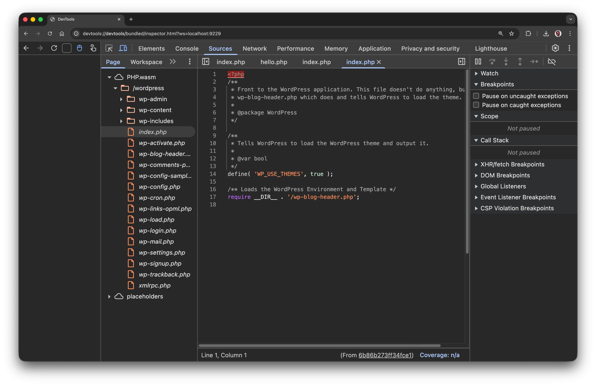
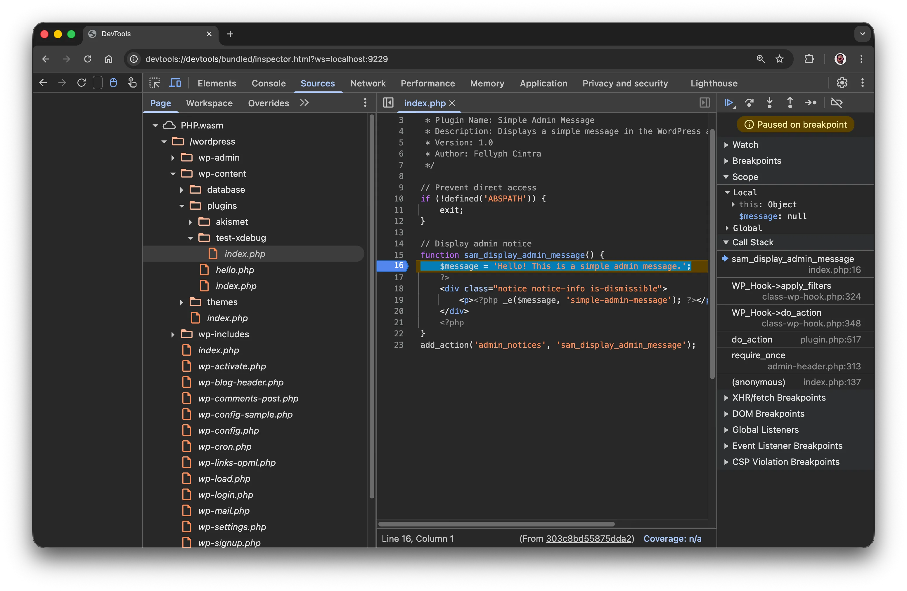
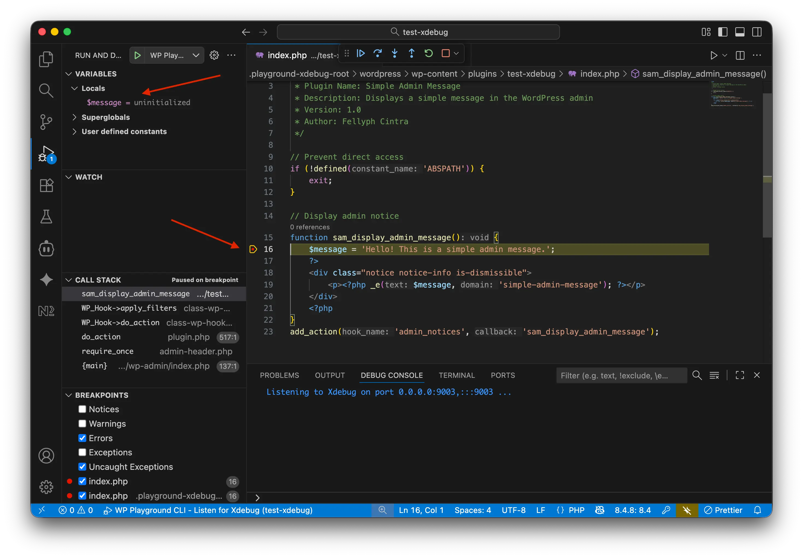

<!-- # Getting Started with Xdebug -->

# Premiers Pas avec Xdebug

<!-- This guide shows you how to enable Xdebug in WordPress Playground and start debugging your code. -->

Ce guide vous montre comment activer Xdebug dans WordPress Playground et commencer à déboguer votre code.

<!-- ## PHP WASM CLI vs Playground CLI -->

## PHP WASM CLI vs Playground CLI

<!-- First, Xdebug is present in two different CLIs: -->

Tout d'abord, Xdebug est présent dans deux CLI différents :

- **`@php-wasm/cli`** : Exécutez des scripts PHP autonomes. Utilisez-le lorsque vous déboguez du code PHP sans avoir besoin d'un environnement WordPress.
- **`@wp-playground/cli`** : Exécutez une installation complète de WordPress. Utile pour déboguer des plugins WordPress, des thèmes ou des fonctionnalités du noyau.

<!-- For this guide, we'll use `@wp-playground/cli`. If you're not familiar with the tool, we recommend reading the [`@wp-playground/cli` guide](/developers/local-development/wp-playground-cli), but the same process can also be applied to debugging PHP applications with `@php-wasm/cli`. -->

Pour ce guide, nous utiliserons `@wp-playground/cli`. Si vous n'êtes pas familier avec l'outil, nous recommandons de lire le guide [`@wp-playground/cli`](/developers/local-development/wp-playground-cli), mais le même processus peut également être appliqué au débogage d'applications PHP avec `@php-wasm/cli`.

<!-- ## Quick start with `npx` -->

## Démarrage rapide avec `npx`

<!-- The fastest way to get started is using npx, which doesn't require installation: -->

Le moyen le plus rapide de commencer est d'utiliser npx, qui ne nécessite pas d'installation :

```bash
npx @wp-playground/cli@latest server --xdebug
```

<!-- The CLI prints the WordPress URL after starting the server with Xdebug enabled. You can now connect a debugger. -->

La CLI affiche l'URL de WordPress après avoir démarré le serveur avec Xdebug activé. Vous pouvez maintenant connecter un débogueur.

<!-- Before starting another example, stop the previous Playground server with `Ctrl+C` and disconnect its debugger. -->

Avant de passer à un autre exemple, arrêtez le serveur Playground précédent avec `Ctrl+C` et déconnectez son débogueur.

<!-- ## Create the sample plugin -->

## Créer le plugin d'exemple

<!-- Create a directory named `test-xdebug` and save the following code as `test-xdebug.php` inside it. Both walkthroughs use this plugin. -->

Créez un dossier `test-xdebug` et enregistrez-y le code suivant dans un fichier nommé `test-xdebug.php`. Les deux procédures utilisent ce plugin.

```PHP
<?php
/**
 * Plugin Name: Simple Admin Message
 * Description: Displays a simple message in the WordPress admin
 * Version: 1.0
 * Author: Playground Team
 */

// Prevent direct access
if (!defined('ABSPATH')) {
    exit;
}

// Display admin notice
function sam_display_admin_message() {
    $message = 'Hello! This is a simple admin message.';
    ?>
    <div class="notice notice-info is-dismissible">
        <p><?php _e($message, 'simple-admin-message'); ?></p>
    </div>
    <?php
}
add_action('admin_notices', 'sam_display_admin_message');
```

<!-- ## Starting with DevTools -->

## Démarrer avec DevTools

<!-- To debug with Chrome DevTools, add the `--experimental-devtools` flag: -->

Pour déboguer avec Chrome DevTools, ajoutez le drapeau `--experimental-devtools` :

```bash
npx @wp-playground/cli@latest server --xdebug --experimental-devtools
```

<!-- Open the URL printed by the bridge in Chrome on the same computer. DevTools connects to the Chrome DevTools Protocol (CDP) listener at `127.0.0.1:9229`. -->

Sur le même ordinateur, ouvrez dans Chrome l'URL affichée par le pont Xdebug. DevTools se connecte à l’adresse `127.0.0.1:9229` via le protocole CDP (Chrome DevTools Protocol).

```text
Starting XDebug Bridge...
Connect Chrome DevTools to CDP at:
devtools://devtools/bundled/inspector.html?ws=127.0.0.1:9229
```

<!-- Once DevTools connects, the bridge starts listening for Xdebug (DBGp) connections at `127.0.0.1:9003`. Both listeners use IPv4 loopback by default. -->

Une fois DevTools connecté, le pont se met à l’écoute des connexions Xdebug (DBGp) à l’adresse `127.0.0.1:9003`. Par défaut, le pont écoute sur l’adresse de bouclage IPv4 pour les deux protocoles.

```text
Chrome connected! Initializing Xdebug receiver...
XDebug receiver running on 127.0.0.1:9003
Running a PHP script with Xdebug enabled...
```



<!-- If you ran the previous command, close its DevTools window and stop the server with `Ctrl+C`. Run the following command from the `test-xdebug` directory. -->

Si vous avez exécuté la commande précédente, fermez sa fenêtre DevTools et arrêtez le serveur avec `Ctrl+C`. Exécutez la commande suivante depuis le dossier `test-xdebug`.

```bash
npx @wp-playground/cli@latest server --xdebug --experimental-devtools --auto-mount
```

<!-- The Playground CLI automatically mounts and activates the plugin. Open the DevTools URL from the terminal and set a breakpoint inside `sam_display_admin_message()`. Append `/wp-admin/plugins.php` to the WordPress URL printed by the CLI and open the resulting URL in your browser to hit the breakpoint. If WordPress asks you to sign in, use `admin` as the username and `password` as the password. -->

La CLI de Playground monte et active automatiquement le plugin. Ouvrez l'URL de DevTools affichée dans le terminal et placez un point d'arrêt dans `sam_display_admin_message()`. Pour déclencher le point d'arrêt, ajoutez `/wp-admin/plugins.php` à l'URL de WordPress affichée par la CLI, puis ouvrez cette adresse dans votre navigateur. Si WordPress vous demande de vous connecter, utilisez `admin` comme identifiant et `password` comme mot de passe.



<!-- ## Starting with IDE integration -->

## Démarrer avec l'intégration IDE

<!-- To debug the sample plugin with VS Code, use the `--experimental-unsafe-ide-integration=vscode` flag. For PhpStorm, open `test-xdebug` as a PhpStorm project first and make sure it contains an `.idea/` directory. In the command below, replace the VS Code flag with `--experimental-unsafe-ide-integration=phpstorm`. -->

Pour déboguer le plugin d'exemple avec VS Code, utilisez l'option `--experimental-unsafe-ide-integration=vscode`. Pour PhpStorm, ouvrez d'abord `test-xdebug` en tant que projet PhpStorm et vérifiez qu'il contient un dossier `.idea/`. Dans la commande ci-dessous, remplacez l'option de VS Code par `--experimental-unsafe-ide-integration=phpstorm`.

<!-- To debug in VSCode you'll need the following prerequisites: -->

Pour déboguer dans VSCode, vous aurez besoin des prérequis suivants :

1. Installez une extension de débogage PHP compatible avec Xdebug, comme [PHP Debug](https://marketplace.visualstudio.com/items?itemName=xdebug.php-debug).
2. Un dossier `.vscode/`. Si le fichier `launch.json` n'existe pas, ne vous inquiétez pas, `@wp-playground/cli` le créera.
3. Activez les points d'arrêt (breakpoints) dans votre IDE. Certains IDE ont cette fonctionnalité désactivée par défaut, alors faites attention à ce détail.

<!-- Run the following command from the plugin directory. -->

Exécutez la commande suivante depuis le dossier du plugin.

```bash
npx @wp-playground/cli@latest server --xdebug --experimental-unsafe-ide-integration=vscode --auto-mount
```

<!-- Start the **WP Playground CLI - Listen for Xdebug** configuration in your IDE and set a breakpoint inside `sam_display_admin_message()`. Append `/wp-admin/plugins.php` to the WordPress URL printed by the CLI and open the resulting URL in your browser to hit the breakpoint. If WordPress asks you to sign in, use `admin` as the username and `password` as the password. -->

Lancez la configuration **WP Playground CLI - Listen for Xdebug** dans votre IDE et placez un point d'arrêt dans `sam_display_admin_message()`. Pour déclencher le point d'arrêt, ajoutez `/wp-admin/plugins.php` à l'URL de WordPress affichée par la CLI, puis ouvrez cette adresse dans votre navigateur. Si WordPress vous demande de vous connecter, utilisez `admin` comme identifiant et `password` comme mot de passe.



<!-- ### PhpStorm troubleshooting -->

### Dépannage de PhpStorm

<!-- If PhpStorm pauses on the first line of unmapped files or scripts outside your project, you can disable these optional settings under **Settings > PHP > Debug > Xdebug**: -->

Si PhpStorm s’arrête à la première ligne de fichiers sans correspondance de chemin ou de scripts situés en dehors de votre projet, vous pouvez désactiver ces options dans **Settings > PHP > Debug > Xdebug** :

- **Force break at first line when no path mapping specified**.
- **Force break at first line when a script is outside the project**.

<!-- If requests that do not hit a breakpoint produce unwanted notifications, disable **Notify if debug session was finished without being paused** under **Settings > PHP > Debug > Settings** (called **Advanced settings** in the current JetBrains documentation). When this setting is disabled and no breakpoint is hit, PhpStorm runs the script without pausing or establishing a debugging session. -->

Si les requêtes qui n’atteignent aucun point d’arrêt génèrent des notifications indésirables, désactivez **Notify if debug session was finished without being paused** dans **Settings > PHP > Debug > Settings** (appelé **Advanced settings** dans la documentation actuelle de JetBrains). Lorsque cette option est désactivée et qu’aucun point d’arrêt n’est atteint, PhpStorm exécute le script sans s’arrêter ni ouvrir de session de débogage.

<!-- These options suppress unwanted pauses or notifications. They do not fix path mappings or configure breakpoints: you still need correct path mappings and enabled breakpoints in the code you want to debug. -->

Ces options évitent les pauses ou les notifications indésirables. Elles ne corrigent pas les correspondances de chemins et ne configurent pas les points d’arrêt : vous devez toujours disposer de correspondances de chemins correctes et de points d’arrêt activés dans le code que vous souhaitez déboguer.

<!-- For more details, see [JetBrains' debug settings reference](https://www.jetbrains.com/help/phpstorm/debug.html) and the [PhpStorm examples](https://github.com/WordPress/wordpress-playground/blob/trunk/examples/xdebug/ide/README.md#phpstorm). -->

Pour plus de détails, consultez la [référence des paramètres de débogage de JetBrains](https://www.jetbrains.com/help/phpstorm/debug.html) et les [exemples pour PhpStorm](https://github.com/WordPress/wordpress-playground/blob/trunk/examples/xdebug/ide/README.md#phpstorm).

<!-- This feature is in experimental mode. Until it is completed, we will need your feedback. Please connect with us in the [#playground Slack channel](https://wordpress.slack.com/archives/C04EWKGDJ0K) and share your thoughts. -->

Cette fonctionnalité est en mode expérimental. Jusqu'à ce qu'elle soit terminée, nous aurons besoin de vos commentaires. Veuillez vous connecter avec nous dans le [canal Slack #playground](https://wordpress.slack.com/archives/C04EWKGDJ0K) et partager vos réflexions.
