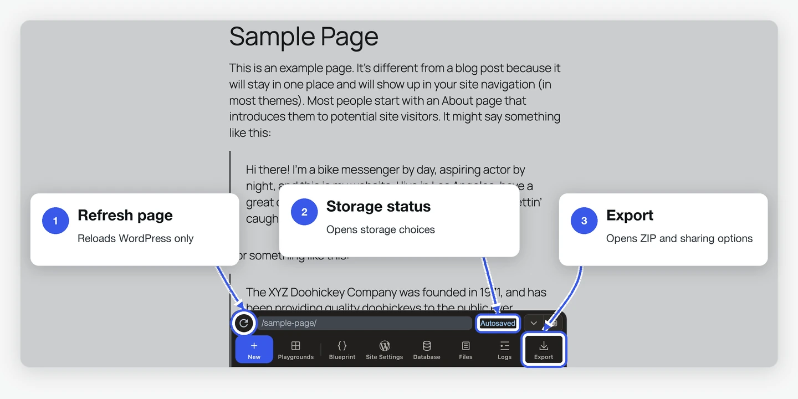
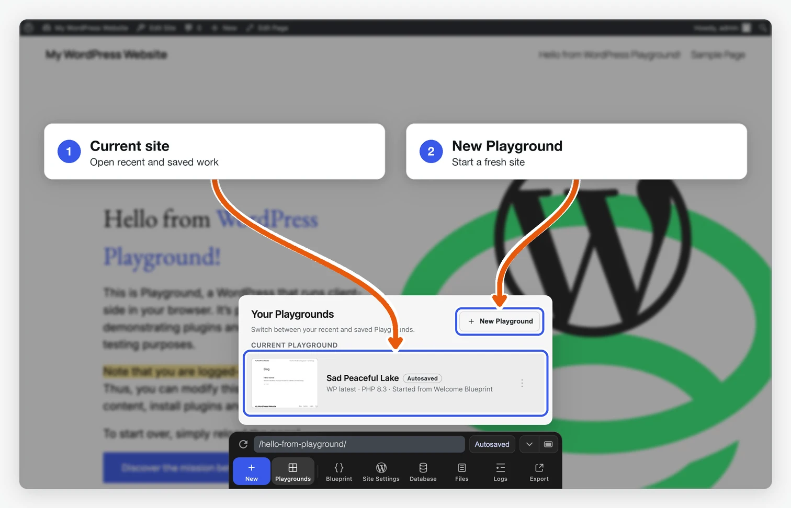
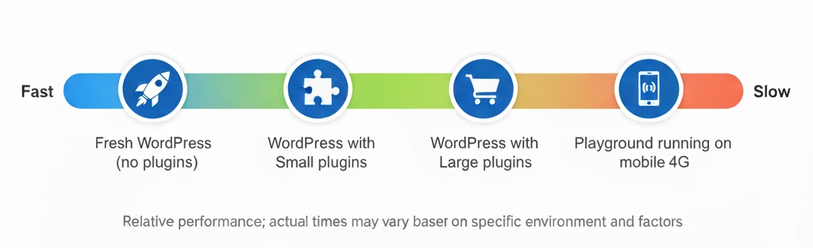

<!--
description: Learn about the current limitations of WordPress Playground, including browser-specific behaviors, browser persistence and recovery constraints, iframe quirks, and WP-CLI support.
-->

# Limitations

<!--
# Limitations
-->

WordPress Playground est en développement actif et présente certaines limitations à garder à l’esprit lorsque vous l’utilisez.

<!--
WordPress Playground is under active development and has some limitations you should keep in mind when running it and developing with it.
-->

Vous pouvez suivre l’état de ces sujets sur le [tableau du projet Playground](https://github.com/orgs/WordPress/projects/180).

<!-- ## In the browser -->

## Dans le navigateur

### Stockage et récupération dans le navigateur

<!--
### Browser storage and recovery
-->

Playground exécute WordPress dans le navigateur. Lorsque le stockage et l’enregistrement sont disponibles, les nouveaux sites sont enregistrés automatiquement et apparaissent dans **Your Playgrounds**. Playground conserve les cinq sites enregistrés automatiquement les plus récents. À la création du sixième, le plus ancien est supprimé. Pour conserver un site à long terme, enregistrez-le de façon permanente ou exportez-le au format ZIP.

<!--
Playground runs WordPress in the browser. New Playgrounds are autosaved when
browser storage and saving are available, and they appear in **Your
Playgrounds**. Playground keeps up to five recent autosaves. After five exist,
creating another deletes the oldest one. Autosaves are recovery points, not
long-term backups. Store an autosave permanently or export a ZIP when you want
to keep it.
-->

Trois modes de stockage sont disponibles :

<!--
Use these storage modes deliberately:
-->

- **Enregistrement automatique** : le site reste dans le navigateur tant qu’il figure parmi les cinq sites enregistrés automatiquement les plus récents.
- **Enregistrement permanent** : le site est conservé dans le navigateur ou dans un répertoire local.
- **Site temporaire** : ce mode est utilisé avec `?storage=temp` ou lorsque l’enregistrement est indisponible. Le site est supprimé à la fermeture de l’onglet ou au rechargement de la page du navigateur.

<!--
- **Autosaved**: stored in browser storage and retained only while it is one of up to five recent autosaves.
- **Saved**: stored permanently in browser storage or saved to a local directory.
- **Temporary**: created with `?storage=temp` or when saving is unavailable. It is discarded when the tab closes or the browser page refreshes.
-->

Le bouton **Refresh page** de Playground recharge la page WordPress du site en cours. Avec Cmd+R ou F5, le navigateur recharge toute l’application. Vous pouvez ensuite retrouver un site enregistré automatiquement ou de façon permanente. Un site temporaire est perdu.

<!--
The Playground **Refresh page** button reloads the WordPress page inside the current Playground. Browser refresh (Cmd+R or F5) reloads the whole Playground app. A stored or autosaved Playground can recover after that reload, but a temporary Playground cannot.
-->



<!--

-->

Le navigateur gère les données qu’il stocke. Elles peuvent disparaître si l’espace vient à manquer, si vous utilisez la navigation privée, si vous changez de profil ou si vous effacez les données du site. Exportez un fichier ZIP pour obtenir une sauvegarde que vous pourrez transférer.

<!--
Browser storage still belongs to the browser. Storage pressure, private browsing, profile changes, or clearing site data can remove it. Export a ZIP when you need a portable backup.
-->



<!--

-->

<!-- ### Browser support -->

### Compatibilité des navigateurs

<!--
### Browser support
-->

WordPress Playground est pensé pour fonctionner sur les principaux navigateurs de bureau et mobiles. Cela inclut :

<!--
WordPress Playground is designed to work across all major desktop and mobile browsers. This includes:
-->

- **Navigateurs de bureau** : Chrome, Firefox, Safari, Edge et autres navigateurs basés sur Chromium
- **Navigateurs mobiles** : Safari (iOS), Chrome (Android) et autres variantes

<!--
- **Desktop browsers**: Chrome, Firefox, Safari, Edge, and other Chromium-based browsers
- **Mobile browsers**: Safari (iOS), Chrome (Android), and other mobile browser variants
-->

Playground s’appuie sur des technologies web récentes et doit se comporter de façon cohérente dans ces environnements. Toutefois, certaines fonctionnalités avancées peuvent être prises en charge différemment selon le navigateur et sa version.

<!--
Playground leverages modern web technologies and should function consistently across these browser environments. However, some advanced features may have varying levels of support depending on the specific browser and its version.
-->

### Attentes de performance

<!--
### Performance expectations
-->

Le temps de chargement dépend de ce que Playground doit installer.

<!--
Loading times vary based on what Playground needs to set up:
-->

| Scénario                                        | Temps de chargement typique           |
| ----------------------------------------------- | ------------------------------------- |
| WordPress seul (sans extensions)                | 5 à 10 secondes                       |
| Avec de petites extensions                      | 10 à 20 secondes                      |
| Avec de grosses extensions (p. ex. WooCommerce) | 30 à 60 secondes                      |
| Sur appareils mobiles                           | 1,5 à 2× plus lent que sur ordinateur |

<!--
| Scenario                               | Typical Load Time          |
| -------------------------------------- | -------------------------- |
| Fresh WordPress (no plugins)           | 5-10 seconds               |
| With small plugins                     | 10-20 seconds              |
| With large plugins (e.g., WooCommerce) | 30-60 seconds              |
| On mobile devices                      | 1.5-2x slower than desktop |
-->



**Facteurs qui influencent les performances :**

<!--
**Factors that affect performance:**
-->

- **Taille des extensions** : les grosses extensions mettent plus longtemps à s’installer à l’exécution
- **Débit réseau** : au premier chargement, le navigateur télécharge l’environnement d’exécution PHP en WebAssembly. La taille du téléchargement dépend de la version de PHP et de sa compilation
- **Mémoire de l’appareil** : l’allocation mémoire WASM initiale est de 64 Mo, puis augmente dynamiquement si besoin. Les appareils peu dotés en mémoire peuvent ralentir
- **Navigateur** : Chrome et Edge offrent en général les meilleures performances ; Safari est légèrement plus lent

<!--
- **Plugin size**: Large plugins take longer to install at runtime
- **Network speed**: The first load downloads the PHP WebAssembly runtime. Download size varies by PHP version and build
- **Device memory**: Initial WASM memory allocation is 64MB, growing dynamically as needed. Low-memory devices may experience slowdowns
- **Browser**: Chrome/Edge perform best; Safari slightly slower
-->

<blockquote>
<strong>Note :</strong> la prise en charge d’Opera Mini n’est pas confirmée pour l’instant.
</blockquote>

<!-- ## When developing with Playground -->

## Lors du développement avec Playground

<!-- ### Iframe quirks -->

### Particularités des iframes

<!--
### Iframe quirks
-->

Playground affiche WordPress dans un [`iframe`](/developers/architecture/browser-iframe-rendering) : cliquer sur des liens avec `target="_top"` recharge donc la page sur laquelle vous travaillez.

<!--
Playground renders WordPress in an [`iframe`](/developers/architecture/browser-iframe-rendering) so clicking links with `target="_top"` will reload the page you're working on.
-->

De plus, les fenêtres popup JavaScript issues de l’`iframe` ne s’affichent pas toujours.

<!-- ### Run WordPress PHP functions -->

### Exécuter des fonctions PHP WordPress

<!--
### Run WordPress PHP functions
-->

Playground permet d’exécuter du code PHP dans les Blueprints via l’[étape `runPHP`](/blueprints/steps#RunPHPStep). Pour appeler des fonctions PHP propres à WordPress, il faut d’abord inclure [wp-load.php](https://github.com/WordPress/WordPress/blob/master/wp-load.php) :

<!--
Playground supports running PHP code in Blueprints using the [`runPHP` step](/blueprints/steps#RunPHPStep). To run WordPress-specific PHP functions, you'd need to first require [wp-load.php](https://github.com/WordPress/WordPress/blob/master/wp-load.php):
-->

```json
{
	"step": "runPHP",
	"code": "<?php require_once('wordpress/wp-load.php'); OTHER_CODE ?>"
}
```

<!-- ### Using WP-CLI -->

### Utilisation de WP-CLI

<!--
### Using WP-CLI
-->

Vous pouvez exécuter des commandes `wp-cli` via l’[étape `wp-cli`](/blueprints/steps#WPCLIStep) des Blueprints. Comme Playground s’exécute dans le navigateur, il ne prend pas en charge la [totalité](https://developer.wordpress.org/cli/commands/) des commandes disponibles. Il n’existe pas de liste officielle des commandes prises en charge ; tester [la démo en ligne](https://playground.wordpress.net/demos/wp-cli.html) permet d’en juger.

<!--
You can execute `wp-cli` commands via the Blueprints [`wp-cli`](/blueprints/steps#WPCLIStep) step. However, since Playground runs in the browser, it doesn't support the [full array](https://developer.wordpress.org/cli/commands/) of available commands. While there is no definite list of supported commands, experimenting in [the online demo](https://playground.wordpress.net/demos/wp-cli.html) will help you assess what's possible.
-->

Avec [Playground CLI](/developers/local-development/wp-playground-cli), la commande `php` peut exécuter des scripts PHP, y compris un fichier `wp-cli.phar` monté, directement dans l’environnement d’exécution PHP WASM.

<!--
When using the [Playground CLI](/developers/local-development/wp-playground-cli), the `php` command can run PHP scripts, including a mounted `wp-cli.phar`, directly in the WASM PHP runtime.
-->

## Améliorations récentes {#recent-improvements}

<!--
## Recent improvements {#recent-improvements}
-->

Plusieurs limitations antérieures ont été levées :

<!--
Several previous limitations have been addressed:
-->

- **Téléchargements de fichiers volumineux dans Playground CLI (>2 Go)** : la CLI peut désormais diffuser les réponses directement au lieu de les mettre en mémoire tampon, ce qui permet d’exporter des sites volumineux (p. ex. des sauvegardes All-in-One WP Migration) qui échouaient auparavant.
- **Téléversements de fichiers via cURL en PHP** : les envois de formulaires multipart via `CURLFile` fonctionnent correctement dans le navigateur. Le blocage lié à `Expect: 100-continue` et les problèmes de transmission multipart via le proxy CORS sont résolus.
- **Réponses PHP longues** : le service worker diffuse désormais le corps de la réponse après avoir reçu les en-têtes, au lieu de mettre en mémoire tampon la réponse entière. Le corps de la réponse n’est donc pas soumis au délai d’expiration de 25 secondes des messages, et les importations de site ainsi que les autres opérations longues peuvent se poursuivre après la réception des en-têtes.
- **Gestion des erreurs de téléchargement** : lorsqu’un téléchargement requis de WASM ou de script échoue à cause d’un problème de réseau, d’un bloqueur de publicités ou d’un problème similaire, Playground affiche une boîte d’erreur utile au lieu d’une page vide.

<!--
- **Large file downloads in Playground CLI (>2 GB)**: The CLI can now stream responses directly instead of buffering them in memory, enabling large site exports (e.g., All-in-One WP Migration backups) that previously failed.
- **PHP cURL file uploads**: Multipart form uploads via `CURLFile` now work correctly in the browser. The `Expect: 100-continue` deadlock and CORS proxy multipart forwarding issues have been resolved.
- **Long-running PHP responses**: The service worker now streams the response body after receiving the headers instead of buffering the entire response. This keeps the response body outside the 25-second message timeout, so site imports and other long-running operations can continue after the headers are received.
- **Download error handling**: When a required WASM or script download fails because of a network issue, an ad blocker, or a similar problem, Playground displays a helpful error modal instead of a blank page.
-->
