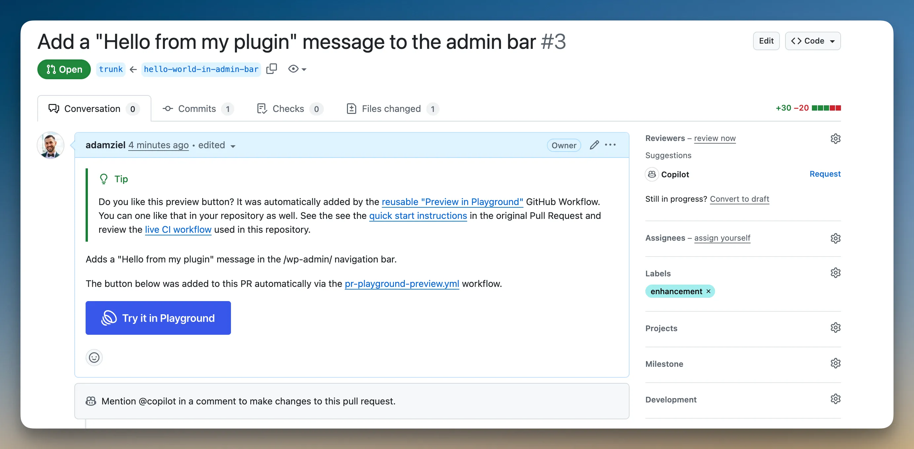

<!--
The Playground PR Preview action adds a preview button to your pull requests. Clicking the button launches Playground with your plugin or theme installed from the PR branch:
-->

L’action Playground PR Preview ajoute un bouton d’aperçu à vos pull requests. Cliquer sur ce bouton lance Playground avec votre extension ou thème installé depuis la branche de la PR :

<!--

-->


<!--
Start with the setup that matches your repository:
-->

Commencez par la configuration qui correspond à votre dépôt :

<!--
| Your repository                                                           | Use this setup                                                                  |
| ------------------------------------------------------------------------- | ------------------------------------------------------------------------------- |
| Plugin or theme works directly from the repository checkout               | [No build step](#no-build-step)                                                 |
| Plugin or theme needs Composer, npm, Vite, or another build command first | [With a build step](#with-a-build-step)                                         |
| Public fork PRs need working previews                                     | [With a build step](#with-a-build-step)                                         |
| Private repository                                                        | The default setup is not enough; Playground needs public, unauthenticated URLs. |
-->

| Votre dépôt                                                                                        | Configuration à utiliser                                                                                           |
| -------------------------------------------------------------------------------------------------- | ------------------------------------------------------------------------------------------------------------------ |
| L’extension ou le thème fonctionne directement avec les fichiers du dépôt                          | [Sans étape de compilation](#no-build-step)                                                                        |
| L’extension ou le thème nécessite d’abord Composer, npm, Vite ou une autre commande de compilation | [Avec une étape de compilation](#with-a-build-step)                                                                |
| Les PR de forks publics nécessitent des aperçus fonctionnels                                       | [Avec une étape de compilation](#with-a-build-step)                                                                |
| Dépôt privé                                                                                        | La configuration par défaut ne suffit pas ; Playground a besoin d’URL publiques accessibles sans authentification. |

<!--
If you are not sure, use the no-build setup only when the files committed to the pull request are exactly the files WordPress should run. If CI must generate anything first, use the build-step setup.
-->

En cas de doute, utilisez la configuration sans compilation uniquement si les fichiers inclus dans la pull request sont exactement ceux que WordPress doit exécuter. Si l’intégration continue (CI) doit d’abord générer des fichiers, utilisez la configuration avec compilation.

<!--
For complete configuration options, recipes, and reference tables, see the [action-wp-playground-pr-preview documentation](https://wordpress.github.io/action-wp-playground-pr-preview/).
-->

Pour consulter toutes les options de configuration, les recettes et les tableaux de référence, reportez-vous à la [documentation de l’action action-wp-playground-pr-preview](https://wordpress.github.io/action-wp-playground-pr-preview/).

<!--
## How it works
-->

## Fonctionnement

<!--
Playground runs WordPress in the browser. Anything Playground installs, such as a plugin ZIP, theme ZIP, or WXR file, must be available at a public URL when someone clicks the preview button.
-->

Playground exécute WordPress dans le navigateur. Tout ce qu’il installe, comme un ZIP d’extension, un ZIP de thème ou un fichier WXR, doit être disponible à une URL publique au moment où quelqu’un clique sur le bouton d’aperçu.

<!--
The action uses two URL strategies:
-->

L’action utilise deux stratégies d’URL :

<!--
- `git:directory`: Playground fetches the repository at the pull request ref. Use this for the no-build setup.
- Release assets: CI builds ZIP files and uploads them to a public `ci-artifacts` prerelease. Use this when the preview needs Composer dependencies, npm output, compiled assets, or any other generated files.
-->

- `git:directory` : Playground récupère le dépôt à la référence de la pull request. Utilisez cette option pour la configuration sans compilation.
- Fichiers de version : la CI génère des fichiers ZIP et les envoie vers une préversion publique appelée `ci-artifacts`. Utilisez cette option lorsque l’aperçu nécessite des dépendances Composer, des fichiers générés par npm, des ressources compilées ou d’autres fichiers générés.

<div class="callout callout-warning">

<!--
**Use the action and reusable workflows in different places**
-->

**Placez l’action et les flux de travail réutilisables à des niveaux différents**

<!--
The direct action, `WordPress/action-wp-playground-pr-preview@v4`, is a regular GitHub Action. Reference it as a step under `jobs.<job_id>.steps[].uses`.
-->

L’action directe, `WordPress/action-wp-playground-pr-preview@v4`, est une action GitHub classique. Référencez-la comme une étape dans `jobs.<job_id>.steps[].uses`.

<!--
The build-step setup uses reusable workflows, `preview-build.yml@v4` and `preview-publish.yml@v4`. Reference those at the job level under `jobs.<job_id>.uses`.
-->

La configuration avec compilation utilise les flux de travail réutilisables `preview-build.yml@v4` et `preview-publish.yml@v4`. Référencez-les au niveau du job, dans `jobs.<job_id>.uses`.

</div>

<!--
## No build step
-->

## Sans étape de compilation {#no-build-step}

<!--
Use this setup when your plugin or theme can run directly from the repository checkout, with no Composer install, npm build, or asset pipeline.
-->

Utilisez cette configuration lorsque votre extension ou thème fonctionne directement avec les fichiers du dépôt, sans installation de dépendances Composer, compilation npm ni traitement de ressources.

<!--
Create `.github/workflows/pr-preview.yml`:
-->

Créez `.github/workflows/pr-preview.yml` :

```yaml
name: PR Preview
on:
    pull_request:
        types: [opened, synchronize, reopened, edited]

jobs:
    preview:
        runs-on: ubuntu-latest
        permissions:
            contents: read
            pull-requests: write
        steps:
            - uses: WordPress/action-wp-playground-pr-preview@v4
              with:
                  plugin-path: .
                  github-token: ${{ secrets.GITHUB_TOKEN }}
```

<!--
Use `theme-path: .` instead of `plugin-path: .` for a theme:
-->

Pour un thème, utilisez `theme-path: .` à la place de `plugin-path: .` :

```yaml
with:
    theme-path: .
    github-token: ${{ secrets.GITHUB_TOKEN }}
```

<!--
Use a subdirectory when the plugin or theme is not at the repository root:
-->

Utilisez un sous-répertoire lorsque l’extension ou le thème ne se trouve pas à la racine du dépôt :

```yaml
with:
    plugin-path: plugins/my-plugin
    github-token: ${{ secrets.GITHUB_TOKEN }}
```

<!--
You do not need to create `secrets.GITHUB_TOKEN`; GitHub provides it automatically. The `permissions` block gives that token the access this action needs.
-->

Vous n’avez pas besoin de créer `secrets.GITHUB_TOKEN` ; GitHub le fournit automatiquement. Le bloc `permissions` accorde à ce jeton les accès nécessaires à l’action.

<!--
Open a pull request. The action updates the PR description with a managed Preview button block. Clicking the button opens Playground with your plugin or theme installed and activated from the pull request ref.
-->

Ouvrez une pull request. L’action met à jour la description de la PR avec un bloc géré contenant le bouton d’aperçu. Cliquer sur ce bouton ouvre Playground avec votre extension ou thème installé et activé depuis la référence de la pull request.

<div class="callout callout-warning">

<!--
**Fork PR note**
-->

**Remarque sur les PR de forks**

<!--
This one-workflow setup is simplest for same-repository PRs. Public fork PRs usually receive a read-only `GITHUB_TOKEN`, so the action may be unable to edit the PR description. If fork contributors need working previews, use the [build-step setup](#with-a-build-step) even when the build command only creates a ZIP.
-->

Cette configuration à un seul flux de travail est la plus simple pour les PR du même dépôt. Les PR de forks publics reçoivent généralement un `GITHUB_TOKEN` en lecture seule ; l’action peut donc ne pas pouvoir modifier la description de la PR. Si les personnes qui contribuent depuis des forks ont besoin d’aperçus fonctionnels, utilisez la [configuration avec compilation](#with-a-build-step), même si la commande ne fait que créer un ZIP.

<!--
Do not switch this workflow to `pull_request_target` to run PR code with write permissions.
-->

Ne remplacez pas le déclencheur de ce flux de travail par `pull_request_target` pour exécuter le code de la PR avec des droits d’écriture.

</div>

<!--
## With a build step
-->

## Avec une étape de compilation {#with-a-build-step}

<!--
Use this setup when the preview needs generated files, such as Composer dependencies, npm or Vite bundles, or another build output. It also gives public fork PRs a safe path to working previews.
-->

Utilisez cette configuration lorsque l’aperçu nécessite des fichiers générés, comme des dépendances Composer, des bundles npm ou Vite, ou d’autres résultats de compilation. Elle offre également un moyen sûr de fournir des aperçus fonctionnels pour les PR de forks publics.

<!--
Create two workflow files:
-->

Créez deux fichiers de flux de travail :

<!--
- A build workflow that runs on `pull_request` with read-only permissions, runs your build command, and uploads ZIP files as a GitHub Actions artifact.
- A publish workflow that runs on `workflow_run` after the build succeeds, uploads those ZIP files to a public release URL, builds a Blueprint, and posts the preview button.
-->

- Un flux de compilation qui s’exécute sur `pull_request` avec des droits en lecture seule, lance votre commande de compilation et envoie les ZIP sous forme d’artefact GitHub Actions.
- Un flux de publication qui s’exécute sur `workflow_run` après la réussite de la compilation, envoie ces ZIP vers une URL publique de version, crée un Blueprint et publie le bouton d’aperçu.

<!--
### Build workflow
-->

### Flux de compilation

<!--
Create `.github/workflows/pr-preview-build.yml`:
-->

Créez `.github/workflows/pr-preview-build.yml` :

```yaml
name: PR Preview - Build
on:
    pull_request:
        types: [opened, synchronize, reopened, edited]

jobs:
    build:
        uses: WordPress/action-wp-playground-pr-preview/.github/workflows/preview-build.yml@v4
        with:
            artifacts: my-plugin=build/my-plugin.zip
            node-version: '20'
            build-command: |
                npm ci
                npm run build:plugin-zip
```

<!--
In `artifacts: my-plugin=build/my-plugin.zip`, `my-plugin` is the artifact name and `build/my-plugin.zip` is the ZIP file your `build-command` must create. The ZIP should extract to a plugin or theme slug folder, such as `my-plugin/my-plugin.php`, not directly to files at the ZIP root.
-->

Dans `artifacts: my-plugin=build/my-plugin.zip`, `my-plugin` est le nom de l’artefact et `build/my-plugin.zip` est le fichier ZIP que votre `build-command` doit créer. Le ZIP doit s’extraire dans un dossier portant le slug de l’extension ou du thème, par exemple `my-plugin/my-plugin.php`, et non directement sous forme de fichiers à la racine.

<!--
### Publish workflow
-->

### Flux de publication

<!--
Create `.github/workflows/pr-preview-publish.yml`:
-->

Créez `.github/workflows/pr-preview-publish.yml` :

```yaml
name: PR Preview - Publish
on:
    workflow_run:
        workflows: ['PR Preview - Build']
        types: [completed]

permissions:
    contents: write
    pull-requests: write

jobs:
    publish:
        permissions:
            contents: write
            pull-requests: write
        uses: WordPress/action-wp-playground-pr-preview/.github/workflows/preview-publish.yml@v4
        with:
            kind: plugin
```

<!--
Use `kind: theme` for one theme ZIP. For multiple ZIPs or extra setup steps, use a custom `blueprint:` as shown in [Built artifacts with a custom blueprint](#built-artifacts-with-a-custom-blueprint).
-->

Utilisez `kind: theme` pour un seul ZIP de thème. Pour plusieurs ZIP ou des étapes de configuration supplémentaires, utilisez un `blueprint:` personnalisé, comme indiqué dans [Artefacts compilés avec un Blueprint personnalisé](#built-artifacts-with-a-custom-blueprint).

<!--
Open a pull request. The build workflow runs your build command. After it succeeds, the publish workflow creates or updates the `ci-artifacts` prerelease, uploads the built ZIP, and adds a Preview button to the PR description.
-->

Ouvrez une pull request. Le flux de compilation lance votre commande de compilation. Une fois celle-ci terminée avec succès, le flux de publication crée ou met à jour la préversion `ci-artifacts`, envoie le ZIP généré et ajoute un bouton d’aperçu à la description de la PR.

<div class="callout callout-info">

<!--
**Why two workflow files?**
-->

**Pourquoi deux fichiers de flux de travail ?**

<!--
GitHub does not allow one workflow to safely run untrusted code from a fork PR and write to releases or PR descriptions. The build workflow runs PR code with read-only permissions. The publish workflow runs later from the default branch with write permissions and never checks out or runs PR code.
-->

GitHub ne permet pas à un même flux de travail d’exécuter en toute sécurité du code non fiable provenant d’une PR de fork et d’écrire dans les versions ou les descriptions de PR. Le flux de compilation exécute le code de la PR avec des droits en lecture seule. Le flux de publication s’exécute ensuite depuis la branche par défaut avec des droits d’écriture, sans jamais faire de checkout ni exécuter le code de la PR.

</div>

<!--
## Custom blueprints
-->

## Blueprints personnalisés

<!--
Use Blueprints to configure the Playground environment. You can install companion plugins, set WordPress options, import content, pin PHP and WordPress versions, open a specific page, or log in as an admin user.
-->

Utilisez les Blueprints pour configurer l’environnement Playground. Vous pouvez installer des extensions complémentaires, définir des options WordPress, importer du contenu, fixer les versions de PHP et WordPress, ouvrir une page précise ou vous connecter avec un compte d’administration.

<!--
For a no-build preview, provide a full Blueprint with the direct action:
-->

Pour un aperçu sans compilation, fournissez un Blueprint complet à l’action directe :

```yaml
- uses: WordPress/action-wp-playground-pr-preview@v4
  with:
      blueprint: |
          {
            "$schema": "https://playground.wordpress.net/blueprint-schema.json",
            "preferredVersions": { "php": "8.3", "wp": "6.6" },
            "steps": [
              {
                "step": "installPlugin",
                "pluginData": {
                  "resource": "git:directory",
                  "url": "https://github.com/${{ github.repository }}.git",
                  "ref": "${{ github.event.pull_request.head.ref }}",
                  "path": "/"
                },
                "options": { "activate": true }
              },
              {
                "step": "installPlugin",
                "pluginData": {
                  "resource": "wordpress.org/plugins",
                  "slug": "woocommerce"
                },
                "options": { "activate": true }
              },
              { "step": "login", "username": "admin" }
            ]
          }
      github-token: ${{ secrets.GITHUB_TOKEN }}
```

<!--
Or reference a hosted Blueprint:
-->

Ou référencez un Blueprint hébergé :

```yaml
- uses: WordPress/action-wp-playground-pr-preview@v4
  with:
      blueprint-url: https://example.com/path/to/blueprint.json
      github-token: ${{ secrets.GITHUB_TOKEN }}
```

<!--
Choose the Blueprint input based on where the JSON comes from:
-->

Choisissez le paramètre du Blueprint selon l’origine du JSON :

<!--
- Use `blueprint` when the direct action or publish workflow can include the full JSON string.
- Use `blueprint-url` with the direct action when the JSON is already hosted at a public URL.
- Use `blueprint-from-build` in `preview-build.yml` together with `blueprint-from-artifact: true` in `preview-publish.yml` when the build workflow generates `blueprint.json` dynamically.
-->

- Utilisez `blueprint` lorsque l’action directe ou le flux de publication peut inclure la chaîne JSON complète.
- Utilisez `blueprint-url` avec l’action directe lorsque le JSON est déjà hébergé à une URL publique.
- Utilisez `blueprint-from-build` dans `preview-build.yml` avec `blueprint-from-artifact: true` dans `preview-publish.yml` lorsque le flux de compilation génère `blueprint.json` dynamiquement.

<!--
See [Blueprints documentation](/blueprints) for all available steps and configuration options.
-->

Consultez la [documentation des Blueprints](/blueprints) pour connaître toutes les étapes et options de configuration disponibles.

<!--
## Built artifacts with a custom blueprint
-->

## Artefacts compilés avec un Blueprint personnalisé {#built-artifacts-with-a-custom-blueprint}

<!--
Use a custom Blueprint in the publish workflow when a built preview needs more than the default “install and activate” behavior. Common reasons include installing multiple ZIP files, opening a specific admin page, installing PHP extension bundles, or logging in automatically.
-->

Utilisez un Blueprint personnalisé dans le flux de publication lorsqu’un aperçu compilé nécessite davantage que le comportement par défaut « installer et activer ». Cela peut être nécessaire pour installer plusieurs ZIP, ouvrir une page d’administration précise, installer des bundles d’extensions PHP ou se connecter automatiquement.

<!--
Put `artifacts` and `build-command` under `jobs.build.with` in `.github/workflows/pr-preview-build.yml`:
-->

Placez `artifacts` et `build-command` dans `jobs.build.with`, dans `.github/workflows/pr-preview-build.yml` :

```yaml
jobs:
    build:
        uses: WordPress/action-wp-playground-pr-preview/.github/workflows/preview-build.yml@v4
        with:
            artifacts: my-plugin=build/my-plugin.zip
            php-version: '8.2'
            build-command: |
                set -euo pipefail
                composer install --no-dev --optimize-autoloader --no-interaction
                mkdir -p build/my-plugin
                rsync -a --delete \
                    --exclude='.git' \
                    --exclude='.github' \
                    --exclude='build' \
                    ./ build/my-plugin/
                ( cd build && zip -qr my-plugin.zip my-plugin )
```

<!--
Then put `blueprint` under `jobs.publish.with` in `.github/workflows/pr-preview-publish.yml`:
-->

Placez ensuite `blueprint` dans `jobs.publish.with`, dans `.github/workflows/pr-preview-publish.yml` :

```yaml
jobs:
    publish:
        permissions:
            contents: write
            pull-requests: write
        uses: WordPress/action-wp-playground-pr-preview/.github/workflows/preview-publish.yml@v4
        with:
            blueprint: |
                {
                  "$schema": "https://playground.wordpress.net/blueprint-schema.json",
                  "landingPage": "/wp-admin/admin.php?page=my-plugin",
                  "steps": [
                    { "step": "login", "username": "admin", "password": "password" },
                    {
                      "step": "installPlugin",
                      "pluginData": {
                        "resource": "url",
                        "url": "{{ARTIFACT_URL:my-plugin}}"
                      },
                      "options": { "activate": true }
                    }
                  ]
                }
```

<!--
`{{ARTIFACT_URL:my-plugin}}` is replaced with the public URL of the matching ZIP. The name must match the left side of the corresponding `artifacts` entry.
-->

`{{ARTIFACT_URL:my-plugin}}` est remplacé par l’URL publique du ZIP correspondant. Le nom doit correspondre à la partie gauche de l’entrée concernée dans `artifacts`.

<!--
For a theme ZIP, use `installTheme` with `themeData`. Custom Blueprints must use `pluginData` or `themeData` to satisfy the current Blueprint schema; the older `pluginZipFile` and `themeZipFile` fields are deprecated.
-->

Pour un ZIP de thème, utilisez `installTheme` avec `themeData`. Les Blueprints personnalisés doivent utiliser `pluginData` ou `themeData` pour respecter le schéma actuel des Blueprints ; les anciens champs `pluginZipFile` et `themeZipFile` sont obsolètes.

<!--
For a monorepo with multiple plugins or themes, add one `artifacts` entry per ZIP and reference each one with `{{ARTIFACT_URL:<name>}}` in the Blueprint.
-->

Pour un monorepo contenant plusieurs extensions ou thèmes, ajoutez une entrée `artifacts` par ZIP et référencez chacun avec `{{ARTIFACT_URL:<name>}}` dans le Blueprint.

<!--
## Button placement and templates
-->

## Emplacement du bouton et modèles

<!--
By default, the action updates the PR description (`mode: append-to-description`). To post as a comment instead:
-->

Par défaut, l’action met à jour la description de la PR (`mode: append-to-description`). Pour publier un commentaire à la place :

```yaml
with:
    plugin-path: .
    mode: comment
    github-token: ${{ secrets.GITHUB_TOKEN }}
```

<!--
In the build-step setup, pass `mode: comment` to `preview-publish.yml` instead.
-->

Dans la configuration avec compilation, transmettez plutôt `mode: comment` à `preview-publish.yml`.

<!--
Customize the PR description with `description-template`:
-->

Personnalisez la description de la PR avec `description-template` :

```yaml
with:
    plugin-path: .
    description-template: |
        ### Test this PR in WordPress Playground

        {{PLAYGROUND_BUTTON}}

        **Branch:** {{PR_HEAD_REF}} · **Plugin:** `{{PLUGIN_SLUG}}`
    github-token: ${{ secrets.GITHUB_TOKEN }}
```

<!--
Available variables include `{{PLAYGROUND_BUTTON}}`, `{{PLAYGROUND_URL}}`, `{{PR_NUMBER}}`, `{{PR_TITLE}}`, `{{PR_HEAD_REF}}`, `{{PLUGIN_SLUG}}`, and `{{THEME_SLUG}}`.
-->

Les variables disponibles comprennent `{{PLAYGROUND_BUTTON}}`, `{{PLAYGROUND_URL}}`, `{{PR_NUMBER}}`, `{{PR_TITLE}}`, `{{PR_HEAD_REF}}`, `{{PLUGIN_SLUG}}` et `{{THEME_SLUG}}`.

<!--
The action restores the button if it is removed from the PR description. To prevent restoration:
-->

L’action rétablit le bouton s’il est supprimé de la description de la PR. Pour empêcher ce rétablissement :

```yaml
with:
    plugin-path: .
    restore-button-if-removed: false
    github-token: ${{ secrets.GITHUB_TOKEN }}
```

<!--
## Checklist for using a coding agent
-->

## Liste de vérification pour utiliser un agent de programmation

<!--
If you ask an LLM or coding agent to add PR previews to a repository, tell it to inspect the repository before choosing a setup.
-->

Si vous demandez à un LLM ou à un agent de programmation d’ajouter des aperçus de PR à un dépôt, indiquez-lui d’examiner le dépôt avant de choisir une configuration.

<!--
Suggested prompt:
-->

Exemple de prompt :

<!--
```text
Add WordPress/action-wp-playground-pr-preview@v4 to this repository.
First inspect whether the WordPress plugin or theme can run directly from the repository checkout, or whether CI must build files first.
If no build step is needed, add one pull_request workflow using plugin-path or theme-path.
If a build step is needed, add the two-workflow preview-build.yml / preview-publish.yml setup.
Use the smallest working configuration. Preserve existing CI. Do not use pull_request_target.
After editing, verify that any artifacts path listed in artifacts: is actually created by build-command.
```
-->

```text
Ajoute WordPress/action-wp-playground-pr-preview@v4 à ce dépôt.
Vérifie d’abord si l’extension ou le thème WordPress peut fonctionner directement avec les fichiers du dépôt, ou si la CI doit d’abord générer des fichiers.
Si aucune compilation n’est nécessaire, ajoute un flux de travail pull_request utilisant plugin-path ou theme-path.
Si une compilation est nécessaire, ajoute la configuration à deux flux preview-build.yml / preview-publish.yml.
Utilise la plus petite configuration fonctionnelle. Préserve la CI existante. N’utilise pas pull_request_target.
Après modification, vérifie que build-command crée bien chaque chemin d’artefact indiqué dans artifacts:.
```

<!--
When reviewing the result, check that:
-->

Lors de la vérification du résultat, assurez-vous que :

<!--
- `secrets.GITHUB_TOKEN` is referenced but not created manually.
- Direct action usage appears under `jobs.<job_id>.steps[].uses`.
- Reusable workflow usage appears under `jobs.<job_id>.uses`.
- Build and publish workflows use the same version, for example `@v4`.
- Every `artifacts` entry has the form `name=path/to/file.zip`, and the build command creates that exact ZIP path.
- Plugin and theme ZIPs extract to slug-named folders, not directly to files at the ZIP root.
- The workflow does not use `pull_request_target`.
-->

- `secrets.GITHUB_TOKEN` est référencé, mais pas créé manuellement.
- L’action directe figure dans `jobs.<job_id>.steps[].uses`.
- Les flux de travail réutilisables figurent dans `jobs.<job_id>.uses`.
- Les flux de compilation et de publication utilisent la même version, par exemple `@v4`.
- Chaque entrée `artifacts` suit le format `name=path/to/file.zip`, et la commande de compilation crée le ZIP exactement à ce chemin.
- Les ZIP d’extensions et de thèmes s’extraient dans des dossiers portant leur slug, et non directement sous forme de fichiers à la racine.
- Le flux de travail n’utilise pas `pull_request_target`.

<!--
## Troubleshooting
-->

## Dépannage

<!--
**`Invalid workflow file` or `jobs.<id>.uses` error:** Check whether you are using the direct action or a reusable workflow. `WordPress/action-wp-playground-pr-preview@v4` belongs under `jobs.<job_id>.steps[].uses`. `WordPress/action-wp-playground-pr-preview/.github/workflows/preview-build.yml@v4` and `preview-publish.yml@v4` belong under `jobs.<job_id>.uses`.
-->

**Erreur `Invalid workflow file` ou `jobs.<id>.uses` :** Vérifiez si vous utilisez l’action directe ou un flux de travail réutilisable. `WordPress/action-wp-playground-pr-preview@v4` doit figurer dans `jobs.<job_id>.steps[].uses`. `WordPress/action-wp-playground-pr-preview/.github/workflows/preview-build.yml@v4` et `preview-publish.yml@v4` doivent figurer dans `jobs.<job_id>.uses`.

<!--
**The publish workflow run is `startup_failure` with no logs:** The reusable publish workflow needs `contents: write` and `pull-requests: write`. Grant those permissions to the publish job, either with a top-level `permissions:` block that the job inherits or with `jobs.publish.permissions:`. The example above includes both so later workflow edits cannot accidentally narrow the publish job permissions.
-->

**Le flux de publication affiche `startup_failure` sans journaux :** Le flux de publication réutilisable nécessite `contents: write` et `pull-requests: write`. Accordez ces droits au job de publication, soit avec un bloc `permissions:` au niveau supérieur dont le job hérite, soit avec `jobs.publish.permissions:`. L’exemple ci-dessus inclut les deux afin que des modifications ultérieures ne réduisent pas accidentellement les droits du job de publication.

<!--
**Button not appearing:** The workflow file must exist on the default branch before it runs on PRs. Check the Actions tab for errors and confirm the calling workflow grants `pull-requests: write`.
-->

**Le bouton n’apparaît pas :** Le fichier du flux de travail doit exister sur la branche par défaut avant de s’exécuter sur les PR. Recherchez les erreurs dans l’onglet Actions et vérifiez que le flux appelant accorde `pull-requests: write`.

<!--
**`Resource not accessible by integration`:** The workflow calling the action cannot write to the pull request. For same-repository PRs, add `permissions: pull-requests: write`. For public fork PRs, use the two-workflow build-step setup.
-->

**`Resource not accessible by integration` :** Le flux appelant l’action ne peut pas écrire dans la pull request. Pour les PR du même dépôt, ajoutez `permissions: pull-requests: write`. Pour les PR de forks publics, utilisez la configuration à deux flux de travail avec compilation.

<!--
**Button appears but preview fails to load or 404s:** For built-artifact workflows, check that the build uploaded the expected ZIP and that the `ci-artifacts` release is a prerelease, not a draft. New v4 setups create a prerelease automatically, but older draft releases may need to be converted once.
-->

**Le bouton apparaît, mais l’aperçu ne se charge pas ou renvoie une erreur 404 :** Pour les flux avec artefacts compilés, vérifiez que la compilation a envoyé le ZIP attendu et que la version `ci-artifacts` est une préversion, et non un brouillon. Les nouvelles configurations v4 créent automatiquement une préversion, mais les anciennes versions en brouillon peuvent nécessiter une conversion initiale.

<!--
**Plugin needs Composer or npm build output and shows up empty:** The workflow is probably using `plugin-path:` directly. That path uses `git:directory`, so Playground receives the repository files without running a build step. Switch to the build-step setup.
-->

**L’extension nécessite des fichiers générés par Composer ou npm et apparaît vide :** Le flux utilise probablement `plugin-path:` directement. Ce chemin utilise `git:directory` ; Playground reçoit donc les fichiers du dépôt sans exécuter de compilation. Passez à la configuration avec compilation.

<!--
**Plugin or theme is missing after install:** Check the ZIP shape. Plugin and theme ZIPs should extract to a slug-named folder, such as `my-plugin/my-plugin.php`, not directly to files at the ZIP root.
-->

**L’extension ou le thème n’apparaît pas après l’installation :** Vérifiez la structure du ZIP. Les ZIP d’extensions et de thèmes doivent s’extraire dans un dossier portant leur slug, par exemple `my-plugin/my-plugin.php`, et non directement sous forme de fichiers à la racine.

<!--
**`git diff origin/$GITHUB_BASE_REF...HEAD` fails with “no merge base”:** The default checkout is shallow. Set `fetch-depth: 0` on the build reusable workflow input.
-->

**`git diff origin/$GITHUB_BASE_REF...HEAD` échoue avec « no merge base » :** Le checkout par défaut utilise un historique limité. Définissez `fetch-depth: 0` dans le paramètre du flux de compilation réutilisable.

<!--
**`plugin-path` or `theme-path` resolves to an empty directory:** The path is relative to the repository root, not to the workflow file. Use `.` for repo-root plugins or themes, or a path like `plugins/my-plugin` for subdirectories.
-->

**`plugin-path` ou `theme-path` pointe vers un répertoire vide :** Le chemin est relatif à la racine du dépôt, pas au fichier du flux de travail. Utilisez `.` pour les extensions ou thèmes à la racine, ou un chemin tel que `plugins/my-plugin` pour les sous-répertoires.

<!--
**Preview fails with `PHP.run()` exit code 255 and no stderr:** This is usually a fatal error during plugin activation, often from missing Composer dependencies. Switch to the build-step setup or check what your `build-command` produces. The build workflow logs `unzip -l` for the final artifact.
-->

**L’aperçu échoue avec le code de sortie 255 de `PHP.run()` et sans stderr :** Cela indique généralement une erreur fatale lors de l’activation de l’extension, souvent due à des dépendances Composer manquantes. Passez à la configuration avec compilation ou vérifiez ce que produit votre `build-command`. Le flux de compilation journalise la sortie de `unzip -l` pour l’artefact final.

<!--
More: [action-wp-playground-pr-preview documentation](https://wordpress.github.io/action-wp-playground-pr-preview/)
-->

Pour en savoir plus, consultez la [documentation de l’action action-wp-playground-pr-preview](https://wordpress.github.io/action-wp-playground-pr-preview/).

<!--
## Other ways of previewing a git repository
-->

## Autres façons de prévisualiser un dépôt Git

<!--
<iframe width="800" src="https://www.youtube.com/embed/2VQkCPYyabQ?si=g5zkAZelHZ9bkN1X" title="Previewing GitHub branches with WordPress Playground" frameborder="0" allow="accelerometer; autoplay; clipboard-write; encrypted-media; gyroscope; picture-in-picture; web-share" referrerpolicy="strict-origin-when-cross-origin" allowfullscreen></iframe>
-->

<iframe width="800" src="https://www.youtube.com/embed/2VQkCPYyabQ?si=g5zkAZelHZ9bkN1X" title="Prévisualiser des branches GitHub avec WordPress Playground" frameborder="0" allow="accelerometer; autoplay; clipboard-write; encrypted-media; gyroscope; picture-in-picture; web-share" referrerpolicy="strict-origin-when-cross-origin" allowfullscreen></iframe>

<!--
## Examples
-->

## Exemples

<!--
- [action-wp-playground-pr-preview examples](https://wordpress.github.io/action-wp-playground-pr-preview/#see-it-live) - Live repositories using the v4 workflows
- [WordPress/blueprints](https://github.com/WordPress/blueprints/pull/155) - Blueprint previews
-->

- [Exemples d’utilisation de action-wp-playground-pr-preview](https://wordpress.github.io/action-wp-playground-pr-preview/#see-it-live) - Dépôts utilisant les flux de travail v4
- [WordPress/blueprints](https://github.com/WordPress/blueprints/pull/155) - Aperçus de Blueprints

<!--
## Next steps
-->

## Étapes suivantes

<!--
- Add demo content ([guide](/guides/providing-content-for-your-demo))
- Create custom blueprints ([docs](/blueprints))
-->

- Ajoutez du contenu de démonstration ([guide](/guides/providing-content-for-your-demo))
- Créez des Blueprints personnalisés ([documentation](/blueprints))
