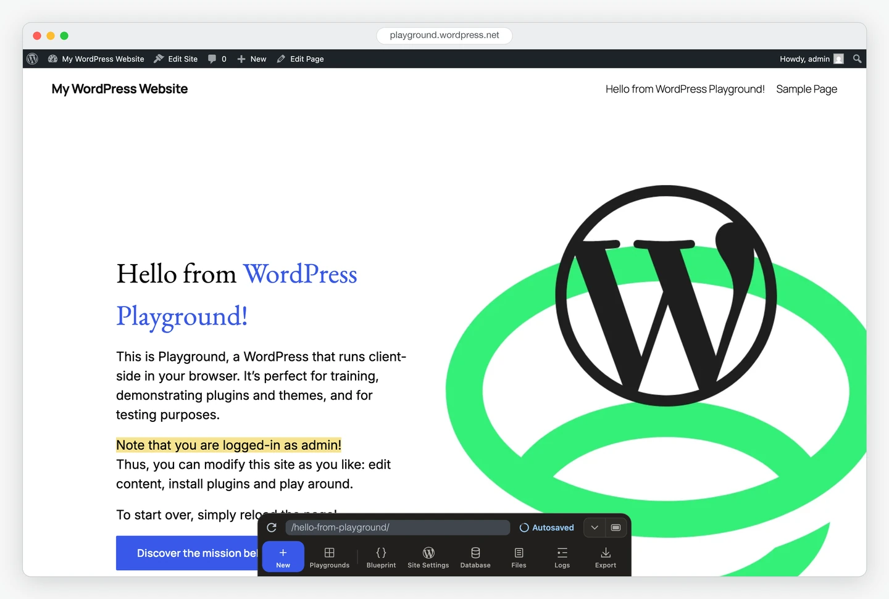
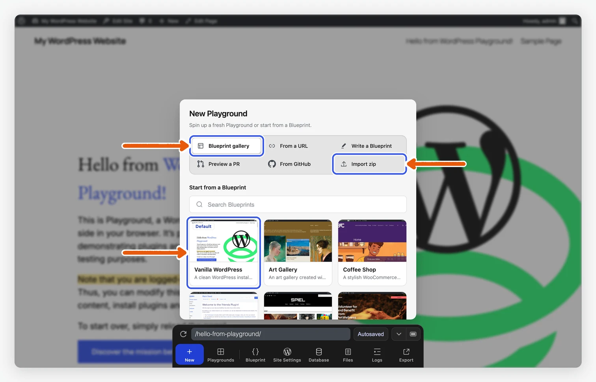
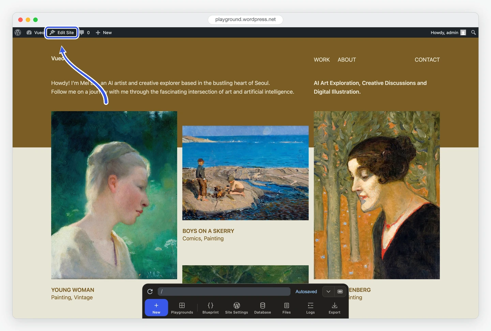
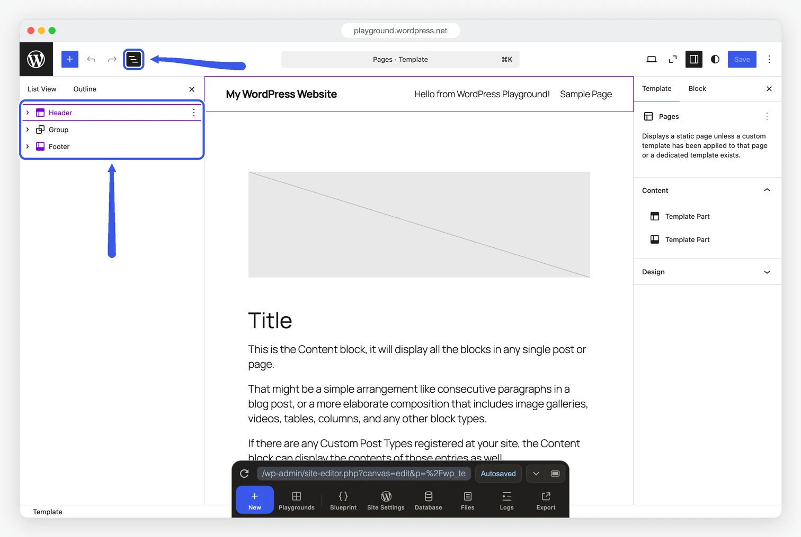
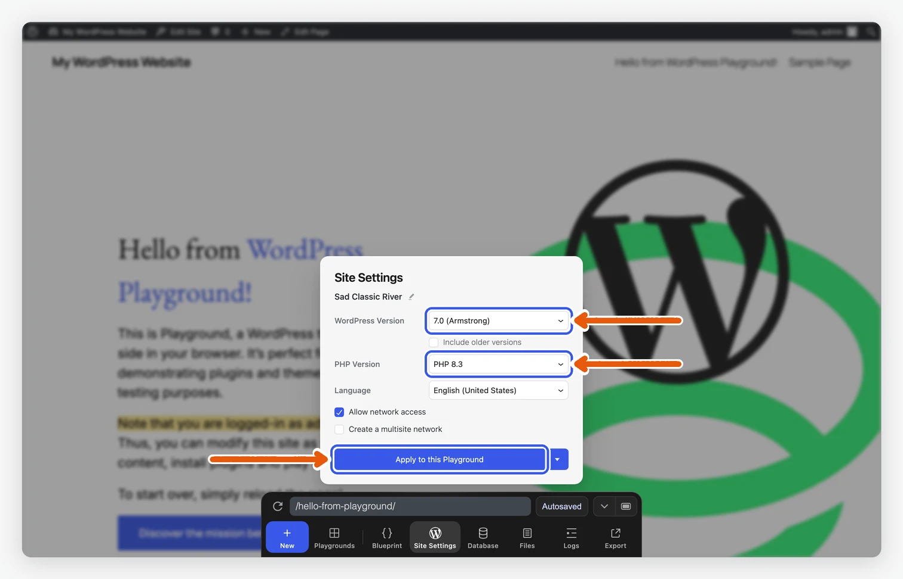
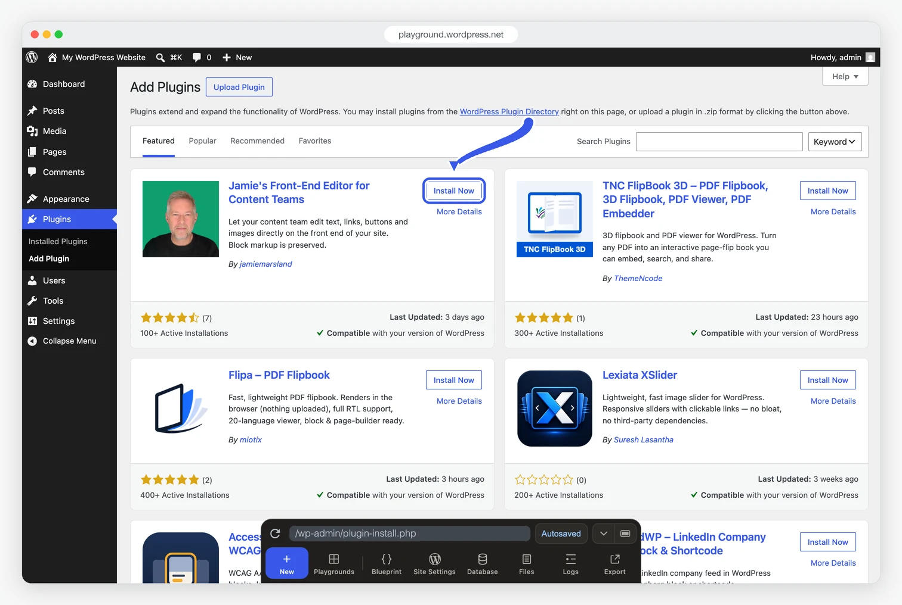
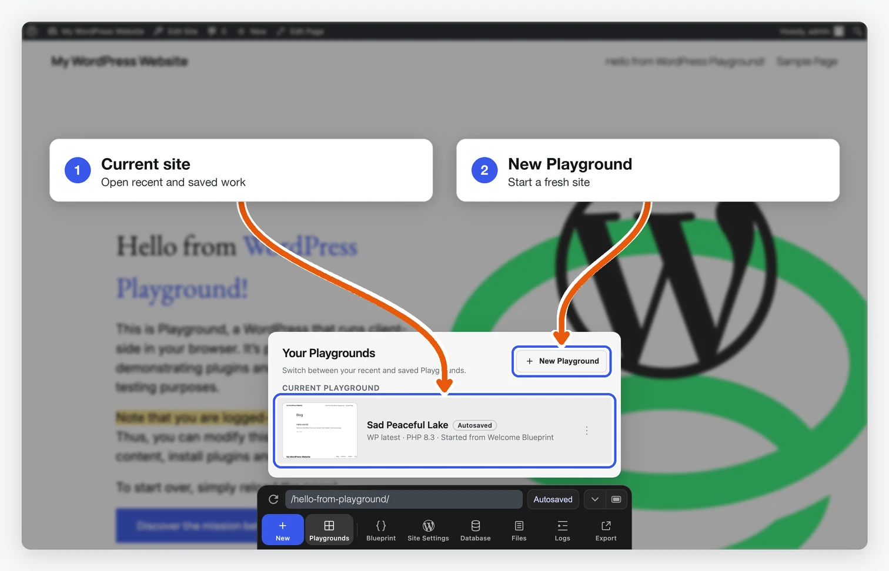
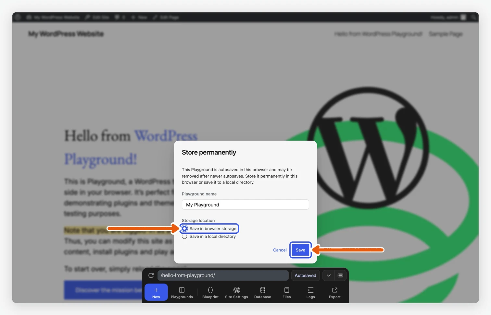
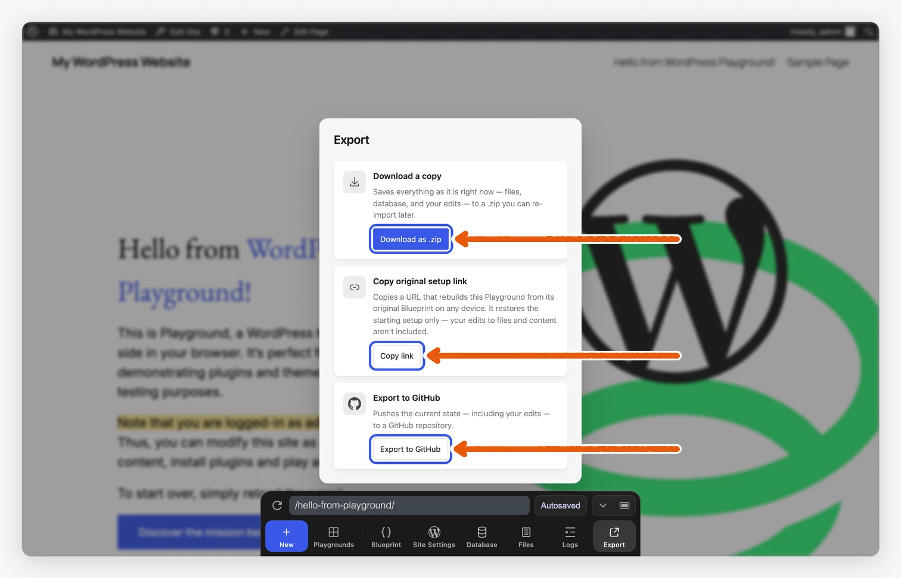

<!--
# WordPress Playground for Everyone
-->

# દરેક માટે વર્ડપ્રેસ પ્લેગ્રાઉન્ડ

<!--
**WordPress Playground lets you run WordPress instantly—no server, no setup, no risk.** It works in your browser at [playground.wordpress.net](https://playground.wordpress.net), and developers can also use it via CLI, Node.js, or embedded in their own apps. But you don't need to be technical to benefit from it.
-->

**વર્ડપ્રેસ પ્લેગ્રાઉન્ડ તમને તરત જ વર્ડપ્રેસ ચલાવવા દે છે—ન સર્વર, ન સેટઅપ, ન કોઈ જોખમ.** તે તમારા બ્રાઉઝરમાં [playground.wordpress.net](https://playground.wordpress.net) પર ચાલે છે, અને ડેવલપર્સ તેનો ઉપયોગ CLI, Node.js દ્વારા અથવા પોતાની એપ્સમાં એમ્બેડ (embed) કરીને પણ કરી શકે છે. પરંતુ તેનો લાભ લેવા માટે તમારે ટેકનિકલ હોવાની જરૂર નથી.

<!--
Watch this quick overview:
-->

આ ટૂંકો પરિચય જુઓ:

<iframe width="800" src="https://www.youtube.com/embed/8_rH2k-OQ8E" frameborder="0" allow="accelerometer; autoplay; clipboard-write; encrypted-media; gyroscope; picture-in-picture" allowfullscreen></iframe>

<!--
## Think of It Like a Car Simulator
-->

## તેને કાર સિમ્યુલેટર જેવું સમજો

<!--
A car simulator gives you a steering wheel, pedals, and virtual streets. Practice driving, hit cones, make mistakes — nothing bad happens. No real car gets damaged. Want to try again? Just restart.
-->

કાર સિમ્યુલેટર તમને સ્ટીયરિંગ વ્હીલ, પેડલ અને વર્ચ્યુઅલ રસ્તાઓ આપે છે. ડ્રાઇવિંગની પ્રેક્ટિસ કરો, કોન સાથે અથડાઓ, ભૂલો કરો — કંઈ ખરાબ થતું નથી. કોઈ સાચી કારને નુકસાન થતું નથી. ફરી પ્રયાસ કરવો છે? બસ ફરીથી શરૂ કરો.

<!--
WordPress Playground works the same way. It gives you a complete WordPress site to experiment with, but nothing you do affects any real website. Make changes, break things, learn from mistakes — then start fresh whenever you want.
-->

વર્ડપ્રેસ પ્લેગ્રાઉન્ડ પણ આ જ રીતે કામ કરે છે. તે તમને પ્રયોગ કરવા માટે એક સંપૂર્ણ વર્ડપ્રેસ સાઇટ આપે છે, પરંતુ તમે જે કંઈ પણ કરો તેની કોઈ સાચી વેબસાઇટ પર અસર થતી નથી. ફેરફારો કરો, વસ્તુઓ તોડો, ભૂલોમાંથી શીખો — પછી જ્યારે ઇચ્છો ત્યારે નવેસરથી શરૂ કરો.

<!--
## What Can You Do with Playground?
-->

## પ્લેગ્રાઉન્ડ સાથે તમે શું કરી શકો?

<!--
When you visit [playground.wordpress.net](https://playground.wordpress.net), you get a WordPress site running entirely in your browser. You can:

- Install plugins and themes
- Edit pages and create content
- Change WordPress and PHP versions
- Explore features you've never tried before
-->

જ્યારે તમે [playground.wordpress.net](https://playground.wordpress.net) ની મુલાકાત લો છો, ત્યારે તમને સંપૂર્ણપણે તમારા બ્રાઉઝરમાં ચાલતી એક વર્ડપ્રેસ સાઇટ મળે છે. તમે:

- પ્લગઇન્સ અને થીમ્સ ઇન્સ્ટોલ કરી શકો છો
- પેજ એડિટ કરી શકો છો અને કન્ટેન્ટ બનાવી શકો છો
- વર્ડપ્રેસ અને PHP ના વર્ઝન બદલી શકો છો
- એવી સુવિધાઓ શોધી શકો છો જે તમે પહેલાં ક્યારેય અજમાવી નથી

<!--
By default, WordPress Playground loads a landing page that introduces Playground. To start with a plain WordPress install, open **New** in the Dock and choose **Vanilla WordPress** from the Blueprint gallery.
-->

ડિફોલ્ટ રીતે, વર્ડપ્રેસ પ્લેગ્રાઉન્ડ એક લેન્ડિંગ પેજ લોડ કરે છે જે પ્લેગ્રાઉન્ડનો પરિચય આપે છે. સાદા વર્ડપ્રેસ ઇન્સ્ટોલથી શરૂ કરવા માટે, ડૉક (Dock) માં **New** ખોલો અને બ્લુપ્રિન્ટ ગેલેરીમાંથી **Vanilla WordPress** પસંદ કરો.

<!--
## If You're Learning WordPress
-->

## જો તમે વર્ડપ્રેસ શીખી રહ્યા હો

<!--
Are you new to WordPress or trying to understand features like the Site Editor or the new features of the latest WordPress Release? Playground is your perfect practice space.
-->

શું તમે વર્ડપ્રેસમાં નવા છો, અથવા સાઇટ એડિટર જેવી સુવિધાઓ કે વર્ડપ્રેસના નવીનતમ રિલીઝની નવી સુવિધાઓ સમજવાનો પ્રયાસ કરી રહ્યા છો? પ્લેગ્રાઉન્ડ તમારી પ્રેક્ટિસ માટે એકદમ યોગ્ય જગ્યા છે.

<!--
### Explore How Pages Are Built
-->

### પેજ કેવી રીતે બને છે તે જુઓ

<!--
Playground logs you in as an administrator, so you can edit any page. Click **Edit** for editing posts and **Edit Site** to update the website layout in the top toolbar to open the editor.
-->

પ્લેગ્રાઉન્ડ તમને એડમિનિસ્ટ્રેટર તરીકે લૉગ ઇન કરે છે, તેથી તમે કોઈપણ પેજ એડિટ કરી શકો છો. એડિટર ખોલવા માટે ઉપરના ટૂલબારમાં, પોસ્ટ એડિટ કરવા **Edit** પર અને વેબસાઇટનું લેઆઉટ બદલવા **Edit Site** પર ક્લિક કરો.

<!--
Want to understand how a page layout was created? Open the **List View** (the three horizontal lines icon) to see every block that makes up the page.
-->

કોઈ પેજનું લેઆઉટ કેવી રીતે બનાવ્યું છે તે સમજવું છે? પેજ બનાવતા દરેક બ્લોકને જોવા માટે **List View** (ત્રણ આડી લીટીઓવાળું આઇકન) ખોલો.

<!--
You can inspect columns, headings, images, and buttons — and see exactly how they're arranged. This is a powerful way to learn by example.
-->

તમે કૉલમ, હેડિંગ, છબીઓ અને બટન તપાસી શકો છો — અને તે બરાબર કેવી રીતે ગોઠવાયેલા છે તે જોઈ શકો છો. ઉદાહરણ દ્વારા શીખવાની આ એક અસરકારક રીત છે.

<!--
#### Explore the Blueprint Library
-->

#### બ્લુપ્રિન્ટ લાઇબ્રેરી જુઓ

<!--
Open **New** in the Dock to browse the Blueprint gallery. The gallery has examples for art galleries, stores, portfolios, learning environments, and many other starting points.
-->

બ્લુપ્રિન્ટ ગેલેરી જોવા માટે ડૉકમાં **New** ખોલો. ગેલેરીમાં આર્ટ ગેલેરી, સ્ટોર, પોર્ટફોલિયો, શીખવા માટેના પરિવેશ અને બીજી ઘણી શરૂઆતની રચનાઓનાં ઉદાહરણો છે.

<!--
### Try New Features Safely
-->

### નવી સુવિધાઓ સુરક્ષિત રીતે અજમાવો

<!--
When the WordPress team releases new features, you can test them in Playground before they affect your real site. Open **Site Settings** from the Dock to choose a WordPress or PHP version.
-->

જ્યારે વર્ડપ્રેસ ટીમ નવી સુવિધાઓ રિલીઝ કરે છે, ત્યારે તે તમારી સાચી સાઇટને અસર કરે તે પહેલાં તમે તેમને પ્લેગ્રાઉન્ડમાં ચકાસી શકો છો. વર્ડપ્રેસ અથવા PHP વર્ઝન પસંદ કરવા માટે ડૉકમાંથી **Site Settings** ખોલો.

<!--
## If You Own a WordPress Site
-->

## જો તમારી પાસે વર્ડપ્રેસ સાઇટ હોય

<!--
Running a live website means every change risks breaking something. Playground lets you test before you commit.
-->

લાઇવ વેબસાઇટ ચલાવવાનો અર્થ એ છે કે દરેક ફેરફારથી કંઈક તૂટવાનું જોખમ રહે છે. પ્લેગ્રાઉન્ડ તમને ફેરફાર પાકો કરતાં પહેલાં ચકાસવા દે છે.

<!--
### Test Plugins Before Installing
-->

### ઇન્સ્ટોલ કરતાં પહેલાં પ્લગઇન્સ ચકાસો

<!--
Curious about a new SEO plugin? Want to compare two contact form options? Install them in Playground first:

1. Open [playground.wordpress.net](https://playground.wordpress.net)
2. Go to **Plugins → Add New**
3. Search for and install any plugin
4. Test it thoroughly
-->

કોઈ નવા SEO પ્લગઇન વિશે જાણવું છે? બે કોન્ટેક્ટ ફોર્મ વિકલ્પોની સરખામણી કરવી છે? પહેલાં તેમને પ્લેગ્રાઉન્ડમાં ઇન્સ્ટોલ કરો:

1. [playground.wordpress.net](https://playground.wordpress.net) ખોલો
2. **Plugins → Add New** પર જાઓ
3. કોઈપણ પ્લગઇન શોધો અને ઇન્સ્ટોલ કરો
4. તેને સારી રીતે ચકાસો

<!--
Your real site stays untouched while you evaluate whether the plugin fits your needs.
-->

પ્લગઇન તમારી જરૂરિયાતોને અનુરૂપ છે કે નહીં તે તમે તપાસો ત્યાં સુધી તમારી સાચી સાઇટને કોઈ અસર થતી નથી.

<!--
### Preview Theme Changes
-->

### થીમના ફેરફારોનું પૂર્વાવલોકન કરો

<!--
Thinking about switching themes? Test your new theme in Playground to see how it handles your content — without disrupting your visitors.
-->

થીમ બદલવાનું વિચારી રહ્યા છો? તમારી નવી થીમ તમારા કન્ટેન્ટને કેવી રીતે દર્શાવે છે તે જોવા માટે તેને પ્લેગ્રાઉન્ડમાં ચકાસો — તમારા મુલાકાતીઓને કોઈ ખલેલ પહોંચાડ્યા વગર.

<!--
### Compare Options Side by Side
-->

### વિકલ્પોની બાજુ-બાજુમાં સરખામણી કરો

<!--
Open multiple browser tabs with different Playground setups. Compare plugin A versus plugin B, or see how your content looks in different themes. Make informed decisions before touching your production site.
-->

અલગ-અલગ પ્લેગ્રાઉન્ડ સેટઅપ સાથે બ્રાઉઝરની ઘણી ટેબ્સ ખોલો. પ્લગઇન A અને પ્લગઇન B ની સરખામણી કરો, અથવા જુદી-જુદી થીમ્સમાં તમારું કન્ટેન્ટ કેવું દેખાય છે તે જુઓ. તમારી પ્રોડક્શન સાઇટને સ્પર્શતા પહેલાં સમજી-વિચારીને નિર્ણય લો.

<!--
**Your Real Site Stays Safe**

Every Playground runs independently in your browser. Nothing syncs to any external server, and nothing affects your live WordPress installation.
-->

**તમારી સાચી સાઇટ સુરક્ષિત રહે છે**

દરેક પ્લેગ્રાઉન્ડ તમારા બ્રાઉઝરમાં સ્વતંત્ર રીતે ચાલે છે. કંઈ પણ કોઈ બાહ્ય સર્વર સાથે સિંક (sync) થતું નથી, અને તમારા લાઇવ વર્ડપ્રેસ ઇન્સ્ટોલેશનને કોઈ અસર થતી નથી.

<!--
## If You Use WordPress Daily
-->

## જો તમે રોજ વર્ડપ્રેસનો ઉપયોગ કરતા હો

<!--
Even experienced WordPress users benefit from a safe testing environment.
-->

અનુભવી વર્ડપ્રેસ વપરાશકર્તાઓને પણ ચકાસણી માટેના સુરક્ષિત પરિવેશનો લાભ મળે છે.

<!--
### Make Design Experiments
-->

### ડિઝાઇનના પ્રયોગો કરો

<!--
Want to try a different font size? Adjust spacing? Change colors? Load a Playground with the same theme that you are using in production and edit it freely:

1. Open any page in the editor
2. Select a block and modify its settings
3. See the results immediately
-->

અલગ ફોન્ટ સાઇઝ અજમાવવી છે? અંતર (spacing) ગોઠવવું છે? રંગો બદલવા છે? પ્રોડક્શનમાં તમે જે થીમ વાપરો છો તે જ થીમ સાથે એક પ્લેગ્રાઉન્ડ લોડ કરો અને તેને મુક્તપણે એડિટ કરો:

1. એડિટરમાં કોઈપણ પેજ ખોલો
2. એક બ્લોક પસંદ કરો અને તેના સેટિંગ્સ બદલો
3. પરિણામ તરત જ જુઓ

<!--
If you like what you see, recreate those changes on your real site. If not,
start another Playground. The experiment may remain as a recent autosave until
newer autosaves replace it.
-->

જો તમને જે દેખાય તે ગમે, તો તે ફેરફારો તમારી સાચી સાઇટ પર ફરીથી કરો. જો ન ગમે, તો બીજું પ્લેગ્રાઉન્ડ શરૂ કરો. નવા ઓટોસેવ તેનું સ્થાન ન લે ત્યાં સુધી આ પ્રયોગ તાજેતરના ઓટોસેવ તરીકે રહી શકે છે.

<!--
## Yes, You Can Save Your Work
-->

## હા, તમે તમારું કામ સેવ કરી શકો છો

<!--
**Playground doesn't have to be temporary.** You can save your progress and return to it later.
-->

**પ્લેગ્રાઉન્ડ કામચલાઉ જ હોય તે જરૂરી નથી.** તમે તમારી પ્રગતિ સેવ કરી શકો છો અને પછીથી તેના પર પાછા આવી શકો છો.

<!--
### Save to Your Browser
-->

### તમારા બ્રાઉઝરમાં સેવ કરો

<!--
New Playgrounds are autosaved when browser storage is available. Open **Your Playgrounds** from the Dock to return to recent autosaves. Playground keeps up to five recent autosaves.
-->

જ્યારે બ્રાઉઝર સ્ટોરેજ ઉપલબ્ધ હોય, ત્યારે નવા પ્લેગ્રાઉન્ડ આપમેળે સેવ (autosave) થાય છે. તાજેતરના ઓટોસેવ પર પાછા જવા માટે ડૉકમાંથી **Your Playgrounds** ખોલો. પ્લેગ્રાઉન્ડ વધુમાં વધુ પાંચ તાજેતરના ઓટોસેવ રાખે છે.

<!--
To keep an autosave permanently, click the **Autosaved** status in the Dock, choose **Save in browser storage**, and save it.
-->

કોઈ ઓટોસેવને કાયમ માટે રાખવા માટે, ડૉકમાં **Autosaved** સ્ટેટસ પર ક્લિક કરો, **Save in browser storage** પસંદ કરો અને તેને સેવ કરો.

<!--
### Download as a ZIP File
-->

### ZIP ફાઇલ તરીકે ડાઉનલોડ કરો

<!--
Need to move your work elsewhere? Open **Export** and choose **Download as .zip**. The ZIP contains the current files, database, plugins, themes, uploads, and edits. You can restore it later with **New → Import zip** or host it on a server that supports PHP and SQLite.
-->

તમારું કામ બીજે ક્યાંક લઈ જવું છે? **Export** ખોલો અને **Download as .zip** પસંદ કરો. આ ZIP માં હાલની ફાઇલો, ડેટાબેઝ, પ્લગઇન્સ, થીમ્સ, અપલોડ્સ અને ફેરફારો હોય છે. તમે પછીથી તેને **New → Import zip** વડે પાછું લાવી શકો છો, અથવા PHP અને SQLite ને સપોર્ટ કરતા સર્વર પર હોસ્ટ કરી શકો છો.

<!--
**Keep a portable backup**

Browser storage belongs to your browser profile and can be cleared or evicted. Export a ZIP when you need a file you can move or archive.
-->

**સાથે લઈ જઈ શકાય તેવો બેકઅપ રાખો**

બ્રાઉઝર સ્ટોરેજ તમારી બ્રાઉઝર પ્રોફાઇલનો ભાગ છે અને તે સાફ થઈ શકે છે અથવા બ્રાઉઝર તેને દૂર કરી શકે છે. જ્યારે તમારે ખસેડી શકાય અથવા સાચવીને રાખી શકાય તેવી ફાઇલની જરૂર હોય, ત્યારે ZIP એક્સપોર્ટ કરો.

<!--
## Next Steps
-->

## આગળનાં પગલાં

<!--
Now that you know Playground is for everyone, explore further:

- [Quick Start Guide](/quick-start-guide) — A 5-minute walkthrough of Playground basics
- [About WordPress Playground](/about) — Learn what you can build, test, and launch
-->

હવે તમે જાણો છો કે પ્લેગ્રાઉન્ડ દરેક માટે છે, તો આગળ વધુ જાણો:

- [ઝડપી શરૂઆત માર્ગદર્શિકા](/quick-start-guide) — પ્લેગ્રાઉન્ડની મૂળભૂત બાબતોની 5 મિનિટની સમજૂતી
- [વર્ડપ્રેસ પ્લેગ્રાઉન્ડ વિશે](/about) — તમે શું બનાવી, ચકાસી અને લોંચ કરી શકો છો તે જાણો
