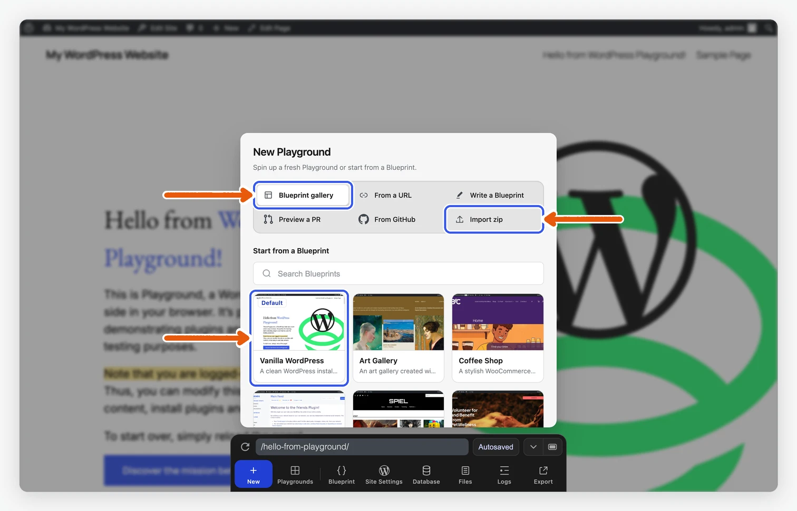

<!-- # Using Blueprints -->

# ब्लूप्रिंट का इस्तेमाल

<!-- You can use Blueprints in one of the following ways: -->

आप इनमें से किसी भी तरीके से ब्लूप्रिंट इस्तेमाल कर सकते हैं:

<!--
- Open **New → Blueprint gallery** in the Playground Dock and choose an example.
- Open **New → From a URL** and enter a public Blueprint JSON or ZIP bundle URL.
- Open **New → Write a Blueprint** to author a Blueprint in the browser.
- Open **Blueprint** to inspect or edit the current Playground's Blueprint.
- Pass a Blueprint as a URL fragment.
- Load a Blueprint from a URL using the `blueprint-url` parameter.
- Use Blueprint bundles (ZIP files or directories).
- Use the JavaScript API.
-->

- Playground Dock में **New → Blueprint gallery** खोलें और कोई उदाहरण चुनें।
- **New → From a URL** खोलें और किसी सार्वजनिक ब्लूप्रिंट JSON या ZIP बंडल का URL डालें।
- ब्राउज़र में ही ब्लूप्रिंट लिखने के लिए **New → Write a Blueprint** खोलें।
- मौजूदा Playground का ब्लूप्रिंट देखने या बदलने के लिए **Blueprint** खोलें।
- ब्लूप्रिंट को URL फ़्रैगमेंट के रूप में दें।
- `blueprint-url` पैरामीटर से किसी URL से ब्लूप्रिंट लोड करें।
- ब्लूप्रिंट बंडल (ZIP फ़ाइलें या डायरेक्टरी) इस्तेमाल करें।
- JavaScript API इस्तेमाल करें।

<!-- When the Playground URL includes the `mcp-port` parameter, Playground rejects Blueprints passed as a URL fragment or through the `blueprint-url` parameter. This prevents prompt injection while the MCP server is active. Remove `mcp-port` from the URL to load a Blueprint this way. -->

जब Playground URL में `mcp-port` पैरामीटर होता है, तो Playground URL फ़्रैगमेंट के रूप में या `blueprint-url` पैरामीटर से दिए गए ब्लूप्रिंट स्वीकार नहीं करता। इससे MCP सर्वर चालू रहते समय प्रॉम्प्ट इंजेक्शन से बचाव होता है। इस तरह ब्लूप्रिंट लोड करने के लिए URL से `mcp-port` हटा दें।

<!--  -->


<!-- ## URL Fragment -->

## URL फ़्रैगमेंट {#url-fragment}

<!-- The easiest way to start using Blueprints is to paste one into the URL "fragment" on WordPress Playground website, e.g. `https://playground.wordpress.net/#{"preferredVersions...`. -->

ब्लूप्रिंट इस्तेमाल करना शुरू करने का सबसे आसान तरीका है उसे WordPress Playground वेबसाइट के URL "फ़्रैगमेंट" में पेस्ट करना, जैसे `https://playground.wordpress.net/#{"preferredVersions...`।

<!-- For example, to create a Playground with specific versions of WordPress and PHP you would use the following Blueprint: -->

उदाहरण के लिए, WordPress और PHP के खास वर्ज़न वाला Playground बनाने के लिए आप यह ब्लूप्रिंट इस्तेमाल करेंगे:

```json
{
	"$schema": "https://playground.wordpress.net/blueprint-schema.json",
	"preferredVersions": {
		"php": "8.3",
		"wp": "6.5"
	}
}
```

<!--
And then you would go to
`https://playground.wordpress.net/#{"preferredVersions":{"php":"8.3","wp":"6.5"}}`.
-->

और फिर आप इस पते पर जाएँगे:
`https://playground.wordpress.net/#{"preferredVersions":{"php":"8.3","wp":"6.5"}}`।

<div class="callout callout-tip">

<!--
In Javascript, you can get a compact version of any blueprint JSON with [`JSON.stringify`](https://developer.mozilla.org/en-US/docs/Web/JavaScript/Reference/Global_Objects/JSON/stringify) and [`JSON.parse`](https://developer.mozilla.org/en-US/docs/Web/JavaScript/Reference/Global_Objects/JSON/parse)
Example:
-->

JavaScript में आप [`JSON.stringify`](https://developer.mozilla.org/en-US/docs/Web/JavaScript/Reference/Global_Objects/JSON/stringify) और [`JSON.parse`](https://developer.mozilla.org/en-US/docs/Web/JavaScript/Reference/Global_Objects/JSON/parse) से किसी भी ब्लूप्रिंट JSON का छोटा रूप पा सकते हैं।
उदाहरण:

```js
const blueprintJson = `{
	"$schema": "https://playground.wordpress.net/blueprint-schema.json",
	"preferredVersions": {
		"php": "8.3",
		"wp": "6.5"
	}
}`;
const minifiedBlueprintJson = JSON.stringify(JSON.parse(blueprintJson)); // {"preferredVersions":{"php":"8.3","wp":"6.5"}}
const encodedBlueprint = encodeURIComponent(minifiedBlueprintJson);
const playgroundUrl = `https://playground.wordpress.net/#${encodedBlueprint}`;
```

</div>

<!-- You won't have to paste links to follow along. We'll use code examples with a "Try it out" button that will automatically run the examples for you: -->

आगे के उदाहरण आज़माने के लिए आपको लिंक पेस्ट नहीं करने होंगे। हम ऐसे कोड उदाहरण इस्तेमाल करेंगे जिनमें एक "Try it out" बटन होगा, जो आपके लिए उदाहरण अपने आप चला देगा:

import BlueprintExample from '@site/src/components/Blueprints/BlueprintExample.mdx';

<BlueprintExample justButton={true} blueprint={{
	"preferredVersions": {
		"php": "8.3",
		"wp": "6.5"
	}
}} />

<!-- ### Encoded Blueprint fragments -->

### एन्कोड किए गए ब्लूप्रिंट फ़्रैगमेंट {#encoded-blueprint-fragments}

<!-- When you create Playground links from JavaScript or automation tools, encode the minified JSON once with `encodeURIComponent()` and append it after `#`: -->

जब आप JavaScript या ऑटोमेशन टूल से Playground लिंक बनाते हैं, तो छोटे किए गए JSON को `encodeURIComponent()` से एक बार एन्कोड करें और उसे `#` के बाद जोड़ दें:

```js
const blueprint = {
	$schema: 'https://playground.wordpress.net/blueprint-schema.json',
	preferredVersions: {
		php: '8.3',
		wp: '6.5',
	},
};
const playgroundUrl = `https://playground.wordpress.net/#${encodeURIComponent(JSON.stringify(blueprint))}`;
```

<!-- Playground also supports Base64-encoded Blueprints. Base64 is useful when a platform modifies JSON fragments or when you want a compact, copyable link. For example, that's the above Blueprint in Base64 format: `eyIkc2NoZW1hIjogImh0dHBzOi8vcGxheWdyb3VuZC53b3JkcHJlc3MubmV0L2JsdWVwcmludC1zY2hlbWEuanNvbiIsInByZWZlcnJlZFZlcnNpb25zIjogeyJwaHAiOiAiOC4zIiwid3AiOiAiNi41In19`. -->

Playground Base64 में एन्कोड किए गए ब्लूप्रिंट भी सपोर्ट करता है। Base64 तब काम आता है जब कोई प्लेटफ़ॉर्म JSON फ़्रैगमेंट को बदल देता है, या जब आपको एक छोटा लिंक चाहिए जिसे आसानी से कॉपी किया जा सके। उदाहरण के लिए, ऊपर वाला ब्लूप्रिंट Base64 फ़ॉर्मेट में यह है: `eyIkc2NoZW1hIjogImh0dHBzOi8vcGxheWdyb3VuZC53b3JkcHJlc3MubmV0L2JsdWVwcmludC1zY2hlbWEuanNvbiIsInByZWZlcnJlZFZlcnNpb25zIjogeyJwaHAiOiAiOC4zIiwid3AiOiAiNi41In19`।

<!-- To run it, go to https://playground.wordpress.net/#eyIkc2NoZW1hIjogImh0dHBzOi8vcGxheWdyb3VuZC53b3JkcHJlc3MubmV0L2JsdWVwcmludC1zY2hlbWEuanNvbiIsInByZWZlcnJlZFZlcnNpb25zIjogeyJwaHAiOiAiOC4zIiwid3AiOiAiNi41In19 -->

इसे चलाने के लिए यहाँ जाएँ: https://playground.wordpress.net/#eyIkc2NoZW1hIjogImh0dHBzOi8vcGxheWdyb3VuZC53b3JkcHJlc3MubmV0L2JsdWVwcmludC1zY2hlbWEuanNvbiIsInByZWZlcnJlZFZlcnNpb25zIjogeyJwaHAiOiAiOC4zIiwid3AiOiAiNi41In19

<!-- #### URIError: URI malformed -->

#### URIError: URI malformed {#urierror-uri-malformed}

<!--
If a Playground link fails with `URIError: URI malformed`, the encoded
Blueprint fragment is usually malformed. Common causes include an invalid `%`
escape, a fragment that was encoded twice, or JSON pasted into the URL without
encoding.
-->

अगर कोई Playground लिंक `URIError: URI malformed` के साथ फ़ेल होता है, तो आम तौर पर एन्कोड किया गया ब्लूप्रिंट फ़्रैगमेंट खराब होता है। इसकी आम वजहें हैं: गलत `%` एस्केप, दो बार एन्कोड किया गया फ़्रैगमेंट, या बिना एन्कोड किए URL में पेस्ट किया गया JSON।

<!-- Rebuild the link from the original Blueprint object and encode it once: -->

मूल ब्लूप्रिंट ऑब्जेक्ट से लिंक फिर से बनाएँ और उसे एक बार एन्कोड करें:

```js
const playgroundUrl = `https://playground.wordpress.net/#${encodeURIComponent(JSON.stringify(blueprint))}`;
```

<!-- If another tool changes URL fragments, use a Base64-encoded Blueprint instead. -->

अगर कोई दूसरा टूल URL फ़्रैगमेंट बदल देता है, तो इसकी जगह Base64 में एन्कोड किया गया ब्लूप्रिंट इस्तेमाल करें।

<div class="callout callout-tip">

<!-- In JavaScript, You can get any blueprint JSON in [Base64 format](https://developer.mozilla.org/en-US/docs/Glossary/Base64#javascript_support) with global function `btoa()`. -->

JavaScript में आप ग्लोबल फ़ंक्शन `btoa()` से किसी भी ब्लूप्रिंट JSON को [Base64 फ़ॉर्मेट](https://developer.mozilla.org/en-US/docs/Glossary/Base64#javascript_support) में बदल सकते हैं।

<!-- Example: -->

उदाहरण:

```js
const blueprintJson = `{
	"$schema": "https://playground.wordpress.net/blueprint-schema.json",
	"preferredVersions": {
		"php": "8.3",
		"wp": "6.5"
	}
}`;
const minifiedBlueprintJson = btoa(blueprintJson); // ewoJIiRzY2hlbWEiOiAiaHR0cHM6Ly9wbGF5Z3JvdW5kLndvcmRwcmVzcy5uZXQvYmx1ZXByaW50LXNjaGVtYS5qc29uIiwKCSJwcmVmZXJyZWRWZXJzaW9ucyI6IHsKCQkicGhwIjogIjguMyIsCgkJIndwIjogIjYuNSIKCX0KfQ==
```

</div>

<!-- ### Load Blueprint from a URL -->

### URL से ब्लूप्रिंट लोड करना {#load-blueprint-from-a-url}

<!-- When your Blueprint gets too wieldy, you can load it via the `?blueprint-url` query parameter in the URL, like this: -->

जब आपका ब्लूप्रिंट बहुत बड़ा हो जाए, तो आप उसे URL में `?blueprint-url` क्वेरी पैरामीटर से लोड कर सकते हैं, इस तरह:

<!-- [https://playground.wordpress.net/?blueprint-url=https://raw.githubusercontent.com/adamziel/blueprints/trunk/blueprints/latest-gutenberg/blueprint.json](https://playground.wordpress.net/?blueprint-url=https://raw.githubusercontent.com/adamziel/blueprints/trunk/blueprints/latest-gutenberg/blueprint.json) -->

[https://playground.wordpress.net/?blueprint-url=https://raw.githubusercontent.com/adamziel/blueprints/trunk/blueprints/latest-gutenberg/blueprint.json](https://playground.wordpress.net/?blueprint-url=https://raw.githubusercontent.com/adamziel/blueprints/trunk/blueprints/latest-gutenberg/blueprint.json)

<!-- Note that the Blueprint must be publicly accessible and served with [the correct `Access-Control-Allow-Origin` header](https://developer.mozilla.org/en-US/docs/Web/HTTP/Reference/Headers/Access-Control-Allow-Origin): -->

ध्यान दें कि ब्लूप्रिंट सबके लिए खुला होना चाहिए और [सही `Access-Control-Allow-Origin` हेडर](https://developer.mozilla.org/en-US/docs/Web/HTTP/Reference/Headers/Access-Control-Allow-Origin) के साथ सर्व होना चाहिए:

```
Access-Control-Allow-Origin: *
```

<!-- When a Blueprint URL fails with `BlueprintFetchError`, check these details: -->

जब कोई ब्लूप्रिंट URL `BlueprintFetchError` के साथ फ़ेल हो, तो ये बातें जाँचें:

<!--
- The URL must return a JSON file or a Blueprint ZIP bundle, not an HTML page.
- GitHub URLs should use `raw.githubusercontent.com`, not `github.com/.../blob/...`.
- GitLab URLs should use the raw file URL, not a `/-/blob/` page.
- The file must be reachable without login, cookies, VPN access, or a temporary browser session.
- Draft releases, expired CI artifacts, and temporary tunnel URLs can stop working even if the Blueprint was valid earlier.
- If you host the file yourself, configure CORS so `https://playground.wordpress.net` can fetch it.
-->

- URL से एक JSON फ़ाइल या ब्लूप्रिंट ZIP बंडल मिलना चाहिए, कोई HTML पेज नहीं।
- GitHub के लिए `raw.githubusercontent.com` वाले URL इस्तेमाल करें, `github.com/.../blob/...` वाले नहीं।
- GitLab के लिए रॉ फ़ाइल का URL इस्तेमाल करें, `/-/blob/` वाला पेज नहीं।
- फ़ाइल बिना लॉगिन, कुकी, VPN या किसी अस्थायी ब्राउज़र सेशन के खुलनी चाहिए।
- ड्राफ़्ट रिलीज़, एक्सपायर हो चुके CI आर्टिफ़ैक्ट और अस्थायी टनल URL काम करना बंद कर सकते हैं, भले ही ब्लूप्रिंट पहले सही था।
- अगर आप फ़ाइल खुद होस्ट करते हैं, तो CORS ऐसे कॉन्फ़िगर करें कि `https://playground.wordpress.net` उसे फ़ेच कर सके।

<!-- #### Blueprint Bundles -->

#### ब्लूप्रिंट बंडल {#blueprint-bundles}

<!-- The `?blueprint-url` parameter now also supports Blueprint bundles in ZIP format. A Blueprint bundle is a ZIP file that contains a `blueprint.json` file at the root level, along with any additional resources referenced by the Blueprint. -->

`?blueprint-url` पैरामीटर अब ZIP फ़ॉर्मेट में ब्लूप्रिंट बंडल भी सपोर्ट करता है। ब्लूप्रिंट बंडल एक ZIP फ़ाइल है, जिसके रूट लेवल पर एक `blueprint.json` फ़ाइल होती है, साथ ही वे सभी अतिरिक्त रिसोर्स भी, जिनका ब्लूप्रिंट में इस्तेमाल हुआ है।

<!-- For example, you can load a Blueprint bundle like this: -->

उदाहरण के लिए, आप ब्लूप्रिंट बंडल इस तरह लोड कर सकते हैं:

<!-- [https://playground.wordpress.net/?blueprint-url=https://example.com/my-blueprint-bundle.zip](https://playground.wordpress.net/?blueprint-url=https://example.com/my-blueprint-bundle.zip) -->

[https://playground.wordpress.net/?blueprint-url=https://example.com/my-blueprint-bundle.zip](https://playground.wordpress.net/?blueprint-url=https://example.com/my-blueprint-bundle.zip)

<!-- When using a Blueprint bundle, you can reference bundled resources using the `bundled` resource type: -->

ब्लूप्रिंट बंडल इस्तेमाल करते समय आप `bundled` रिसोर्स टाइप से बंडल किए गए रिसोर्स इस्तेमाल कर सकते हैं:

```json
{
	"landingPage": "/my-file.txt",
	"steps": [
		{
			"step": "writeFile",
			"path": "/wordpress/my-file.txt",
			"data": {
				"resource": "bundled",
				"path": "/bundled-text-file.txt"
			}
		}
	]
}
```

<!-- For more information on Blueprint bundles, see the [Blueprint Bundles](/blueprints/bundles) documentation. -->

ब्लूप्रिंट बंडल के बारे में ज़्यादा जानकारी के लिए [ब्लूप्रिंट बंडल](/blueprints/bundles) डॉक्यूमेंटेशन देखें।

<!-- ## JavaScript API -->

## JavaScript API {#javascript-api}

<!-- You can also use Blueprints with the JavaScript API using the `startPlaygroundWeb()` function from the `@wp-playground/client` package. Here's a small, self-contained example you can run on JSFiddle or CodePen: -->

आप `@wp-playground/client` पैकेज के `startPlaygroundWeb()` फ़ंक्शन से JavaScript API के ज़रिए भी ब्लूप्रिंट इस्तेमाल कर सकते हैं। यहाँ एक छोटा उदाहरण है, जो अपने आप में पूरा है और जिसे आप JSFiddle या CodePen पर चला सकते हैं:

```html
<iframe id="wp-playground" style="width: 1200px; height: 800px"></iframe>
<script type="module">
	import { startPlaygroundWeb } from 'https://playground.wordpress.net/client/index.js';

	const client = await startPlaygroundWeb({
		iframe: document.getElementById('wp-playground'),
		remoteUrl: `https://playground.wordpress.net/remote.html`,
		blueprint: {
			landingPage: '/wp-admin/',
			preferredVersions: {
				php: '8.3',
				wp: 'latest',
			},
			steps: [
				{
					step: 'login',
					username: 'admin',
					password: 'password',
				},
				{
					step: 'installPlugin',
					pluginData: {
						resource: 'wordpress.org/plugins',
						slug: 'friends',
					},
				},
			],
		},
	});

	const response = await client.run({
		// wp-load.php is only required if you want to interact with WordPress.
		code: '<?php require_once "/wordpress/wp-load.php"; $posts = get_posts(); echo "Post Title: " . $posts[0]->post_title;',
	});
	console.log(response.text);
</script>
```
