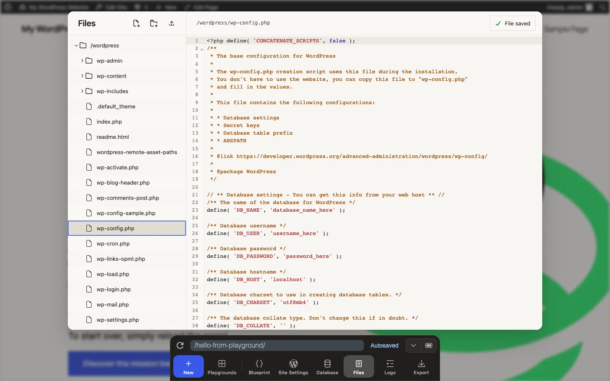
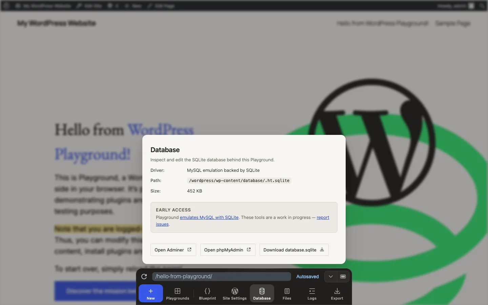
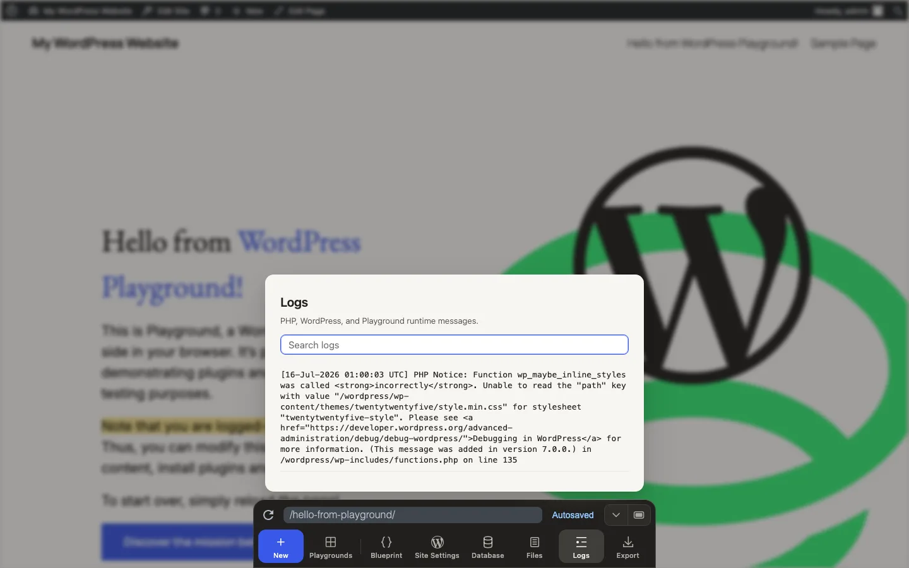

<!-- # Troubleshoot and debug Blueprints -->

# ब्लूप्रिंट की समस्याएँ सुलझाना और डीबग करना

<!-- Blueprint errors usually point to one of three places: -->

ब्लूप्रिंट एरर आम तौर पर इन तीन में से किसी एक जगह की ओर इशारा करते हैं:

<!--
- The Blueprint JSON is invalid.
- Playground could not fetch the Blueprint or one of its resources.
- A Blueprint step ran, but WordPress, PHP, WP-CLI, or a plugin failed.
-->

- ब्लूप्रिंट JSON सही नहीं है।
- Playground ब्लूप्रिंट या उसका कोई रिसोर्स फ़ेच नहीं कर पाया।
- कोई ब्लूप्रिंट स्टेप चला, लेकिन WordPress, PHP, WP-CLI या कोई प्लगइन फ़ेल हो गया।

<!--
Start with the exact error name shown by Playground, then use the matching
section below.
-->

Playground में दिखाए गए एरर के सटीक नाम से शुरू करें, फिर नीचे उससे मेल खाने वाला सेक्शन देखें।

<!-- ## Quick checklist -->

## जल्दी से जाँचने की सूची {#quick-checklist}

<!--
- Paste the Blueprint into the [Blueprints editor](https://playground.wordpress.net/builder/builder.html) to validate the JSON schema.
- If the Blueprint is loaded from a URL, open that URL directly in a private browser window and confirm it downloads valid JSON or a Blueprint ZIP bundle.
- If a step fails, note the step number in `BlueprintStepExecutionError`. It is the position in the compiled list of steps, after Blueprint shorthands have been expanded and any steps Playground adds itself have been inserted.
- Open browser developer tools and check the Console and Network tabs for download, CORS, PHP, or plugin activation details.
- For plugin/theme activation failures, check the Playground **Logs** panel or the browser console for PHP warnings and fatal errors.
-->

- JSON स्कीमा जाँचने के लिए ब्लूप्रिंट को [Blueprints editor](https://playground.wordpress.net/builder/builder.html) में पेस्ट करें।
- अगर ब्लूप्रिंट किसी URL से लोड होता है, तो वह URL सीधे किसी प्राइवेट ब्राउज़र विंडो में खोलें और पक्का करें कि उससे सही JSON या ब्लूप्रिंट ZIP बंडल डाउनलोड होता है।
- अगर कोई स्टेप फ़ेल होता है, तो `BlueprintStepExecutionError` में स्टेप नंबर नोट करें। यह स्टेप की कंपाइल की गई सूची में उसकी जगह है, यानी ब्लूप्रिंट शॉर्टहैंड के स्टेप में बदलने और Playground के खुद जोड़े गए स्टेप शामिल होने के बाद की जगह।
- ब्राउज़र डेवलपर टूल खोलें और डाउनलोड, CORS, PHP या प्लगइन एक्टिवेशन की जानकारी के लिए Console और Network टैब देखें।
- प्लगइन या थीम एक्टिवेशन फ़ेल होने पर PHP चेतावनियों और फ़ेटल एरर के लिए Playground का **Logs** पैनल या ब्राउज़र कंसोल देखें।

<!-- ## InvalidBlueprintError -->

## InvalidBlueprintError {#invalidblueprinterror}

<!--
`InvalidBlueprintError` means the Blueprint does not match the
[Blueprint data format](/blueprints/data-format). The error output usually
contains paths such as `/steps/2/pluginData` or `/preferredVersions`.
-->

`InvalidBlueprintError` का मतलब है कि ब्लूप्रिंट [ब्लूप्रिंट डेटा फ़ॉर्मेट](/blueprints/data-format) से मेल नहीं खाता। एरर आउटपुट में आम तौर पर `/steps/2/pluginData` या `/preferredVersions` जैसे पाथ होते हैं।

<!-- ### Unexpected property `activate` -->

### अनपेक्षित प्रॉपर्टी `activate` {#unexpected-property-activate}

<!--
`activate` belongs inside `options`, not directly on the step or inside
`pluginData`.
-->

`activate` को `options` के अंदर रखें, सीधे स्टेप पर या `pluginData` के अंदर नहीं।

```json
{
	"step": "installPlugin",
	"pluginData": {
		"resource": "wordpress.org/plugins",
		"slug": "woocommerce"
	},
	"options": {
		"activate": true
	}
}
```

<!-- ### Unexpected property `plugins` in `preferredVersions` -->

### `preferredVersions` में अनपेक्षित प्रॉपर्टी `plugins` {#unexpected-property-plugins-in-preferredversions}

<!--
`preferredVersions` only accepts `php` and `wp`. Install plugins with the
top-level `plugins` shorthand or with an explicit `installPlugin` step.
-->

`preferredVersions` सिर्फ़ `php` और `wp` स्वीकार करती है। प्लगइन सबसे ऊपरी लेवल के `plugins` शॉर्टहैंड से या साफ़ तौर पर लिखे गए `installPlugin` स्टेप से इंस्टॉल करें।

```json
{
	"preferredVersions": {
		"php": "8.3",
		"wp": "latest"
	},
	"plugins": ["sqlite-database-integration"]
}
```

<!-- ### Missing `slug`, `url`, `path`, or `files` -->

### `slug`, `url`, `path` या `files` मौजूद नहीं {#missing-slug-url-path-or-files}

<!-- The resource object is incomplete or uses the wrong shape. Common fixes: -->

रिसोर्स ऑब्जेक्ट अधूरा है या गलत रूप में लिखा गया है। आम सुधार:

<!--
- WordPress.org plugin: `{ "resource": "wordpress.org/plugins", "slug": "akismet" }`
- ZIP URL: `{ "resource": "url", "url": "https://example.com/plugin.zip" }`
- Git directory: `{ "resource": "git:directory", "url": "https://github.com/org/repo", "ref": "trunk", "refType": "branch" }`
-->

- WordPress.org प्लगइन: `{ "resource": "wordpress.org/plugins", "slug": "akismet" }`
- ZIP URL: `{ "resource": "url", "url": "https://example.com/plugin.zip" }`
- Git डायरेक्टरी: `{ "resource": "git:directory", "url": "https://github.com/org/repo", "ref": "trunk", "refType": "branch" }`

<!--
See [Resources References](/blueprints/steps/resources) for all supported
resource shapes.
-->

सपोर्ट किए जाने वाले सभी रिसोर्स के रूप के लिए [रिसोर्स रेफ़रेंस](/blueprints/steps/resources) देखें।

<!-- ### Mixed plugin install properties -->

### प्लगइन इंस्टॉल करने की प्रॉपर्टी को मिलाना {#mixed-plugin-install-properties}

<!--
Use `pluginData` for `installPlugin`. Do not provide both `pluginData` and
older examples or custom objects such as `pluginZipFile`.
-->

`installPlugin` के लिए `pluginData` इस्तेमाल करें। `pluginData` के साथ पुराने उदाहरण या `pluginZipFile` जैसे कस्टम ऑब्जेक्ट न दें।

<!-- The WordPress.org plugin resource also needs a separate `slug`: -->

WordPress.org प्लगइन रिसोर्स के लिए अलग से `slug` भी चाहिए:

```json
{
	"step": "installPlugin",
	"pluginData": {
		"resource": "wordpress.org/plugins",
		"slug": "woocommerce"
	}
}
```

<!-- Do not write `"resource": "wordpress.org/plugins/woocommerce"`. -->

`"resource": "wordpress.org/plugins/woocommerce"` न लिखें।

<!-- ## BlueprintFetchError -->

## BlueprintFetchError {#blueprintfetcherror}

<!--
`BlueprintFetchError` means Playground could not load the file passed to
`?blueprint-url=`.
-->

`BlueprintFetchError` का मतलब है कि Playground, `?blueprint-url=` में दी गई फ़ाइल लोड नहीं कर पाया।

<!-- Check that the URL: -->

जाँचें कि URL:

<!--
- Is public and does not require cookies, login, a temporary session, or a VPN.
- Returns HTTP 200 when opened directly.
- Serves valid JSON or a ZIP bundle with `blueprint.json` inside it.
- Sends `Access-Control-Allow-Origin: *` or another header that allows
  `https://playground.wordpress.net`.
- Uses a raw file URL, not a repository HTML page.
-->

- सार्वजनिक है और उसके लिए कुकी, लॉगिन, अस्थायी सेशन या VPN की ज़रूरत नहीं है।
- सीधे खोलने पर HTTP 200 लौटाता है।
- सही JSON या ऐसा ZIP बंडल देता है, जिसके अंदर `blueprint.json` हो।
- `Access-Control-Allow-Origin: *` या ऐसा कोई दूसरा हेडर भेजता है, जो `https://playground.wordpress.net` को अनुमति देता हो।
- रॉ फ़ाइल का URL है, रिपॉज़िटरी का HTML पेज नहीं।

<!--
For GitHub, use `raw.githubusercontent.com` URLs instead of `github.com/.../blob/...`.
For GitLab, use the raw file URL instead of a `/-/blob/` page.
-->

GitHub के लिए `github.com/.../blob/...` की जगह `raw.githubusercontent.com` वाले URL इस्तेमाल करें। GitLab के लिए `/-/blob/` पेज की जगह रॉ फ़ाइल का URL इस्तेमाल करें।

```text
# Good
https://raw.githubusercontent.com/WordPress/blueprints/trunk/blueprints/welcome/blueprint.json

# Not a raw JSON response
https://github.com/WordPress/blueprints/blob/trunk/blueprints/welcome/blueprint.json
```

<!--
Temporary tunnel URLs, local development URLs, and draft release assets often
fail because the browser cannot reach them or because they do not allow
cross-origin requests. Move the Blueprint to a public host with CORS enabled.
-->

अस्थायी टनल URL, लोकल डेवलपमेंट URL और ड्राफ़्ट रिलीज़ एसेट अक्सर फ़ेल होते हैं, क्योंकि ब्राउज़र उन तक पहुँच नहीं पाता या वे cross-origin रिक्वेस्ट की अनुमति नहीं देते। ब्लूप्रिंट को किसी ऐसे सार्वजनिक होस्ट पर ले जाएँ, जहाँ CORS चालू हो।

<!-- ### Blueprint file is neither a valid JSON nor a ZIP file -->

### Blueprint file is neither a valid JSON nor a ZIP file {#blueprint-file-is-neither-a-valid-json-nor-a-zip-file}

<!--
This means Playground received a response, but the response was not a Blueprint.
The URL may have returned an HTML page, 404 page, repository file viewer, proxy
warning, login page, or corrupted ZIP.
-->

इसका मतलब है कि Playground को जवाब तो मिला, लेकिन वह जवाब कोई ब्लूप्रिंट नहीं था। हो सकता है URL ने HTML पेज, 404 पेज, रिपॉज़िटरी का फ़ाइल व्यूअर, प्रॉक्सी चेतावनी, लॉगिन पेज या खराब ZIP लौटाया हो।

<!-- Open the URL directly and check that: -->

URL सीधे खोलें और जाँचें कि:

<!--
- JSON URLs return valid Blueprint JSON.
- ZIP bundle URLs download a real ZIP archive.
- Blueprint bundles contain `blueprint.json` at the root of the ZIP.
- The response is not a small HTML or text error page.
-->

- JSON वाले URL सही ब्लूप्रिंट JSON लौटाते हैं।
- ZIP बंडल वाले URL से असली ZIP आर्काइव डाउनलोड होता है।
- ब्लूप्रिंट बंडल में ZIP के रूट पर `blueprint.json` है।
- जवाब कोई छोटा HTML या टेक्स्ट एरर पेज नहीं है।

<!-- ### URIError: URI malformed -->

### URIError: URI malformed {#urierror-uri-malformed}

<!--
`URIError: URI malformed` usually points to a broken encoded Blueprint fragment
in the URL, not to a failed Blueprint step. Check for invalid `%` escapes,
double-encoded fragments, or raw JSON pasted after `#`. Rebuild the link from
the original Blueprint and encode it once, or use Base64. See
[Encoded Blueprint fragments](/blueprints/using-blueprints).
-->

`URIError: URI malformed` आम तौर पर URL में एन्कोड किए गए किसी खराब ब्लूप्रिंट फ़्रैगमेंट की ओर इशारा करता है, किसी फ़ेल हुए ब्लूप्रिंट स्टेप की ओर नहीं। गलत `%` एस्केप, दो बार एन्कोड किए गए फ़्रैगमेंट या `#` के बाद पेस्ट किया गया रॉ JSON देखें। मूल ब्लूप्रिंट से लिंक फिर से बनाएँ और उसे एक बार एन्कोड करें, या Base64 इस्तेमाल करें। [एन्कोड किए गए ब्लूप्रिंट फ़्रैगमेंट](/blueprints/using-blueprints) देखें।

<!-- ## ResourceDownloadError -->

## ResourceDownloadError {#resourcedownloaderror}

<!--
`ResourceDownloadError` means the Blueprint loaded, but a step could not download
a resource such as a plugin ZIP, theme ZIP, WXR file, or imported site archive.
-->

`ResourceDownloadError` का मतलब है कि ब्लूप्रिंट तो लोड हो गया, लेकिन कोई स्टेप प्लगइन ZIP, थीम ZIP, WXR फ़ाइल या इम्पोर्ट की जाने वाली साइट आर्काइव जैसा कोई रिसोर्स डाउनलोड नहीं कर पाया।

<!-- Confirm the resource URL: -->

पक्का करें कि रिसोर्स का URL:

<!--
- Downloads the actual file, not an HTML page, redirect warning, or expired artifact.
- Is public and does not require authentication.
- Allows cross-origin requests.
- Is the direct file URL. Some release pages and CI artifact pages are human pages, not direct downloads.
- Still exists. Temporary links and CI artifacts can expire.
-->

- असली फ़ाइल डाउनलोड करता है, कोई HTML पेज, रीडायरेक्ट चेतावनी या एक्सपायर हो चुका आर्टिफ़ैक्ट नहीं।
- सार्वजनिक है और उसके लिए लॉगिन की ज़रूरत नहीं है।
- cross-origin रिक्वेस्ट की अनुमति देता है।
- फ़ाइल का सीधा URL है। कुछ रिलीज़ पेज और CI आर्टिफ़ैक्ट पेज लोगों के पढ़ने के लिए होते हैं, सीधे डाउनलोड के लिए नहीं।
- अब भी मौजूद है। अस्थायी लिंक और CI आर्टिफ़ैक्ट एक्सपायर हो सकते हैं।

<!--
For source code in a Git repository, prefer a
[`git:directory` resource](/blueprints/steps/resources#gitdirectoryreference).
Use a `url` resource for built ZIP artifacts that are already publicly
downloadable.
-->

Git रिपॉज़िटरी में रखे सोर्स कोड के लिए [`git:directory` रिसोर्स](/blueprints/steps/resources#gitdirectoryreference) बेहतर है। जो बिल्ट ZIP आर्टिफ़ैक्ट पहले से सार्वजनिक रूप से डाउनलोड किए जा सकते हैं, उनके लिए `url` रिसोर्स इस्तेमाल करें।

<!-- ## BlueprintStepExecutionError -->

## BlueprintStepExecutionError {#blueprintstepexecutionerror}

<!--
`BlueprintStepExecutionError` means a specific step failed after the Blueprint
started running. The message includes a step number:
-->

`BlueprintStepExecutionError` का मतलब है कि ब्लूप्रिंट शुरू होने के बाद कोई खास स्टेप फ़ेल हो गया। मैसेज में एक स्टेप नंबर होता है:

```text
BlueprintStepExecutionError: Error when executing the blueprint step #4
```

<!--
Use that number to inspect the matching step. If your Blueprint uses shorthands
such as `plugins`, `login`, `siteOptions`, or `constants`, Playground expands
them into steps before running the Blueprint. Use explicit `steps` when the
order matters.
-->

उस नंबर से मेल खाने वाला स्टेप देखें। अगर आपका ब्लूप्रिंट `plugins`, `login`, `siteOptions` या `constants` जैसे शॉर्टहैंड इस्तेमाल करता है, तो Playground ब्लूप्रिंट चलाने से पहले उन्हें स्टेप में बदल देता है। जब क्रम मायने रखता हो, तो `steps` साफ़ तौर पर लिखें।

<!--
The step number is the position in the compiled list of steps, which can include
steps that Playground adds itself. For example, if the only declared step is
`wp-cli`, Playground first inserts a `writeFile` step that installs WP-CLI, so a
failure in the command is reported as step 2. This can happen even in a
Blueprint without shorthands.
-->

स्टेप नंबर, स्टेप की कंपाइल की गई सूची में उसकी जगह होता है, और इस सूची में वे स्टेप भी हो सकते हैं जो Playground खुद जोड़ता है। उदाहरण के लिए, अगर ब्लूप्रिंट में घोषित इकलौता स्टेप `wp-cli` है, तो Playground पहले WP-CLI इंस्टॉल करने वाला एक `writeFile` स्टेप जोड़ता है, इसलिए कमांड के फ़ेल होने पर स्टेप 2 बताया जाता है। ऐसा बिना शॉर्टहैंड वाले ब्लूप्रिंट में भी हो सकता है।

<!--
URL query parameters such as `?plugin=...`, `?theme=...`, `?php=...`,
`?wp=...`, and `?networking=yes` also create an implicit Blueprint. Errors from
those URLs are still Blueprint execution errors, and the generated steps affect
the reported step number.
-->

`?plugin=...`, `?theme=...`, `?php=...`, `?wp=...` और `?networking=yes` जैसे URL क्वेरी पैरामीटर भी अपने आप एक ब्लूप्रिंट बनाते हैं। ऐसे URL से आने वाले एरर भी ब्लूप्रिंट चलने के एरर ही होते हैं, और बनाए गए स्टेप बताए गए स्टेप नंबर पर असर डालते हैं।

<!-- ## PHP.run() failed with exit code 255 -->

## PHP.run() failed with exit code 255 {#phprun-failed-with-exit-code-255}

<!--
Exit code `255` usually means PHP hit a fatal error. Look for the first
`Fatal error`, `Uncaught`, or `TypeError` line in the output. The large HTML
error page around it is usually WordPress's generic critical error screen.
-->

एग्ज़िट कोड `255` का मतलब आम तौर पर यह होता है कि PHP में कोई फ़ेटल एरर हुआ। आउटपुट में पहली `Fatal error`, `Uncaught` या `TypeError` वाली लाइन ढूँढें। उसके आसपास का बड़ा HTML एरर पेज आम तौर पर WordPress की सामान्य critical error स्क्रीन होता है।

<!--
To make the output more useful while debugging, enable WordPress debug constants
near the beginning of the Blueprint:
-->

डीबग करते समय आउटपुट को ज़्यादा काम का बनाने के लिए, ब्लूप्रिंट की शुरुआत के पास WordPress के डीबग कॉन्स्टेंट चालू करें:

```json
{
	"step": "defineWpConfigConsts",
	"consts": {
		"WP_DEBUG": true,
		"WP_DEBUG_LOG": true,
		"WP_DEBUG_DISPLAY": true,
		"WP_DISABLE_FATAL_ERROR_HANDLER": true
	}
}
```

<!--
Then rerun the Blueprint and check the Playground **Logs** panel or browser
console.
-->

फिर ब्लूप्रिंट दोबारा चलाएँ और Playground का **Logs** पैनल या ब्राउज़र कंसोल देखें।

<!-- ## PHP.run() failed with exit code 1 -->

## PHP.run() failed with exit code 1 {#phprun-failed-with-exit-code-1}

<!--
Exit code `1` often appears when WP-CLI or WordPress returns an application
error. Read the `Stderr` section first. It usually names the unsupported
argument, missing resource, or command-specific failure.
-->

एग्ज़िट कोड `1` अक्सर तब आता है, जब WP-CLI या WordPress कोई ऐप्लिकेशन एरर लौटाता है। पहले `Stderr` सेक्शन पढ़ें। उसमें आम तौर पर बिना सपोर्ट वाले आर्ग्युमेंट, गायब रिसोर्स या कमांड से जुड़ी किसी गड़बड़ी का नाम होता है।

<!--
Some WP-CLI commands behave differently in Playground because WordPress runs in
WebAssembly with SQLite. Keep commands small and test them individually before
adding a long chain to a Blueprint.
-->

कुछ WP-CLI कमांड Playground में अलग तरह से काम करती हैं, क्योंकि WordPress यहाँ SQLite के साथ WebAssembly में चलता है। कमांड छोटी रखें और ब्लूप्रिंट में लंबी चेन जोड़ने से पहले हर कमांड को अलग से टेस्ट करें।

<!-- ## Undefined constant `ABSPATH` -->

## Undefined constant `ABSPATH` {#undefined-constant-abspath}

<!--
This usually happens in a `runPHP` step that calls WordPress APIs without first
loading WordPress.
-->

यह आम तौर पर ऐसे `runPHP` स्टेप में होता है, जो पहले WordPress लोड किए बिना WordPress API कॉल करता है।

<!-- Add `wp-load.php` before any WordPress function, constant, option, or plugin API: -->

किसी भी WordPress फ़ंक्शन, कॉन्स्टेंट, विकल्प या प्लगइन API से पहले `wp-load.php` जोड़ें:

```json
{
	"step": "runPHP",
	"code": "<?php require '/wordpress/wp-load.php'; update_option('blogname', 'Demo site');"
}
```

<!-- ## Plugin could not be activated -->

## प्लगइन एक्टिवेट नहीं हो सका {#plugin-could-not-be-activated}

<!--
Plugin activation errors usually come from the plugin itself, not from the
Blueprint runner. Common causes:
-->

प्लगइन एक्टिवेशन के एरर आम तौर पर खुद प्लगइन से आते हैं, ब्लूप्रिंट चलाने वाले से नहीं। आम वजहें:

<!--
- The plugin requires a newer PHP version or WordPress version.
- The plugin has a fatal error on activation.
- The plugin depends on another plugin that is not installed or activated.
- The plugin performs a redirect or prints unexpected output during activation.
- The plugin ZIP extracts to a folder or main file name different from the path the step is activating.
-->

- प्लगइन को PHP या WordPress का नया वर्ज़न चाहिए।
- एक्टिवेट होते समय प्लगइन में फ़ेटल एरर आता है।
- प्लगइन किसी ऐसे दूसरे प्लगइन पर निर्भर है, जो इंस्टॉल या एक्टिवेट नहीं है।
- एक्टिवेशन के दौरान प्लगइन रीडायरेक्ट करता है या अनपेक्षित आउटपुट प्रिंट करता है।
- प्लगइन ZIP खुलने पर जिस फ़ोल्डर या मुख्य फ़ाइल के नाम से बनता है, वह उस पाथ से अलग है जिसे स्टेप एक्टिवेट कर रहा है।

<!--
If the error says the current PHP or WordPress version does not meet minimum
requirements, set `preferredVersions`:
-->

अगर एरर कहता है कि मौजूदा PHP या WordPress वर्ज़न न्यूनतम ज़रूरतें पूरी नहीं करता, तो `preferredVersions` सेट करें:

```json
{
	"preferredVersions": {
		"php": "8.3",
		"wp": "latest"
	}
}
```

<!-- ### WordPress exited with exit code 0 -->

### WordPress exited with exit code 0 {#wordpress-exited-with-exit-code-0}

<!--
Activation can fail even when WordPress exits with code `0`. This usually means
WordPress returned an activation error response rather than a PHP process crash.
When the message says `Inspect the "debug" logs`, check the Playground **Logs**
panel, browser console, or CLI output.
-->

WordPress के कोड `0` के साथ बंद होने पर भी एक्टिवेशन फ़ेल हो सकता है। इसका मतलब आम तौर पर यह होता है कि WordPress ने PHP प्रोसेस क्रैश होने की जगह एक्टिवेशन एरर वाला जवाब लौटाया। जब मैसेज में `Inspect the "debug" logs` लिखा हो, तो Playground का **Logs** पैनल, ब्राउज़र कंसोल या CLI आउटपुट देखें।

<!--
Look for PHP warnings, redirects or output printed during activation, missing
dependency plugins, or plugin minimum PHP/WordPress requirements.
-->

PHP चेतावनियाँ, एक्टिवेशन के दौरान हुए रीडायरेक्ट या प्रिंट हुआ आउटपुट, गायब डिपेंडेंसी प्लगइन, या प्लगइन की PHP और WordPress की न्यूनतम ज़रूरतें देखें।

<!-- ### Current PHP or WordPress version does not meet minimum requirements -->

### मौजूदा PHP या WordPress वर्ज़न न्यूनतम ज़रूरतें पूरी नहीं करता {#current-php-or-wordpress-version-does-not-meet-minimum-requirements}

<!-- Version mismatch errors often include text like: -->

वर्ज़न मेल न खाने वाले एरर में अक्सर ऐसा टेक्स्ट होता है:

```text
Current PHP version (7.4.33) does not meet minimum requirements. The plugin requires PHP 8.0.
```

<!-- or: -->

या:

```text
Current WordPress version (6.9.4) does not meet minimum requirements. The plugin requires WordPress 7.0.
```

<!--
Set `preferredVersions` to a compatible PHP and WordPress version, or use a
plugin/theme release that supports the versions available in Playground.
-->

`preferredVersions` में PHP और WordPress का कोई संगत वर्ज़न सेट करें, या प्लगइन या थीम की ऐसी रिलीज़ इस्तेमाल करें जो Playground में उपलब्ध वर्ज़न सपोर्ट करती हो।

<!-- If the error is: -->

अगर एरर यह है:

```text
Failed to download WordPress 6.9.0 (HTTP 404)
```

<!--
the requested WordPress build is not available. Use `latest`, a supported
released version, or a supported beta/nightly value.
-->

तो माँगा गया WordPress बिल्ड उपलब्ध नहीं है। `latest`, कोई सपोर्ट किया गया रिलीज़ वर्ज़न, या सपोर्ट की गई beta या nightly वैल्यू इस्तेमाल करें।

<!--
If the error says `Plugin file does not exist`, inspect the installed folder
name. For ZIP URLs with unusual folder names, set `targetFolderName`:
-->

अगर एरर में `Plugin file does not exist` लिखा हो, तो इंस्टॉल हुए फ़ोल्डर का नाम देखें। असामान्य फ़ोल्डर नाम वाले ZIP URL के लिए `targetFolderName` सेट करें:

```json
{
	"step": "installPlugin",
	"pluginData": {
		"resource": "url",
		"url": "https://example.com/my-plugin.zip"
	},
	"options": {
		"activate": true,
		"targetFolderName": "my-plugin"
	}
}
```

<!--
If the plugin has dependencies, install and activate those dependencies first
with explicit steps.
-->

अगर प्लगइन किसी दूसरे प्लगइन पर निर्भर है, तो पहले साफ़ तौर पर लिखे गए स्टेप से उन्हें इंस्टॉल और एक्टिवेट करें।

<!-- ## Theme could not be activated -->

## थीम एक्टिवेट नहीं हो सकी {#theme-could-not-be-activated}

<!--
Theme activation failures usually mean the theme folder name is wrong, the
theme ZIP extracted to an unexpected directory, or the theme code caused a
WordPress/PHP error.
-->

थीम एक्टिवेशन फ़ेल होने का मतलब आम तौर पर यह होता है कि थीम फ़ोल्डर का नाम गलत है, थीम ZIP किसी अनपेक्षित डायरेक्टरी में खुला, या थीम के कोड से WordPress या PHP एरर आया।

<!-- Use `installTheme` with `options.activate` when installing a theme: -->

थीम इंस्टॉल करते समय `options.activate` के साथ `installTheme` इस्तेमाल करें:

```json
{
	"step": "installTheme",
	"themeData": {
		"resource": "wordpress.org/themes",
		"slug": "twentytwentyfour"
	},
	"options": {
		"activate": true
	}
}
```

<!--
If you use a standalone `activateTheme` step, pass the folder name inside
`wp-content/themes`, not a full URL or ZIP filename.
-->

अगर आप अलग से `activateTheme` स्टेप इस्तेमाल करते हैं, तो `wp-content/themes` के अंदर के फ़ोल्डर का नाम दें, पूरा URL या ZIP फ़ाइल का नाम नहीं।

<!-- ## Could not write to a file -->

## फ़ाइल में लिखा नहीं जा सका {#could-not-write-to-a-file}

<!-- Errors like this mean the parent directory does not exist: -->

ऐसे एरर का मतलब है कि पैरेंट डायरेक्टरी मौजूद नहीं है:

```text
Could not write to "/wordpress/wp-content/plugins/example/index.php":
There is no such file or directory OR the parent directory does not exist.
```

<!--
Create the directory first with `mkdir`, or use `writeFiles` with a
`literal:directory` resource.
-->

पहले `mkdir` से डायरेक्टरी बनाएँ, या `literal:directory` रिसोर्स के साथ `writeFiles` इस्तेमाल करें।

```json
[
	{
		"step": "mkdir",
		"path": "/wordpress/wp-content/plugins/example"
	},
	{
		"step": "writeFile",
		"path": "/wordpress/wp-content/plugins/example/index.php",
		"data": "<?php /* Plugin Name: Example */"
	}
]
```

<!-- ## Could not unzip file -->

## फ़ाइल अनज़िप नहीं हो सकी {#could-not-unzip-file}

<!--
This usually means the file is not a valid ZIP archive. The URL may have
returned an HTML page, an error response, a login page, or a truncated file.
-->

इसका मतलब आम तौर पर यह होता है कि फ़ाइल सही ZIP आर्काइव नहीं है। हो सकता है URL ने HTML पेज, एरर वाला जवाब, लॉगिन पेज या अधूरी फ़ाइल लौटाई हो।

<!--
If the output says `Could not unzip file. Error code: 19`, verify the download
is a ZIP archive. A small file size often means the server returned an HTML
error page instead of the archive.
-->

अगर आउटपुट में `Could not unzip file. Error code: 19` लिखा हो, तो जाँचें कि डाउनलोड हुई फ़ाइल ZIP आर्काइव है। फ़ाइल का छोटा साइज़ अक्सर बताता है कि सर्वर ने आर्काइव की जगह HTML एरर पेज लौटाया।

<!--
Open the URL directly and confirm the browser downloads a ZIP. If you are using
a GitHub or CI artifact, use a direct-download URL and make sure the release or
artifact is public.
-->

URL सीधे खोलें और पक्का करें कि ब्राउज़र एक ZIP डाउनलोड करता है। अगर आप GitHub या CI आर्टिफ़ैक्ट इस्तेमाल कर रहे हैं, तो सीधे डाउनलोड वाला URL इस्तेमाल करें और पक्का करें कि रिलीज़ या आर्टिफ़ैक्ट सार्वजनिक है।

<!-- ## WP-CLI command pitfalls -->

## WP-CLI कमांड की आम गलतियाँ {#wp-cli-command-pitfalls}

<!--
The `wp-cli` step runs WP-CLI inside Playground. It is useful for setup tasks,
but not every command or shell feature behaves like a local terminal.
-->

`wp-cli` स्टेप Playground के अंदर WP-CLI चलाता है। यह सेटअप के कामों में मदद करता है, लेकिन हर कमांड या शेल फ़ीचर लोकल टर्मिनल जैसा काम नहीं करता।

<!-- Common fixes: -->

आम सुधार:

<!--
- Use the step name `"wp-cli"`, not `"wpcli"` or `"cli"`.
- Keep commands focused. Prefer multiple `wp-cli` steps over one complex shell command.
- Avoid shell substitutions such as `$(...)` in shared Blueprints. Use `runPHP` for logic that needs WordPress APIs.
- Check parameter names against the WP-CLI command you are using. For example, command-specific parameters may differ between `wp post list`, `wp post delete`, and plugin-provided commands.
- If a plugin-provided WP-CLI command fails with a plugin stack trace, the fix usually belongs in that plugin or in the input data passed to the command.
- If a command fails with `unknown --post_type parameter` or `unknown --format parameter`, check whether the flags belong to a different command in the pipeline.
- If a plugin command fails with `Unsupported argument type passed to WP_CLI::error_to_string(): 'NULL'`, confirm the plugin is active, the imported data exists, and the command input points to a valid resource.
-->

- स्टेप का नाम `"wp-cli"` लिखें, `"wpcli"` या `"cli"` नहीं।
- कमांड एक ही काम पर केंद्रित रखें। एक मुश्किल शेल कमांड की जगह कई `wp-cli` स्टेप बेहतर हैं।
- शेयर किए जाने वाले ब्लूप्रिंट में `$(...)` जैसे शेल सब्स्टिट्यूशन से बचें। जिस लॉजिक के लिए WordPress API चाहिए, उसके लिए `runPHP` इस्तेमाल करें।
- पैरामीटर के नाम उसी WP-CLI कमांड से मिलाकर देखें, जिसे आप इस्तेमाल कर रहे हैं। उदाहरण के लिए, `wp post list`, `wp post delete` और प्लगइन की दी हुई कमांड में कमांड से जुड़े पैरामीटर अलग हो सकते हैं।
- अगर प्लगइन की दी हुई कोई WP-CLI कमांड प्लगइन के stack trace के साथ फ़ेल होती है, तो सुधार आम तौर पर उसी प्लगइन में या कमांड को दिए गए इनपुट डेटा में करना होता है।
- अगर कोई कमांड `unknown --post_type parameter` या `unknown --format parameter` के साथ फ़ेल होती है, तो देखें कि कहीं ये फ़्लैग पाइपलाइन की किसी दूसरी कमांड के तो नहीं हैं।
- अगर कोई प्लगइन कमांड `Unsupported argument type passed to WP_CLI::error_to_string(): 'NULL'` के साथ फ़ेल होती है, तो पक्का करें कि प्लगइन एक्टिव है, इम्पोर्ट किया गया डेटा मौजूद है, और कमांड का इनपुट किसी सही रिसोर्स की ओर इशारा करता है।

<!-- ## WP-CLI: Error establishing a database connection on mounted sites -->

## WP-CLI: माउंट की गई साइट पर Error establishing a database connection {#wp-cli-error-establishing-a-database-connection-on-mounted-sites}

<!--
When using `wp-cli` with a mounted Playground site, for example via
`--mount-before-install`, you might encounter an "Error establishing a database
connection." This happens because WordPress Playground loads the SQLite database
integration plugin from its internal files by default, not from the mounted
directory.
-->

माउंट की गई Playground साइट के साथ `wp-cli` इस्तेमाल करते समय, जैसे `--mount-before-install` के ज़रिए, आपको "Error establishing a database connection." दिख सकता है। ऐसा इसलिए होता है क्योंकि WordPress Playground डिफ़ॉल्ट रूप से SQLite डेटाबेस इंटीग्रेशन प्लगइन अपनी अंदरूनी फ़ाइलों से लोड करता है, माउंट की गई डायरेक्टरी से नहीं।

<!--
If the mounted directory already contains `wp-content/db.php`, Playground skips
its SQLite preload and uses that drop-in instead. A broken drop-in stops
WordPress from loading, so the plugin activation below never runs. Before you
try the Blueprint, check that the existing drop-in can connect to its database.
-->

अगर माउंट की गई डायरेक्टरी में पहले से `wp-content/db.php` है, तो Playground अपना SQLite प्रीलोड छोड़ देता है और उसी drop-in को इस्तेमाल करता है। खराब drop-in से WordPress लोड नहीं हो पाता, इसलिए नीचे दिया गया प्लगइन एक्टिवेशन कभी नहीं चलता। ब्लूप्रिंट आज़माने से पहले जाँच लें कि मौजूदा drop-in अपने डेटाबेस से जुड़ पा रहा है।

<!-- Add the SQLite integration plugin to the mounted WordPress site explicitly: -->

माउंट की गई WordPress साइट में SQLite इंटीग्रेशन प्लगइन साफ़ तौर पर जोड़ें:

```json
{
	"preferredVersions": {
		"php": "8.3",
		"wp": "latest"
	},
	"plugins": ["sqlite-database-integration"],
	"steps": [
		{
			"step": "login",
			"username": "admin"
		}
	]
}
```

<!-- Then run the Blueprint with the mounted site: -->

फिर माउंट की गई साइट के साथ ब्लूप्रिंट चलाएँ:

```bash
mkdir wordpress
npx @wp-playground/cli server --mount-before-install=wordpress:/wordpress --blueprint=./blueprint.json
```

<!-- ## Debugging tools -->

## डीबग करने के टूल {#debugging-tools}

<!-- ### Blueprints editor -->

### Blueprints editor {#blueprints-editor}

<!--
Use the in-browser [Blueprints editor](https://playground.wordpress.net/builder/builder.html)
to build, validate, and preview Blueprints.
-->

ब्लूप्रिंट बनाने, जाँचने और उनका प्रीव्यू देखने के लिए ब्राउज़र में चलने वाला [Blueprints editor](https://playground.wordpress.net/builder/builder.html) इस्तेमाल करें।

<div class="callout callout-warning">

<!-- **Caution** -->

**सावधानी**

<!--
The editor is under development and the embedded Playground sometimes fails to
load. To get around it, refresh the page.
-->

एडिटर अभी बन रहा है और इसमें एम्बेड किया गया Playground कभी कभी लोड नहीं होता। ऐसा होने पर पेज रिफ़्रेश करें।

</div>

<!-- ### Filesystem and database inspection -->

### फ़ाइल सिस्टम और डेटाबेस की जाँच {#filesystem-and-database-inspection}

<!--
Some Blueprint steps, such as [`writeFile`](/blueprints/steps),
alter the internal filesystem. Others, such as
[`runSql`](/blueprints/steps), alter the database.
-->

कुछ ब्लूप्रिंट स्टेप, जैसे [`writeFile`](/blueprints/steps), अंदरूनी फ़ाइल सिस्टम बदलते हैं। दूसरे, जैसे [`runSql`](/blueprints/steps), डेटाबेस बदलते हैं।

<!-- To inspect the final state, use **Files**, **Database**, and **Logs** from the Dock. -->

आखिरी स्थिति देखने के लिए Dock से **Files**, **Database** और **Logs** इस्तेमाल करें।

<!-- Use **Files** to confirm the Blueprint created, moved, or edited the expected files. -->

यह पक्का करने के लिए **Files** इस्तेमाल करें कि ब्लूप्रिंट ने उम्मीद के मुताबिक फ़ाइलें बनाईं, खिसकाईं या बदलीं।

<!--  -->


<!-- Use **Database** to inspect tables and records changed by SQL or WordPress steps. -->

SQL या WordPress स्टेप से बदली गई टेबल और रिकॉर्ड देखने के लिए **Database** इस्तेमाल करें।

<!--  -->


<!--
You can also inspect a Playground instance from the browser console through
`window.playground`:
-->

आप ब्राउज़र कंसोल से `window.playground` के ज़रिए भी किसी Playground इंस्टेंस की जाँच कर सकते हैं:

```js
await playground.isDir('/wordpress/wp-content/plugins');
await playground.listFiles('/wordpress/wp-content/plugins');
```

<!-- See the full [PlaygroundClient API](/api/client/interface/PlaygroundClient). -->

पूरा [PlaygroundClient API](/api/client/interface/PlaygroundClient) देखें।

<!-- ### Browser console and network requests -->

### ब्राउज़र कंसोल और नेटवर्क रिक्वेस्ट {#browser-console-and-network-requests}

<!--
Open browser developer tools to check JavaScript errors, PHP debug logs, and
failed network requests. In Chrome, Firefox, and Edge, press
`Ctrl + Shift + I` on Windows/Linux or `Cmd + Option + I` on macOS.
-->

JavaScript एरर, PHP डीबग लॉग और फ़ेल हुई नेटवर्क रिक्वेस्ट देखने के लिए ब्राउज़र डेवलपर टूल खोलें। Chrome, Firefox और Edge में Windows या Linux पर `Ctrl + Shift + I` और macOS पर `Cmd + Option + I` दबाएँ।

<div class="callout callout-warning">

<!-- **Safari** -->

**Safari**

<!--
If you have not enabled the Develop menu, go to **Safari > Settings... >
Advanced** and check **Show features for web developers**.
-->

अगर आपने Develop मेन्यू चालू नहीं किया है, तो **Safari > Settings... > Advanced** पर जाएँ और **Show features for web developers** चुनें।

</div>

<!-- ### Custom error logging -->

### कस्टम एरर लॉगिंग {#custom-error-logging}

<!--
You can write your own messages with `error_log()` in a
[`runPHP` step](/blueprints/steps), then check the Playground
**Logs** panel or the browser console.
-->

आप [`runPHP` स्टेप](/blueprints/steps) में `error_log()` से अपने मैसेज लिख सकते हैं, फिर Playground का **Logs** पैनल या ब्राउज़र कंसोल देख सकते हैं।

<!--  -->


<div class="callout callout-info">

<!-- When you download your Playground as a ZIP through **Export → Download as .zip**, the archive also includes `debug.log`. -->

जब आप अपना Playground **Export → Download as .zip** से ZIP के रूप में डाउनलोड करते हैं, तो उस आर्काइव में `debug.log` भी शामिल होता है।

</div>

<!-- ## Ask for help -->

## मदद माँगें {#ask-for-help}

<!--
If you need help, [open an issue](https://github.com/WordPress/wordpress-playground/issues)
and include:
-->

अगर आपको मदद चाहिए, तो [एक issue खोलें](https://github.com/WordPress/wordpress-playground/issues) और उसमें ये शामिल करें:

<!--
- The Blueprint JSON or the public Blueprint URL.
- The exact error message.
- The failing step number, if shown.
- Browser, operating system, and whether you used the website, JavaScript API, or CLI.
- Relevant console, network, or CLI output.
-->

- ब्लूप्रिंट JSON या सार्वजनिक ब्लूप्रिंट URL।
- एरर का सटीक मैसेज।
- फ़ेल होने वाले स्टेप का नंबर, अगर दिखा हो।
- ब्राउज़र, ऑपरेटिंग सिस्टम, और आपने वेबसाइट, JavaScript API या CLI में से क्या इस्तेमाल किया।
- कंसोल, नेटवर्क या CLI का ज़रूरी आउटपुट।
