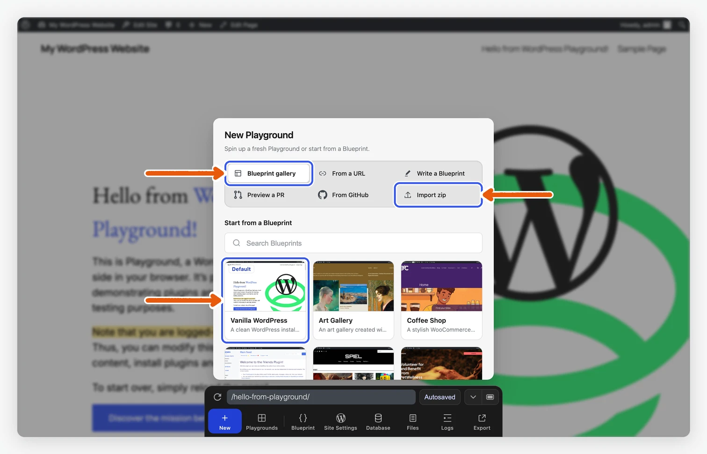

<!-- # How to load and run Blueprints -->

# ब्लूप्रिंट कैसे लोड करें और चलाएँ

<!-- ## Playground Dock -->

## Playground Dock {#playground-dock}

<!-- The easiest way to run a Blueprint from the website is through the Dock: -->

वेबसाइट से ब्लूप्रिंट चलाने का सबसे आसान तरीका Dock है:

<!--
- Open **New → Blueprint gallery** to choose an example.
- Open **New → From a URL** to run a public Blueprint JSON or ZIP bundle URL.
- Open **New → Write a Blueprint** to write a Blueprint in the browser.
- Open **Blueprint** to inspect or edit the current Playground's Blueprint.
-->

- कोई उदाहरण चुनने के लिए **New → Blueprint gallery** खोलें।
- किसी सार्वजनिक ब्लूप्रिंट JSON या ZIP बंडल का URL चलाने के लिए **New → From a URL** खोलें।
- ब्राउज़र में ब्लूप्रिंट लिखने के लिए **New → Write a Blueprint** खोलें।
- मौजूदा Playground का ब्लूप्रिंट देखने या बदलने के लिए **Blueprint** खोलें।

<!-- See [Using Blueprints](/blueprints/using-blueprints) for the full list of UI paths. -->

UI के सभी रास्तों की पूरी सूची के लिए [ब्लूप्रिंट का इस्तेमाल](/blueprints/using-blueprints) देखें।

<!--  -->


<!-- ## URL fragment -->

## URL फ़्रैगमेंट {#url-fragment}

<!-- For links and automation, you can paste a Blueprint into the URL "fragment" of a WordPress Playground website. Just add a `#` after the `.net/`. -->

लिंक और ऑटोमेशन के लिए, आप WordPress Playground वेबसाइट के URL के "फ़्रैगमेंट" में ब्लूप्रिंट पेस्ट कर सकते हैं। बस `.net/` के बाद `#` जोड़ें।

<!-- Let's say you want to create a Playground with specific versions of WordPress and PHP using the following Blueprint: -->

मान लीजिए कि आप इस ब्लूप्रिंट से WordPress और PHP के खास वर्ज़न वाला Playground बनाना चाहते हैं:

```json
{
	"$schema": "https://playground.wordpress.net/blueprint-schema.json",
	"preferredVersions": {
		"php": "8.3",
		"wp": "5.9"
	}
}
```

<!-- To run it, go to `https://playground.wordpress.net/#{"preferredVersions": {"php":"8.3", "wp":"5.9"}}`. You can also use the button below: -->

इसे चलाने के लिए `https://playground.wordpress.net/#{"preferredVersions": {"php":"8.3", "wp":"5.9"}}` पर जाएँ। आप नीचे दिए गए बटन का भी इस्तेमाल कर सकते हैं:

<!-- [<kbd> &nbsp; Run Blueprint &nbsp; </kbd>](https://playground.wordpress.net/#{"preferredVersions":{"php":"8.3","wp":"5.9"}}) -->

[<kbd> &nbsp; ब्लूप्रिंट चलाएँ &nbsp; </kbd>](https://playground.wordpress.net/#{"preferredVersions":{"php":"8.3","wp":"5.9"}})

<!-- Use this method to run the example code in the next chapter, [**Build your first Blueprint**](/blueprints/tutorial/build-your-first-blueprint). -->

अगले अध्याय, [**अपना पहला ब्लूप्रिंट बनाएँ**](/blueprints/tutorial/build-your-first-blueprint), का उदाहरण कोड चलाने के लिए इसी तरीके का इस्तेमाल करें।

<!-- ### Encoded Blueprint fragments -->

### एन्कोड किए गए ब्लूप्रिंट फ़्रैगमेंट {#encoded-blueprint-fragments}

<!-- When you build a Playground link from JavaScript or an automation tool, encode the Blueprint JSON once with `encodeURIComponent(JSON.stringify(blueprint))` and append it after `#`. -->

जब आप JavaScript या किसी ऑटोमेशन टूल से Playground लिंक बनाते हैं, तो ब्लूप्रिंट JSON को `encodeURIComponent(JSON.stringify(blueprint))` से एक बार एन्कोड करें और उसे `#` के बाद जोड़ दें।

<!-- Playground also supports [Base64-encoded Blueprints](https://www.base64encode.org), which are useful when a platform modifies JSON fragments or when you want a compact, copyable link. For example, that's the above Blueprint in Base64 format: `eyJwcmVmZXJyZWRWZXJzaW9ucyI6IHsicGhwIjoiOC4zIiwgIndwIjoiNS45In19`. -->

Playground [Base64 में एन्कोड किए गए ब्लूप्रिंट](https://www.base64encode.org) भी सपोर्ट करता है। ये तब काम आते हैं जब कोई प्लेटफ़ॉर्म JSON फ़्रैगमेंट को बदल देता है, या जब आपको छोटा और आसानी से कॉपी होने वाला लिंक चाहिए। उदाहरण के लिए, ऊपर वाला ब्लूप्रिंट Base64 फ़ॉर्मेट में ऐसा दिखता है: `eyJwcmVmZXJyZWRWZXJzaW9ucyI6IHsicGhwIjoiOC4zIiwgIndwIjoiNS45In19`।

<!-- To run it, go to [https://playground.wordpress.net/#eyJwcmVmZXJyZWRWZXJzaW9ucyI6IHsicGhwIjoiOC4zIiwgIndwIjoiNS45In19](https://playground.wordpress.net/#eyJwcmVmZXJyZWRWZXJzaW9ucyI6IHsicGhwIjoiOC4zIiwgIndwIjoiNS45In19) -->

इसे चलाने के लिए [https://playground.wordpress.net/#eyJwcmVmZXJyZWRWZXJzaW9ucyI6IHsicGhwIjoiOC4zIiwgIndwIjoiNS45In19](https://playground.wordpress.net/#eyJwcmVmZXJyZWRWZXJzaW9ucyI6IHsicGhwIjoiOC4zIiwgIndwIjoiNS45In19) पर जाएँ।

<!-- ### Load Blueprint from a URL -->

### URL से ब्लूप्रिंट लोड करें {#load-blueprint-from-a-url}

<!-- When your Blueprint gets too wieldy, you can load it via the `?blueprint-url` query parameter in the URL, like this: -->

जब आपका ब्लूप्रिंट बहुत बड़ा हो जाए, तो आप उसे URL में `?blueprint-url` क्वेरी पैरामीटर से लोड कर सकते हैं, इस तरह:

<!-- [https://playground.wordpress.net/?blueprint-url=https://raw.githubusercontent.com/wordpress/blueprints/trunk/blueprints/latest-gutenberg/blueprint.json](https://playground.wordpress.net/?blueprint-url=https://raw.githubusercontent.com/wordpress/blueprints/trunk/blueprints/latest-gutenberg/blueprint.json) -->

[https://playground.wordpress.net/?blueprint-url=https://raw.githubusercontent.com/wordpress/blueprints/trunk/blueprints/latest-gutenberg/blueprint.json](https://playground.wordpress.net/?blueprint-url=https://raw.githubusercontent.com/wordpress/blueprints/trunk/blueprints/latest-gutenberg/blueprint.json)

<!-- Note that the Blueprint must be publicly accessible and served with [the correct `Access-Control-Allow-Origin` header](https://developer.mozilla.org/en-US/docs/Web/HTTP/Reference/Headers/Access-Control-Allow-Origin): -->

ध्यान दें कि ब्लूप्रिंट सार्वजनिक रूप से उपलब्ध होना चाहिए और [सही `Access-Control-Allow-Origin` हेडर](https://developer.mozilla.org/en-US/docs/Web/HTTP/Reference/Headers/Access-Control-Allow-Origin) के साथ सर्व किया जाना चाहिए:

```
Access-Control-Allow-Origin: *
```

<!-- When the Playground URL includes the `mcp-port` parameter, Playground rejects Blueprints passed as a URL fragment or through the `blueprint-url` parameter. This prevents prompt injection while the MCP server is active. Remove `mcp-port` from the URL to load a Blueprint this way. -->

जब Playground URL में `mcp-port` पैरामीटर होता है, तो Playground URL फ़्रैगमेंट के रूप में या `blueprint-url` पैरामीटर से दिए गए ब्लूप्रिंट स्वीकार नहीं करता। इससे MCP सर्वर चालू रहते समय प्रॉम्प्ट इंजेक्शन से बचाव होता है। इस तरह ब्लूप्रिंट लोड करने के लिए URL से `mcp-port` हटा दें।
