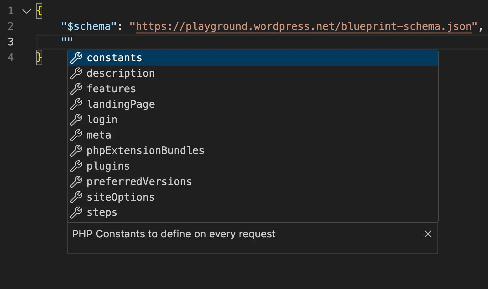
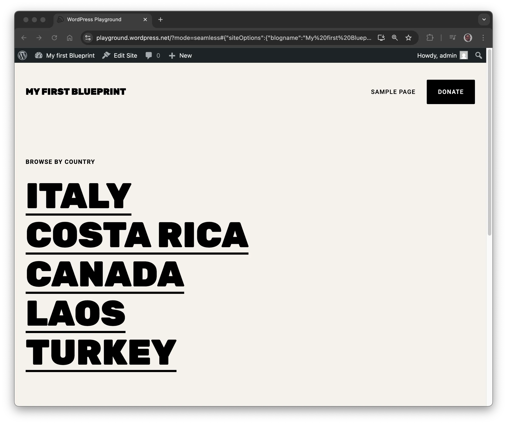
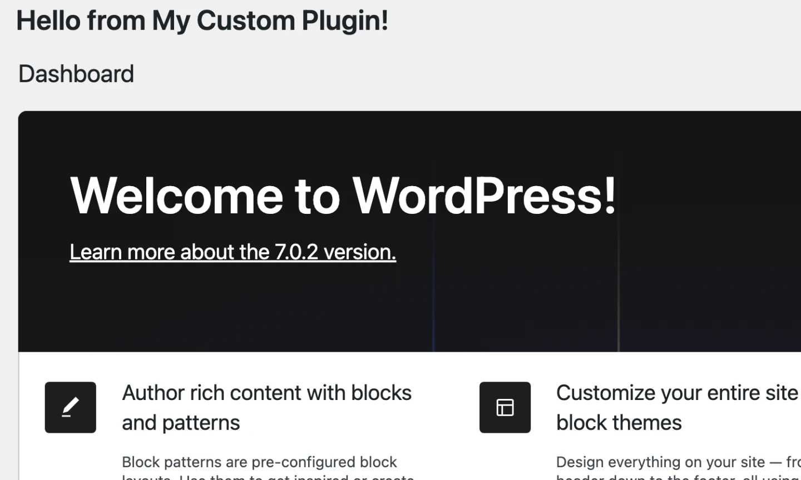

<!-- Let's build an elementary Blueprint that -->

आइए एक आसान सा ब्लूप्रिंट बनाएँ, जो:

<!--
1. Creates a new WordPress site
2. Sets the site title to "My first Blueprint"
3. Installs the _Adventurer_ theme
4. Installs the _Hello Dolly_ plugin from the WordPress plugin directory
5. Installs a custom plugin
6. Changes the site content
-->

1. एक नई WordPress साइट बनाता है
2. साइट का टाइटल "My first Blueprint" सेट करता है
3. _Adventurer_ थीम इंस्टॉल करता है
4. WordPress प्लगइन डायरेक्टरी से _Hello Dolly_ प्लगइन इंस्टॉल करता है
5. एक कस्टम प्लगइन इंस्टॉल करता है
6. साइट का कंटेंट बदलता है

<!-- ## 1. Create a new WordPress site -->

## 1. नई WordPress साइट बनाना {#1-create-a-new-wordpress-site}

<!-- Let's start by creating a `blueprint.json` file with the following contents: -->

सबसे पहले इस कंटेंट के साथ एक `blueprint.json` फ़ाइल बनाएँ:

```json
{}
```

<!-- It may seem like nothing is happening, but this Blueprint already spins up a WordPress site with the latest major version. -->

भले ही लगे कि कुछ नहीं हो रहा, पर यह ब्लूप्रिंट पहले से ही WordPress के सबसे नए मेजर वर्ज़न वाली साइट शुरू कर देता है।

<!-- [<kbd> &nbsp; Run Blueprint &nbsp; </kbd>](https://playground.wordpress.net/#{}) -->

[<kbd> &nbsp; ब्लूप्रिंट चलाएँ &nbsp; </kbd>](https://playground.wordpress.net/#{})

<div class="callout callout-tip">

<!-- **Autocomplete** -->

**ऑटोकम्प्लीट**

<!-- If you use an IDE, like VS Code or PHPStorm, you can use the [Blueprint JSON Schema](https://playground.wordpress.net/blueprint-schema.json) for an autocompleted Blueprint development experience. Add the following line at the top of your `blueprint.json` file: -->

अगर आप VS Code या PHPStorm जैसा कोई IDE इस्तेमाल करते हैं, तो ब्लूप्रिंट लिखते समय ऑटोकम्प्लीट के लिए [ब्लूप्रिंट JSON स्कीमा](https://playground.wordpress.net/blueprint-schema.json) इस्तेमाल कर सकते हैं। अपनी `blueprint.json` फ़ाइल में सबसे ऊपर यह लाइन जोड़ें:

```json
{
	"$schema": "https://playground.wordpress.net/blueprint-schema.json"
}
```

</div>

<!-- Here's what it looks like in VS Code: -->

VS Code में यह ऐसा दिखता है:

<!--  -->


<!-- ## 2. Set the site title to "My first Blueprint" -->

## 2. साइट का टाइटल "My first Blueprint" सेट करना {#2-set-the-site-title-to-my-first-blueprint}

<!-- Blueprints consist of a series of [steps](/blueprints/steps) that define how to build a WordPress site. Before you write the first step, declare an empty list of steps: -->

ब्लूप्रिंट कई [स्टेप](/blueprints/steps) से मिलकर बनते हैं, जो तय करते हैं कि WordPress साइट कैसे बनेगी। पहला स्टेप लिखने से पहले स्टेप की एक खाली सूची बनाएँ:

```json
{
	"$schema": "https://playground.wordpress.net/blueprint-schema.json",
	"steps": []
}
```

<!-- This Blueprint isn't very exciting—it creates the same default site as the empty Blueprint above. Let's do something about it! -->

यह ब्लूप्रिंट बहुत दिलचस्प नहीं है, क्योंकि यह ऊपर वाले खाली ब्लूप्रिंट जैसी ही डिफ़ॉल्ट साइट बनाता है। आइए इसमें कुछ जोड़ें!

<!-- WordPress stores the site title in the `blogname` option. Add your first step and set that option to "My first Blueprint": -->

WordPress साइट का टाइटल `blogname` विकल्प में रखता है। अपना पहला स्टेप जोड़ें और उस विकल्प को "My first Blueprint" पर सेट करें:

```json
{
	"$schema": "https://playground.wordpress.net/blueprint-schema.json",
	"steps": [
		{
			"step": "setSiteOptions",
			"options": {
				"blogname": "My first Blueprint"
			}
		}
	]
}
```

<!-- [<kbd> &nbsp; Run Blueprint &nbsp; </kbd>](https://playground.wordpress.net/#eyIkc2NoZW1hIjoiaHR0cHM6Ly9wbGF5Z3JvdW5kLndvcmRwcmVzcy5uZXQvYmx1ZXByaW50LXNjaGVtYS5qc29uIiwic3RlcHMiOlt7InN0ZXAiOiJzZXRTaXRlT3B0aW9ucyIsIm9wdGlvbnMiOnsiYmxvZ25hbWUiOiJNeSBmaXJzdCBCbHVlcHJpbnQifX1dfQ==) -->

[<kbd> &nbsp; ब्लूप्रिंट चलाएँ &nbsp; </kbd>](https://playground.wordpress.net/#eyIkc2NoZW1hIjoiaHR0cHM6Ly9wbGF5Z3JvdW5kLndvcmRwcmVzcy5uZXQvYmx1ZXByaW50LXNjaGVtYS5qc29uIiwic3RlcHMiOlt7InN0ZXAiOiJzZXRTaXRlT3B0aW9ucyIsIm9wdGlvbnMiOnsiYmxvZ25hbWUiOiJNeSBmaXJzdCBCbHVlcHJpbnQifX1dfQ==)

<!-- The [`setSiteOptions` step](/blueprints/steps#SetSiteOptionsStep) specifies the site options in the WordPress database. The `options` object contains the key-value pairs to set. In this case, you changed the value of the `blogname` key to "My first Blueprint". You can read more about all available steps in the [Blueprint Steps API Reference](/blueprints/steps). -->

[`setSiteOptions` स्टेप](/blueprints/steps#SetSiteOptionsStep) WordPress डेटाबेस में साइट के विकल्प सेट करता है। `options` ऑब्जेक्ट में सेट किए जाने वाले key और value के जोड़े होते हैं। इस मामले में आपने `blogname` key की वैल्यू बदलकर "My first Blueprint" कर दी। सभी उपलब्ध स्टेप के बारे में आप [Blueprint Steps API रेफ़रेंस](/blueprints/steps) में और पढ़ सकते हैं।

<!-- ### Shorthands -->

### शॉर्टहैंड {#shorthands}

<!-- You can specify some steps using a shorthand syntax. For example, you could write the `setSiteOptions` step like this: -->

आप कुछ स्टेप को शॉर्टहैंड सिंटैक्स से भी लिख सकते हैं। उदाहरण के लिए, `setSiteOptions` स्टेप को आप ऐसे लिख सकते हैं:

```json
{
	"$schema": "https://playground.wordpress.net/blueprint-schema.json",
	"siteOptions": {
		"blogname": "My first Blueprint"
	}
}
```

<!-- The shorthand syntax and the step syntax correspond with each other. Every step specified with the shorthand syntax is automatically added at the beginning of the `steps` array in an arbitrary order. Which should you choose? Use shorthands when brevity is your main concern, use steps when you need more control over the order of execution. -->

शॉर्टहैंड सिंटैक्स और स्टेप सिंटैक्स एक दूसरे से मेल खाते हैं। शॉर्टहैंड सिंटैक्स से लिखा गया हर स्टेप अपने आप `steps` ऐरे की शुरुआत में किसी भी क्रम में जुड़ जाता है। आपको कौन सा चुनना चाहिए? जब कम शब्दों में लिखना आपकी मुख्य ज़रूरत हो, तो शॉर्टहैंड इस्तेमाल करें, और जब आपको चलने के क्रम पर ज़्यादा नियंत्रण चाहिए, तो स्टेप इस्तेमाल करें।

<!-- ## 3. Install the _Adventurer_ theme -->

## 3. _Adventurer_ थीम इंस्टॉल करना {#3-install-the-adventurer-theme}

<!-- Adventurer is an open-source theme [available in the WordPress theme directory](https://wordpress.org/themes/adventurer/). Let's install it using the [`installTheme` step](/blueprints/steps#InstallThemeStep): -->

Adventurer एक ओपन सोर्स थीम है, जो [WordPress थीम डायरेक्टरी में उपलब्ध है](https://wordpress.org/themes/adventurer/)। आइए इसे [`installTheme` स्टेप](/blueprints/steps#InstallThemeStep) से इंस्टॉल करें:

```json
{
	"siteOptions": {
		"blogname": "My first Blueprint"
	},
	"steps": [
		{
			"step": "installTheme",
			"themeData": {
				"resource": "wordpress.org/themes",
				"slug": "adventurer"
			}
		}
	]
}
```

<!-- [<kbd> &nbsp; Run Blueprint &nbsp; </kbd>](https://playground.wordpress.net/#eyJzaXRlT3B0aW9ucyI6eyJibG9nbmFtZSI6Ik15IGZpcnN0IEJsdWVwcmludCJ9LCJzdGVwcyI6W3sic3RlcCI6Imluc3RhbGxUaGVtZSIsInRoZW1lRGF0YSI6eyJyZXNvdXJjZSI6IndvcmRwcmVzcy5vcmcvdGhlbWVzIiwic2x1ZyI6ImFkdmVudHVyZXIifX1dfQ==) -->

[<kbd> &nbsp; ब्लूप्रिंट चलाएँ &nbsp; </kbd>](https://playground.wordpress.net/#eyJzaXRlT3B0aW9ucyI6eyJibG9nbmFtZSI6Ik15IGZpcnN0IEJsdWVwcmludCJ9LCJzdGVwcyI6W3sic3RlcCI6Imluc3RhbGxUaGVtZSIsInRoZW1lRGF0YSI6eyJyZXNvdXJjZSI6IndvcmRwcmVzcy5vcmcvdGhlbWVzIiwic2x1ZyI6ImFkdmVudHVyZXIifX1dfQ==)

<!-- The site should now look like the screenshot below: -->

अब साइट नीचे दिए गए स्क्रीनशॉट जैसी दिखनी चाहिए:

<!--  -->


<!-- ### Resources -->

### रिसोर्स {#resources}

<!-- The `themeData` defines a [resource](/blueprints/steps/resources) and references an external file required to complete the step. Playground supports different types of resources, including -->

`themeData` एक [रिसोर्स](/blueprints/steps/resources) तय करता है और उस बाहरी फ़ाइल का हवाला देता है, जो स्टेप पूरा करने के लिए ज़रूरी है। Playground कई तरह के रिसोर्स सपोर्ट करता है, जैसे

<!--
- `url`,
- `wordpress.org/themes`,
- `wordpress.org/plugins`,
- `vfs`(virtual file system), or
- `literal`.
-->

- `url`,
- `wordpress.org/themes`,
- `wordpress.org/plugins`,
- `vfs` (वर्चुअल फ़ाइल सिस्टम), या
- `literal`।

<!-- The example uses the `wordpress.org/themes` resource, which requires a `slug` identical to the one used in WordPress theme directory: -->

उदाहरण में `wordpress.org/themes` रिसोर्स इस्तेमाल हुआ है, जिसके लिए वही `slug` चाहिए जो WordPress थीम डायरेक्टरी में इस्तेमाल होता है:

<!-- In this case, `https://wordpress.org/themes/<slug>/` becomes `https://wordpress.org/themes/adventurer/`. -->

इस मामले में `https://wordpress.org/themes/<slug>/`, `https://wordpress.org/themes/adventurer/` बन जाता है।

<div class="callout callout-info">

<!-- Learn more about the supported resources in the [Blueprint Resources API Reference](/blueprints/steps/resources/). -->

समर्थित रिसोर्स के बारे में [Blueprint Resources API रेफ़रेंस](/blueprints/steps/resources/) में और जानें।

</div>

<!-- ## 4. Install the _Hello Dolly_ plugin -->

## 4. _Hello Dolly_ प्लगइन इंस्टॉल करना {#4-install-the-hello-dolly-plugin}

<!-- A classic WordPress plugin that displays random lyrics from the song "Hello, Dolly!" in the admin dashboard. Let's install it using the [`installPlugin` step](/blueprints/steps#InstallPluginStep): -->

यह एक क्लासिक WordPress प्लगइन है, जो एडमिन डैशबोर्ड में "Hello, Dolly!" गाने की लाइनें रैंडम तरीके से दिखाता है। आइए इसे [`installPlugin` स्टेप](/blueprints/steps#InstallPluginStep) से इंस्टॉल करें:

```json
{
	"siteOptions": {
		"blogname": "My first Blueprint"
	},
	"steps": [
		{
			"step": "installTheme",
			"themeData": {
				"resource": "wordpress.org/themes",
				"slug": "adventurer"
			}
		},
		{
			"step": "installPlugin",
			"pluginData": {
				"resource": "wordpress.org/plugins",
				"slug": "hello-dolly"
			}
		}
	]
}
```

<!-- [<kbd> &nbsp; Run Blueprint &nbsp; </kbd>](https://playground.wordpress.net/#eyJzaXRlT3B0aW9ucyI6eyJibG9nbmFtZSI6Ik15IGZpcnN0IEJsdWVwcmludCJ9LCJzdGVwcyI6W3sic3RlcCI6Imluc3RhbGxUaGVtZSIsInRoZW1lWmlwRmlsZSI6eyJyZXNvdXJjZSI6IndvcmRwcmVzcy5vcmcvdGhlbWVzIiwic2x1ZyI6ImFkdmVudHVyZXIifX0seyJzdGVwIjoiaW5zdGFsbFBsdWdpbiIsInBsdWdpblppcEZpbGUiOnsicmVzb3VyY2UiOiJ3b3JkcHJlc3Mub3JnL3BsdWdpbnMiLCJzbHVnIjoiaGVsbG8tZG9sbHkifX1dfQ==) -->

[<kbd> &nbsp; ब्लूप्रिंट चलाएँ &nbsp; </kbd>](https://playground.wordpress.net/#eyJzaXRlT3B0aW9ucyI6eyJibG9nbmFtZSI6Ik15IGZpcnN0IEJsdWVwcmludCJ9LCJzdGVwcyI6W3sic3RlcCI6Imluc3RhbGxUaGVtZSIsInRoZW1lWmlwRmlsZSI6eyJyZXNvdXJjZSI6IndvcmRwcmVzcy5vcmcvdGhlbWVzIiwic2x1ZyI6ImFkdmVudHVyZXIifX0seyJzdGVwIjoiaW5zdGFsbFBsdWdpbiIsInBsdWdpblppcEZpbGUiOnsicmVzb3VyY2UiOiJ3b3JkcHJlc3Mub3JnL3BsdWdpbnMiLCJzbHVnIjoiaGVsbG8tZG9sbHkifX1dfQ==)

<!-- The Hello Dolly plugin is now installed and activated. -->

Hello Dolly प्लगइन अब इंस्टॉल और एक्टिवेट हो गया है।

<!-- Like the `themeData`, the `pluginData` defines a reference to an external file required for the step. The example uses the `wordpress.org/plugins` resource to install the plugin with the matching `slug` from the WordPress plugin directory. -->

`themeData` की तरह `pluginData` भी स्टेप के लिए ज़रूरी बाहरी फ़ाइल का हवाला तय करता है। उदाहरण में `wordpress.org/plugins` रिसोर्स से WordPress प्लगइन डायरेक्टरी का वह प्लगइन इंस्टॉल किया गया है, जिसका `slug` मेल खाता है।

<!-- ## 5. Install a custom plugin -->

## 5. कस्टम प्लगइन इंस्टॉल करना {#5-install-a-custom-plugin}

<!-- Let's install a custom WordPress plugin that adds a message to the admin dashboard: -->

आइए एक कस्टम WordPress प्लगइन इंस्टॉल करें, जो एडमिन डैशबोर्ड में एक मैसेज जोड़ता है:

```php
<?php
/*
Plugin Name: "Hello" on the Dashboard
Description: A custom plugin to showcase WordPress Blueprints
Version: 1.0
Author: WordPress Contributors
*/

function my_custom_plugin() {
    echo '<h1>Hello from My Custom Plugin!</h1>';
}

add_action('admin_notices', 'my_custom_plugin');
```

<!-- You can use the [installPlugin](/blueprints/steps#InstallPluginStep), but that requires creating a ZIP file. Let's start with something different to see if the plugin works: -->

आप [installPlugin](/blueprints/steps#InstallPluginStep) इस्तेमाल कर सकते हैं, लेकिन उसके लिए ZIP फ़ाइल बनानी पड़ती है। यह देखने के लिए कि प्लगइन काम करता है या नहीं, आइए कुछ अलग तरीके से शुरू करें:

<!--
1. Create a `wp-content/plugins/hello-from-the-dashboard` directory using the [`mkdir` step](/blueprints/steps#MkdirStep).
2. Write a `plugin.php` file using the [`writeFile` step](/blueprints/steps#WriteFileStep).
3. Activate the plugin using the [`activatePlugin` step](/blueprints/steps#ActivatePluginStep).
-->

1. [`mkdir` स्टेप](/blueprints/steps#MkdirStep) से एक `wp-content/plugins/hello-from-the-dashboard` डायरेक्टरी बनाएँ।
2. [`writeFile` स्टेप](/blueprints/steps#WriteFileStep) से एक `plugin.php` फ़ाइल लिखें।
3. [`activatePlugin` स्टेप](/blueprints/steps#ActivatePluginStep) से प्लगइन एक्टिवेट करें।

<!-- Here's what that looks like in a Blueprint: -->

ब्लूप्रिंट में यह ऐसा दिखता है:

```json
{
	// ...
	"steps": [
		// ...
		{
			"step": "mkdir",
			"path": "/wordpress/wp-content/plugins/hello-from-the-dashboard"
		},
		{
			"step": "writeFile",
			"path": "/wordpress/wp-content/plugins/hello-from-the-dashboard/plugin.php",
			"data": "<?php\n/*\nPlugin Name: \"Hello\" on the Dashboard\nDescription: A custom plugin to showcase WordPress Blueprints\nVersion: 1.0\nAuthor: WordPress Contributors\n*/\n\nfunction my_custom_plugin() {\n    echo '<h1>Hello from My Custom Plugin!</h1>';\n}\n\nadd_action('admin_notices', 'my_custom_plugin');"
		},
		{
			"step": "activatePlugin",
			"pluginPath": "hello-from-the-dashboard/plugin.php"
		}
	]
}
```

<!-- The last thing to do is log the user in as an admin. You can do that with a shorthand of the [`login` step](/blueprints/steps#LoginStep): -->

आखिरी काम है उपयोगकर्ता को एडमिन के रूप में लॉग इन करना। यह आप [`login` स्टेप](/blueprints/steps#LoginStep) के शॉर्टहैंड से कर सकते हैं:

```json
{
	"login": true,
	"steps": {
		// ...
	}
}
```

<!-- Here's the complete Blueprint: -->

यह रहा पूरा ब्लूप्रिंट:

```json
{
	"$schema": "https://playground.wordpress.net/blueprint-schema.json",
	"login": true,
	"siteOptions": {
		"blogname": "My first Blueprint"
	},
	"steps": [
		{
			"step": "installTheme",
			"themeData": {
				"resource": "wordpress.org/themes",
				"slug": "adventurer"
			}
		},
		{
			"step": "installPlugin",
			"pluginData": {
				"resource": "wordpress.org/plugins",
				"slug": "hello-dolly"
			}
		},
		{
			"step": "mkdir",
			"path": "/wordpress/wp-content/plugins/hello-from-the-dashboard"
		},
		{
			"step": "writeFile",
			"path": "/wordpress/wp-content/plugins/hello-from-the-dashboard/plugin.php",
			"data": "<?php\n/*\nPlugin Name: \"Hello\" on the Dashboard\nDescription: A custom plugin to showcase WordPress Blueprints\nVersion: 1.0\nAuthor: WordPress Contributors\n*/\n\nfunction my_custom_plugin() {\n    echo '<h1>Hello from My Custom Plugin!</h1>';\n}\n\nadd_action('admin_notices', 'my_custom_plugin');"
		},
		{
			"step": "activatePlugin",
			"pluginPath": "hello-from-the-dashboard/plugin.php"
		}
	]
}
```

<!-- [<kbd> &nbsp; Run Blueprint &nbsp; </kbd>](https://playground.wordpress.net/#eyJsb2dpbiI6dHJ1ZSwic2l0ZU9wdGlvbnMiOnsiYmxvZ25hbWUiOiJNeSBmaXJzdCBCbHVlcHJpbnQifSwic3RlcHMiOlt7InN0ZXAiOiJpbnN0YWxsVGhlbWUiLCJ0aGVtZVppcEZpbGUiOnsicmVzb3VyY2UiOiJ3b3JkcHJlc3Mub3JnL3RoZW1lcyIsInNsdWciOiJhZHZlbnR1cmVyIn19LHsic3RlcCI6Imluc3RhbGxQbHVnaW4iLCJwbHVnaW5aaXBGaWxlIjp7InJlc291cmNlIjoid29yZHByZXNzLm9yZy9wbHVnaW5zIiwic2x1ZyI6ImhlbGxvLWRvbGx5In19LHsic3RlcCI6Im1rZGlyIiwicGF0aCI6Ii93b3JkcHJlc3Mvd3AtY29udGVudC9wbHVnaW5zL2hlbGxvLW9uLXRoZS1kYXNoYm9hcmQifSx7InN0ZXAiOiJ3cml0ZUZpbGUiLCJwYXRoIjoiL3dvcmRwcmVzcy93cC1jb250ZW50L3BsdWdpbnMvaGVsbG8tb24tdGhlLWRhc2hib2FyZC9wbHVnaW4ucGhwIiwiZGF0YSI6Ijw/cGhwXG4vKlxuUGx1Z2luIE5hbWU6IFwiSGVsbG9cIiBvbiB0aGUgRGFzaGJvYXJkXG5EZXNjcmlwdGlvbjogQSBjdXN0b20gcGx1Z2luIHRvIHNob3djYXNlIFdvcmRQcmVzcyBCbHVlcHJpbnRzXG5WZXJzaW9uOiAxLjBcbkF1dGhvcjogV29yZFByZXNzIENvbnRyaWJ1dG9yc1xuKi9cblxuZnVuY3Rpb24gbXlfY3VzdG9tX3BsdWdpbigpIHtcbiAgICBlY2hvICc8aDE+SGVsbG8gZnJvbSBNeSBDdXN0b20gUGx1Z2luITwvaDE+Jztcbn1cblxuYWRkX2FjdGlvbignYWRtaW5fbm90aWNlcycsICdteV9jdXN0b21fcGx1Z2luJyk7In0seyJzdGVwIjoiYWN0aXZhdGVQbHVnaW4iLCJwbHVnaW5QYXRoIjoiaGVsbG8tb24tdGhlLWRhc2hib2FyZC9wbHVnaW4ucGhwIn1dfQ==) -->

[<kbd> &nbsp; ब्लूप्रिंट चलाएँ &nbsp; </kbd>](https://playground.wordpress.net/#eyJsb2dpbiI6dHJ1ZSwic2l0ZU9wdGlvbnMiOnsiYmxvZ25hbWUiOiJNeSBmaXJzdCBCbHVlcHJpbnQifSwic3RlcHMiOlt7InN0ZXAiOiJpbnN0YWxsVGhlbWUiLCJ0aGVtZVppcEZpbGUiOnsicmVzb3VyY2UiOiJ3b3JkcHJlc3Mub3JnL3RoZW1lcyIsInNsdWciOiJhZHZlbnR1cmVyIn19LHsic3RlcCI6Imluc3RhbGxQbHVnaW4iLCJwbHVnaW5aaXBGaWxlIjp7InJlc291cmNlIjoid29yZHByZXNzLm9yZy9wbHVnaW5zIiwic2x1ZyI6ImhlbGxvLWRvbGx5In19LHsic3RlcCI6Im1rZGlyIiwicGF0aCI6Ii93b3JkcHJlc3Mvd3AtY29udGVudC9wbHVnaW5zL2hlbGxvLW9uLXRoZS1kYXNoYm9hcmQifSx7InN0ZXAiOiJ3cml0ZUZpbGUiLCJwYXRoIjoiL3dvcmRwcmVzcy93cC1jb250ZW50L3BsdWdpbnMvaGVsbG8tb24tdGhlLWRhc2hib2FyZC9wbHVnaW4ucGhwIiwiZGF0YSI6Ijw/cGhwXG4vKlxuUGx1Z2luIE5hbWU6IFwiSGVsbG9cIiBvbiB0aGUgRGFzaGJvYXJkXG5EZXNjcmlwdGlvbjogQSBjdXN0b20gcGx1Z2luIHRvIHNob3djYXNlIFdvcmRQcmVzcyBCbHVlcHJpbnRzXG5WZXJzaW9uOiAxLjBcbkF1dGhvcjogV29yZFByZXNzIENvbnRyaWJ1dG9yc1xuKi9cblxuZnVuY3Rpb24gbXlfY3VzdG9tX3BsdWdpbigpIHtcbiAgICBlY2hvICc8aDE+SGVsbG8gZnJvbSBNeSBDdXN0b20gUGx1Z2luITwvaDE+Jztcbn1cblxuYWRkX2FjdGlvbignYWRtaW5fbm90aWNlcycsICdteV9jdXN0b21fcGx1Z2luJyk7In0seyJzdGVwIjoiYWN0aXZhdGVQbHVnaW4iLCJwbHVnaW5QYXRoIjoiaGVsbG8tb24tdGhlLWRhc2hib2FyZC9wbHVnaW4ucGhwIn1dfQ==)

<!-- That's what it looks like when you navigate to the dashboard: -->

डैशबोर्ड पर जाने पर यह ऐसा दिखता है:

<!--  -->


<!-- ### Create a plugin and zip it -->

### प्लगइन बनाना और उसे ZIP करना {#create-a-plugin-and-zip-it}

<!-- Encoding PHP files as `JSON` can be useful for quick testing, but it's inconvenient and difficult to read. Instead, create a file with the plugin code, compress it, and use the `ZIP` file as the `resource` in the [`installPlugin` step](/blueprints/steps#InstallPluginStep) to install it (the path in the `URL` should match the one in your GitHub repository): -->

जल्दी टेस्ट करने के लिए PHP फ़ाइलों को `JSON` में एन्कोड करना काम का हो सकता है, लेकिन यह असुविधाजनक है और इसे पढ़ना मुश्किल होता है। इसकी जगह प्लगइन कोड वाली एक फ़ाइल बनाएँ, उसे कंप्रेस करें, और उसे इंस्टॉल करने के लिए [`installPlugin` स्टेप](/blueprints/steps#InstallPluginStep) में `ZIP` फ़ाइल को `resource` के रूप में इस्तेमाल करें (`URL` में पाथ वही होना चाहिए जो आपकी GitHub रिपॉज़िटरी में है):

```json
{
	"$schema": "https://playground.wordpress.net/blueprint-schema.json",
	"login": true,
	"siteOptions": {
		"blogname": "My first Blueprint"
	},
	"steps": [
		{
			"step": "installTheme",
			"themeData": {
				"resource": "wordpress.org/themes",
				"slug": "adventurer"
			}
		},
		{
			"step": "installPlugin",
			"pluginData": {
				"resource": "wordpress.org/plugins",
				"slug": "hello-dolly"
			}
		},
		{
			"step": "installPlugin",
			"pluginData": {
				"resource": "url",
				"url": "https://raw.githubusercontent.com/wordpress/blueprints/trunk/docs/assets/hello-from-the-dashboard.zip"
			}
		}
	]
}
```

<!-- You can shorten that Blueprint even more using the shorthand syntax: -->

शॉर्टहैंड सिंटैक्स से आप इस ब्लूप्रिंट को और छोटा कर सकते हैं:

```json
{
	"$schema": "https://playground.wordpress.net/blueprint-schema.json",
	"login": true,
	"siteOptions": {
		"blogname": "My first Blueprint"
	},
	"plugins": ["hello-dolly", "https://raw.githubusercontent.com/wordpress/blueprints/trunk/docs/assets/hello-from-the-dashboard.zip"],
	"steps": [
		{
			"step": "installTheme",
			"themeData": {
				"resource": "wordpress.org/themes",
				"slug": "adventurer"
			}
		}
	]
}
```

<!-- [<kbd> &nbsp; Run Blueprint &nbsp; </kbd>](https://playground.wordpress.net/#eyIkc2NoZW1hIjoiaHR0cHM6Ly9wbGF5Z3JvdW5kLndvcmRwcmVzcy5uZXQvYmx1ZXByaW50LXNjaGVtYS5qc29uIiwibG9naW4iOnRydWUsInNpdGVPcHRpb25zIjp7ImJsb2duYW1lIjoiTXkgZmlyc3QgQmx1ZXByaW50In0sInBsdWdpbnMiOlsiaGVsbG8tZG9sbHkiLCJodHRwczovL3Jhdy5naXRodWJ1c2VyY29udGVudC5jb20vd29yZHByZXNzL2JsdWVwcmludHMvdHJ1bmsvZG9jcy9hc3NldHMvaGVsbG8tZnJvbS10aGUtZGFzaGJvYXJkLnppcCJdLCJzdGVwcyI6W3sic3RlcCI6Imluc3RhbGxUaGVtZSIsInRoZW1lRGF0YSI6eyJyZXNvdXJjZSI6IndvcmRwcmVzcy5vcmcvdGhlbWVzIiwic2x1ZyI6ImFkdmVudHVyZXIifX1dfQ==) -->

[<kbd> &nbsp; ब्लूप्रिंट चलाएँ &nbsp; </kbd>](https://playground.wordpress.net/#eyIkc2NoZW1hIjoiaHR0cHM6Ly9wbGF5Z3JvdW5kLndvcmRwcmVzcy5uZXQvYmx1ZXByaW50LXNjaGVtYS5qc29uIiwibG9naW4iOnRydWUsInNpdGVPcHRpb25zIjp7ImJsb2duYW1lIjoiTXkgZmlyc3QgQmx1ZXByaW50In0sInBsdWdpbnMiOlsiaGVsbG8tZG9sbHkiLCJodHRwczovL3Jhdy5naXRodWJ1c2VyY29udGVudC5jb20vd29yZHByZXNzL2JsdWVwcmludHMvdHJ1bmsvZG9jcy9hc3NldHMvaGVsbG8tZnJvbS10aGUtZGFzaGJvYXJkLnppcCJdLCJzdGVwcyI6W3sic3RlcCI6Imluc3RhbGxUaGVtZSIsInRoZW1lRGF0YSI6eyJyZXNvdXJjZSI6IndvcmRwcmVzcy5vcmcvdGhlbWVzIiwic2x1ZyI6ImFkdmVudHVyZXIifX1dfQ==)

<!-- ## 6. Change the site content -->

## 6. साइट का कंटेंट बदलना {#6-change-the-site-content}

<!-- Finally, let's delete the default content of the site and import a new one from a WordPress export file (WXR). -->

आखिर में, आइए साइट का डिफ़ॉल्ट कंटेंट हटाएँ और WordPress एक्सपोर्ट फ़ाइल (WXR) से नया कंटेंट इम्पोर्ट करें।

<!-- ### Delete the old content -->

### पुराना कंटेंट हटाना {#delete-the-old-content}

<!-- There isn't a Blueprint step to delete the default content, but you can do that with a snippet of PHP code: -->

डिफ़ॉल्ट कंटेंट हटाने के लिए कोई ब्लूप्रिंट स्टेप नहीं है, लेकिन यह काम आप PHP कोड के एक छोटे हिस्से से कर सकते हैं:

```php
<?php
require '/wordpress/wp-load.php';

// Delete all posts and pages
$posts = get_posts(array(
    'numberposts' => -1,
    'post_type' => array('post', 'page'),
    'post_status' => 'any'
));

foreach ($posts as $post) {
    wp_delete_post($post->ID, true);
}
```

<!-- To run that code during the site setup, use the [`runPHP` step](/blueprints/steps#RunPHPStep): -->

साइट सेटअप के दौरान वह कोड चलाने के लिए [`runPHP` स्टेप](/blueprints/steps#RunPHPStep) इस्तेमाल करें:

```json
{
	// ...
	"steps": [
		// ...
		{
			"step": "runPHP",
			"code": "<?php\nrequire '/wordpress/wp-load.php';\n\n$posts = get_posts(array(\n    'numberposts' => -1,\n    'post_type' => array('post', 'page'),\n    'post_status' => 'any'\n));\n\nforeach ($posts as $post) {\n    wp_delete_post($post->ID, true);\n}"
		}
	]
}
```

<!-- ### Import the new content -->

### नया कंटेंट इम्पोर्ट करना {#import-the-new-content}

<!-- Let's use the [`importWxr` step](/blueprints/steps#ImportWxrStep) to import a WordPress export (`WXR`) file that helps test WordPress themes. The file is available in the [WordPress/theme-test-data](https://github.com/WordPress/theme-test-data) repository, and you can access it via its `raw.githubusercontent.com` address: [https://raw.githubusercontent.com/WordPress/theme-test-data/master/themeunittestdata.wordpress.xml](https://raw.githubusercontent.com/WordPress/theme-test-data/master/themeunittestdata.wordpress.xml). -->

आइए [`importWxr` स्टेप](/blueprints/steps#ImportWxrStep) से एक WordPress एक्सपोर्ट (`WXR`) फ़ाइल इम्पोर्ट करें, जो WordPress थीम टेस्ट करने में मदद करती है। यह फ़ाइल [WordPress/theme-test-data](https://github.com/WordPress/theme-test-data) रिपॉज़िटरी में उपलब्ध है, और आप इसे इसके `raw.githubusercontent.com` पते से खोल सकते हैं: [https://raw.githubusercontent.com/WordPress/theme-test-data/master/themeunittestdata.wordpress.xml](https://raw.githubusercontent.com/WordPress/theme-test-data/master/themeunittestdata.wordpress.xml)।

<!-- Here's what the final Blueprint looks like: -->

फ़ाइनल ब्लूप्रिंट ऐसा दिखता है:

```json
{
	"$schema": "https://playground.wordpress.net/blueprint-schema.json",
	"login": true,
	"siteOptions": {
		"blogname": "My first Blueprint"
	},
	"plugins": ["hello-dolly", "https://raw.githubusercontent.com/wordpress/blueprints/trunk/docs/assets/hello-from-the-dashboard.zip"],
	"steps": [
		{
			"step": "installTheme",
			"themeData": {
				"resource": "wordpress.org/themes",
				"slug": "adventurer"
			}
		},
		{
			"step": "runPHP",
			"code": "<?php\nrequire '/wordpress/wp-load.php';\n\n$posts = get_posts(array(\n    'numberposts' => -1,\n    'post_type' => array('post', 'page'),\n    'post_status' => 'any'\n));\n\nforeach ($posts as $post) {\n    wp_delete_post($post->ID, true);\n}"
		},
		{
			"step": "importWxr",
			"file": {
				"resource": "url",
				"url": "https://raw.githubusercontent.com/WordPress/theme-test-data/master/themeunittestdata.wordpress.xml"
			}
		}
	]
}
```

<!-- [<kbd> &nbsp; Run Blueprint &nbsp; </kbd>](https://playground.wordpress.net/#eyIkc2NoZW1hIjoiaHR0cHM6Ly9wbGF5Z3JvdW5kLndvcmRwcmVzcy5uZXQvYmx1ZXByaW50LXNjaGVtYS5qc29uIiwibG9naW4iOnRydWUsInNpdGVPcHRpb25zIjp7ImJsb2duYW1lIjoiTXkgZmlyc3QgQmx1ZXByaW50In0sInBsdWdpbnMiOlsiaGVsbG8tZG9sbHkiLCJodHRwczovL3Jhdy5naXRodWJ1c2VyY29udGVudC5jb20vYWRhbXppZWwvYmx1ZXByaW50cy90cnVuay9kb2NzL2Fzc2V0cy9oZWxsby1mcm9tLXRoZS1kYXNoYm9hcmQuemlwIl0sInN0ZXBzIjpbeyJzdGVwIjoiaW5zdGFsbFRoZW1lIiwidGhlbWVaaXBGaWxlIjp7InJlc291cmNlIjoid29yZHByZXNzLm9yZy90aGVtZXMiLCJzbHVnIjoiYWR2ZW50dXJlciJ9fSx7InN0ZXAiOiJydW5QSFAiLCJjb2RlIjoiPD9waHBcbnJlcXVpcmUgJy93b3JkcHJlc3Mvd3AtbG9hZC5waHAnO1xuXG4kcG9zdHMgPSBnZXRfcG9zdHMoYXJyYXkoXG4gICAgJ251bWJlcnBvc3RzJyA9PiAtMSxcbiAgICAncG9zdF90eXBlJyA9PiBhcnJheSgncG9zdCcsICdwYWdlJyksXG4gICAgJ3Bvc3Rfc3RhdHVzJyA9PiAnYW55J1xuKSk7XG5cbmZvcmVhY2ggKCRwb3N0cyBhcyAkcG9zdCkge1xuICAgIHdwX2RlbGV0ZV9wb3N0KCRwb3N0LT5JRCwgdHJ1ZSk7XG59In0seyJzdGVwIjoiaW1wb3J0V3hyIiwiZmlsZSI6eyJyZXNvdXJjZSI6InVybCIsInVybCI6Imh0dHBzOi8vcmF3LmdpdGh1YnVzZXJjb250ZW50LmNvbS9Xb3JkUHJlc3MvdGhlbWUtdGVzdC1kYXRhL21hc3Rlci90aGVtZXVuaXR0ZXN0ZGF0YS53b3JkcHJlc3MueG1sIn19XX0=) -->

[<kbd> &nbsp; ब्लूप्रिंट चलाएँ &nbsp; </kbd>](https://playground.wordpress.net/#eyIkc2NoZW1hIjoiaHR0cHM6Ly9wbGF5Z3JvdW5kLndvcmRwcmVzcy5uZXQvYmx1ZXByaW50LXNjaGVtYS5qc29uIiwibG9naW4iOnRydWUsInNpdGVPcHRpb25zIjp7ImJsb2duYW1lIjoiTXkgZmlyc3QgQmx1ZXByaW50In0sInBsdWdpbnMiOlsiaGVsbG8tZG9sbHkiLCJodHRwczovL3Jhdy5naXRodWJ1c2VyY29udGVudC5jb20vYWRhbXppZWwvYmx1ZXByaW50cy90cnVuay9kb2NzL2Fzc2V0cy9oZWxsby1mcm9tLXRoZS1kYXNoYm9hcmQuemlwIl0sInN0ZXBzIjpbeyJzdGVwIjoiaW5zdGFsbFRoZW1lIiwidGhlbWVaaXBGaWxlIjp7InJlc291cmNlIjoid29yZHByZXNzLm9yZy90aGVtZXMiLCJzbHVnIjoiYWR2ZW50dXJlciJ9fSx7InN0ZXAiOiJydW5QSFAiLCJjb2RlIjoiPD9waHBcbnJlcXVpcmUgJy93b3JkcHJlc3Mvd3AtbG9hZC5waHAnO1xuXG4kcG9zdHMgPSBnZXRfcG9zdHMoYXJyYXkoXG4gICAgJ251bWJlcnBvc3RzJyA9PiAtMSxcbiAgICAncG9zdF90eXBlJyA9PiBhcnJheSgncG9zdCcsICdwYWdlJyksXG4gICAgJ3Bvc3Rfc3RhdHVzJyA9PiAnYW55J1xuKSk7XG5cbmZvcmVhY2ggKCRwb3N0cyBhcyAkcG9zdCkge1xuICAgIHdwX2RlbGV0ZV9wb3N0KCRwb3N0LT5JRCwgdHJ1ZSk7XG59In0seyJzdGVwIjoiaW1wb3J0V3hyIiwiZmlsZSI6eyJyZXNvdXJjZSI6InVybCIsInVybCI6Imh0dHBzOi8vcmF3LmdpdGh1YnVzZXJjb250ZW50LmNvbS9Xb3JkUHJlc3MvdGhlbWUtdGVzdC1kYXRhL21hc3Rlci90aGVtZXVuaXR0ZXN0ZGF0YS53b3JkcHJlc3MueG1sIn19XX0=)

<!-- And that's it. Congratulations on creating your first Blueprint! 🥳 -->

बस इतना ही। अपना पहला ब्लूप्रिंट बनाने पर बधाई! 🥳
