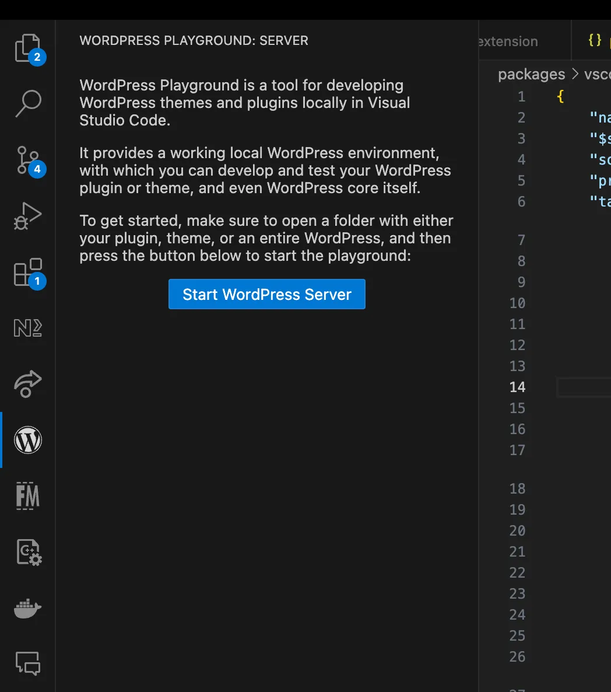

<!-- # VS Code extension -->

# VS Code एक्सटेंशन

<!-- Start a zero-setup development environment using the [VS Code extension](https://marketplace.visualstudio.com/items?itemName=WordPressPlayground.wordpress-playground), and develop your plugin or theme locally without installing Apache or MySQL. -->

[VS Code एक्सटेंशन](https://marketplace.visualstudio.com/items?itemName=WordPressPlayground.wordpress-playground) का उपयोग करके बिना किसी सेटअप वाला डेवलपमेंट एनवायरनमेंट शुरू करें, और Apache या MySQL स्थापित किए बिना अपना प्लगइन या थीम अपने कंप्यूटर पर ही डेवलप करें।

<!-- Key Features: -->

मुख्य फ़ीचर:

<!-- - **Integrated Development**: Develop WordPress sites directly within VS Code.
- **Ease of Use**: Simplifies the development workflow with integrated tools. -->

- **एकीकृत डेवलपमेंट**: WordPress साइटें सीधे VS Code के अंदर डेवलप करें।
- **उपयोग में आसान**: एकीकृत टूल के साथ डेवलपमेंट वर्कफ़्लो को आसान बनाता है।

<!-- **Documentation** -->

**दस्तावेज़ीकरण**

<!-- The VS Code extension is maintained in a different GitHub repository, [Playground Tools](https://github.com/WordPress/playground-tools/). You can find the latest documentation in the [dedicated README file](https://github.com/WordPress/playground-tools/blob/trunk/packages/vscode-extension/README.md). -->

VS Code एक्सटेंशन एक अलग GitHub रिपॉज़िटरी, [Playground Tools](https://github.com/WordPress/playground-tools/), में मेंटेन होता है। इसका नवीनतम दस्तावेज़ीकरण [इसकी अपनी README फ़ाइल](https://github.com/WordPress/playground-tools/blob/trunk/packages/vscode-extension/README.md) में मिलेगा।

<!-- ## Installation and Usage -->

## स्थापना और उपयोग {#installation-and-usage}

<!-- 1.  **Install the Extension**: Search for “WordPress Playground” in the VS Code extensions marketplace and install it.
2.  **Setup**: Follow the setup instructions provided in the extension to configure your development environment.
3.  **Develop and Debug**: Use the integrated tools to develop and debug your WordPress site. -->

1.  **एक्सटेंशन स्थापित करें**: VS Code के एक्सटेंशन मार्केटप्लेस में “WordPress Playground” खोजें और उसे स्थापित करें।
2.  **सेटअप**: अपना डेवलपमेंट एनवायरनमेंट कॉन्फ़िगर करने के लिए एक्सटेंशन में दिए गए सेटअप निर्देशों का पालन करें।
3.  **डेवलप और डीबग करें**: अपनी WordPress साइट को डेवलप और डीबग करने के लिए एकीकृत टूल का उपयोग करें।

<!-- The extension ships with a portable WebAssembly version of PHP and sets up WordPress to use SQLite. Once installed, click the WordPress icon in the VS Code Activity Bar, then click the **Start WordPress Server** button: -->

इस एक्सटेंशन के साथ PHP का पोर्टेबल WebAssembly संस्करण आता है, और यह WordPress को SQLite का उपयोग करने के लिए सेट करता है। स्थापित होने के बाद, VS Code के Activity Bar में WordPress आइकन पर क्लिक करें, फिर **Start WordPress Server** बटन पर क्लिक करें:

<!--  -->

