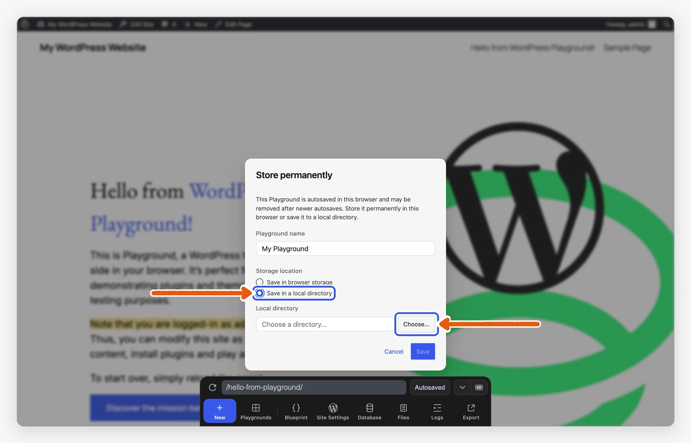

<!-- # Build -->

# बिल्ड

<!-- WordPress Playground can help you to create and learn WordPress quickly, even on mobile with no signal. You can use Playground where you work best, whether that’s in the browser, Node.js, mobile apps, VS Code, or elsewhere. -->

WordPress Playground की मदद से आप WordPress के साथ जल्दी बना और सीख सकते हैं, मोबाइल पर बिना सिग्नल के भी। आप Playground को वहीं इस्तेमाल कर सकते हैं जहाँ आप सबसे अच्छा काम करते हैं, चाहे वह ब्राउज़र हो, Node.js हो, मोबाइल ऐप हों, VS Code हो या कोई और जगह।

<!-- ## Setting up a local WordPress environment quickly -->

## लोकल WordPress एनवायरनमेंट जल्दी सेट करना {#setting-up-a-local-wordpress-environment-quickly}

<!-- You can seamlessly integrate Playground into your development workflow to launch a local WordPress environment quickly for testing your code. You can do this directly [from the terminal](/developers/local-development/wp-playground-cli) or [your preferred IDE.](/developers/local-development/vscode-extension) -->

अपने कोड का परीक्षण करने के लिए आप Playground को आसानी से अपने डेवलपमेंट वर्कफ़्लो में जोड़कर जल्दी से एक लोकल WordPress एनवायरनमेंट शुरू कर सकते हैं। आप यह सीधे [टर्मिनल से](/developers/local-development/wp-playground-cli) या [अपने पसंदीदा IDE से](/developers/local-development/vscode-extension) कर सकते हैं।

<!-- ## Save changes done on a Block Theme and create GitHub Pull Requests -->

## ब्लॉक थीम में किए गए बदलाव सहेजें और GitHub पुल रिक्वेस्ट बनाएँ {#save-changes-done-on-a-block-theme-and-create-github-pull-requests}

<!-- You can connect your Playground instance to a GitHub repository and create a Pull Request with the changes you’ve made through the WordPress UI, leveraging the [Create Block Theme](https://wordpress.org/plugins/create-block-theme/) plugin. -->

[Create Block Theme](https://wordpress.org/plugins/create-block-theme/) प्लगइन की मदद से आप अपने Playground इंस्टेंस को किसी GitHub रिपॉज़िटरी से जोड़ सकते हैं और WordPress UI में किए गए अपने बदलावों के साथ एक पुल रिक्वेस्ट बना सकते हैं।

<!-- With this workflow, you could build a block theme completely in your browser and save your changes to GitHub, or you could improve/fix an existing one. -->

इस वर्कफ़्लो से आप पूरी ब्लॉक थीम अपने ब्राउज़र में ही बना सकते हैं और अपने बदलाव GitHub पर सहेज सकते हैं, या किसी मौजूदा थीम को बेहतर बना/ठीक कर सकते हैं।

<iframe width="800" src="https://www.youtube.com/embed/94KnoFhQg1g" frameborder="0" allow="accelerometer; autoplay; clipboard-write; encrypted-media; gyroscope; picture-in-picture" allowfullscreen></iframe>

<!--
Some more examples of this workflow:

- [Developer Hours: Creating WordPress Playground Blueprints for Testing and Demos](https://www.youtube.com/watch?v=gKrij8V3nK0&t=2488s)
- [Recap Hallway Hangout: Theme Building with Playground, Create-block-theme plugin, and GitHub](https://make.wordpress.org/core/2024/06/25/recap-hallway-hangout-theme-building-with-playground-create-block-theme-plugin-and-github/)
-->

इस वर्कफ़्लो के कुछ और उदाहरण:

- [Developer Hours: Creating WordPress Playground Blueprints for Testing and Demos](https://www.youtube.com/watch?v=gKrij8V3nK0&t=2488s)
- [Recap Hallway Hangout: Theme Building with Playground, Create-block-theme plugin, and GitHub](https://make.wordpress.org/core/2024/06/25/recap-hallway-hangout-theme-building-with-playground-create-block-theme-plugin-and-github/)

<!-- ## Synchronize your Playground with a local folder and create GitHub Pull Requests -->

## अपने Playground को किसी लोकल फ़ोल्डर से सिंक करें और GitHub पुल रिक्वेस्ट बनाएँ {#synchronize-your-playground-with-a-local-folder-and-create-github-pull-requests}

<!--
In the Dock, click the **Autosaved** or **Unsaved** save status, select **Save
in a local directory**, click **Choose...**, and select a directory dedicated
to this Playground. After granting write access, click **Save**. Playground
copies the current site into the selected directory and overwrites files with
matching names; it does not import an existing site from that directory.
-->

Dock में **Autosaved** या **Unsaved** सेव स्टेटस पर क्लिक करें, **Save in a local directory** चुनें, **Choose...** पर क्लिक करें, और इस Playground के लिए अलग रखी गई कोई डायरेक्टरी चुनें। लिखने की अनुमति देने के बाद **Save** पर क्लिक करें। Playground मौजूदा साइट को चुनी गई डायरेक्टरी में कॉपी करता है और एक जैसे नाम वाली फ़ाइलों को ओवरराइट कर देता है। यह उस डायरेक्टरी से कोई मौजूदा साइट इंपोर्ट नहीं करता।

<!--  -->

<!-- Local-directory storage uses the File System Access API, so availability depends on browser and platform support for choosing and writing to directories. Chromium-based desktop browsers usually support it. Browsers without that capability can still use browser storage and ZIP export. See [Browser support](/developers/limitations#browser-support) for the broader compatibility model. -->

लोकल डायरेक्टरी स्टोरेज File System Access API का उपयोग करता है, इसलिए यह सुविधा इस पर निर्भर करती है कि आपका ब्राउज़र और प्लेटफ़ॉर्म डायरेक्टरी चुनने और उसमें लिखने का सपोर्ट देते हैं या नहीं। Chromium पर आधारित डेस्कटॉप ब्राउज़र आमतौर पर इसे सपोर्ट करते हैं। जिन ब्राउज़र में यह सुविधा नहीं है, उनमें भी ब्राउज़र स्टोरेज और ZIP निर्यात का उपयोग किया जा सकता है। संगतता के बारे में विस्तार से जानने के लिए [ब्राउज़र सपोर्ट](/developers/limitations#browser-support) देखें।

<!-- Files changed in Playground are written to the selected directory. Files changed on disk are not pulled into the running Playground automatically. For a local-directory Playground, open the **Saved** status menu in the Dock and choose **Reload files from disk** when you want Playground to read the current files from the directory. -->

Playground में बदली गई फ़ाइलें चुनी गई डायरेक्टरी में लिखी जाती हैं। डिस्क पर बदली गई फ़ाइलें चल रहे Playground में अपने-आप नहीं आतीं। लोकल डायरेक्टरी वाले Playground में, जब आप चाहें कि Playground डायरेक्टरी से मौजूदा फ़ाइलें पढ़े, तब Dock में **Saved** स्टेटस मेनू खोलें और **Reload files from disk** चुनें।

<!-- With this workflow, you can create GitHub PRs directly from changes made in your local directory. -->

इस वर्कफ़्लो से आप अपनी लोकल डायरेक्टरी में किए गए बदलावों से सीधे GitHub PR बना सकते हैं।

<!-- See here a little demo of this workflow in action: -->

इस वर्कफ़्लो का एक छोटा डेमो यहाँ देखें:

<iframe width="800" src="https://www.youtube.com/embed/UYK88eZqrjo" frameborder="0" allow="accelerometer; autoplay; clipboard-write; encrypted-media; gyroscope; picture-in-picture" allowfullscreen></iframe>

<!-- ## Integrate with other APIs to create new tools. -->

## दूसरे API के साथ जोड़कर नए टूल बनाएँ। {#integrate-with-other-apis-to-create-new-tools}

<!-- Playground can be combined with different APIs to create amazing tools. The possibilities are endless. -->

Playground को अलग-अलग API के साथ जोड़कर शानदार टूल बनाए जा सकते हैं। संभावनाएँ अनगिनत हैं।

<!-- You can [use WordPress Playground in Node.js](/developers/local-development/php-wasm-node) to create new tools. The [@php-wasm/node package](https://npmjs.org/@php-wasm/node), which ships the PHP WebAssembly runtime, is the package used for [https://playground.wordpress.net/](https://playground.wordpress.net/), for example. -->

नए टूल बनाने के लिए आप [Node.js में WordPress Playground का उपयोग](/developers/local-development/php-wasm-node) कर सकते हैं। उदाहरण के लिए, PHP WebAssembly रनटाइम देने वाला [@php-wasm/node पैकेज](https://npmjs.org/@php-wasm/node) वही पैकेज है, जिसका उपयोग [https://playground.wordpress.net/](https://playground.wordpress.net/) के लिए होता है।

<!-- Another interesting app built on top of Playground is **Translate Live** (see [example](https://translate.wordpress.org/projects/wp-plugins/friends/dev/de/default/playground/)) which, in combination with OpenAI provides a WordPress translations tool “in place” where translations can be seen and modified in their real context (see example). Read more about this tool at [Translate Live: Updates to the Translation Playground](https://make.wordpress.org/polyglots/2023/05/08/translate-live-updates-to-the-translation-playground/) -->

Playground पर बना एक और दिलचस्प ऐप **Translate Live** है ([उदाहरण](https://translate.wordpress.org/projects/wp-plugins/friends/dev/de/default/playground/) देखें)। OpenAI के साथ मिलकर यह WordPress अनुवाद का एक “इन-प्लेस” टूल देता है, जिसमें अनुवादों को उनके असली संदर्भ में देखा और बदला जा सकता है। इस टूल के बारे में और जानकारी [Translate Live: Updates to the Translation Playground](https://make.wordpress.org/polyglots/2023/05/08/translate-live-updates-to-the-translation-playground/) में पढ़ें।

<!-- ## Work offline and as a native app -->

## ऑफ़लाइन और नेटिव ऐप की तरह काम करें {#work-offline-and-as-a-native-app}

<!-- When you first visit [playground.wordpress.net](https://playground.wordpress.net/), your browser automatically caches all the necessary files to use Playground. From that point on, you can access [playground.wordpress.net](https://playground.wordpress.net/), even without an internet connection, ensuring you can continue working on your projects without interruptions. -->

जब आप पहली बार [playground.wordpress.net](https://playground.wordpress.net/) पर जाते हैं, तो आपका ब्राउज़र Playground इस्तेमाल करने के लिए ज़रूरी सभी फ़ाइलें अपने-आप कैश कर लेता है। उसके बाद आप इंटरनेट कनेक्शन के बिना भी [playground.wordpress.net](https://playground.wordpress.net/) खोल सकते हैं, ताकि आप बिना रुकावट अपने प्रोजेक्ट पर काम करते रहें।

<!-- You can also install Playground on your device as a Progressive Web App (PWA) to launch the Playground directly from your home screen—just like a native app. -->

आप Playground को अपने डिवाइस पर प्रोग्रेसिव वेब ऐप (PWA) के रूप में स्थापित भी कर सकते हैं, ताकि उसे सीधे अपनी होम स्क्रीन से खोल सकें, बिल्कुल किसी नेटिव ऐप की तरह।

<!-- Read [Introducing Offline Mode and PWA Support for WordPress Playground](https://make.wordpress.org/playground/2024/08/05/offline-mode-and-pwa-support/) for more info. -->

ज़्यादा जानकारी के लिए [Introducing Offline Mode and PWA Support for WordPress Playground](https://make.wordpress.org/playground/2024/08/05/offline-mode-and-pwa-support/) पढ़ें।

<!-- ## Embed a WordPress site in non-web environments -->

## वेब के बाहर के एनवायरनमेंट में WordPress साइट एम्बेड करें {#embed-a-wordpress-site-in-non-web-environments}

<!-- The [How to ship a real WordPress site in a native iOS app via Playground?](../guides/wordpress-native-ios-app) guide shows how we can leverage Playground to wrap a WordPress site into an IOS app. -->

[Playground की मदद से नेटिव iOS ऐप में असली WordPress साइट कैसे लाएँ?](../guides/wordpress-native-ios-app) गाइड में बताया गया है कि Playground का उपयोग करके किसी WordPress साइट को iOS ऐप में कैसे पैक किया जा सकता है।
