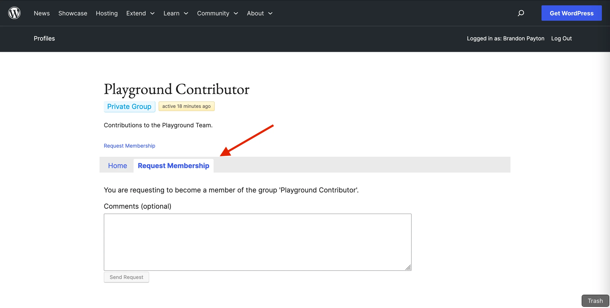

<!-- # Playground Contributor Badge -->

# Playground योगदानकर्ता बैज

<!-- This page provides detailed information on the Playground Contributor Badge and the process of requesting it on your [WordPress.org](https://wordpress.org) profile. -->

यह पेज Playground योगदानकर्ता बैज के बारे में, और अपनी [WordPress.org](https://wordpress.org) प्रोफ़ाइल पर इसका अनुरोध करने की प्रक्रिया के बारे में विस्तृत जानकारी देता है।

---

<!-- ## Getting Started -->

## शुरुआत {#getting-started}

<!-- Any contribution to the WordPress Playground project is highly valued. The Playground team recognizes contributions across several key areas: -->

WordPress Playground प्रोजेक्ट में किसी भी तरह का योगदान बहुत मूल्यवान है। Playground टीम कई मुख्य क्षेत्रों में योगदान को मान्यता देती है:

<!--
- **Playground Code:** Making code changes and reviewing the core project.
- **Playground UI:** Improving the user interface of the web experience.
- **Documentation:** Writing, updating, and reviewing documentation.
- **Translation:** Translating any part of the project.
- **Blueprints Gallery:** Creating new blueprints or improving existing ones.
-->

- **Playground कोड:** मुख्य प्रोजेक्ट में कोड बदलाव करना और उनकी समीक्षा करना।
- **Playground UI:** वेब अनुभव के यूज़र इंटरफ़ेस को बेहतर बनाना।
- **दस्तावेज़ीकरण:** दस्तावेज़ीकरण लिखना, अपडेट करना और उसकी समीक्षा करना।
- **अनुवाद:** प्रोजेक्ट के किसी भी हिस्से का अनुवाद करना।
- **Blueprints गैलरी:** नए ब्लूप्रिंट बनाना या मौजूदा ब्लूप्रिंट को बेहतर बनाना।

<!-- ## Playground Contributor Badge -->

## Playground योगदानकर्ता बैज {#playground-contributor-badge}

<!-- To get a Playground Contributor Badge, you must have made at least one eligible contribution from the list above. The team may choose to award the badge for other contributions or a combination of the above at the team’s discretion. -->

Playground योगदानकर्ता बैज पाने के लिए, आपने ऊपर दी गई सूची में से कम से कम एक योग्य योगदान किया होना चाहिए। टीम अपने विवेक से दूसरे योगदानों के लिए, या ऊपर दिए गए योगदानों के मेल के लिए भी बैज दे सकती है।

<!-- ## Playground Team Badge -->

## Playground टीम बैज {#playground-team-badge}

<!-- If you are currently a contributor and have been actively involved in the Playground project for the past **twelve months**, you are eligible for a **Playground Team Badge**. -->

अगर आप अभी योगदानकर्ता हैं और पिछले **बारह महीनों** से Playground प्रोजेक्ट में सक्रिय रूप से जुड़े रहे हैं, तो आप **Playground टीम बैज** के लिए पात्र हैं।

<!-- ## Requesting a Profile Badge -->

## प्रोफ़ाइल बैज का अनुरोध करना {#requesting-a-profile-badge}

<!-- If you meet the criteria, you can request a badge. Please include links to resources (such as GitHub pull requests, issues, or translated strings) that show you have met the criteria. Send a request at the links bellow: -->

अगर आप मानदंड पूरे करते हैं, तो आप बैज का अनुरोध कर सकते हैं। कृपया ऐसे संसाधनों के लिंक शामिल करें (जैसे GitHub पुल रिक्वेस्ट, इश्यू या अनुवादित स्ट्रिंग्स) जो दिखाएँ कि आपने मानदंड पूरे किए हैं। नीचे दिए गए लिंक पर अनुरोध भेजें:

<!--
- [Contributor Badge](https://profiles.wordpress.org/associations/playground-contributor/)
- [Team Badge](https://profiles.wordpress.org/associations/playground-team/)
-->

- [योगदानकर्ता बैज](https://profiles.wordpress.org/associations/playground-contributor/)
- [टीम बैज](https://profiles.wordpress.org/associations/playground-team/)

<!-- ### Request form -->

### अनुरोध फ़ॉर्म {#request-form}

<!-- To access the request, the user should be logged in with their WordPress.org account and open the Request Membership tab, after submitting the required information. A Playground Team Representative will confirm your contribution and assign the badge. The team will perform a weekly review of contributions and award badges at that time. Updates on new badges awarded will be posted during the Playground Team meeting. -->

अनुरोध करने के लिए, अपने WordPress.org खाते से लॉग इन करें, **Request Membership** टैब खोलें और ज़रूरी जानकारी भरकर भेजें। Playground टीम का कोई प्रतिनिधि आपके योगदान की पुष्टि करेगा और बैज देगा। टीम हर हफ़्ते योगदानों की समीक्षा करती है और उसी समय बैज देती है। नए दिए गए बैज की जानकारी Playground टीम मीटिंग में दी जाती है।
