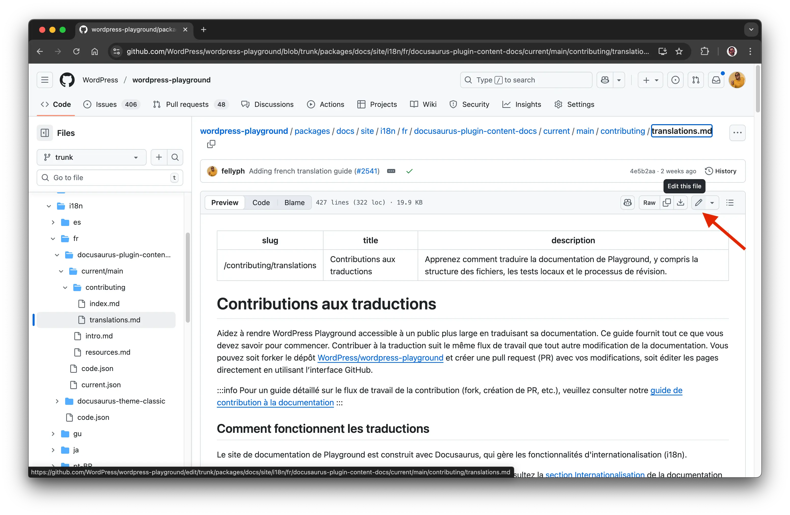
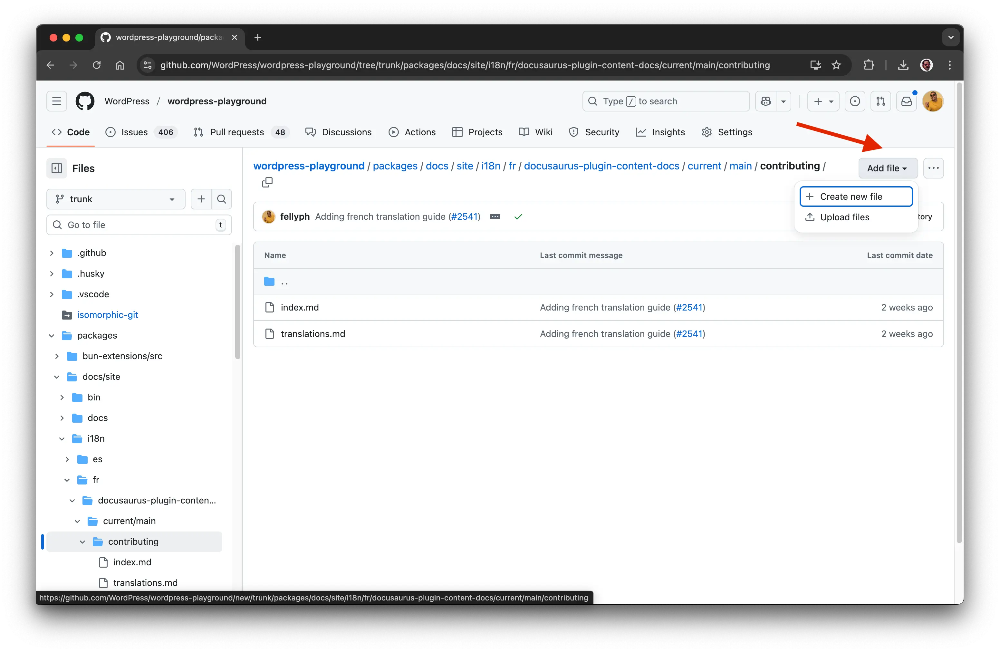
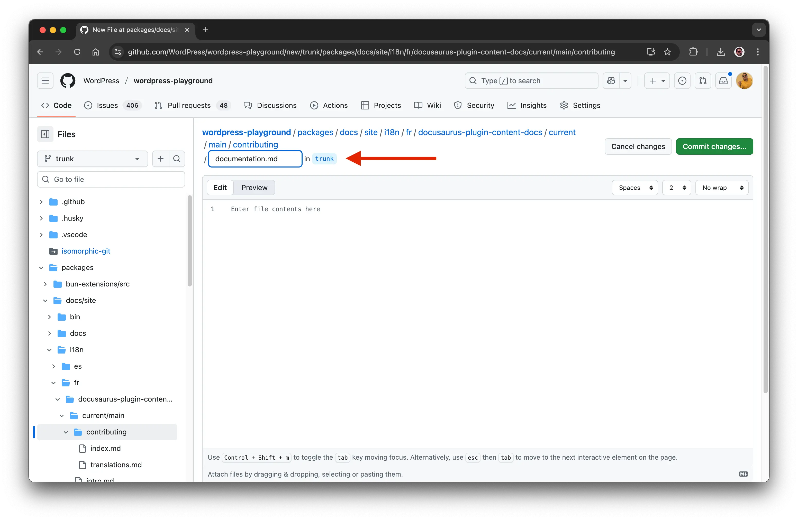

<!-- # Contribute with the GitHub web interface -->

# GitHub वेब इंटरफ़ेस से योगदान करें

<!-- You can improve Playground documentation directly on GitHub. This is useful for typo fixes, small clarifications, and translation updates when you do not want to clone the repository or set up a local development environment. -->

आप Playground दस्तावेज़ को सीधे GitHub पर बेहतर बना सकते हैं। यह तरीका टाइपो ठीक करने, छोटे स्पष्टीकरण जोड़ने और अनुवाद अपडेट करने के लिए उपयोगी है, जब आप रिपॉज़िटरी क्लोन नहीं करना चाहते या अपने कंप्यूटर पर डेवलपमेंट एनवायरनमेंट सेट नहीं करना चाहते।

<!-- Before you start, sign in to GitHub and identify the documentation page you want to change. -->

शुरू करने से पहले GitHub में साइन इन करें और तय कर लें कि आप दस्तावेज़ का कौन-सा पेज बदलना चाहते हैं।

<!-- ## When to use this workflow -->

## इस तरीके का उपयोग कब करें {#when-to-use-this-workflow}

<!--
The GitHub web interface is a good fit for:

- Fixing typos.
- Clarifying a sentence or paragraph.
- Updating links.
- Improving an existing translation.
- Adding a short documentation page.
-->

GitHub वेब इंटरफ़ेस इन कामों के लिए सही है:

- टाइपो ठीक करना।
- किसी वाक्य या पैराग्राफ़ को और स्पष्ट करना।
- लिंक अपडेट करना।
- किसी मौजूदा अनुवाद को बेहतर बनाना।
- दस्तावेज़ का कोई छोटा पेज जोड़ना।

<!-- For larger changes, updates that need local preview, or changes that affect code, use the local workflow in [Documentation contributions](/contributing/documentation) or [Code contributions](/contributing/code). -->

बड़े बदलावों, लोकल पूर्वावलोकन की ज़रूरत वाले अपडेट या कोड पर असर डालने वाले बदलावों के लिए [दस्तावेज़ में योगदान](/contributing/documentation) या [कोड में योगदान](/contributing/code) में बताए गए लोकल तरीके का उपयोग करें।

<!-- ## Find the documentation file -->

## दस्तावेज़ की फ़ाइल ढूँढें {#find-the-documentation-file}

<!-- Most English documentation pages live in the [`packages/docs/site/docs`](https://github.com/WordPress/wordpress-playground/tree/trunk/packages/docs/site/docs) directory. -->

अंग्रेज़ी दस्तावेज़ के ज़्यादातर पेज [`packages/docs/site/docs`](https://github.com/WordPress/wordpress-playground/tree/trunk/packages/docs/site/docs) डायरेक्टरी में होते हैं।

<!-- Translated documentation lives in [`packages/docs/site/i18n`](https://github.com/WordPress/wordpress-playground/tree/trunk/packages/docs/site/i18n). For more details about translation file paths, see [Contributions to translations](/contributing/translations). -->

अनुवादित दस्तावेज़ [`packages/docs/site/i18n`](https://github.com/WordPress/wordpress-playground/tree/trunk/packages/docs/site/i18n) में होते हैं। अनुवाद फ़ाइलों के पाथ के बारे में ज़्यादा जानकारी के लिए [अनुवाद में योगदान](/contributing/translations) देखें।

<!--
For existing pages, the fastest way to find the source file is from the documentation site:

1. Open the documentation page you want to update.
2. Select the **Edit this page** link near the bottom of the page.
3. GitHub opens the source file for that page.
-->

मौजूदा पेजों के लिए सोर्स फ़ाइल ढूँढने का सबसे तेज़ तरीका दस्तावेज़ साइट से है:

1. दस्तावेज़ का वह पेज खोलें जिसे आप अपडेट करना चाहते हैं।
2. पेज में नीचे की ओर दिए गए **इस पेज को बदलें** (**Edit this page**) लिंक को चुनें।
3. GitHub उस पेज की सोर्स फ़ाइल खोल देता है।

<!--
You can also browse the repository directly:

1. Open the [WordPress Playground repository](https://github.com/WordPress/wordpress-playground).
2. Browse to the relevant documentation directory.
3. Select the file that matches the page you want to update.
-->

आप रिपॉज़िटरी को सीधे भी ब्राउज़ कर सकते हैं:

1. [WordPress Playground रिपॉज़िटरी](https://github.com/WordPress/wordpress-playground) खोलें।
2. दस्तावेज़ की संबंधित डायरेक्टरी पर जाएँ।
3. वह फ़ाइल चुनें जो उस पेज से मेल खाती है जिसे आप अपडेट करना चाहते हैं।

<!-- The screenshots below use translation files as examples, but the same GitHub controls apply to English documentation files. -->

नीचे दिए गए स्क्रीनशॉट में उदाहरण के लिए अनुवाद फ़ाइलें दिखाई गई हैं, लेकिन अंग्रेज़ी दस्तावेज़ की फ़ाइलों पर भी GitHub के यही कंट्रोल लागू होते हैं।

<!-- ## Edit an existing page -->

## किसी मौजूदा पेज को संपादित करें {#edit-an-existing-page}

<!--
1. Open the file in GitHub.
2. Select the pencil icon to edit the file.
3. If GitHub asks you to fork the repository, follow the prompt. This creates a copy under your GitHub account.
4. Make your changes in the editor.
-->

1. फ़ाइल को GitHub में खोलें।
2. फ़ाइल संपादित करने के लिए पेंसिल आइकन चुनें।
3. अगर GitHub आपसे रिपॉज़िटरी फ़ोर्क करने को कहे, तो उसके निर्देशों का पालन करें। इससे आपके GitHub अकाउंट में रिपॉज़िटरी की एक कॉपी बन जाती है।
4. एडिटर में अपने बदलाव करें।

<!--  -->



<!-- GitHub's web editor is best for small, focused changes. If your update is large or needs local preview, use the local workflow in [Documentation contributions](/contributing/documentation). -->

GitHub का वेब एडिटर छोटे और एक ही बात पर केंद्रित बदलावों के लिए सबसे अच्छा है। अगर आपका अपडेट बड़ा है या उसे लोकल पूर्वावलोकन की ज़रूरत है, तो [दस्तावेज़ में योगदान](/contributing/documentation) में बताए गए लोकल तरीके का उपयोग करें।

<!-- ## Add a new page -->

## नया पेज जोड़ें {#add-a-new-page}

<!--
1. Open the directory where the new page should live.
2. Select **Add file** and then **Create new file**.
3. Enter the file name. You can create folders by typing the folder name followed by `/`.
4. Add the page content.
5. Mention where the page should appear in the documentation sidebar when you open the pull request.
   If you are comfortable editing another file, you can also add the page to
   [`packages/docs/site/sidebars.js`](https://github.com/WordPress/wordpress-playground/blob/trunk/packages/docs/site/sidebars.js).
-->

1. वह डायरेक्टरी खोलें जहाँ नया पेज रखा जाना चाहिए।
2. **Add file** और फिर **Create new file** चुनें।
3. फ़ाइल का नाम दर्ज करें। फ़ोल्डर का नाम और उसके बाद `/` लिखकर आप फ़ोल्डर बना सकते हैं।
4. पेज की सामग्री जोड़ें।
5. पुल रिक्वेस्ट खोलते समय बताएँ कि दस्तावेज़ के साइडबार में यह पेज कहाँ दिखना चाहिए।
   अगर आप दूसरी फ़ाइल संपादित करने में सहज हैं, तो आप इस पेज को
   [`packages/docs/site/sidebars.js`](https://github.com/WordPress/wordpress-playground/blob/trunk/packages/docs/site/sidebars.js) में भी जोड़ सकते हैं।

<!--  -->


<!-- For new English documentation pages, add front matter at the top of the file: -->

अंग्रेज़ी दस्तावेज़ के नए पेजों के लिए फ़ाइल में सबसे ऊपर फ़्रंट मैटर जोड़ें:

```markdown
---
slug: /example-page
title: Example page
description: A short description of the page.
---
```

<!--
For new translated pages, mirror the English file path in the matching language directory. For example,
a French translation of `packages/docs/site/docs/main/contributing/documentation.md` belongs in
`packages/docs/site/i18n/fr/docusaurus-plugin-content-docs/current/main/contributing/documentation.md`.
Keep the original English content in a comment above the translation so reviewers can compare the text.
-->

नए अनुवादित पेजों के लिए, संबंधित भाषा की डायरेक्टरी में अंग्रेज़ी फ़ाइल का पाथ हूबहू दोहराएँ। उदाहरण के लिए,
`packages/docs/site/docs/main/contributing/documentation.md` का फ़्रेंच अनुवाद
`packages/docs/site/i18n/fr/docusaurus-plugin-content-docs/current/main/contributing/documentation.md` में रखा जाता है।
मूल अंग्रेज़ी सामग्री को अनुवाद के ऊपर एक कमेंट में रखें, ताकि समीक्षक दोनों टेक्स्ट की तुलना कर सकें।

<!-- ## Review your changes -->

## अपने बदलाव जाँचें {#review-your-changes}

<!--
Before submitting, use the **Preview** tab in GitHub to check basic Markdown formatting. This is not
a full Docusaurus preview, so also review links and images carefully. Site-relative paths such as
`/img/contributing/example.webp` may not behave the same way in GitHub's Markdown preview.
-->

सबमिट करने से पहले, Markdown की बुनियादी फ़ॉर्मैटिंग जाँचने के लिए GitHub में **Preview** टैब का उपयोग करें। यह Docusaurus का पूरा
पूर्वावलोकन नहीं है, इसलिए लिंक और चित्रों को भी ध्यान से जाँचें। `/img/contributing/example.webp` जैसे साइट-रिलेटिव पाथ
GitHub के Markdown पूर्वावलोकन में शायद उसी तरह काम न करें।

<!--  -->


<!--
Look for:

- Headings in the right order.
- Working links.
- Lists and code blocks that render correctly.
- A focused change that is easy to review.
-->

इन बातों पर ध्यान दें:

- हेडिंग सही क्रम में हों।
- लिंक काम कर रहे हों।
- सूचियाँ और कोड ब्लॉक सही तरह से दिखें।
- बदलाव एक ही बात पर केंद्रित हो, ताकि उसकी समीक्षा आसान रहे।

<!-- ## Propose the change -->

## बदलाव प्रस्तावित करें {#propose-the-change}

<!--
1. Scroll to the **Commit changes** section.
2. Add a short commit message, such as `Fix typo in documentation guide`.
3. Add a short description if the change needs context.
4. Select the option to create a new branch for the commit.
5. Select **Propose changes**.
6. On the next page, select **Create pull request**.
-->

1. **Commit changes** सेक्शन तक स्क्रॉल करें।
2. एक छोटा कमिट मैसेज जोड़ें, जैसे `Fix typo in documentation guide`।
3. अगर बदलाव को समझाने के लिए संदर्भ ज़रूरी है, तो एक छोटा विवरण जोड़ें।
4. कमिट के लिए नई ब्रांच बनाने वाला विकल्प चुनें।
5. **Propose changes** चुनें।
6. अगले पेज पर **Create pull request** चुनें।

<!-- ## What happens next -->

## आगे क्या होता है {#what-happens-next}

<!-- A maintainer will review your pull request. They may ask for changes before merging it. -->

मेंटेनर आपकी पुल रिक्वेस्ट की समीक्षा करेंगे। मर्ज करने से पहले वे आपसे कुछ बदलाव करने को कह सकते हैं।

<!-- If you are contributing translations, you can also request a review in the `#polyglots` or `#playground` channel in [Make WordPress Slack](https://make.wordpress.org/chat/). -->

अगर आप अनुवाद में योगदान कर रहे हैं, तो आप [Make WordPress Slack](https://make.wordpress.org/chat/) के `#polyglots` या `#playground` चैनल में भी समीक्षा का अनुरोध कर सकते हैं।
