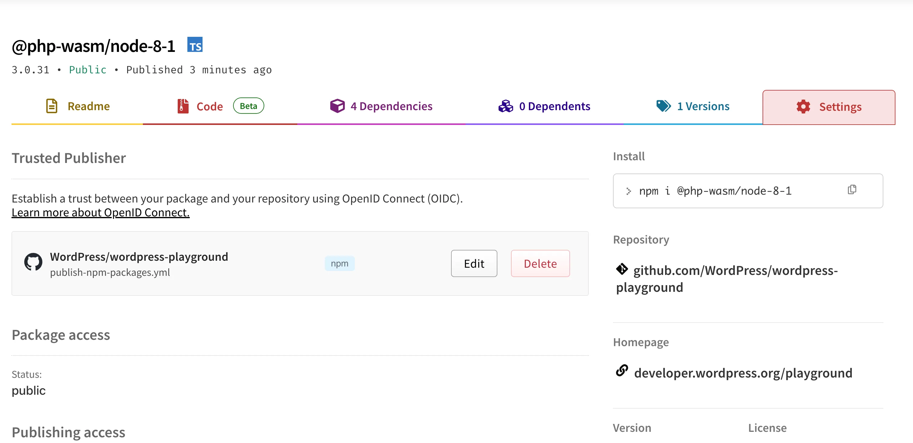

<!-- # Releasing packages -->

# पैकेज रिलीज़ करना

<!-- Playground publishes its packages to npm using automated CI workflows. This page explains how the release process works and what you need to know when adding new packages. -->

Playground अपने पैकेज ऑटोमेटेड CI वर्कफ़्लो की मदद से npm पर पब्लिश करता है। इस पेज में बताया गया है कि रिलीज़ की प्रक्रिया कैसे काम करती है और नए पैकेज जोड़ते समय आपको क्या जानना ज़रूरी है।

<!-- ## Automated releases -->

## ऑटोमेटेड रिलीज़ {#automated-releases}

<!-- The npm packages are published automatically every Monday via GitHub Actions, or manually by maintainers using the workflow dispatch. The workflow bumps versions using [Lerna](https://lerna.js.org/), tags the release, and publishes all public packages to npm. -->

ये npm पैकेज हर सोमवार GitHub Actions के ज़रिए अपने-आप पब्लिश होते हैं, या मेंटेनर workflow dispatch का उपयोग करके उन्हें मैन्युअली पब्लिश करते हैं। वर्कफ़्लो [Lerna](https://lerna.js.org/) की मदद से संस्करण बढ़ाता है, रिलीज़ को टैग करता है, और सभी पब्लिक पैकेज npm पर पब्लिश करता है।

<!-- The CI authenticates with npm using [OpenID Connect (OIDC) trusted publishing](https://docs.npmjs.com/generating-provenance-statements#publishing-packages-with-provenance-via-github-actions). This is more secure than using long-lived npm tokens because it generates short-lived credentials for each workflow run and ties package provenance directly to the GitHub repository. -->

यह CI, npm के साथ ऑथेंटिकेशन के लिए [OpenID Connect (OIDC) trusted publishing](https://docs.npmjs.com/generating-provenance-statements#publishing-packages-with-provenance-via-github-actions) का उपयोग करता है। यह तरीका लंबे समय तक चलने वाले npm टोकन से ज़्यादा सुरक्षित है, क्योंकि यह हर वर्कफ़्लो रन के लिए कम समय तक चलने वाले क्रेडेंशियल बनाता है और पैकेज के स्रोत का रिकॉर्ड सीधे GitHub रिपॉज़िटरी से जोड़ता है।

<!-- ## Adding a new package -->

## नया पैकेज जोड़ना {#adding-a-new-package}

<!-- When you add a new npm package to the monorepo, the automated release workflow won't be able to publish it on the first run. This is an npm security feature: OIDC trusted publishing only works for packages that already exist and have been configured to trust the GitHub repository. -->

जब आप मोनोरेपो में कोई नया npm पैकेज जोड़ते हैं, तो ऑटोमेटेड रिलीज़ वर्कफ़्लो पहली बार में उसे पब्लिश नहीं कर पाएगा। यह npm की एक सुरक्षा सुविधा है: OIDC trusted publishing सिर्फ़ उन्हीं पैकेज के लिए काम करता है जो पहले से मौजूद हैं और जिन्हें GitHub रिपॉज़िटरी पर भरोसा करने के लिए कॉन्फ़िगर किया गया है।

<!-- Here's what you need to do: -->

आपको यह करना होगा:

<!-- ### 1. Publish the package manually -->

### 1. पैकेज को मैन्युअली पब्लिश करें {#1-publish-the-package-manually}

<!-- First, authenticate with npm on your local machine: -->

सबसे पहले, अपने लोकल कंप्यूटर पर npm के साथ ऑथेंटिकेट करें:

```bash
npm login
```

<!-- Then publish the package for the first time: -->

फिर पैकेज को पहली बार पब्लिश करें:

```bash
cd packages/your-new-package
npm publish --access public
```

<!-- This creates the package on the npm registry under your account. -->

इससे npm रजिस्ट्री पर आपके अकाउंट के तहत पैकेज बन जाता है।

<!-- ### 2. Configure trusted publishing -->

### 2. Trusted publishing कॉन्फ़िगर करें {#2-configure-trusted-publishing}

<!--
After the initial publish, go to the package's settings on npmjs.com and set up OIDC trusted publishing:

1. Navigate to your package on [npmjs.com](https://www.npmjs.com)
2. Go to **Settings** → **Configure Trusted Publishers**
3. Add a new trusted publisher with these settings. All of them are case-sensitive!
    - **Repository owner**: `WordPress`
    - **Repository name**: `wordpress-playground`
    - **Workflow filename**: `publish-npm-packages.yml`
    - **Environment**: `npm`
-->

पहली बार पब्लिश करने के बाद, npmjs.com पर पैकेज की सेटिंग्स में जाएँ और OIDC trusted publishing सेट करें:

1. [npmjs.com](https://www.npmjs.com) पर अपने पैकेज पर जाएँ
2. **Settings** → **Configure Trusted Publishers** पर जाएँ
3. इन सेटिंग्स के साथ एक नया trusted publisher जोड़ें। इन सभी में बड़े और छोटे अक्षरों का फ़र्क मायने रखता है!
    - **Repository owner**: `WordPress`
    - **Repository name**: `wordpress-playground`
    - **Workflow filename**: `publish-npm-packages.yml`
    - **Environment**: `npm`

<!--  -->


<!-- ### 3. Transfer ownership (if needed) -->

### 3. स्वामित्व ट्रांसफ़र करें (अगर ज़रूरी हो) {#3-transfer-ownership-if-needed}

<!-- If you published under your personal account, transfer the package to the `@aspect` organization or ensure the appropriate team has publish access. -->

अगर आपने अपने निजी अकाउंट से पब्लिश किया है, तो पैकेज को `@aspect` ऑर्गनाइज़ेशन को ट्रांसफ़र करें, या पक्का करें कि सही टीम के पास पब्लिश करने की अनुमति है।

<!-- Once configured, subsequent releases will work automatically through the CI workflow. -->

एक बार कॉन्फ़िगर हो जाने के बाद, आगे की रिलीज़ CI वर्कफ़्लो के ज़रिए अपने-आप होंगी।

<!-- ## Why OIDC can't publish new packages -->

## OIDC नए पैकेज पब्लिश क्यों नहीं कर सकता {#why-oidc-cant-publish-new-packages}

<!-- npm's OIDC implementation requires the package to already exist before a trusted publisher can be configured. This is a chicken-and-egg situation by design—it prevents someone from hijacking a package name through a GitHub workflow before the legitimate owner can claim it. -->

npm के OIDC सिस्टम में trusted publisher कॉन्फ़िगर करने से पहले पैकेज का मौजूद होना ज़रूरी है। यह जान-बूझकर रखी गई मुर्गी और अंडे वाली स्थिति है: इससे कोई भी व्यक्ति असली मालिक के दावा करने से पहले GitHub वर्कफ़्लो के ज़रिए किसी पैकेज का नाम हथिया नहीं सकता।

<!-- The manual first publish establishes ownership, and trusted publishing then provides secure, token-free authentication for all future releases. -->

पहली बार मैन्युअली पब्लिश करने से स्वामित्व तय हो जाता है, और उसके बाद trusted publishing आगे की सभी रिलीज़ के लिए सुरक्षित, बिना टोकन वाला ऑथेंटिकेशन देता है।
