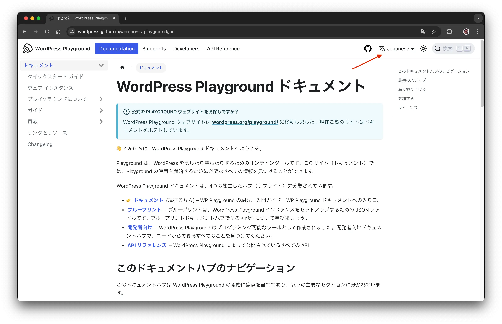
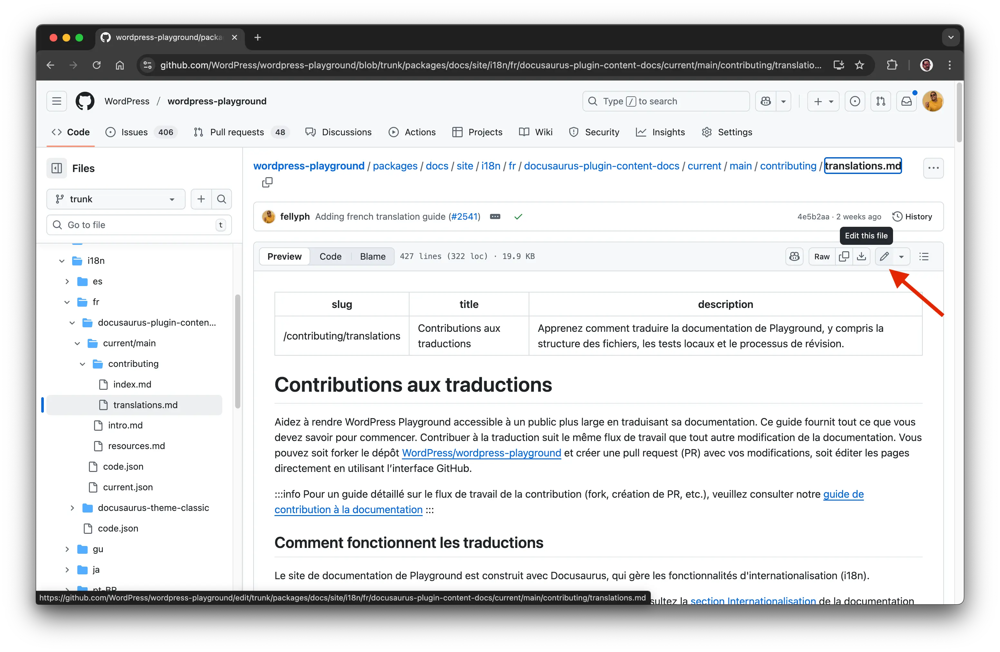
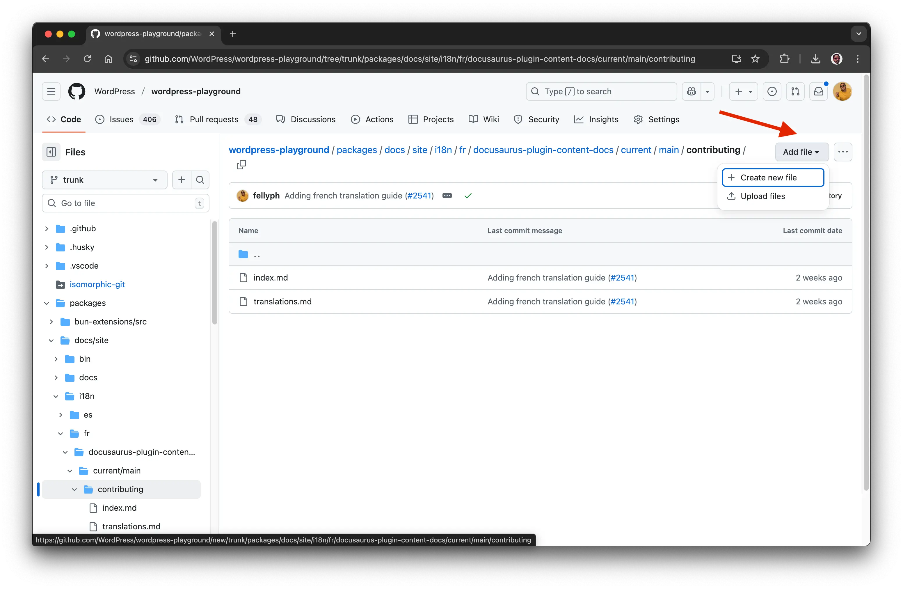
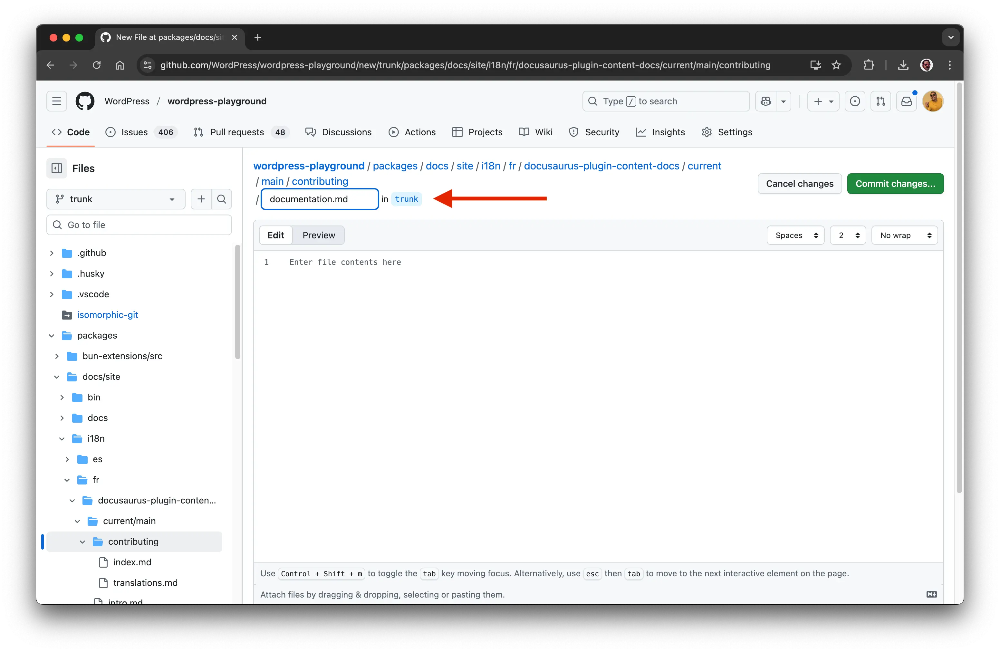

<!-- # Contributions to translations -->

# अनुवाद में योगदान

<!-- Help make WordPress Playground accessible to a global audience by translating its documentation. This guide provides everything you need to know to get started. Contributing translations follows the same workflow as any other documentation change. You can either fork the [WordPress/wordpress-playground](https://github.com/WordPress/wordpress-playground) repository and create a pull request (PR) with your changes or edit pages directly using the GitHub UI. -->

WordPress Playground के दस्तावेज़ का अनुवाद करके इसे दुनिया भर के लोगों के लिए सुलभ बनाने में मदद करें। शुरू करने के लिए आपको जो कुछ भी जानना ज़रूरी है, वह सब इस गाइड में है। अनुवाद में योगदान करने का तरीका वही है, जो दस्तावेज़ में किसी भी दूसरे बदलाव का है। आप या तो [WordPress/wordpress-playground](https://github.com/WordPress/wordpress-playground) रिपॉज़िटरी फ़ोर्क करके अपने बदलावों के साथ एक पुल रिक्वेस्ट (PR) बना सकते हैं, या GitHub UI का उपयोग करके सीधे पेज संपादित कर सकते हैं।

<div class="callout callout-info">

<!-- For a detailed guide on the contribution workflow (forking, creating PRs, etc.), please see our [documentation contribution guide](/contributing/documentation#how-can-i-contribute). To make changes directly in GitHub, see [Contribute with the GitHub web interface](/contributing/github-ui). -->

योगदान की प्रक्रिया (फ़ोर्क करना, PR बनाना आदि) की विस्तृत गाइड के लिए कृपया हमारी [दस्तावेज़ योगदान गाइड](/contributing/documentation#how-can-i-contribute) देखें। GitHub में सीधे बदलाव करने के लिए [GitHub वेब इंटरफ़ेस से योगदान करें](/contributing/github-ui) देखें।

</div>

<!-- ## How Translations Work -->

## अनुवाद कैसे काम करते हैं {#how-translations-work}

<!-- Playground's documentation site is built with Docusaurus, which handles the internationalization (i18n) features. -->

Playground की दस्तावेज़ साइट Docusaurus से बनी है, जो अंतरराष्ट्रीयकरण (i18n) की सुविधाएँ संभालता है।

<div class="callout callout-info">

<!-- To learn more about how Docusaurus manages translations, see the [Internationalization section](https://docusaurus.io/docs/i18n/introduction) of the official Docusaurus documentation. -->

Docusaurus अनुवादों को कैसे संभालता है, इसके बारे में और जानने के लिए Docusaurus के आधिकारिक दस्तावेज़ का [Internationalization सेक्शन](https://docusaurus.io/docs/i18n/introduction) देखें।

</div>

<!-- ### Configuration -->

### कॉन्फ़िगरेशन {#configuration}

<!-- Available languages are defined in the `packages/docs/site/docusaurus.config.js` file. For example: -->

उपलब्ध भाषाएँ `packages/docs/site/docusaurus.config.js` फ़ाइल में तय की जाती हैं। उदाहरण के लिए:

```
i18n: {
  defaultLocale: 'en',
  path: 'i18n',
  locales: ['en', 'fr'],
  localeConfigs: {
	en: {
		label: 'English',
		path: 'en',
	},
	fr: {
		label: 'French',
		path: 'fr',
	},
  },
}
```

<!-- ### File Structure -->

### फ़ाइल संरचना {#file-structure}

<!-- All translated documentation pages are located within the `packages/docs/site/i18n/` directory, organized by language code. -->

अनुवादित दस्तावेज़ के सभी पेज `packages/docs/site/i18n/` डायरेक्टरी में होते हैं, जहाँ वे भाषा कोड के हिसाब से व्यवस्थित हैं।

<!-- For a language to work correctly, its file structure must mirror the original English documentation found in `packages/docs/site/docs`. -->

किसी भाषा के सही ढंग से काम करने के लिए उसकी फ़ाइल संरचना `packages/docs/site/docs` में मौजूद मूल अंग्रेज़ी दस्तावेज़ जैसी ही होनी चाहिए।

<!--
For example, the Spanish (es) translation for `docs/main/intro.md` must be placed at:
`packages/docs/site/i18n/es/docusaurus-plugin-content-docs/current/main/intro.md`.
-->

उदाहरण के लिए, `docs/main/intro.md` का स्पेनिश (es) अनुवाद यहाँ रखा जाना चाहिए:
`packages/docs/site/i18n/es/docusaurus-plugin-content-docs/current/main/intro.md`।

<!-- If a translated file does not exist for a specific language, Docusaurus will automatically fall back to the English version of that page. -->

अगर किसी भाषा के लिए कोई अनुवादित फ़ाइल मौजूद नहीं है, तो Docusaurus अपने-आप उस पेज का अंग्रेज़ी संस्करण दिखाएगा।

<!-- ### Generating Translation Files -->

### अनुवाद फ़ाइलें जनरेट करना {#generating-translation-files}

<!-- When adding a new language, you can generate the necessary JSON files for UI strings (like button labels and navigation items) by running the following command from the `packages/docs/site` directory: -->

नई भाषा जोड़ते समय आप `packages/docs/site` डायरेक्टरी से यह कमांड चलाकर UI स्ट्रिंग्स (जैसे बटन लेबल और नेविगेशन आइटम) के लिए ज़रूरी JSON फ़ाइलें जनरेट कर सकते हैं:

```bash
npm run write-translations -- --locale <LANGUAGE_CODE>
```

<!-- With the proper i18n `docusaurus.config.js` configuration and files under `i18n` when running `npm run build:docs` from the root of the project, specific folders under `dist` for each language will be created. -->

जब `docusaurus.config.js` में i18n का सही कॉन्फ़िगरेशन हो और `i18n` के अंदर फ़ाइलें मौजूद हों, तब प्रोजेक्ट के रूट से `npm run build:docs` चलाने पर `dist` के अंदर हर भाषा के लिए अलग फ़ोल्डर बनाए जाएँगे।

<!-- ## Testing Translations Locally -->

## अनुवादों का लोकल परीक्षण करना {#testing-translations-locally}

<!--
To preview your changes for an existing language:

1. Modify or add a translated file in the appropriate language directory, such as `packages/docs/site/i18n/es/docusaurus-plugin-content-docs/current/`.
2. From the `/packages/docs/site` directory, run the local development server for your target language. For example, to test Spanish (es):
-->

किसी मौजूदा भाषा के लिए अपने बदलावों का पूर्वावलोकन करने के लिए:

1. भाषा की उपयुक्त डायरेक्टरी में, जैसे `packages/docs/site/i18n/es/docusaurus-plugin-content-docs/current/` में, कोई अनुवादित फ़ाइल बदलें या जोड़ें।
2. जिस भाषा पर आप काम कर रहे हैं, उसके लिए `/packages/docs/site` डायरेक्टरी से लोकल डेवलपमेंट सर्वर चलाएँ। उदाहरण के लिए, स्पेनिश (es) का परीक्षण करने के लिए:

```bash

npm run dev -- --locale es

```

<!-- ## The Language Switcher -->

## भाषा स्विचर {#the-language-switcher}

<!-- The language switcher is a dropdown menu that allows users to select their preferred language. -->

भाषा स्विचर एक ड्रॉपडाउन मेनू है, जिससे उपयोगकर्ता अपनी पसंद की भाषा चुन सकते हैं।

<!--  -->


<!-- ### Making a language publicly available on the Language Switcher -->

### भाषा स्विचर में किसी भाषा को सार्वजनिक रूप से उपलब्ध कराना {#making-a-language-publicly-available-on-the-language-switcher}

<!-- We recommend only adding a language to the switcher when a significant portion of the documentation has been translated. This avoids a poor user experience where switching to a new language results in seeing mostly untranslated English content. -->

हमारा सुझाव है कि किसी भाषा को स्विचर में तभी जोड़ें, जब दस्तावेज़ के एक बड़े हिस्से का अनुवाद हो चुका हो। इससे उपयोगकर्ता को वह ख़राब अनुभव नहीं होता, जिसमें नई भाषा चुनने पर उसे ज़्यादातर बिना अनुवाद वाली अंग्रेज़ी सामग्री ही दिखती है।

<!--
As a guideline, a language should be made publicly available in the switcher only when the entire "Documentation" hub is translated, including these key sections:

- [Quick Start Guide](https://wordpress.github.io/wordpress-playground/quick-start-guide)
- [Playground web instance](https://wordpress.github.io/wordpress-playground/web-instance)
- [About Playground](https://wordpress.github.io/wordpress-playground/about)
- [Guides](https://wordpress.github.io/wordpress-playground/guides)
- [Contributing](https://wordpress.github.io/wordpress-playground/contributing)
- [Links and Resources](https://wordpress.github.io/wordpress-playground/links-and-resources)
-->

दिशानिर्देश के तौर पर, किसी भाषा को स्विचर में सार्वजनिक रूप से तभी उपलब्ध कराना चाहिए, जब पूरे "दस्तावेज़" हब का अनुवाद हो चुका हो, जिसमें ये मुख्य सेक्शन भी शामिल हैं:

- [क्विक स्टार्ट गाइड](https://wordpress.github.io/wordpress-playground/quick-start-guide)
- [Playground वेब इंस्टेंस](https://wordpress.github.io/wordpress-playground/web-instance)
- [Playground के बारे में](https://wordpress.github.io/wordpress-playground/about)
- [गाइड](https://wordpress.github.io/wordpress-playground/guides)
- [योगदान](https://wordpress.github.io/wordpress-playground/contributing)
- [लिंक और संसाधन](https://wordpress.github.io/wordpress-playground/links-and-resources)

<!-- All languages are available once the i18n setup for a language is complete and the correct file structure is in place under `i18n`. -->

किसी भाषा का i18n सेटअप पूरा होने और `i18n` के अंदर सही फ़ाइल संरचना तैयार होने के बाद सभी भाषाएँ उपलब्ध हो जाती हैं।

- https://wordpress.github.io/wordpress-playground/
- https://wordpress.github.io/wordpress-playground/es/
- https://wordpress.github.io/wordpress-playground/fr/

<!-- Assuming the `fr` language is the first language with the Documentation hub pages (Quick Start Guide, Playground web instance, About Playground, Guides,... ) completely translated to French, the `docusaurus.config.js` should look like this in that branch so `npm run build:docs` properly generates the `fr` subsite and only displays the French language in the `localeDropdown` language switcher. -->

मान लें कि `fr` पहली भाषा है, जिसमें दस्तावेज़ हब के पेजों (क्विक स्टार्ट गाइड, Playground वेब इंस्टेंस, Playground के बारे में, गाइड,... ) का पूरी तरह फ़्रेंच में अनुवाद हो चुका है। ऐसे में उस ब्रांच में `docusaurus.config.js` कुछ इस तरह दिखना चाहिए, ताकि `npm run build:docs` सही तरीके से `fr` सबसाइट जनरेट करे और `localeDropdown` भाषा स्विचर में सिर्फ़ फ़्रेंच भाषा दिखाए।

```
  {
    "i18n": {
      "defaultLocale": "en",
      "path": "i18n",
      "locales": [
        "en",
        "fr"
      ],
      "localeConfigs": {
        "en": {
          "label": "English",
          "path": "en"
        },
        "fr": {
          "label": "French",
          "path": "fr"
        }
      }
    }
  },
  {
    "type": "localeDropdown",
    "position": "right"
  }
```

<!-- ## Translation Workflow -->

## अनुवाद की प्रक्रिया {#translation-workflow}

<!--
Follow these steps to translate a page:

1. **Check for an Existing Translation Issue**: First, [search the repository issues](https://github.com/WordPress/wordpress-playground/issues?q=is%3Aissue%20state%3Aopen%20%5Btranslation%5D%20progress) to see if a tracking issue for your desired language already exists. If it does, comment on the issue to claim the page(s) you would like to translate.
2. **Create a New Translation Issue**: If no issue exists, please create a new one to track the translation progress for the language. You can model it after issue [#2202](https://github.com/WordPress/wordpress-playground/issues/2202) and use the markdown checklist below to track progress.
3. **Translate the File**:
-->

किसी पेज का अनुवाद करने के लिए ये चरण अपनाएँ:

1. **पहले से मौजूद अनुवाद इश्यू देखें**: सबसे पहले [रिपॉज़िटरी के इश्यू खोजें](https://github.com/WordPress/wordpress-playground/issues?q=is%3Aissue%20state%3Aopen%20%5Btranslation%5D%20progress) और देखें कि आपकी चुनी हुई भाषा के लिए कोई ट्रैकिंग इश्यू पहले से मौजूद है या नहीं। अगर है, तो जिन पेजों का आप अनुवाद करना चाहते हैं, उन्हें अपने नाम करने के लिए उस इश्यू पर टिप्पणी करें।
2. **नया अनुवाद इश्यू बनाएँ**: अगर कोई इश्यू मौजूद नहीं है, तो कृपया उस भाषा के अनुवाद की प्रगति ट्रैक करने के लिए एक नया इश्यू बनाएँ। आप इसे इश्यू [#2202](https://github.com/WordPress/wordpress-playground/issues/2202) की तरह बना सकते हैं और प्रगति ट्रैक करने के लिए नीचे दी गई Markdown चेकलिस्ट का उपयोग कर सकते हैं।
3. **फ़ाइल का अनुवाद करें**:

<!--
- Check if you have the latest version of the documentation
- Copy the original .md file from `packages/docs/site/docs/...` to the corresponding path in the language directory (e.g., `packages/docs/site/i18n/<LANGUAGE_CODE>/...`). It is crucial to replicate the original file structure.
-->

<!-- prettier-ignore -->
{/* - Translate the content of the new file, keeping the original content commented out `<!-- English Content -->`. */}

<!--
- The assets are listed at `packages/docs/site/static/img/`. Only place assets inside the translation folder when they require localized content.
- Once the translations are ready, check if the docs build script is running properly `npm run build:docs`.
-->

- जाँचें कि आपके पास दस्तावेज़ का नवीनतम संस्करण है या नहीं
- मूल .md फ़ाइल को `packages/docs/site/docs/...` से भाषा डायरेक्टरी में संबंधित पाथ पर कॉपी करें (जैसे `packages/docs/site/i18n/<LANGUAGE_CODE>/...`)। मूल फ़ाइल संरचना को हूबहू दोहराना बहुत ज़रूरी है।
- नई फ़ाइल की सामग्री का अनुवाद करें और मूल सामग्री को `<!-- English Content -->` की तरह कमेंट में रखें।
- एसेट `packages/docs/site/static/img/` में मौजूद हैं। एसेट को अनुवाद फ़ोल्डर के अंदर सिर्फ़ तभी रखें, जब उनमें स्थानीयकृत सामग्री की ज़रूरत हो।
- अनुवाद तैयार होने पर जाँचें कि दस्तावेज़ की बिल्ड स्क्रिप्ट `npm run build:docs` ठीक से चल रही है या नहीं।

<!-- 4. **Create a pull request with your changes** -->

4. **अपने बदलावों के साथ पुल रिक्वेस्ट बनाएँ**

<!--
- Add a prefix to the title `[i18n]` to help to identify the translations
- Describe the pages that you translated
- Request a review at `#playground` or `#polyglots` at `wordpress.slack.com`
-->

- अनुवादों को पहचानने में मदद के लिए शीर्षक में `[i18n]` प्रीफ़िक्स जोड़ें
- बताएँ कि आपने किन पेजों का अनुवाद किया है
- समीक्षा के लिए `wordpress.slack.com` पर `#playground` या `#polyglots` में अनुरोध करें

<div class="callout callout-info">

<!-- We highly recommend submitting pull requests with a small number of translated pages. This approach simplifies the review process and allows for a more gradual and manageable integration of your work. -->

हमारी पुरज़ोर सलाह है कि आप हर पुल रिक्वेस्ट में कुछ ही अनुवादित पेज भेजें। इससे समीक्षा की प्रक्रिया आसान होती है और आपका काम धीरे-धीरे और ज़्यादा व्यवस्थित ढंग से जोड़ा जा सकता है।

</div>

<!-- ### Translation Tracking Template -->

### अनुवाद ट्रैकिंग टेम्पलेट {#translation-tracking-template}

<!-- You can use the following markdown in your tracking issue: -->

अपने ट्रैकिंग इश्यू में आप नीचे दिए गए Markdown का उपयोग कर सकते हैं:

```
## Remaining translation pages

<details open>
<summary><h3>Main</h3></summary>

- about
  - [ ] build.md
  - [ ] index.md
  - [ ] launch.md
  - [ ] test.md
- contributing
  - [ ] code.md
  - [ ] coding-standards.md
  - [ ] contributor-badge.md
  - [ ] contributor-day.md
  - [ ] contributor-day-table-lead.md
  - [ ] documentation.md
  - [ ] github-ui.md
  - [ ] index.md
  - [ ] releases.md
  - [ ] translations.md
- guides
  - [ ] agent-skill-wp-playground.md
  - [ ] ai-assistants-mcp.md
  - [ ] e2e-testing-with-playwright.md
  - [ ] for-plugin-developers.md
  - [ ] for-theme-developers.md
  - [ ] github-action-pr-preview.md
  - [ ] import-content-with-blueprints.md
  - [ ] index.md
  - [ ] php-code-snippets.md
  - [ ] php-frameworks.md
  - [ ] phpunit-testing.md
  - [ ] playground-for-everyone.md
  - [ ] programmatic-playground-cli.md
  - [ ] providing-content-for-your-demo.md
  - [ ] wordpress-native-ios-app.md
- [ ] changelog.md
- [ ] intro.md
- [ ] quick-start-guide.md
- [ ] resources.md
- [ ] troubleshooting.md
- [ ] web-instance.md

</details>

<details open>
<summary><h3>Blueprints</h3></summary>

- [ ] 01-index.md
- [ ] 02-using-blueprints.md
- [ ] 03-data-format.md
- [ ] 04-resources.md
- [ ] 05-steps.md
- [ ] 05-steps-shorthands.md
- [ ] 06-bundles.md
- [ ] 07-json-api-and-function-api.md
- [ ] 08-examples.md
- [ ] 09-troubleshoot-and-debug-blueprints.md
- [ ] intro.md
- tutorial
  - [ ] 01-what-are-blueprints-what-you-can-do-with-them.md
  - [ ] 02-how-to-load-run-blueprints.md
  - [ ] 03-build-your-first-blueprint.md
  - [ ] index.md

</details>

<details open>
<summary><h3>Developers</h3></summary>

- 03-build-an-app
  - [ ] 01-index.md
- 05-local-development
  - [ ] 01-wp-now.md
  - [ ] 02-vscode-extension.md
  - [ ] 03-php-wasm-node.md
  - [ ] 04-wp-playground-cli.md
  - [ ] intro.md
- 06-apis
  - [ ] 01-index.md
  - javascript-api
    - [ ] 01-index.md
    - [ ] 02-index-html-vs-remote-html.md
    - [ ] 03-playground-api-client.md
    - [ ] 04-blueprint-json-in-api-client.md
    - [ ] 05-blueprint-functions-in-api-client.md
    - [ ] 06-mount-data.md
    - [ ] 07-php-extensions.md
    - [ ] 08-build-php-extensions.md
    - [ ] 09-php-extension-dependencies.md
  - query-api
    - [ ] 01-index.md
  - sites-api
    - [ ] 01-index.md
- 07-xdebug
  - [ ] 01-introduction.md
  - [ ] 02-getting-started.md
  - [ ] 03-trace-and-profile.md
- 23-architecture
  - [ ] 01-index.md
  - [ ] 02-wasm-php-overview.md
  - [ ] 03-wasm-php-compiling.md
  - [ ] 04-wasm-php-javascript-module.md
  - [ ] 05-wasm-php-filesystem.md
  - [ ] 06-php-wasm-packages.md
  - [ ] 07-wasm-asyncify.md
  - [ ] 08-browser-concepts.md
  - [ ] 09-browser-tab-orchestrates-execution.md
  - [ ] 10-browser-iframe-rendering.md
  - [ ] 11-browser-php-worker-threads.md
  - [ ] 12-browser-service-workers.md
  - [ ] 13-browser-scopes.md
  - [ ] 14-browser-cross-process-communication.md
  - [ ] 15-wordpress.md
  - [ ] 16-wordpress-database.md
  - [ ] 17-browser-wordpress.md
  - [ ] 18-host-your-own-playground.md
- 24-limitations
  - [ ] 01-index.md
- [ ] intro-devs.md

</details>
```

<!-- ### Translating with the GitHub Web Interface -->

### GitHub वेब इंटरफ़ेस से अनुवाद करना {#translating-with-the-github-web-interface}

<!-- If you prefer not to use developer tools, you can easily contribute translations directly on the GitHub website. All you need is a free GitHub account. -->

अगर आप डेवलपर टूल्स का उपयोग नहीं करना चाहते, तो आप सीधे GitHub वेबसाइट पर आसानी से अनुवाद में योगदान कर सकते हैं। इसके लिए आपको सिर्फ़ एक मुफ़्त GitHub अकाउंट चाहिए।

<!-- This guide will show you how to both update an existing translation and add a brand-new one. -->

यह गाइड आपको बताएगी कि मौजूदा अनुवाद को कैसे अपडेट करें और बिल्कुल नया अनुवाद कैसे जोड़ें।

---

<!-- #### Updating an Existing Translation -->

#### मौजूदा अनुवाद अपडेट करना {#updating-an-existing-translation}

<!-- 1.  **Navigate to the file.** Go to the repository and find the file you want to update. Translation files are located in a folder named after their language code. For example, all French translations are in `packages/docs/site/i18n/fr/docusaurus-plugin-content-docs/current/`. -->

1.  **फ़ाइल पर जाएँ।** रिपॉज़िटरी में जाएँ और वह फ़ाइल ढूँढें जिसे आप अपडेट करना चाहते हैं। अनुवाद फ़ाइलें उस फ़ोल्डर में होती हैं, जिसका नाम उनकी भाषा का कोड है। उदाहरण के लिए, फ़्रेंच के सभी अनुवाद `packages/docs/site/i18n/fr/docusaurus-plugin-content-docs/current/` में हैं।

<!--
2.  **Open the editor.** Select the file you wish to edit and click the pencil icon (**Edit this file**) in the upper right corner.
    
-->

2.  **एडिटर खोलें।** जिस फ़ाइल को आप संपादित करना चाहते हैं, उसे चुनें और ऊपर दाएँ कोने में पेंसिल आइकन (**Edit this file**) पर क्लिक करें।
    

<!-- 3.  **Fork the repository.** GitHub will automatically prompt you to **Fork this repository**. This creates a personal copy for you to edit safely. Click the button to proceed. -->

3.  **रिपॉज़िटरी फ़ोर्क करें।** GitHub आपसे अपने-आप **Fork this repository** करने को कहेगा। इससे आपके लिए एक निजी कॉपी बनती है, जिसे आप सुरक्षित रूप से संपादित कर सकते हैं। आगे बढ़ने के लिए बटन पर क्लिक करें।

<!-- 4.  **Make your changes.** The editor will open in your browser. Update the text with your improved translations. -->

4.  **अपने बदलाव करें।** एडिटर आपके ब्राउज़र में खुलेगा। टेक्स्ट में अपने बेहतर अनुवाद डालें।

<!-- 5.  **Propose your changes.** Once you are finished, scroll to the bottom of the page. Add a brief title and description of your changes (e.g., "Fixing typos in French translation") and click the **Propose changes** button. -->

5.  **अपने बदलाव प्रस्तावित करें।** काम पूरा होने पर पेज में सबसे नीचे स्क्रॉल करें। अपने बदलावों का एक छोटा शीर्षक और विवरण जोड़ें (जैसे "Fixing typos in French translation") और **Propose changes** बटन पर क्लिक करें।

<!-- 6.  **Create a Pull Request.** On the next screen, click the **Create pull request** button. This will submit your changes to the project maintainers for review. -->

6.  **पुल रिक्वेस्ट बनाएँ।** अगली स्क्रीन पर **Create pull request** बटन पर क्लिक करें। इससे आपके बदलाव समीक्षा के लिए प्रोजेक्ट के मेंटेनर्स के पास भेजे जाएँगे।

---

<!-- #### Adding a New Translation -->

#### नया अनुवाद जोड़ना {#adding-a-new-translation}

<!--
1.  **Determine the correct file path.** The new file's path and name must mirror the original English file.
    - **English original:** `packages/docs/site/docs/main/contributing/documentation.md`
    - **French translation:** `packages/docs/site/i18n/fr/docusaurus-plugin-content-docs/current/main/contributing/documentation.md`
-->

1.  **सही फ़ाइल पाथ तय करें।** नई फ़ाइल का पाथ और नाम मूल अंग्रेज़ी फ़ाइल जैसा ही होना चाहिए।
    - **मूल अंग्रेज़ी फ़ाइल:** `packages/docs/site/docs/main/contributing/documentation.md`
    - **फ़्रेंच अनुवाद:** `packages/docs/site/i18n/fr/docusaurus-plugin-content-docs/current/main/contributing/documentation.md`

<!--
2.  **Create the new file.** Navigate to the correct language folder (e.g., `/packages/docs/site/i18n/fr/docusaurus-plugin-content-docs/current/`). Click **Add file** > **Create new file**.
    
    - **Pro Tip:** In the filename box, you can create new folders by typing the folder name followed by a `/`. For example, typing `main/contributing/documentation.md` will create the `main` and `contributing` folders automatically.
-->

2.  **नई फ़ाइल बनाएँ।** भाषा के सही फ़ोल्डर में जाएँ (जैसे `/packages/docs/site/i18n/fr/docusaurus-plugin-content-docs/current/`)। **Add file** > **Create new file** पर क्लिक करें।
    
    - **प्रो टिप:** फ़ाइल नाम वाले बॉक्स में फ़ोल्डर का नाम और उसके बाद `/` लिखकर आप नए फ़ोल्डर बना सकते हैं। उदाहरण के लिए, `main/contributing/documentation.md` लिखने पर `main` और `contributing` फ़ोल्डर अपने-आप बन जाएँगे।

<!-- 3.  **Fork the repository.** Just like before, GitHub will prompt you to **Fork this repository**. Click the button to create your personal copy. -->

3.  **रिपॉज़िटरी फ़ोर्क करें।** पहले की तरह, GitHub आपसे **Fork this repository** करने को कहेगा। अपनी निजी कॉपी बनाने के लिए बटन पर क्लिक करें।

<!-- 4.  **Add the translated content.** The editor will open with an empty file. For the convenience of reviewers, please copy the content from the original English file and paste it into your new file, wrapping it in comment tags. Add your translation below it. -->

4.  **अनुवादित सामग्री जोड़ें।** एडिटर एक खाली फ़ाइल के साथ खुलेगा। समीक्षकों की सुविधा के लिए, कृपया मूल अंग्रेज़ी फ़ाइल की सामग्री कॉपी करें और उसे कमेंट टैग में लपेटकर अपनी नई फ़ाइल में पेस्ट करें। उसके नीचे अपना अनुवाद जोड़ें।

    ```markdown
    <!--
    This is the original English content.
    It helps reviewers understand the context of the translation.
    -->

    Ceci est le contenu traduit en français.
    ```

    <!--  -->

    

<!-- 5.  **Commit the new file.** When you are done, scroll to the bottom. Add a title for your new file (e.g., "Add French translation for documentation.md") and click the **Commit new file** button. -->

5.  **नई फ़ाइल कमिट करें।** काम पूरा होने पर सबसे नीचे स्क्रॉल करें। अपनी नई फ़ाइल के लिए एक शीर्षक जोड़ें (जैसे "Add French translation for documentation.md") और **Commit new file** बटन पर क्लिक करें।

<!-- 6.  **Create a Pull Request.** On the next screen, click **Create pull request** to submit your new translation for review. -->

6.  **पुल रिक्वेस्ट बनाएँ।** अगली स्क्रीन पर **Create pull request** पर क्लिक करें, ताकि आपका नया अनुवाद समीक्षा के लिए भेजा जा सके।

<!-- ## Review Process -->

## समीक्षा की प्रक्रिया {#review-process}

<!-- To simplify the review process, please keep the original English text as a comment directly above the translated content. -->

समीक्षा की प्रक्रिया आसान बनाने के लिए, कृपया मूल अंग्रेज़ी टेक्स्ट को अनुवादित सामग्री के ठीक ऊपर कमेंट के रूप में रखें।

```
<!--
👋 Hi! Welcome to WordPress Playground documentation.

Playground is an online tool to experiment and learn about WordPress. This site (Documentation) is where you will find all the information you need to start using Playground.
-->

👋 Olá! Bem vindo a documentação oficial do WordPress Playground.

WordPress Playground é uma ferramenta online onde podes testar e aprender mais sobre o WordPress. Nesta página(Documentação) irá encontrar todas as informações necessárias para começar a trabalhar com o Playground.
```

<div class="callout callout-info">

<!-- This practice also helps the maintenance team identify outdated translations. When the original English content is updated, we can search the codebase for the old text (now in comments) and flag the corresponding translation for review. -->

यह तरीका मेंटेनेंस टीम को पुराने पड़ चुके अनुवाद पहचानने में भी मदद करता है। जब मूल अंग्रेज़ी सामग्री अपडेट होती है, तो हम कोडबेस में पुराना टेक्स्ट (जो अब कमेंट में है) खोज सकते हैं और उससे जुड़े अनुवाद को समीक्षा के लिए चिह्नित कर सकते हैं।

</div>

<!-- To find a reviewer fluent in the language of your PR, you can post a request on the [Make WordPress Polyglots blog](https://make.wordpress.org/polyglots/). Be sure to include the locale tag (e.g., #ja for Japanese) to notify the appropriate General Translation Editors (GTEs). -->

ऐसा समीक्षक ढूँढने के लिए जो आपके PR की भाषा अच्छी तरह जानता हो, आप [Make WordPress Polyglots ब्लॉग](https://make.wordpress.org/polyglots/) पर अनुरोध पोस्ट कर सकते हैं। सही जनरल ट्रांसलेशन एडिटर्स (GTEs) तक सूचना पहुँचाने के लिए लोकेल टैग (जैसे जापानी के लिए #ja) ज़रूर जोड़ें।

<!-- When the PR is merged, the translated version of that page should appear under `https://wordpress.github.io/wordpress-playground/`. If you are contributing for the first time, request your [Contributor Badge](/contributing/contributor-badge). -->

जब PR मर्ज हो जाए, तो उस पेज का अनुवादित संस्करण `https://wordpress.github.io/wordpress-playground/` के अंतर्गत दिखना चाहिए। अगर आप पहली बार योगदान कर रहे हैं, तो अपने [योगदानकर्ता बैज](/contributing/contributor-badge) का अनुरोध करें।
