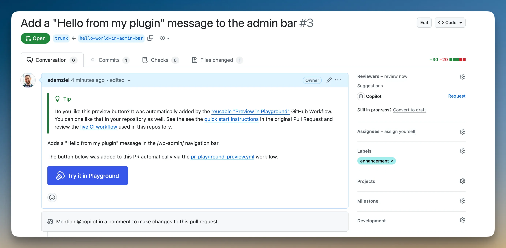

<!-- The Playground PR Preview action adds a preview button to your pull requests. Clicking the button launches Playground with your plugin or theme installed from the PR branch: -->

Playground PR Preview एक्शन आपके पुल रिक्वेस्ट में एक पूर्वावलोकन बटन जोड़ता है। बटन पर क्लिक करने से Playground खुलता है, जिसमें PR की ब्रांच से आपका प्लगइन या थीम स्थापित होता है:

<!--  -->


<!-- Start with the setup that matches your repository: -->

वह सेटअप चुनें, जो आपकी रिपॉज़िटरी से मेल खाता है:

<!--
| Your repository                                                           | Use this setup                                                                  |
| ------------------------------------------------------------------------- | ------------------------------------------------------------------------------- |
| Plugin or theme works directly from the repository checkout               | [No build step](#no-build-step)                                                 |
| Plugin or theme needs Composer, npm, Vite, or another build command first | [With a build step](#with-a-build-step)                                         |
| Public fork PRs need working previews                                     | [With a build step](#with-a-build-step)                                         |
| Private repository                                                        | The default setup is not enough; Playground needs public, unauthenticated URLs. |
-->

| आपकी रिपॉज़िटरी                                                          | यह सेटअप उपयोग करें                                                                            |
| ------------------------------------------------------------------------ | ---------------------------------------------------------------------------------------------- |
| प्लगइन या थीम, रिपॉज़िटरी के चेकआउट से सीधे काम करता है                  | [बिना बिल्ड चरण के](#no-build-step)                                                            |
| प्लगइन या थीम को पहले Composer, npm, Vite या कोई दूसरी बिल्ड कमांड चाहिए | [बिल्ड चरण के साथ](#with-a-build-step)                                                         |
| सार्वजनिक फ़ोर्क से आए PR में भी पूर्वावलोकन काम करना चाहिए              | [बिल्ड चरण के साथ](#with-a-build-step)                                                         |
| निजी रिपॉज़िटरी                                                          | डिफ़ॉल्ट सेटअप काफ़ी नहीं है, क्योंकि Playground को सार्वजनिक, बिना प्रमाणीकरण वाले URL चाहिए। |

<!-- If you are not sure, use the no-build setup only when the files committed to the pull request are exactly the files WordPress should run. If CI must generate anything first, use the build-step setup. -->

अगर आप पक्का नहीं हैं, तो बिना बिल्ड वाला सेटअप तभी उपयोग करें, जब पुल रिक्वेस्ट में कमिट की गई फ़ाइलें ठीक वही हों, जिन्हें WordPress को चलाना है। अगर CI को पहले कुछ भी बनाना पड़ता है, तो बिल्ड चरण वाला सेटअप उपयोग करें।

<!-- For complete configuration options, recipes, and reference tables, see the [action-wp-playground-pr-preview documentation](https://wordpress.github.io/action-wp-playground-pr-preview/). -->

कॉन्फ़िगरेशन के सभी विकल्पों, तैयार उदाहरणों और संदर्भ तालिकाओं के लिए [action-wp-playground-pr-preview दस्तावेज़](https://wordpress.github.io/action-wp-playground-pr-preview/) देखें।

<!-- ## How it works -->

## यह कैसे काम करता है {#how-it-works}

<!-- Playground runs WordPress in the browser. Anything Playground installs, such as a plugin ZIP, theme ZIP, or WXR file, must be available at a public URL when someone clicks the preview button. -->

Playground, WordPress को ब्राउज़र में चलाता है। Playground जो कुछ भी स्थापित करता है, जैसे प्लगइन ZIP, थीम ZIP या WXR फ़ाइल, वह किसी के पूर्वावलोकन बटन पर क्लिक करते समय किसी सार्वजनिक URL पर उपलब्ध होना चाहिए।

<!-- The action uses two URL strategies: -->

एक्शन, URL के लिए दो तरीके उपयोग करता है:

<!--
- `git:directory`: Playground fetches the repository at the pull request ref. Use this for the no-build setup.
- Release assets: CI builds ZIP files and uploads them to a public `ci-artifacts` prerelease. Use this when the preview needs Composer dependencies, npm output, compiled assets, or any other generated files.
-->

- `git:directory`: Playground पुल रिक्वेस्ट के ref पर रिपॉज़िटरी लाता है। बिना बिल्ड वाले सेटअप के लिए इसका उपयोग करें।
- रिलीज़ एसेट: CI, ZIP फ़ाइलें बनाता है और उन्हें एक सार्वजनिक `ci-artifacts` प्रीरिलीज़ पर अपलोड करता है। जब पूर्वावलोकन को Composer डिपेंडेंसी, npm आउटपुट, कंपाइल किए गए एसेट या कोई और बनाई गई फ़ाइलें चाहिए हों, तब इसका उपयोग करें।

<div class="callout callout-warning">

<!-- **Use the action and reusable workflows in different places** -->

**एक्शन और दोबारा उपयोग होने वाले वर्कफ़्लो अलग-अलग जगह उपयोग करें**

<!-- The direct action, `WordPress/action-wp-playground-pr-preview@v4`, is a regular GitHub Action. Reference it as a step under `jobs.<job_id>.steps[].uses`. -->

सीधा एक्शन, `WordPress/action-wp-playground-pr-preview@v4`, एक सामान्य GitHub Action है। इसे `jobs.<job_id>.steps[].uses` के अंदर एक चरण के रूप में जोड़ें।

<!-- The build-step setup uses reusable workflows, `preview-build.yml@v4` and `preview-publish.yml@v4`. Reference those at the job level under `jobs.<job_id>.uses`. -->

बिल्ड चरण वाला सेटअप दोबारा उपयोग होने वाले वर्कफ़्लो, `preview-build.yml@v4` और `preview-publish.yml@v4`, उपयोग करता है। इन्हें जॉब के स्तर पर `jobs.<job_id>.uses` के अंदर जोड़ें।

</div>

<!-- ## No build step -->

## बिना बिल्ड चरण के {#no-build-step}

<!-- Use this setup when your plugin or theme can run directly from the repository checkout, with no Composer install, npm build, or asset pipeline. -->

यह सेटअप तब उपयोग करें, जब आपका प्लगइन या थीम Composer install, npm build या एसेट पाइपलाइन के बिना, रिपॉज़िटरी के चेकआउट से सीधे चल सकता हो।

<!-- Create `.github/workflows/pr-preview.yml`: -->

नई फ़ाइल `.github/workflows/pr-preview.yml` बनाएँ:

```yaml
name: PR Preview
on:
    pull_request:
        types: [opened, synchronize, reopened, edited]

jobs:
    preview:
        runs-on: ubuntu-latest
        permissions:
            contents: read
            pull-requests: write
        steps:
            - uses: WordPress/action-wp-playground-pr-preview@v4
              with:
                  plugin-path: .
                  github-token: ${{ secrets.GITHUB_TOKEN }}
```

<!-- Use `theme-path: .` instead of `plugin-path: .` for a theme: -->

थीम के लिए `plugin-path: .` की जगह `theme-path: .` उपयोग करें:

```yaml
with:
    theme-path: .
    github-token: ${{ secrets.GITHUB_TOKEN }}
```

<!-- Use a subdirectory when the plugin or theme is not at the repository root: -->

जब प्लगइन या थीम रिपॉज़िटरी के रूट में न हो, तब सबडायरेक्टरी उपयोग करें:

```yaml
with:
    plugin-path: plugins/my-plugin
    github-token: ${{ secrets.GITHUB_TOKEN }}
```

<!-- You do not need to create `secrets.GITHUB_TOKEN`; GitHub provides it automatically. The `permissions` block gives that token the access this action needs. -->

आपको `secrets.GITHUB_TOKEN` बनाने की ज़रूरत नहीं है, GitHub इसे अपने-आप देता है। `permissions` ब्लॉक उस टोकन को वह एक्सेस देता है, जिसकी इस एक्शन को ज़रूरत है।

<!-- Open a pull request. The action updates the PR description with a managed Preview button block. Clicking the button opens Playground with your plugin or theme installed and activated from the pull request ref. -->

एक पुल रिक्वेस्ट खोलें। एक्शन, PR के विवरण में एक प्रबंधित पूर्वावलोकन बटन ब्लॉक जोड़ देता है। बटन पर क्लिक करने से Playground खुलता है, जिसमें पुल रिक्वेस्ट के ref से आपका प्लगइन या थीम स्थापित और सक्रिय होता है।

<div class="callout callout-warning">

<!-- **Fork PR note** -->

**फ़ोर्क PR के बारे में**

<!-- This one-workflow setup is simplest for same-repository PRs. Public fork PRs usually receive a read-only `GITHUB_TOKEN`, so the action may be unable to edit the PR description. If fork contributors need working previews, use the [build-step setup](#with-a-build-step) even when the build command only creates a ZIP. -->

एक वर्कफ़्लो वाला यह सेटअप उसी रिपॉज़िटरी के PR के लिए सबसे आसान है। सार्वजनिक फ़ोर्क से आए PR को आमतौर पर सिर्फ़ पढ़ने वाला `GITHUB_TOKEN` मिलता है, इसलिए हो सकता है कि एक्शन PR का विवरण संपादित न कर पाए। अगर फ़ोर्क से योगदान करने वालों को भी काम करने वाला पूर्वावलोकन चाहिए, तो [बिल्ड चरण वाला सेटअप](#with-a-build-step) उपयोग करें, भले ही बिल्ड कमांड सिर्फ़ एक ZIP बनाती हो।

<!-- Do not switch this workflow to `pull_request_target` to run PR code with write permissions. -->

PR के कोड को लिखने की अनुमतियों के साथ चलाने के लिए इस वर्कफ़्लो को `pull_request_target` पर न बदलें।

</div>

<!-- ## With a build step -->

## बिल्ड चरण के साथ {#with-a-build-step}

<!-- Use this setup when the preview needs generated files, such as Composer dependencies, npm or Vite bundles, or another build output. It also gives public fork PRs a safe path to working previews. -->

यह सेटअप तब उपयोग करें, जब पूर्वावलोकन को बनाई गई फ़ाइलें चाहिए हों, जैसे Composer डिपेंडेंसी, npm या Vite बंडल, या कोई दूसरा बिल्ड आउटपुट। यह सार्वजनिक फ़ोर्क से आए PR के लिए भी काम करने वाले पूर्वावलोकन का सुरक्षित रास्ता देता है।

<!-- Create two workflow files: -->

दो वर्कफ़्लो फ़ाइलें बनाएँ:

<!--
- A build workflow that runs on `pull_request` with read-only permissions, runs your build command, and uploads ZIP files as a GitHub Actions artifact.
- A publish workflow that runs on `workflow_run` after the build succeeds, uploads those ZIP files to a public release URL, builds a Blueprint, and posts the preview button.
-->

- एक बिल्ड वर्कफ़्लो, जो सिर्फ़ पढ़ने की अनुमतियों के साथ `pull_request` पर चलता है, आपकी बिल्ड कमांड चलाता है और ZIP फ़ाइलों को GitHub Actions आर्टिफ़ैक्ट के रूप में अपलोड करता है।
- एक पब्लिश वर्कफ़्लो, जो बिल्ड सफल होने के बाद `workflow_run` पर चलता है, उन ZIP फ़ाइलों को एक सार्वजनिक रिलीज़ URL पर अपलोड करता है, एक ब्लूप्रिंट बनाता है और पूर्वावलोकन बटन पोस्ट करता है।

<!-- ### Build workflow -->

### बिल्ड वर्कफ़्लो {#build-workflow}

<!-- Create `.github/workflows/pr-preview-build.yml`: -->

नई फ़ाइल `.github/workflows/pr-preview-build.yml` बनाएँ:

```yaml
name: PR Preview - Build
on:
    pull_request:
        types: [opened, synchronize, reopened, edited]

jobs:
    build:
        uses: WordPress/action-wp-playground-pr-preview/.github/workflows/preview-build.yml@v4
        with:
            artifacts: my-plugin=build/my-plugin.zip
            node-version: '20'
            build-command: |
                npm ci
                npm run build:plugin-zip
```

<!-- In `artifacts: my-plugin=build/my-plugin.zip`, `my-plugin` is the artifact name and `build/my-plugin.zip` is the ZIP file your `build-command` must create. The ZIP should extract to a plugin or theme slug folder, such as `my-plugin/my-plugin.php`, not directly to files at the ZIP root. -->

इनपुट `artifacts: my-plugin=build/my-plugin.zip` में `my-plugin` आर्टिफ़ैक्ट का नाम है और `build/my-plugin.zip` वह ZIP फ़ाइल है, जिसे आपकी `build-command` को बनाना है। ZIP खुलने पर फ़ाइलें प्लगइन या थीम के स्लग वाले फ़ोल्डर में आनी चाहिए, जैसे `my-plugin/my-plugin.php`, न कि सीधे ZIP के रूट में।

<!-- ### Publish workflow -->

### पब्लिश वर्कफ़्लो {#publish-workflow}

<!-- Create `.github/workflows/pr-preview-publish.yml`: -->

नई फ़ाइल `.github/workflows/pr-preview-publish.yml` बनाएँ:

```yaml
name: PR Preview - Publish
on:
    workflow_run:
        workflows: ['PR Preview - Build']
        types: [completed]

permissions:
    contents: write
    pull-requests: write

jobs:
    publish:
        permissions:
            contents: write
            pull-requests: write
        uses: WordPress/action-wp-playground-pr-preview/.github/workflows/preview-publish.yml@v4
        with:
            kind: plugin
```

<!-- Use `kind: theme` for one theme ZIP. For multiple ZIPs or extra setup steps, use a custom `blueprint:` instead of `kind`, as shown in [Built artifacts with a custom blueprint](#built-artifacts-with-a-custom-blueprint). -->

एक थीम ZIP के लिए `kind: theme` उपयोग करें। कई ZIP या सेटअप के अतिरिक्त चरणों के लिए, `kind` की जगह कस्टम `blueprint:` उपयोग करें, जैसा [कस्टम ब्लूप्रिंट के साथ बने आर्टिफ़ैक्ट](#built-artifacts-with-a-custom-blueprint) में दिखाया गया है।

<!-- Open a pull request. The build workflow runs your build command. After it succeeds, the publish workflow creates or updates the `ci-artifacts` prerelease, uploads the built ZIP, and adds a Preview button to the PR description. -->

एक पुल रिक्वेस्ट खोलें। बिल्ड वर्कफ़्लो आपकी बिल्ड कमांड चलाता है। उसके सफल होने के बाद पब्लिश वर्कफ़्लो `ci-artifacts` प्रीरिलीज़ बनाता या अपडेट करता है, बनी हुई ZIP अपलोड करता है और PR के विवरण में पूर्वावलोकन बटन जोड़ता है।

<div class="callout callout-info">

<!-- **Why two workflow files?** -->

**दो वर्कफ़्लो फ़ाइलें क्यों?**

<!-- GitHub does not allow one workflow to safely run untrusted code from a fork PR and write to releases or PR descriptions. The build workflow runs PR code with read-only permissions. The publish workflow runs later from the default branch with write permissions and never checks out or runs PR code. -->

GitHub एक ही वर्कफ़्लो को फ़ोर्क PR का अविश्वसनीय कोड सुरक्षित रूप से चलाने और साथ में रिलीज़ या PR विवरण में लिखने की अनुमति नहीं देता। बिल्ड वर्कफ़्लो PR का कोड सिर्फ़ पढ़ने की अनुमतियों के साथ चलाता है। पब्लिश वर्कफ़्लो बाद में डिफ़ॉल्ट ब्रांच से लिखने की अनुमतियों के साथ चलता है और PR का कोड न कभी चेकआउट करता है, न चलाता है।

</div>

<!-- ## Custom blueprints -->

## कस्टम ब्लूप्रिंट {#custom-blueprints}

<!-- Use Blueprints to configure the Playground environment. You can install companion plugins, set WordPress options, import content, pin PHP and WordPress versions, open a specific page, or log in as an admin user. -->

Playground एनवायरनमेंट कॉन्फ़िगर करने के लिए ब्लूप्रिंट उपयोग करें। आप साथ में चलने वाले प्लगइन स्थापित कर सकते हैं, WordPress के विकल्प सेट कर सकते हैं, सामग्री इम्पोर्ट कर सकते हैं, PHP और WordPress के संस्करण तय कर सकते हैं, कोई ख़ास पेज खोल सकते हैं या एडमिन उपयोगकर्ता के रूप में लॉग इन कर सकते हैं।

<!-- For a no-build preview, provide a full Blueprint with the direct action: -->

बिना बिल्ड वाले पूर्वावलोकन के लिए, सीधे एक्शन के साथ पूरा ब्लूप्रिंट दें:

```yaml
- uses: WordPress/action-wp-playground-pr-preview@v4
  with:
      blueprint: |
          {
            "$schema": "https://playground.wordpress.net/blueprint-schema.json",
            "preferredVersions": { "php": "8.3", "wp": "6.6" },
            "steps": [
              {
                "step": "installPlugin",
                "pluginData": {
                  "resource": "git:directory",
                  "url": "https://github.com/${{ github.repository }}.git",
                  "ref": "${{ github.event.pull_request.head.ref }}",
                  "path": "/"
                },
                "options": { "activate": true }
              },
              {
                "step": "installPlugin",
                "pluginData": {
                  "resource": "wordpress.org/plugins",
                  "slug": "woocommerce"
                },
                "options": { "activate": true }
              },
              { "step": "login", "username": "admin" }
            ]
          }
      github-token: ${{ secrets.GITHUB_TOKEN }}
```

<!-- Or reference a hosted Blueprint: -->

या कहीं होस्ट किए गए ब्लूप्रिंट का संदर्भ दें:

```yaml
- uses: WordPress/action-wp-playground-pr-preview@v4
  with:
      blueprint-url: https://example.com/path/to/blueprint.json
      github-token: ${{ secrets.GITHUB_TOKEN }}
```

<!-- Choose the Blueprint input based on where the JSON comes from: -->

JSON कहाँ से आता है, इसके आधार पर ब्लूप्रिंट इनपुट चुनें:

<!--
- Use `blueprint` when the direct action or publish workflow can include the full JSON string.
- Use `blueprint-url` with the direct action when the JSON is already hosted at a public URL.
- Use `blueprint-from-build` in `preview-build.yml` together with `blueprint-from-artifact: true` in `preview-publish.yml` when the build workflow generates `blueprint.json` dynamically.
-->

- जब सीधा एक्शन या पब्लिश वर्कफ़्लो पूरी JSON स्ट्रिंग शामिल कर सकता हो, तब `blueprint` उपयोग करें।
- जब JSON पहले से किसी सार्वजनिक URL पर होस्ट हो, तब सीधे एक्शन के साथ `blueprint-url` उपयोग करें।
- जब बिल्ड वर्कफ़्लो `blueprint.json` को डायनेमिक रूप से बनाता हो, तब `preview-build.yml` में `blueprint-from-build` और उसके साथ `preview-publish.yml` में `blueprint-from-artifact: true` उपयोग करें।

<!-- See [Blueprints documentation](/blueprints) for all available steps and configuration options. -->

सभी उपलब्ध चरणों और कॉन्फ़िगरेशन विकल्पों के लिए [Blueprints दस्तावेज़](/blueprints) देखें।

<!-- ## Built artifacts with a custom blueprint -->

## कस्टम ब्लूप्रिंट के साथ बने आर्टिफ़ैक्ट {#built-artifacts-with-a-custom-blueprint}

<!-- Use a custom Blueprint in the publish workflow when a built preview needs more than the default “install and activate” behavior. Common reasons include installing multiple ZIP files, opening a specific admin page, installing PHP extension bundles, or logging in automatically. -->

जब बने हुए पूर्वावलोकन को डिफ़ॉल्ट “स्थापित और सक्रिय करें” वाले व्यवहार से ज़्यादा कुछ चाहिए, तब पब्लिश वर्कफ़्लो में कस्टम ब्लूप्रिंट उपयोग करें। आम वजहों में कई ZIP फ़ाइलें स्थापित करना, कोई ख़ास एडमिन पेज खोलना, PHP एक्सटेंशन बंडल स्थापित करना या अपने-आप लॉग इन करना शामिल है।

<!-- Put `artifacts` and `build-command` under `jobs.build.with` in `.github/workflows/pr-preview-build.yml`: -->

फ़ाइल `.github/workflows/pr-preview-build.yml` में `artifacts` और `build-command` को `jobs.build.with` के अंदर रखें:

```yaml
jobs:
    build:
        uses: WordPress/action-wp-playground-pr-preview/.github/workflows/preview-build.yml@v4
        with:
            artifacts: my-plugin=build/my-plugin.zip
            php-version: '8.2'
            build-command: |
                set -euo pipefail
                composer install --no-dev --optimize-autoloader --no-interaction
                mkdir -p build/my-plugin
                rsync -a --delete \
                    --exclude='.git' \
                    --exclude='.github' \
                    --exclude='build' \
                    ./ build/my-plugin/
                ( cd build && zip -qr my-plugin.zip my-plugin )
```

<!-- Then, in `.github/workflows/pr-preview-publish.yml`, put `blueprint` under `jobs.publish.with` in place of `kind`. The publish workflow accepts exactly one of `kind`, `blueprint`, and `blueprint-from-artifact`: -->

फिर `.github/workflows/pr-preview-publish.yml` में `jobs.publish.with` के अंदर `kind` की जगह `blueprint` रखें। पब्लिश वर्कफ़्लो `kind`, `blueprint` और `blueprint-from-artifact` में से ठीक एक ही इनपुट स्वीकार करता है:

```yaml
jobs:
    publish:
        permissions:
            contents: write
            pull-requests: write
        uses: WordPress/action-wp-playground-pr-preview/.github/workflows/preview-publish.yml@v4
        with:
            blueprint: |
                {
                  "$schema": "https://playground.wordpress.net/blueprint-schema.json",
                  "landingPage": "/wp-admin/admin.php?page=my-plugin",
                  "steps": [
                    { "step": "login", "username": "admin", "password": "password" },
                    {
                      "step": "installPlugin",
                      "pluginData": {
                        "resource": "url",
                        "url": "{{ARTIFACT_URL:my-plugin}}"
                      },
                      "options": { "activate": true }
                    }
                  ]
                }
```

<!-- `{{ARTIFACT_URL:my-plugin}}` is replaced with the public URL of the matching ZIP. The name must match the left side of the corresponding `artifacts` entry. -->

`{{ARTIFACT_URL:my-plugin}}` की जगह मेल खाने वाली ZIP का सार्वजनिक URL आ जाता है। यह नाम संबंधित `artifacts` एंट्री के बाईं ओर वाले नाम से मेल खाना चाहिए।

<!-- For a theme ZIP, use `installTheme` with `themeData`. Custom Blueprints must use `pluginData` or `themeData` to satisfy the current Blueprint schema; the older `pluginZipFile` and `themeZipFile` fields are deprecated. -->

थीम ZIP के लिए `themeData` के साथ `installTheme` उपयोग करें। मौजूदा ब्लूप्रिंट स्कीमा के अनुसार कस्टम ब्लूप्रिंट में `pluginData` या `themeData` ही उपयोग होना चाहिए। पुराने `pluginZipFile` और `themeZipFile` फ़ील्ड अप्रचलित हो चुके हैं।

<!-- For a monorepo with multiple plugins or themes, add one `artifacts` entry per ZIP and reference each one with `{{ARTIFACT_URL:<name>}}` in the Blueprint. -->

कई प्लगइन या थीम वाली मोनोरेपो के लिए, हर ZIP के लिए एक `artifacts` एंट्री जोड़ें और ब्लूप्रिंट में हर एक का संदर्भ `{{ARTIFACT_URL:<name>}}` से दें।

<!-- ## Button placement and templates -->

## बटन की जगह और टेम्पलेट {#button-placement-and-templates}

<!-- By default, the action updates the PR description (`mode: append-to-description`). To post as a comment instead: -->

डिफ़ॉल्ट रूप से एक्शन PR का विवरण अपडेट करता है (`mode: append-to-description`)। इसके बजाय टिप्पणी के रूप में पोस्ट करने के लिए:

```yaml
with:
    plugin-path: .
    mode: comment
    github-token: ${{ secrets.GITHUB_TOKEN }}
```

<!-- In the build-step setup, pass `mode: comment` to `preview-publish.yml` instead. -->

बिल्ड चरण वाले सेटअप में, इसके बजाय `preview-publish.yml` को `mode: comment` दें।

<!-- Customize the PR description with `description-template`: -->

PR का विवरण `description-template` से अपने हिसाब से बदलें:

```yaml
with:
    plugin-path: .
    description-template: |
        ### Test this PR in WordPress Playground

        {{PLAYGROUND_BUTTON}}

        **Branch:** {{PR_HEAD_REF}} · **Plugin:** `{{PLUGIN_SLUG}}`
    github-token: ${{ secrets.GITHUB_TOKEN }}
```

<!-- Available variables include `{{PLAYGROUND_BUTTON}}`, `{{PLAYGROUND_URL}}`, `{{PR_NUMBER}}`, `{{PR_TITLE}}`, `{{PR_HEAD_REF}}`, `{{PLUGIN_SLUG}}`, and `{{THEME_SLUG}}`. -->

उपलब्ध वेरिएबल में `{{PLAYGROUND_BUTTON}}`, `{{PLAYGROUND_URL}}`, `{{PR_NUMBER}}`, `{{PR_TITLE}}`, `{{PR_HEAD_REF}}`, `{{PLUGIN_SLUG}}` और `{{THEME_SLUG}}` शामिल हैं।

<!-- The action restores the button if it is removed from the PR description. To prevent restoration: -->

अगर बटन PR के विवरण से हटा दिया जाए, तो एक्शन उसे वापस जोड़ देता है। इसे रोकने के लिए:

```yaml
with:
    plugin-path: .
    restore-button-if-removed: false
    github-token: ${{ secrets.GITHUB_TOKEN }}
```

<!-- ## Checklist for using a coding agent -->

## कोडिंग एजेंट के लिए चेकलिस्ट {#checklist-for-using-a-coding-agent}

<!-- If you ask an LLM or coding agent to add PR previews to a repository, tell it to inspect the repository before choosing a setup. -->

अगर आप किसी LLM या कोडिंग एजेंट से रिपॉज़िटरी में PR पूर्वावलोकन जोड़ने को कहते हैं, तो उसे सेटअप चुनने से पहले रिपॉज़िटरी की जाँच करने को कहें।

<!-- Suggested prompt: -->

सुझाया गया प्रॉम्प्ट:

```text
Add WordPress/action-wp-playground-pr-preview@v4 to this repository.
First inspect whether the WordPress plugin or theme can run directly from the repository checkout, or whether CI must build files first.
If no build step is needed, add one pull_request workflow using plugin-path or theme-path.
If a build step is needed, add the two-workflow preview-build.yml / preview-publish.yml setup.
Use the smallest working configuration. Preserve existing CI. Do not use pull_request_target.
After editing, verify that any artifacts path listed in artifacts: is actually created by build-command.
```

<!-- When reviewing the result, check that: -->

नतीजे की समीक्षा करते समय जाँचें कि:

<!--
- `secrets.GITHUB_TOKEN` is referenced but not created manually.
- Direct action usage appears under `jobs.<job_id>.steps[].uses`.
- Reusable workflow usage appears under `jobs.<job_id>.uses`.
- Build and publish workflows use the same version, for example `@v4`.
- Every `artifacts` entry has the form `name=path/to/file.zip`, and the build command creates that exact ZIP path.
- Plugin and theme ZIPs extract to slug-named folders, not directly to files at the ZIP root.
- The workflow does not use `pull_request_target`.
-->

- `secrets.GITHUB_TOKEN` का संदर्भ दिया गया है, लेकिन उसे मैन्युअल रूप से नहीं बनाया गया है।
- सीधा एक्शन `jobs.<job_id>.steps[].uses` के अंदर उपयोग हुआ है।
- दोबारा उपयोग होने वाले वर्कफ़्लो `jobs.<job_id>.uses` के अंदर उपयोग हुए हैं।
- बिल्ड और पब्लिश वर्कफ़्लो एक ही संस्करण उपयोग करते हैं, जैसे `@v4`।
- हर `artifacts` एंट्री `name=path/to/file.zip` के रूप में है, और बिल्ड कमांड ठीक उसी पाथ पर ZIP बनाती है।
- प्लगइन और थीम की ZIP खुलने पर फ़ाइलें स्लग वाले फ़ोल्डर में आती हैं, सीधे ZIP के रूट में नहीं।
- वर्कफ़्लो `pull_request_target` उपयोग नहीं करता।

<!-- ## Troubleshooting -->

## समस्या निवारण {#troubleshooting}

<!-- **`Invalid workflow file` or `jobs.<id>.uses` error:** Check whether you are using the direct action or a reusable workflow. `WordPress/action-wp-playground-pr-preview@v4` belongs under `jobs.<job_id>.steps[].uses`. `WordPress/action-wp-playground-pr-preview/.github/workflows/preview-build.yml@v4` and `preview-publish.yml@v4` belong under `jobs.<job_id>.uses`. -->

**`Invalid workflow file` या `jobs.<id>.uses` त्रुटि:** जाँचें कि आप सीधा एक्शन उपयोग कर रहे हैं या दोबारा उपयोग होने वाला वर्कफ़्लो। `WordPress/action-wp-playground-pr-preview@v4` की जगह `jobs.<job_id>.steps[].uses` के अंदर है। `WordPress/action-wp-playground-pr-preview/.github/workflows/preview-build.yml@v4` और `preview-publish.yml@v4` की जगह `jobs.<job_id>.uses` के अंदर है।

<!-- **The publish workflow run is `startup_failure` with no logs:** The reusable publish workflow needs `contents: write` and `pull-requests: write`. Grant those permissions to the publish job, either with a top-level `permissions:` block that the job inherits or with `jobs.publish.permissions:`. The example above includes both so later workflow edits cannot accidentally narrow the publish job permissions. -->

**पब्लिश वर्कफ़्लो का रन बिना लॉग के `startup_failure` पर रुकता है:** दोबारा उपयोग होने वाले पब्लिश वर्कफ़्लो को `contents: write` और `pull-requests: write` चाहिए। ये अनुमतियाँ पब्लिश जॉब को दें, या तो सबसे ऊपर के `permissions:` ब्लॉक से, जिसे जॉब अपना लेती है, या `jobs.publish.permissions:` से। ऊपर के उदाहरण में दोनों हैं, ताकि बाद में वर्कफ़्लो में बदलाव करते समय पब्लिश जॉब की अनुमतियाँ गलती से कम न हो जाएँ।

<!-- **Button not appearing:** In the build-step setup, the publish workflow must exist on the default branch, because `workflow_run` only starts workflows from there. Check the Actions tab for errors and confirm the calling workflow grants `pull-requests: write`. -->

**बटन नहीं दिख रहा:** बिल्ड चरण वाले सेटअप में पब्लिश वर्कफ़्लो डिफ़ॉल्ट ब्रांच पर होना चाहिए, क्योंकि `workflow_run` सिर्फ़ वहीं से वर्कफ़्लो शुरू करता है। Actions टैब में त्रुटियाँ देखें और पक्का करें कि कॉल करने वाला वर्कफ़्लो `pull-requests: write` देता है।

<!-- **`Resource not accessible by integration`:** The workflow calling the action cannot write to the pull request. For same-repository PRs, add `permissions: pull-requests: write`. For public fork PRs, use the two-workflow build-step setup. -->

**`Resource not accessible by integration`:** एक्शन को कॉल करने वाला वर्कफ़्लो पुल रिक्वेस्ट में नहीं लिख सकता। उसी रिपॉज़िटरी के PR के लिए `permissions: pull-requests: write` जोड़ें। सार्वजनिक फ़ोर्क से आए PR के लिए, दो वर्कफ़्लो वाला बिल्ड चरण सेटअप उपयोग करें।

<!-- **Button appears but preview fails to load or 404s:** For built-artifact workflows, check that the build uploaded the expected ZIP and that the `ci-artifacts` release is a prerelease, not a draft. New v4 setups create a prerelease automatically, but older draft releases may need to be converted once. -->

**बटन दिखता है, लेकिन पूर्वावलोकन लोड नहीं होता या 404 देता है:** बने हुए आर्टिफ़ैक्ट वाले वर्कफ़्लो में जाँचें कि बिल्ड ने वही ZIP अपलोड की है जिसकी उम्मीद थी, और `ci-artifacts` रिलीज़ एक प्रीरिलीज़ है, ड्राफ़्ट नहीं। नए v4 सेटअप अपने-आप प्रीरिलीज़ बनाते हैं, लेकिन पुरानी ड्राफ़्ट रिलीज़ को एक बार बदलना पड़ सकता है।

<!-- **Plugin needs Composer or npm build output and shows up empty:** The workflow is probably using `plugin-path:` directly. That path uses `git:directory`, so Playground receives the repository files without running a build step. Switch to the build-step setup. -->

**प्लगइन को Composer या npm का बिल्ड आउटपुट चाहिए और वह खाली दिखता है:** शायद वर्कफ़्लो सीधे `plugin-path:` उपयोग कर रहा है। वह रास्ता `git:directory` उपयोग करता है, इसलिए Playground को कोई बिल्ड चरण चलाए बिना रिपॉज़िटरी की फ़ाइलें मिलती हैं। बिल्ड चरण वाले सेटअप पर जाएँ।

<!-- **Plugin or theme is missing after install:** Check the ZIP shape. Plugin and theme ZIPs should extract to a slug-named folder, such as `my-plugin/my-plugin.php`, not directly to files at the ZIP root. -->

**स्थापित करने के बाद प्लगइन या थीम नहीं दिखता:** ZIP की बनावट जाँचें। प्लगइन और थीम की ZIP खुलने पर फ़ाइलें स्लग वाले फ़ोल्डर में आनी चाहिए, जैसे `my-plugin/my-plugin.php`, न कि सीधे ZIP के रूट में।

<!-- **`git diff origin/$GITHUB_BASE_REF...HEAD` fails with “no merge base”:** The default checkout is shallow. Set `fetch-depth: 0` on the build reusable workflow input. -->

**`git diff origin/$GITHUB_BASE_REF...HEAD` “no merge base” के साथ विफल होता है:** डिफ़ॉल्ट चेकआउट शैलो होता है। दोबारा उपयोग होने वाले बिल्ड वर्कफ़्लो के इनपुट में `fetch-depth: 0` सेट करें।

<!-- **`plugin-path` or `theme-path` resolves to an empty directory:** The path is relative to the repository root, not to the workflow file. Use `.` for repo-root plugins or themes, or a path like `plugins/my-plugin` for subdirectories. -->

**`plugin-path` या `theme-path` किसी खाली डायरेक्टरी पर पहुँचता है:** पाथ रिपॉज़िटरी के रूट से गिना जाता है, वर्कफ़्लो फ़ाइल से नहीं। रिपॉज़िटरी के रूट में मौजूद प्लगइन या थीम के लिए `.` उपयोग करें, या सबडायरेक्टरी के लिए `plugins/my-plugin` जैसा पाथ।

<!-- **Preview fails with `PHP.run()` exit code 255 and no stderr:** This is usually a fatal error during plugin activation, often from missing Composer dependencies. Switch to the build-step setup or check what your `build-command` produces. The build workflow logs `unzip -l` for the final artifact. -->

**पूर्वावलोकन `PHP.run()` के exit code 255 के साथ, बिना stderr के विफल होता है:** यह आमतौर पर प्लगइन सक्रिय करते समय आई कोई फ़ेटल त्रुटि होती है, जो अक्सर Composer डिपेंडेंसी न होने से आती है। बिल्ड चरण वाले सेटअप पर जाएँ या जाँचें कि आपकी `build-command` क्या बनाती है। बिल्ड वर्कफ़्लो आख़िरी आर्टिफ़ैक्ट के लिए `unzip -l` का आउटपुट लॉग करता है।

<!-- More: [action-wp-playground-pr-preview documentation](https://wordpress.github.io/action-wp-playground-pr-preview/) -->

और जानकारी: [action-wp-playground-pr-preview दस्तावेज़](https://wordpress.github.io/action-wp-playground-pr-preview/)

<!-- ## Other ways of previewing a git repository -->

## किसी git रिपॉज़िटरी का पूर्वावलोकन करने के दूसरे तरीके {#other-ways-of-previewing-a-git-repository}

<iframe width="800" src="https://www.youtube.com/embed/2VQkCPYyabQ?si=g5zkAZelHZ9bkN1X" title="WordPress Playground से GitHub ब्रांच का पूर्वावलोकन" frameborder="0" allow="accelerometer; autoplay; clipboard-write; encrypted-media; gyroscope; picture-in-picture; web-share" referrerpolicy="strict-origin-when-cross-origin" allowfullscreen></iframe>

<!-- ## Examples -->

## उदाहरण {#examples}

<!--
- [action-wp-playground-pr-preview examples](https://wordpress.github.io/action-wp-playground-pr-preview/#see-it-live) - Live repositories using the v4 workflows
- [WordPress/blueprints](https://github.com/WordPress/blueprints/pull/155) - Blueprint previews
-->

- [action-wp-playground-pr-preview के उदाहरण](https://wordpress.github.io/action-wp-playground-pr-preview/#see-it-live): v4 वर्कफ़्लो उपयोग करने वाली लाइव रिपॉज़िटरी
- [WordPress/blueprints](https://github.com/WordPress/blueprints/pull/155): ब्लूप्रिंट के पूर्वावलोकन

<!-- ## Next steps -->

## आगे क्या करें {#next-steps}

<!--
- Add demo content ([guide](/guides/providing-content-for-your-demo))
- Create custom blueprints ([docs](/blueprints))
-->

- डेमो सामग्री जोड़ें ([गाइड](/guides/providing-content-for-your-demo))
- कस्टम ब्लूप्रिंट बनाएँ ([दस्तावेज़](/blueprints))
