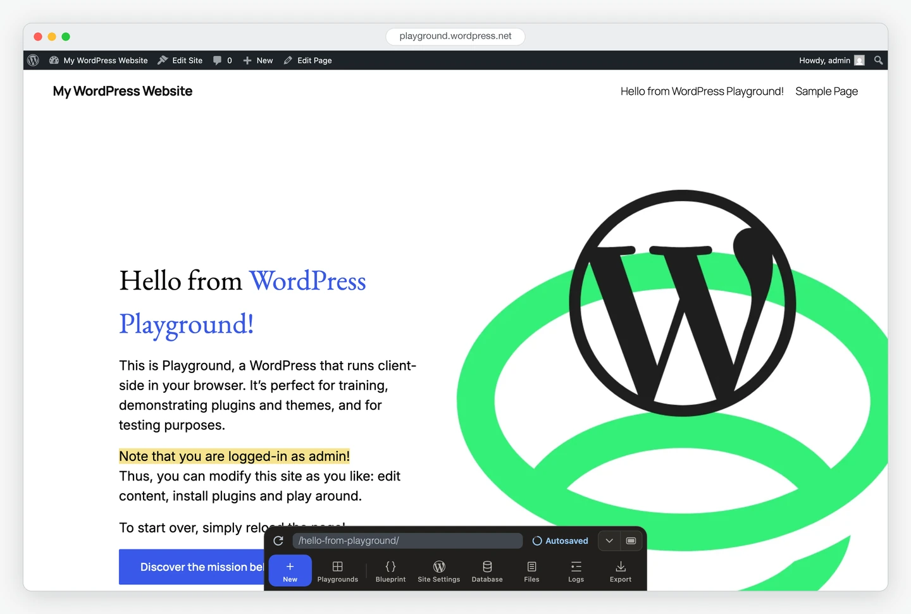
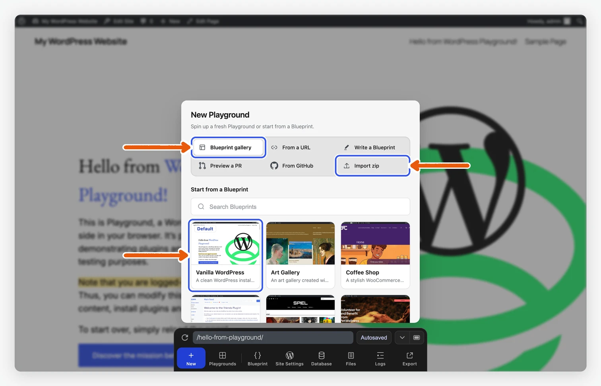
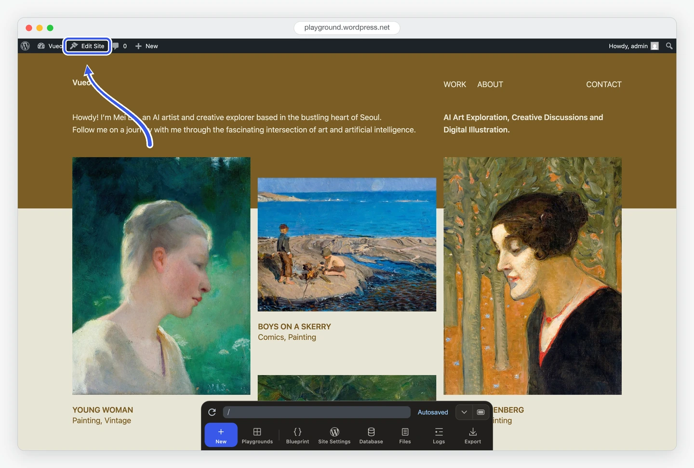
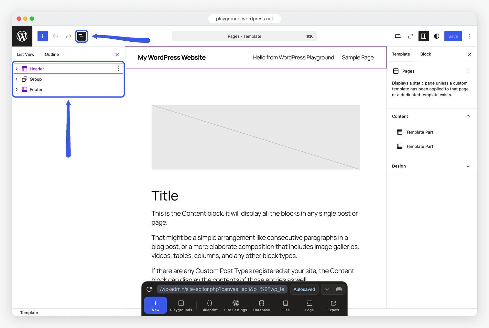
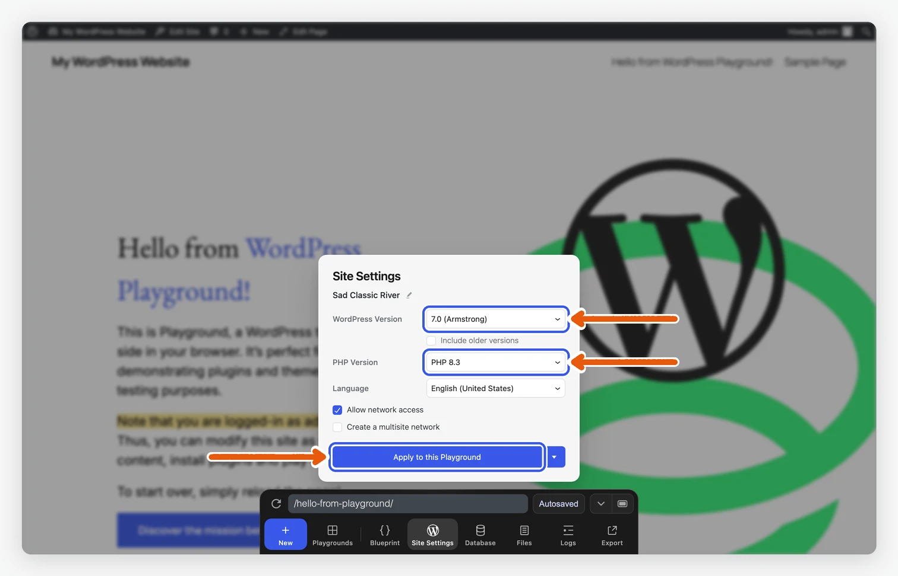
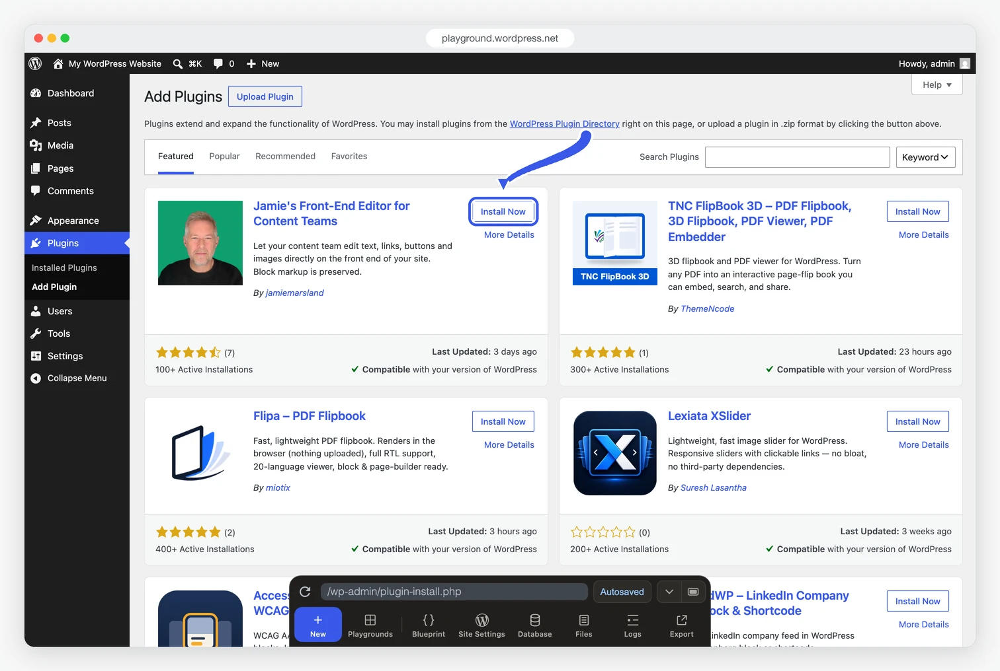
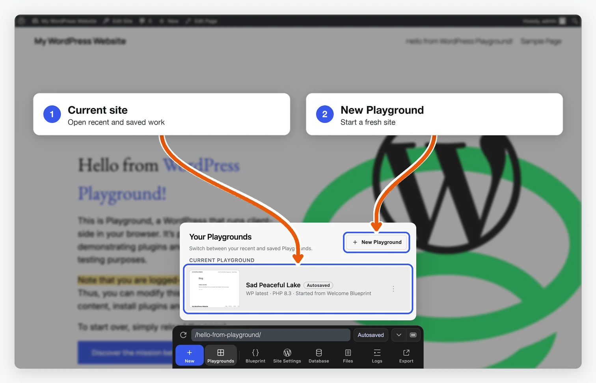
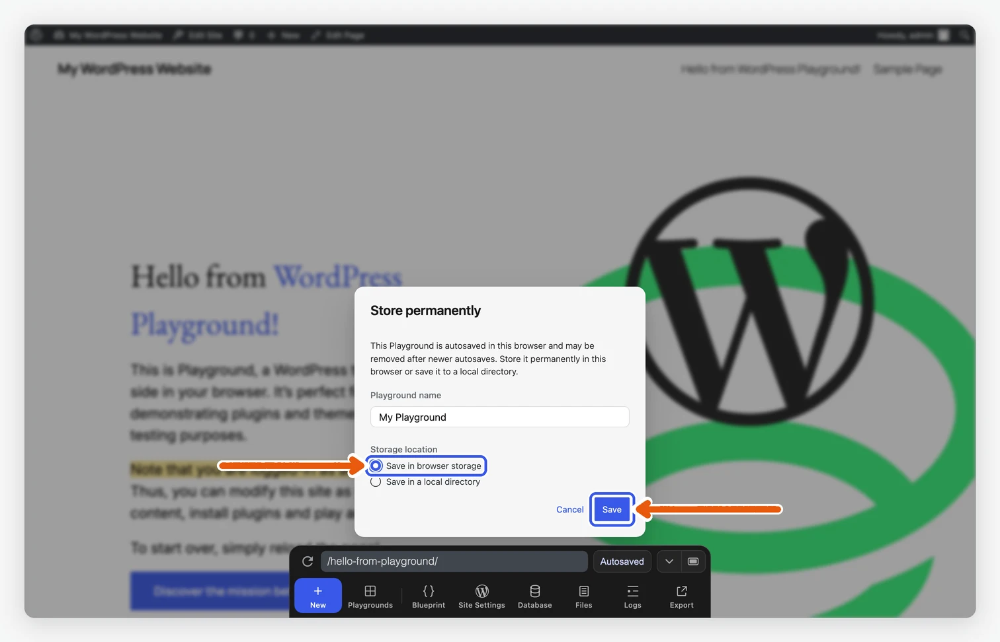
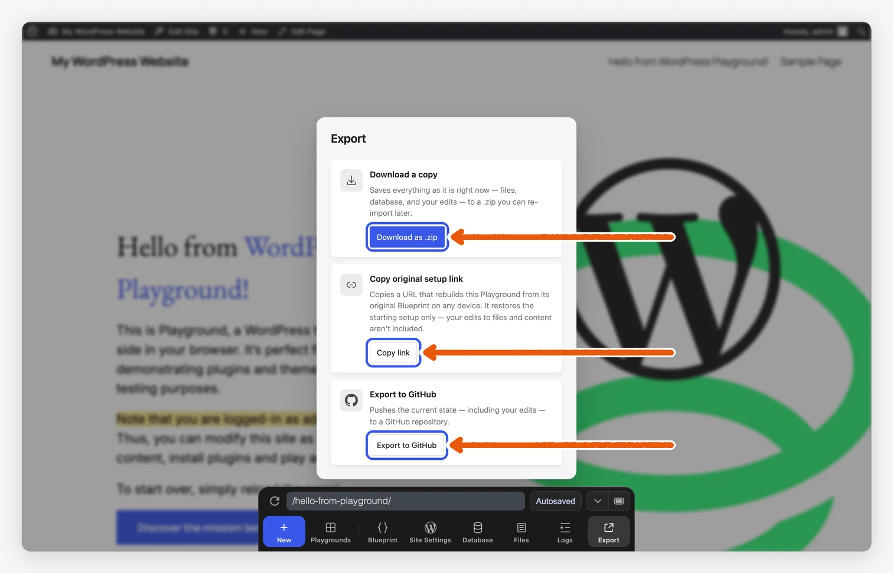

<!-- # WordPress Playground for Everyone -->

# सभी के लिए WordPress Playground

<!-- **WordPress Playground lets you run WordPress instantly—no server, no setup, no risk.** It works in your browser at [playground.wordpress.net](https://playground.wordpress.net), and developers can also use it via CLI, Node.js, or embedded in their own apps. But you don't need to be technical to benefit from it. -->

**WordPress Playground से आप तुरंत WordPress चला सकते हैं, बिना सर्वर, बिना सेटअप और बिना किसी जोखिम के।** यह आपके ब्राउज़र में [playground.wordpress.net](https://playground.wordpress.net) पर चलता है, और डेवलपर इसे CLI या Node.js के ज़रिए, या अपने ऐप में एम्बेड करके भी इस्तेमाल कर सकते हैं। लेकिन इसका फ़ायदा उठाने के लिए आपको तकनीकी जानकार होने की ज़रूरत नहीं है।

<!-- Watch this quick overview: -->

यह छोटा-सा परिचय देखें:

<iframe width="800" src="https://www.youtube.com/embed/8_rH2k-OQ8E" frameborder="0" allow="accelerometer; autoplay; clipboard-write; encrypted-media; gyroscope; picture-in-picture" allowfullscreen></iframe>

<!-- ## Think of It Like a Car Simulator -->

## इसे कार सिम्युलेटर की तरह समझें {#think-of-it-like-a-car-simulator}

<!-- A car simulator gives you a steering wheel, pedals, and virtual streets. Practice driving, hit cones, make mistakes — nothing bad happens. No real car gets damaged. Want to try again? Just restart. -->

कार सिम्युलेटर आपको स्टीयरिंग व्हील, पैडल और वर्चुअल सड़कें देता है। ड्राइविंग का अभ्यास करें, कोन से टकराएँ, गलतियाँ करें, फिर भी कुछ बुरा नहीं होता। किसी असली कार को नुकसान नहीं पहुँचता। फिर से कोशिश करना चाहते हैं? बस दोबारा शुरू करें।

<!-- WordPress Playground works the same way. It gives you a complete WordPress site to experiment with, but nothing you do affects any real website. Make changes, break things, learn from mistakes — then start fresh whenever you want. -->

WordPress Playground भी इसी तरह काम करता है। यह आपको प्रयोग करने के लिए एक पूरी WordPress साइट देता है, लेकिन आप जो भी करें, उसका किसी असली वेबसाइट पर कोई असर नहीं पड़ता। बदलाव करें, चीज़ें तोड़ें, गलतियों से सीखें, और जब चाहें फिर से नई शुरुआत करें।

<!--  -->

<!-- ## What Can You Do with Playground? -->

## Playground से आप क्या कर सकते हैं? {#what-can-you-do-with-playground}

<!-- When you visit [playground.wordpress.net](https://playground.wordpress.net), you get a WordPress site running entirely in your browser. You can: -->

जब आप [playground.wordpress.net](https://playground.wordpress.net) पर जाते हैं, तो आपको एक WordPress साइट मिलती है जो पूरी तरह आपके ब्राउज़र में चलती है। आप ये कर सकते हैं:

<!--
- Install plugins and themes
- Edit pages and create content
- Change WordPress and PHP versions
- Explore features you've never tried before
-->

- प्लगइन और थीम इंस्टॉल करना
- पेज संपादित करना और सामग्री बनाना
- WordPress और PHP संस्करण बदलना
- ऐसे फ़ीचर आज़माना जिन्हें आपने पहले कभी इस्तेमाल नहीं किया

<!-- By default, WordPress Playground loads a landing page that introduces Playground. To start with a plain WordPress install, open **New** in the Dock and choose **Vanilla WordPress** from the Blueprint gallery. -->

डिफ़ॉल्ट रूप से WordPress Playground एक लैंडिंग पेज लोड करता है, जो Playground का परिचय देता है। सामान्य WordPress इंस्टॉल से शुरू करने के लिए Dock में **New** खोलें और ब्लूप्रिंट गैलरी से **Vanilla WordPress** चुनें।

<!--  -->

<!-- ## If You're Learning WordPress -->

## अगर आप WordPress सीख रहे हैं {#if-youre-learning-wordpress}

<!-- Are you new to WordPress or trying to understand features like the Site Editor or the new features of the latest WordPress Release? Playground is your perfect practice space. -->

क्या आप WordPress में नए हैं, या Site Editor जैसे फ़ीचर या WordPress की नई रिलीज़ के नए फ़ीचर समझना चाहते हैं? Playground अभ्यास के लिए आपकी सबसे सही जगह है।

<!-- ### Explore How Pages Are Built -->

### देखें कि पेज कैसे बनते हैं {#explore-how-pages-are-built}

<!-- Playground logs you in as an administrator, so you can edit any page. Click **Edit** for editing posts and **Edit Site** to update the website layout in the top toolbar to open the editor. -->

Playground आपको एडमिनिस्ट्रेटर के रूप में लॉग इन करता है, इसलिए आप कोई भी पेज संपादित कर सकते हैं। एडिटर खोलने के लिए ऊपर के टूलबार में पोस्ट संपादित करने के लिए **Edit** और वेबसाइट का लेआउट बदलने के लिए **Edit Site** पर क्लिक करें।

<!--  -->

<!-- Want to understand how a page layout was created? Open the **List View** (the three horizontal lines icon) to see every block that makes up the page. -->

क्या आप समझना चाहते हैं कि किसी पेज का लेआउट कैसे बनाया गया? पेज बनाने वाले हर ब्लॉक को देखने के लिए **List View** (तीन आड़ी लाइनों वाला आइकन) खोलें।

<!--  -->

<!-- You can inspect columns, headings, images, and buttons — and see exactly how they're arranged. This is a powerful way to learn by example. -->

आप कॉलम, हेडिंग, इमेज और बटन की जाँच कर सकते हैं, और ठीक-ठीक देख सकते हैं कि वे कैसे व्यवस्थित हैं। उदाहरण से सीखने का यह एक असरदार तरीका है।

<!-- #### Explore the Blueprint Library -->

#### ब्लूप्रिंट लाइब्रेरी देखें {#explore-the-blueprint-library}

<!-- Open **New** in the Dock to browse the Blueprint gallery. The gallery has examples for art galleries, stores, portfolios, learning environments, and many other starting points. -->

ब्लूप्रिंट गैलरी देखने के लिए Dock में **New** खोलें। गैलरी में आर्ट गैलरी, स्टोर, पोर्टफ़ोलियो, सीखने के माहौल और शुरुआत के कई दूसरे उदाहरण हैं।

<!--  -->

<!-- ### Try New Features Safely -->

### नए फ़ीचर सुरक्षित रूप से आज़माएँ {#try-new-features-safely}

<!-- When the WordPress team releases new features, you can test them in Playground before they affect your real site. Open **Site Settings** from the Dock to choose a WordPress or PHP version. -->

जब WordPress टीम नए फ़ीचर रिलीज़ करती है, तो आप उन्हें अपनी असली साइट पर असर पड़ने से पहले Playground में परख सकते हैं। WordPress या PHP संस्करण चुनने के लिए Dock से **Site Settings** खोलें।

<!--  -->

<!-- ## If You Own a WordPress Site -->

## अगर आपकी अपनी WordPress साइट है {#if-you-own-a-wordpress-site}

<!-- Running a live website means every change risks breaking something. Playground lets you test before you commit. -->

लाइव वेबसाइट चलाने का मतलब है कि हर बदलाव से कुछ टूटने का खतरा रहता है। Playground में आप बदलाव पक्का करने से पहले उसे परख सकते हैं।

<!-- ### Test Plugins Before Installing -->

### इंस्टॉल करने से पहले प्लगइन परखें {#test-plugins-before-installing}

<!-- Curious about a new SEO plugin? Want to compare two contact form options? Install them in Playground first: -->

किसी नए SEO प्लगइन के बारे में जानना चाहते हैं? कॉन्टैक्ट फ़ॉर्म के दो विकल्पों की तुलना करना चाहते हैं? पहले उन्हें Playground में इंस्टॉल करें:

<!--
1. Open [playground.wordpress.net](https://playground.wordpress.net)
2. Go to **Plugins → Add New**
3. Search for and install any plugin
4. Test it thoroughly
-->

1. [playground.wordpress.net](https://playground.wordpress.net) खोलें
2. **Plugins → Add New** पर जाएँ
3. कोई भी प्लगइन खोजें और इंस्टॉल करें
4. उसे अच्छी तरह परखें

<!-- Your real site stays untouched while you evaluate whether the plugin fits your needs. -->

जब तक आप यह परखते हैं कि प्लगइन आपकी ज़रूरतों के मुताबिक है या नहीं, आपकी असली साइट पर कोई असर नहीं पड़ता।

<!--  -->

<!-- ### Preview Theme Changes -->

### थीम में बदलाव का प्रीव्यू देखें {#preview-theme-changes}

<!-- Thinking about switching themes? Test your new theme in Playground to see how it handles your content — without disrupting your visitors. -->

थीम बदलने के बारे में सोच रहे हैं? अपनी नई थीम को Playground में परखें और देखें कि वह आपकी सामग्री को कैसे दिखाती है। इससे आपके विज़िटर को कोई परेशानी नहीं होगी।

<!-- ### Compare Options Side by Side -->

### विकल्पों की आमने-सामने तुलना करें {#compare-options-side-by-side}

<!-- Open multiple browser tabs with different Playground setups. Compare plugin A versus plugin B, or see how your content looks in different themes. Make informed decisions before touching your production site. -->

अलग-अलग Playground सेटअप के साथ ब्राउज़र के कई टैब खोलें। प्लगइन A और प्लगइन B की तुलना करें, या देखें कि आपकी सामग्री अलग-अलग थीम में कैसी दिखती है। अपनी प्रोडक्शन साइट में बदलाव करने से पहले सोच-समझकर फ़ैसला लें।

<!-- **Your Real Site Stays Safe** -->

**आपकी असली साइट सुरक्षित रहती है**

<!-- Every Playground runs independently in your browser. Nothing syncs to any external server, and nothing affects your live WordPress installation. -->

हर Playground आपके ब्राउज़र में अलग से चलता है। कुछ भी किसी बाहरी सर्वर से सिंक नहीं होता, और आपके लाइव WordPress इंस्टॉलेशन पर कोई असर नहीं पड़ता।

<!-- ## If You Use WordPress Daily -->

## अगर आप रोज़ WordPress इस्तेमाल करते हैं {#if-you-use-wordpress-daily}

<!-- Even experienced WordPress users benefit from a safe testing environment. -->

अनुभवी WordPress उपयोगकर्ताओं को भी परीक्षण के लिए एक सुरक्षित माहौल से फ़ायदा होता है।

<!-- ### Make Design Experiments -->

### डिज़ाइन के प्रयोग करें {#make-design-experiments}

<!-- Want to try a different font size? Adjust spacing? Change colors? Load a Playground with the same theme that you are using in production and edit it freely: -->

कोई दूसरा फ़ॉन्ट साइज़ आज़माना चाहते हैं? स्पेसिंग ठीक करनी है? रंग बदलने हैं? प्रोडक्शन में इस्तेमाल हो रही उसी थीम के साथ एक Playground लोड करें और उसे खुलकर संपादित करें:

<!--
1. Open any page in the editor
2. Select a block and modify its settings
3. See the results immediately
-->

1. एडिटर में कोई भी पेज खोलें
2. कोई ब्लॉक चुनें और उसकी सेटिंग्स बदलें
3. नतीजे तुरंत देखें

<!--
If you like what you see, recreate those changes on your real site. If not,
start another Playground. The experiment may remain as a recent autosave until
newer autosaves replace it.
-->

अगर आपको नतीजा पसंद आए, तो वही बदलाव अपनी असली साइट पर दोबारा करें। अगर नहीं, तो एक और Playground शुरू करें। यह प्रयोग तब तक हाल के ऑटोसेव के रूप में बना रह सकता है, जब तक नए ऑटोसेव उसकी जगह न ले लें।

<!-- ## Yes, You Can Save Your Work -->

## हाँ, आप अपना काम सहेज सकते हैं {#yes-you-can-save-your-work}

<!-- **Playground doesn't have to be temporary.** You can save your progress and return to it later. -->

**Playground का अस्थायी होना ज़रूरी नहीं है।** आप अपनी प्रगति सहेज सकते हैं और बाद में उस पर लौट सकते हैं।

<!-- ### Save to Your Browser -->

### अपने ब्राउज़र में सहेजें {#save-to-your-browser}

<!-- New Playgrounds are autosaved when browser storage is available. Open **Your Playgrounds** from the Dock to return to recent autosaves. Playground keeps up to five recent autosaves. -->

जब ब्राउज़र स्टोरेज उपलब्ध होता है, तो नए Playground अपने-आप सहेजे जाते हैं। हाल के ऑटोसेव पर लौटने के लिए Dock से **Your Playgrounds** खोलें। Playground हाल के अधिकतम पाँच ऑटोसेव रखता है।

<!--  -->

<!-- To keep an autosave permanently, click the **Autosaved** status in the Dock, choose **Save in browser storage**, and save it. -->

किसी ऑटोसेव को हमेशा के लिए रखने के लिए Dock में **Autosaved** स्टेटस पर क्लिक करें, **Save in browser storage** चुनें और उसे सहेजें।

<!--  -->

<!-- ### Download as a ZIP File -->

### ZIP फ़ाइल के रूप में डाउनलोड करें {#download-as-a-zip-file}

<!-- Need to move your work elsewhere? Open **Export** and choose **Download as .zip**. The ZIP contains the current files, database, plugins, themes, uploads, and edits. You can restore it later with **New → Import zip** or host it on a server that supports PHP and SQLite. -->

अपना काम कहीं और ले जाना है? **Export** खोलें और **Download as .zip** चुनें। ZIP में मौजूदा फ़ाइलें, डेटाबेस, प्लगइन, थीम, अपलोड और बदलाव होते हैं। आप इसे बाद में **New → Import zip** से वापस ला सकते हैं, या किसी ऐसे सर्वर पर होस्ट कर सकते हैं जो PHP और SQLite सपोर्ट करता हो।

<!--  -->

<!-- **Keep a portable backup** -->

**एक पोर्टेबल बैकअप रखें**

<!-- Browser storage belongs to your browser profile and can be cleared or evicted. Export a ZIP when you need a file you can move or archive. -->

ब्राउज़र स्टोरेज आपकी ब्राउज़र प्रोफ़ाइल का हिस्सा होता है, और उसे साफ़ किया जा सकता है या ब्राउज़र उसे हटा सकता है। जब आपको ऐसी फ़ाइल चाहिए जिसे आप कहीं ले जा सकें या संभालकर रख सकें, तो ZIP एक्सपोर्ट करें।

<!-- ## Next Steps -->

## आगे क्या करें {#next-steps}

<!-- Now that you know Playground is for everyone, explore further: -->

अब जब आप जान गए हैं कि Playground सभी के लिए है, तो आगे और जानें:

<!--
- [Quick Start Guide](/quick-start-guide) — A 5-minute walkthrough of Playground basics
- [About WordPress Playground](/about) — Learn what you can build, test, and launch
-->

- [क्विक स्टार्ट गाइड](/quick-start-guide): Playground की बुनियादी बातों का 5 मिनट का परिचय
- [WordPress Playground के बारे में](/about): जानें कि आप क्या बना सकते हैं, परख सकते हैं और लॉन्च कर सकते हैं
