<!-- # WordPress Playground web instance -->

# WordPress Playground वेब इंस्टेंस

<!--
[https://playground.wordpress.net/](https://playground.wordpress.net/) runs
WordPress in your browser without a server. The page opens a Playground, shows
the WordPress site, and keeps the site tools in the **Dock**.
-->

[https://playground.wordpress.net/](https://playground.wordpress.net/) बिना सर्वर के आपके ब्राउज़र में WordPress चलाता है। यह पेज एक Playground खोलता है, WordPress साइट दिखाता है, और साइट के टूल **Dock** में रखता है।

<!--  -->

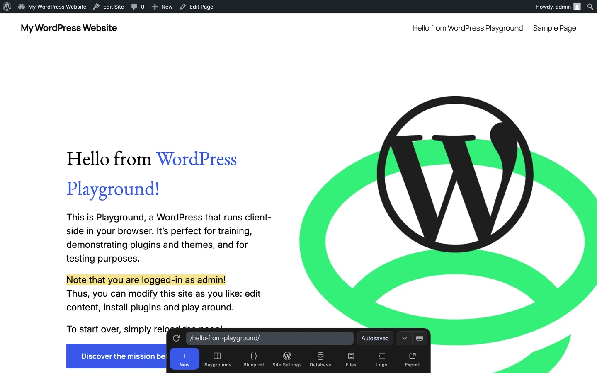

<!-- The Dock has an address field, a save status, layout controls, and destinations for creating, storing, inspecting, and exporting Playgrounds. -->

Dock में एक एड्रेस फ़ील्ड, सेव स्टेटस, लेआउट कंट्रोल, और Playground बनाने, सहेजने, जाँचने और एक्सपोर्ट करने के लिए अलग-अलग पैन हैं।

<!-- ## Customize Playground -->

## Playground को अपनी ज़रूरत के हिसाब से बदलें {#customize-playground}

<!-- The Dock includes these destinations: -->

Dock में ये पैन हैं:

<!--
- **New**: Start from the Blueprint gallery, a public Blueprint URL, a new
  Blueprint, a pull request preview, a GitHub repository, or an imported `.zip`
  file.
- **Playgrounds**: Switch between recent and saved Playgrounds.
- **Blueprint**: View, edit, export, and run the current Blueprint.
- **Site Settings**: Configure WordPress version, PHP version, language,
  networking, and multisite.
- **Database**: Inspect or download the SQLite database and open database tools.
- **Files**: Browse and edit files in the WordPress filesystem.
- **Logs**: Inspect PHP errors, warnings, and notices.
- **Export**: Download a `.zip`, copy the original setup link, or export selected
  files to a GitHub pull request.
-->

- **New**: ब्लूप्रिंट गैलरी, किसी सार्वजनिक ब्लूप्रिंट URL, नए ब्लूप्रिंट, पुल रिक्वेस्ट प्रीव्यू, GitHub रिपॉज़िटरी या इम्पोर्ट की गई `.zip` फ़ाइल से शुरू करें।
- **Playgrounds**: हाल के और सहेजे गए Playground के बीच स्विच करें।
- **Blueprint**: मौजूदा ब्लूप्रिंट देखें, संपादित करें, एक्सपोर्ट करें और चलाएँ।
- **Site Settings**: WordPress संस्करण, PHP संस्करण, भाषा, नेटवर्किंग और मल्टीसाइट कॉन्फ़िगर करें।
- **Database**: SQLite डेटाबेस की जाँच करें या उसे डाउनलोड करें, और डेटाबेस टूल खोलें।
- **Files**: WordPress फ़ाइल सिस्टम की फ़ाइलें देखें और संपादित करें।
- **Logs**: PHP एरर, चेतावनियाँ और नोटिस देखें।
- **Export**: `.zip` डाउनलोड करें, मूल सेटअप लिंक कॉपी करें, या चुनी हुई फ़ाइलें GitHub पुल रिक्वेस्ट में एक्सपोर्ट करें।

<!-- ## Navigate inside WordPress -->

## WordPress के अंदर जाएँ {#navigate-inside-wordpress}

<!--
Use the Dock address field to open a path inside the current WordPress site.
For example, enter `/wp-admin/` to open the dashboard or
`/wp-admin/plugins.php` to open the Plugins screen. **Refresh page** reloads
the current WordPress path.
-->

मौजूदा WordPress साइट के अंदर कोई पाथ खोलने के लिए Dock के एड्रेस फ़ील्ड का उपयोग करें। उदाहरण के लिए, डैशबोर्ड खोलने के लिए `/wp-admin/` लिखें, या Plugins स्क्रीन खोलने के लिए `/wp-admin/plugins.php`। **Refresh page** मौजूदा WordPress पाथ को फिर से लोड करता है।

<!-- You can also use the [Query Params API](/developers/apis/query-api/) to open Playground with a specific setup, such as a WordPress version, PHP version, plugin, theme, or Blueprint. -->

किसी खास सेटअप के साथ Playground खोलने के लिए आप [Query Params API](/developers/apis/query-api/) का भी उपयोग कर सकते हैं, जैसे कोई WordPress संस्करण, PHP संस्करण, प्लगइन, थीम या ब्लूप्रिंट।

<!-- ## Understand the save status -->

## सेव स्टेटस को समझें {#understand-the-save-status}

<!-- The status next to the address field tells you how the current Playground is stored: -->

एड्रेस फ़ील्ड के पास दिखने वाला स्टेटस बताता है कि मौजूदा Playground किस तरह सहेजा गया है:

<!--
- **Autosaved** means the Playground is stored in this browser and can be recovered from **Your Playgrounds**. Playground keeps up to five recent autosaves.
- **Saved** means the Playground was stored permanently in browser storage or saved to a local directory.
- **Unsaved** means the Playground has not been saved. Temporary Playgrounds, including `?storage=temp`, are lost when the tab is closed or refreshed.
-->

- **Autosaved** का मतलब है कि Playground इसी ब्राउज़र में सहेजा गया है और उसे **Your Playgrounds** से वापस पाया जा सकता है। Playground हाल के अधिकतम पाँच ऑटोसेव रखता है।
- **Saved** का मतलब है कि Playground ब्राउज़र स्टोरेज में हमेशा के लिए सहेजा गया है, या किसी लोकल डायरेक्टरी में सेव किया गया है।
- **Unsaved** का मतलब है कि Playground सहेजा नहीं गया है। अस्थायी Playground, जिनमें `?storage=temp` भी शामिल है, टैब बंद करने या रिफ़्रेश करने पर खो जाते हैं।

<!-- Click **Autosaved** or **Unsaved** to open **Store permanently**. -->

**Store permanently** खोलने के लिए **Autosaved** या **Unsaved** पर क्लिक करें।

<!--  -->

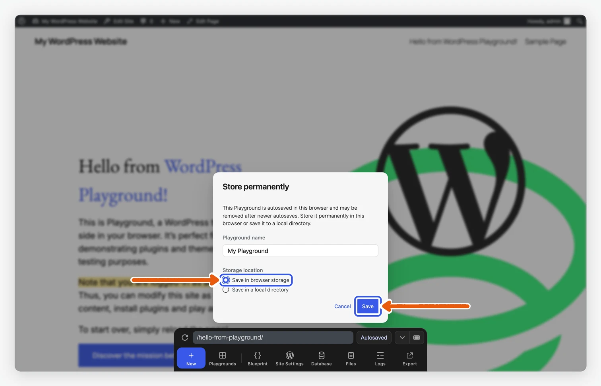

<!-- Store permanently can keep an autosaved Playground in browser storage so autosave pruning no longer removes it. In browsers that support the File System Access API, it can also save the Playground to a local directory. -->

Store permanently किसी ऑटोसेव किए गए Playground को ब्राउज़र स्टोरेज में रख सकता है, ताकि पुराने ऑटोसेव हटाते समय वह न हटे। जिन ब्राउज़र में File System Access API काम करता है, उनमें यह Playground को किसी लोकल डायरेक्टरी में भी सेव कर सकता है।

<!-- Browser storage still belongs to the browser. The browser may remove stored data when storage pressure or privacy settings require it. Export a ZIP when you need a portable backup. -->

फिर भी, ब्राउज़र स्टोरेज ब्राउज़र का ही हिस्सा होता है। जगह कम होने पर या प्राइवेसी सेटिंग्स की वजह से ब्राउज़र सहेजा गया डेटा हटा सकता है। जब आपको ऐसा बैकअप चाहिए जिसे कहीं भी ले जा सकें, तो ZIP एक्सपोर्ट करें।

<!-- ## Start a Playground -->

## Playground शुरू करें {#start-a-playground}

<!--
Open **New Playground** from the Dock by clicking **New**. The pane contains
**Blueprint gallery**, **From a URL**, **Write a Blueprint**, **Preview a PR**,
**From GitHub**, and **Import zip**.
-->

Dock में **New** पर क्लिक करके **New Playground** खोलें। इस पैन में **Blueprint gallery**, **From a URL**, **Write a Blueprint**, **Preview a PR**, **From GitHub** और **Import zip** विकल्प हैं।

<!--  -->

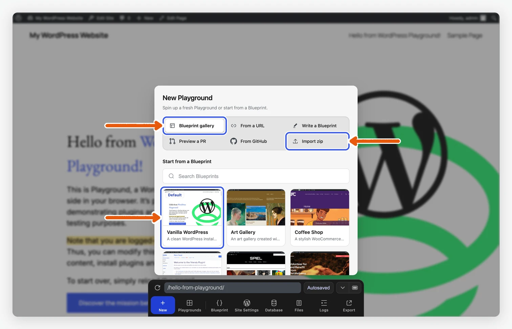

<!--
The Blueprint gallery starts with **Vanilla WordPress**, which creates a clean
WordPress install. **From a URL** opens a public Blueprint URL. **Write a
Blueprint** opens an editor for a new Blueprint. **Import zip** restores a ZIP
exported from Playground.
-->

ब्लूप्रिंट गैलरी **Vanilla WordPress** से शुरू होती है, जो एक साफ़ WordPress इंस्टॉल बनाता है। **From a URL** किसी सार्वजनिक ब्लूप्रिंट URL को खोलता है। **Write a Blueprint** नए ब्लूप्रिंट के लिए एडिटर खोलता है। **Import zip** Playground से एक्सपोर्ट किए गए ZIP को वापस लाता है।

<!--  -->

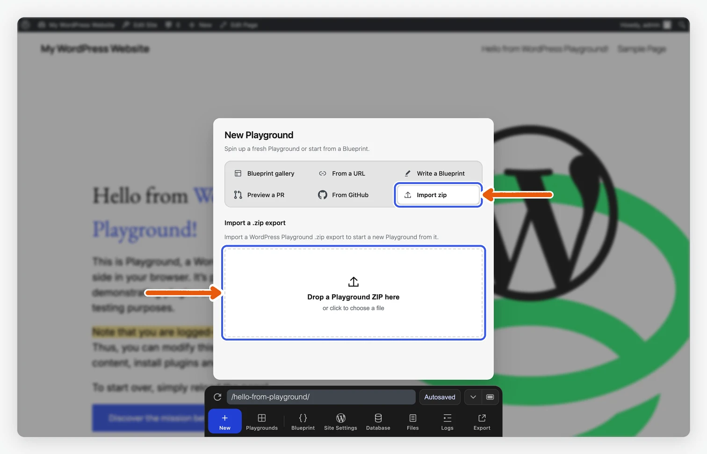

<!-- ## Return to recent and saved Playgrounds -->

## हाल के और सहेजे गए Playground पर लौटें {#return-to-recent-and-saved-playgrounds}

<!-- Open **Your Playgrounds** from the Dock by clicking **Playgrounds**. It lists the current Playground, recent autosaves, and Playgrounds you saved permanently. -->

Dock में **Playgrounds** पर क्लिक करके **Your Playgrounds** खोलें। इसमें मौजूदा Playground, हाल के ऑटोसेव, और आपके हमेशा के लिए सहेजे गए Playground की सूची होती है।

<!--  -->

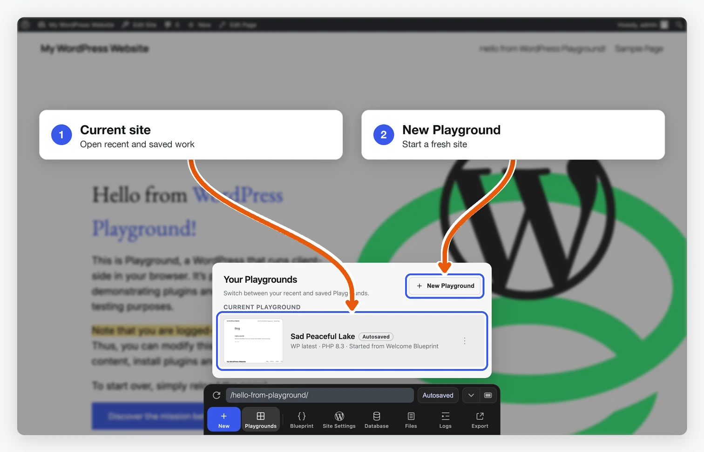

<!--
Autosaved Playgrounds are recovery points. Playground retains up to five recent
autosaves. Use **Store permanently** to keep one as a saved Playground.
-->

ऑटोसेव किए गए Playground रिकवरी पॉइंट होते हैं। Playground हाल के अधिकतम पाँच ऑटोसेव रखता है। किसी एक को सहेजे गए Playground के रूप में रखने के लिए **Store permanently** का उपयोग करें।

<!-- ## Change site settings -->

## साइट सेटिंग्स बदलें {#change-site-settings}

<!-- Open **Site Settings** to change runtime and WordPress setup options. -->

रनटाइम और WordPress सेटअप के विकल्प बदलने के लिए **Site Settings** खोलें।

<!--  -->

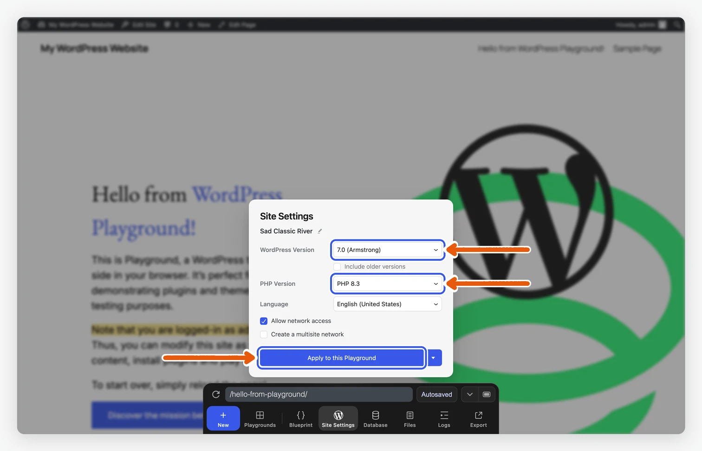

<!-- PHP version and networking can be applied to an existing stored Playground. WordPress version, language, and multisite change the WordPress installation itself, so they require a fresh Playground. -->

PHP संस्करण और नेटवर्किंग किसी पहले से सहेजे गए Playground पर भी लागू किए जा सकते हैं। WordPress संस्करण, भाषा और मल्टीसाइट WordPress इंस्टॉलेशन को ही बदल देते हैं, इसलिए इनके लिए नया Playground चाहिए।

<!-- Running an edited Blueprint keeps stored and autosaved Playgrounds. It discards a temporary Playground because the new run starts from a fresh setup. -->

संपादित ब्लूप्रिंट चलाने पर सहेजे गए और ऑटोसेव किए गए Playground बने रहते हैं। लेकिन अस्थायी Playground हट जाता है, क्योंकि नया रन एक नए सेटअप से शुरू होता है।

<!-- ## Inspect the current Blueprint -->

## मौजूदा ब्लूप्रिंट देखें {#inspect-the-current-blueprint}

<!-- Open **Blueprint** to view and edit the Blueprint for the current Playground. -->

मौजूदा Playground का ब्लूप्रिंट देखने और संपादित करने के लिए **Blueprint** खोलें।

<!--  -->

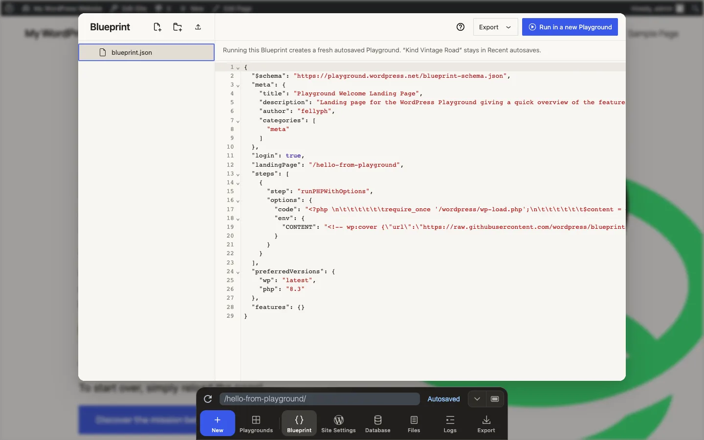

<!-- The editor can run the edited Blueprint in a new Playground. For a stored or autosaved Playground, the original Playground remains available in **Your Playgrounds**. -->

एडिटर संपादित ब्लूप्रिंट को एक नए Playground में चला सकता है। सहेजे गए या ऑटोसेव किए गए Playground के मामले में, मूल Playground **Your Playgrounds** में उपलब्ध रहता है।

<!-- ## Inspect files, database, and logs -->

## फ़ाइलें, डेटाबेस और लॉग जाँचें {#inspect-files-database-and-logs}

<!-- Open **Files** to browse and edit the current Playground files. -->

मौजूदा Playground की फ़ाइलें देखने और संपादित करने के लिए **Files** खोलें।

<!--  -->

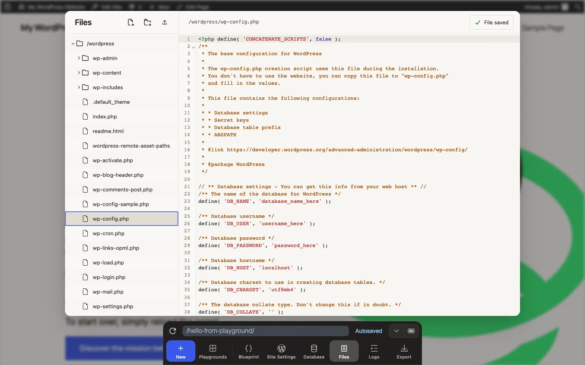

<!-- Open **Database** to use database tools or download the SQLite database. -->

डेटाबेस टूल इस्तेमाल करने या SQLite डेटाबेस डाउनलोड करने के लिए **Database** खोलें।

<!--  -->

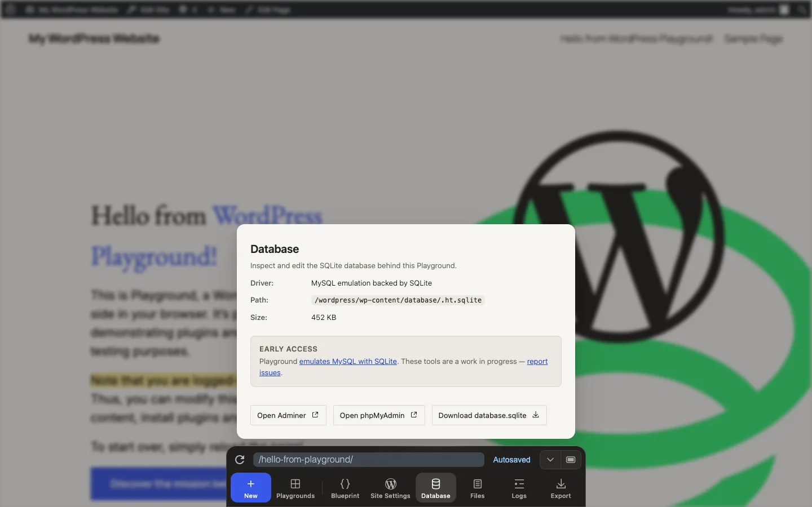

<!-- Open **Logs** to inspect PHP errors, warnings, and notices. -->

PHP एरर, चेतावनियाँ और नोटिस देखने के लिए **Logs** खोलें।

<!--  -->

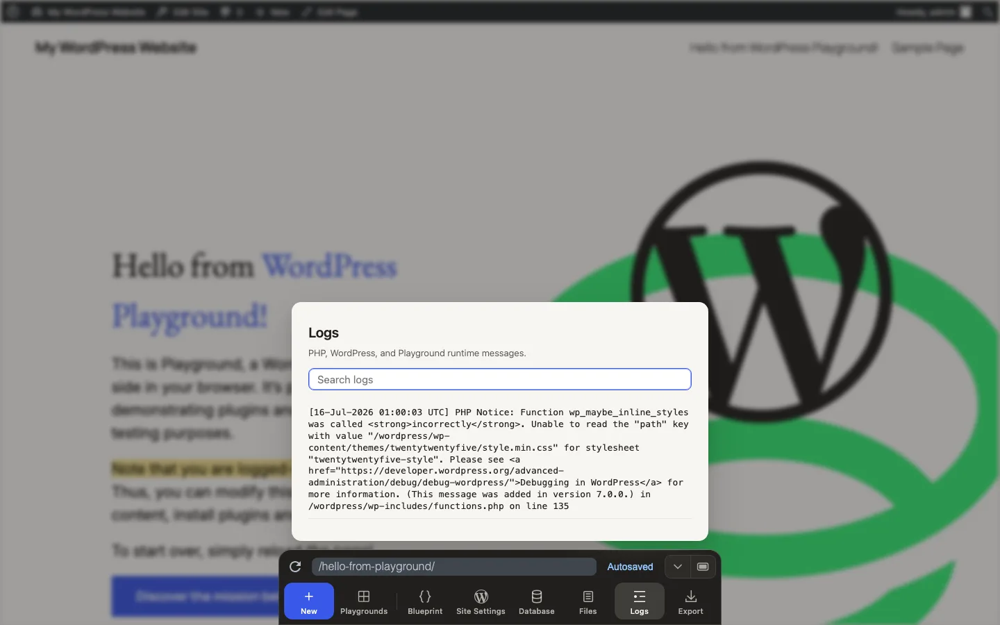

<!-- ## Export and share {#playground-options-menu} -->

## एक्सपोर्ट और शेयर करें {#playground-options-menu}

<!-- Open **Export** to download or share the current Playground. -->

मौजूदा Playground को डाउनलोड या शेयर करने के लिए **Export** खोलें।

<!--  -->

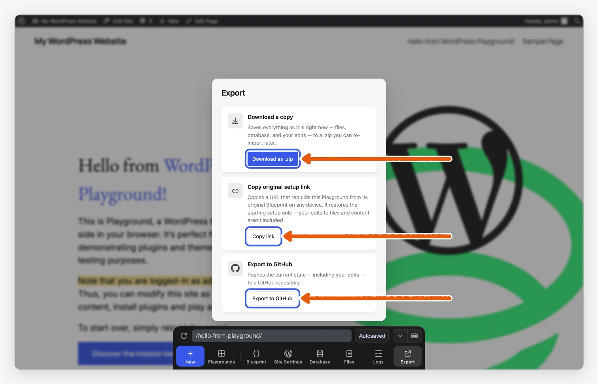

<!-- **Download as .zip** exports the current files, database, plugins, themes, uploads, and edits. The ZIP can be restored later with **New → Import zip**. -->

**Download as .zip** मौजूदा फ़ाइलें, डेटाबेस, प्लगइन, थीम, अपलोड और बदलाव एक्सपोर्ट करता है। इस ZIP को बाद में **New → Import zip** से वापस लाया जा सकता है।

<!--
**Copy original setup link** copies a link that recreates only the original
setup. It does not include edits made after the Playground started.
-->

**Copy original setup link** एक ऐसा लिंक कॉपी करता है जो सिर्फ़ मूल सेटअप को फिर से बनाता है। इसमें Playground शुरू होने के बाद किए गए बदलाव शामिल नहीं होते।

<!-- **Export to GitHub** can create a pull request with selected files from the current Playground. -->

**Export to GitHub** मौजूदा Playground की चुनी हुई फ़ाइलों के साथ एक पुल रिक्वेस्ट बना सकता है।

<!-- ## Change the Dock layout -->

## Dock का लेआउट बदलें {#change-the-dock-layout}

<!-- The Dock can be shown as a floating panel or full-width bar. Use **Full width** to switch layouts. -->

Dock को एक फ़्लोटिंग पैनल या पूरी चौड़ाई वाले बार के रूप में दिखाया जा सकता है। लेआउट बदलने के लिए **Full width** का उपयोग करें।

<!--
| Floating                                                   | Full width                                                    |
| ---------------------------------------------------------- | ------------------------------------------------------------- |
|  |  |
-->

| फ़्लोटिंग | पूरी चौड़ाई |
| --- | --- |
|  | 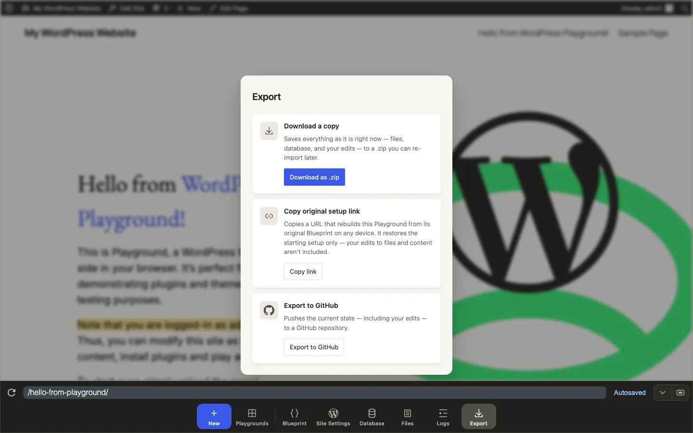 |

<!--
Use **Hide tools** to collapse the Dock to its address field and save status.
Use **Show tools** to reopen the tool row.
-->

Dock को सिर्फ़ उसके एड्रेस फ़ील्ड और सेव स्टेटस तक छोटा करने के लिए **Hide tools** का उपयोग करें। टूल की पंक्ति फिर से खोलने के लिए **Show tools** का उपयोग करें।

<!--  -->

<!--
You can drag the floating Dock on desktop. Drag it past the left or right edge
to fold it into a corner launcher, then click the launcher to restore the Dock.
-->

डेस्कटॉप पर आप फ़्लोटिंग Dock को खींचकर कहीं भी ले जा सकते हैं। उसे बाएँ या दाएँ किनारे से आगे खींचें, तो वह कोने में एक छोटे लॉन्चर में सिमट जाता है। Dock को वापस लाने के लिए उस लॉन्चर पर क्लिक करें।

<!--  -->

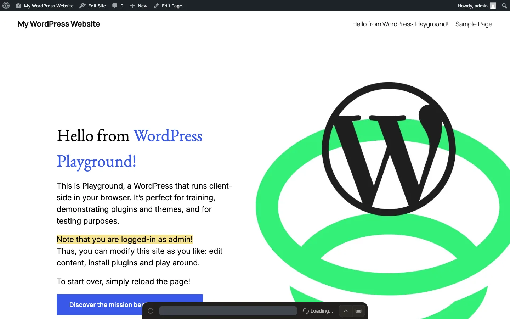

<!-- On narrow screens, the Dock uses a full-width mobile layout. -->

छोटी स्क्रीन पर Dock पूरी चौड़ाई वाला मोबाइल लेआउट इस्तेमाल करता है।

<!--  -->

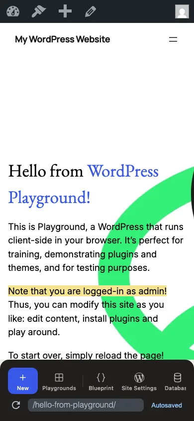

<!-- The site at https://playground.wordpress.net is there to support the community, but there are no guarantees it will continue to work if the traffic grows significantly. -->

https://playground.wordpress.net पर मौजूद साइट समुदाय की मदद के लिए है, लेकिन ट्रैफ़िक बहुत ज़्यादा बढ़ने पर इसके चलते रहने की कोई गारंटी नहीं है।

<!-- If you need certain availability, you should [host your own WordPress Playground](/developers/architecture/host-your-own-playground). -->

अगर आपको भरोसेमंद उपलब्धता चाहिए, तो आपको [अपना खुद का WordPress Playground होस्ट करना](/developers/architecture/host-your-own-playground) चाहिए।

