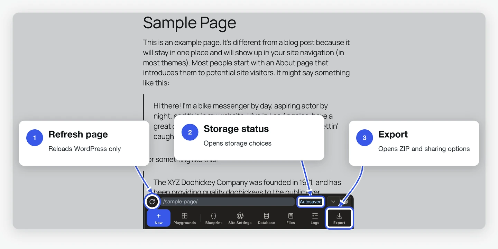
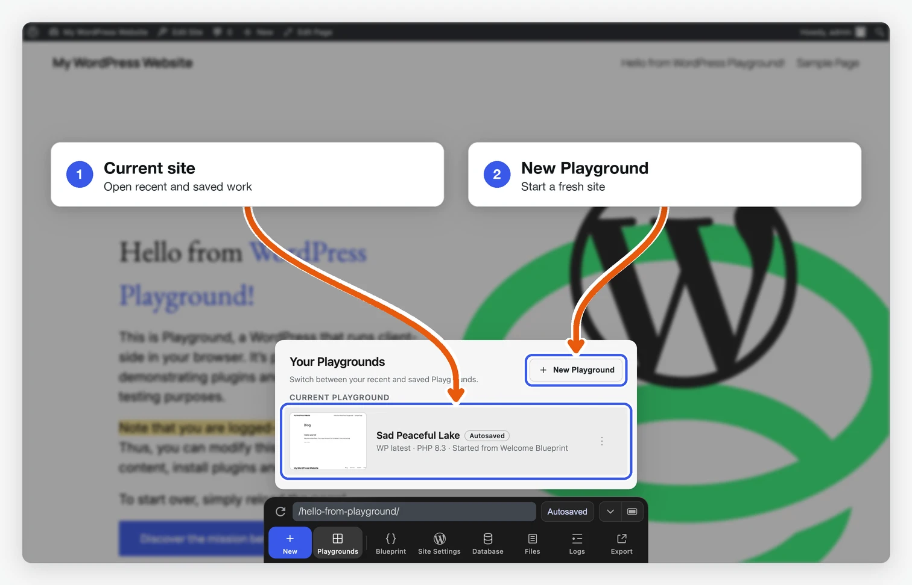
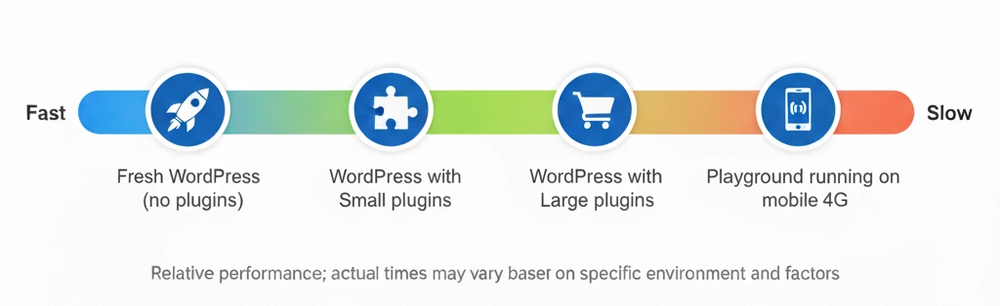

# 制限事項

<!--
# Limitations
-->

WordPress Playground は現在開発中であり、実行および開発時に留意すべき制限がいくつかあります。

<!--
WordPress Playground is under active development and has some limitations you should keep in mind when running it and developing with it.
-->

これらの問題のステータスは、[Playground プロジェクト ボード](https://github.com/orgs/WordPress/projects/180) で追跡できます。

<!--
You can track the status of these issues on the [Playground Project board](https://github.com/orgs/WordPress/projects/180).
-->

## ブラウザの中で

<!--
## In the browser
-->

### ブラウザでの保存と復元

<!--
### Browser storage and recovery
-->

Playground はブラウザ内で WordPress を実行します。ブラウザにデータを保存できる場合、新しいサイトは自動保存され、**Your Playgrounds** に表示されます。自動保存されるのは直近の5件です。6件目を作成すると、最も古いものが削除されます。長く残したいサイトは手動で保存するか、ZIP ファイルとしてエクスポートしてください。

<!--
Playground runs WordPress in the browser. New Playgrounds are autosaved when
browser storage and saving are available, and they appear in **Your
Playgrounds**. Playground keeps up to five recent autosaves. After five exist,
creating another deletes the oldest one. Autosaves are recovery points, not
long-term backups. Store an autosave permanently or export a ZIP when you want
to keep it.
-->

保存方法は次の3種類です。

<!--
Use these storage modes deliberately:
-->

- **自動保存**: 自動保存されたサイトのうち、直近の5件がブラウザに残ります。
- **手動で保存**: サイトをブラウザのストレージまたはローカルのディレクトリに継続して保存します。
- **一時サイト**: `?storage=temp` を指定した場合や保存できない場合に作成されます。タブを閉じるか、ブラウザのページを再読み込みすると破棄されます。

<!--
- **Autosaved**: stored in browser storage and retained only while it is one of up to five recent autosaves.
- **Saved**: stored permanently in browser storage or saved to a local directory.
- **Temporary**: created with `?storage=temp` or when saving is unavailable. It is discarded when the tab closes or the browser page refreshes.
-->

Playground の **Refresh page** ボタンを押すと、現在のサイトの WordPress ページが再読み込みされます。Cmd+R または F5 を押すと、ブラウザがアプリ全体を再読み込みします。その後、自動または手動で保存したサイトは復元できますが、一時サイトは失われます。

<!--
The Playground **Refresh page** button reloads the WordPress page inside the current Playground. Browser refresh (Cmd+R or F5) reloads the whole Playground app. A stored or autosaved Playground can recover after that reload, but a temporary Playground cannot.
-->



<!--

-->

保存したデータはブラウザが管理します。空き容量の不足、プライベートブラウジング、プロファイルの変更、サイトデータの消去などによって失われることがあります。別の環境でも使えるバックアップが必要な場合は、ZIP ファイルをエクスポートしてください。

<!--
Browser storage still belongs to the browser. Storage pressure, private browsing, profile changes, or clearing site data can remove it. Export a ZIP when you need a portable backup.
-->



<!--

-->

### ブラウザサポート

<!--
### Browser support
-->

WordPress Playgroundは、主要なデスクトップおよびモバイルブラウザすべてで動作するように設計されています。対応ブラウザは以下の通りです。

<!--
WordPress Playground is designed to work across all major desktop and mobile browsers. This includes:
-->

- **デスクトップブラウザ**: Chrome、Firefox、Safari、Edge、その他Chromiumベースのブラウザ
- **モバイルブラウザ**: Safari（iOS）、Chrome（Android）、その他モバイルブラウザの派生版

<!--
- **Desktop browsers**: Chrome, Firefox, Safari, Edge, and other Chromium-based browsers
- **Mobile browsers**: Safari (iOS), Chrome (Android), and other mobile browser variants
-->

Playgroundは最新のWeb技術を活用しており、主要なブラウザ環境で一貫して機能するはずです。ただし、一部の高度な機能については、特定のブラウザやバージョンによってサポートレベルが異なる場合があります。

<!--
Playground leverages modern web technologies and should function consistently across these browser environments. However, some advanced features may have varying levels of support depending on the specific browser and its version.
-->

### パフォーマンスに関する注意点

<!--
### Performance expectations
-->

Playgroundがセットアップする内容によって、読み込み時間は異なります。

<!--
Loading times vary based on what Playground needs to set up:
-->

| シナリオ                                 | 一般的な読み込み時間       |
| :--------------------------------------- | :------------------------- |
| 新規WordPress (プラグインなし)           | 5～10秒                    |
| 小規模なプラグインあり                   | 10～20秒                   |
| 大規模なプラグインあり (例: WooCommerce) | 30～60秒                   |
| モバイル端末                             | デスクトップの1.5～2倍遅い |

<!--
| Scenario                               | Typical Load Time          |
| -------------------------------------- | -------------------------- |
| Fresh WordPress (no plugins)           | 5-10 seconds               |
| With small plugins                     | 10-20 seconds              |
| With large plugins (e.g., WooCommerce) | 30-60 seconds              |
| On mobile devices                      | 1.5-2x slower than desktop |
-->



**パフォーマンスに影響を与える要因**

<!--
**Factors that affect performance:**
-->

- **プラグインのサイズ**: プラグインのサイズが大きいと、実行時のインストールに時間がかかります。
- **ネットワーク速度**: 初回の読み込み時に PHP の WebAssembly ランタイムをダウンロードします。ダウンロードサイズは PHP のバージョンとビルドによって異なります。
- **デバイスのメモリ**: WASMメモリの初期割り当ては64MBで、必要に応じて動的に増加します。メモリの少ないデバイスでは、動作が遅くなることがあります。
- **ブラウザ**: Chrome/Edgeが最もパフォーマンスが高く、Safariはやや劣ります。

<!--
- **Plugin size**: Large plugins take longer to install at runtime
- **Network speed**: The first load downloads the PHP WebAssembly runtime. Download size varies by PHP version and build
- **Device memory**: Initial WASM memory allocation is 64MB, growing dynamically as needed. Low-memory devices may experience slowdowns
- **Browser**: Chrome/Edge perform best; Safari slightly slower
-->

<blockquote>
<strong>注:</strong> 現在、Opera Miniへの対応は未確認です。
</blockquote>

## Playground で開発する場合

<!--
## When developing with Playground
-->

### iframe の癖

<!--
### Iframe quirks
-->

Playground は WordPress を [`iframe`](/developers/architecture/browser-iframe-rendering) でレンダリングするため、`target="_top"` を含むリンクをクリックすると作業中のページがリロードされます。
また、`iframe` で生成された JavaScript ポップアップは常に表示されるとは限りません。

<!--
Playground renders WordPress in an [`iframe`](/developers/architecture/browser-iframe-rendering) so clicking links with `target="_top"` will reload the page you’re working on.
Also, JavaScript popups originating in the `iframe` may not always display.
-->

### WordPress PHP 関数を実行する

<!--
### Run WordPress PHP functions
-->

Playgroundでは、`runPHP`ステップを使ってブループリント内でPHPコードを実行できます。WordPress固有のPHP関数を実行するには、まず`wp-load.php`を読み込む必要があります。

<!--
Playground supports running PHP code in Blueprints using the [`runPHP` step](/blueprints/steps#RunPHPStep). To run WordPress-specific PHP functions, you’d need to first require [wp-load.php](https://github.com/WordPress/WordPress/blob/master/wp-load.php):
-->

```json
{
	"step": "runPHP",
	"code": "<?php require_once('wordpress/wp-load.php'); OTHER_CODE ?>"
}
```

### WP-CLI の使用

<!--
### Using WP-CLI
-->

ブループリントの[`wp-cli`](/blueprints/steps#WPCLIStep)ステップから`wp-cli`コマンドを実行できます。ただし、Playground はブラウザ内で実行されるため、[利用可能なコマンドの全て](https://developer.wordpress.org/cli/commands/)をサポートしているわけではありません。サポートされているコマンドの明確なリストはありませんが、[オンラインデモ](https://playground.wordpress.net/demos/wp-cli.html)で試してみることで、どのようなことが可能かを確認するのに役立ちます。

<!--
You can execute `wp-cli` commands via the Blueprints [`wp-cli`](/blueprints/steps#WPCLIStep) step. However, since Playground runs in the browser, it doesn't support the [full array](https://developer.wordpress.org/cli/commands/) of available commands. While there is no definite list of supported commands, experimenting in [the online demo](https://playground.wordpress.net/demos/wp-cli.html) will help you assess what's possible.
-->

[Playground CLI](/developers/local-development/wp-playground-cli)を使う場合、`php`コマンドでは、マウントした`wp-cli.phar`を含むPHPスクリプトをWASM PHPランタイムで直接実行できます。

<!--
When using the [Playground CLI](/developers/local-development/wp-playground-cli), the `php` command can run PHP scripts, including a mounted `wp-cli.phar`, directly in the WASM PHP runtime.
-->

## 最近の改善 {#recent-improvements}

これまでの制限のいくつかが解消されました。

- **Playground CLIでの大容量ファイルのダウンロード（2GB超）**: CLIがレスポンスをメモリにバッファリングせず直接ストリーミングできるようになり、以前は失敗していた大規模サイトのエクスポート（例: All-in-One WP Migrationのバックアップ）が可能になりました。
- **PHP cURLでのファイルアップロード**: `CURLFile`によるmultipartフォームアップロードがブラウザで正しく動作するようになりました。`Expect: 100-continue`によるデッドロックと、CORSプロキシのmultipart転送問題が解消されています。
- **長時間実行されるPHPレスポンス**: service workerはヘッダーを受信した後、レスポンス全体をバッファリングせずにレスポンス本文をストリーミングします。これによりレスポンス本文は25秒のメッセージタイムアウトの対象外となり、サイトのインポートやその他の長時間処理はヘッダーの受信後も続行できます。
- **ダウンロードエラー時の表示改善**: ネットワーク、広告ブロッカーなどの問題で必要なWASMやスクリプトのダウンロードに失敗した場合、Playgroundは空白ページではなく分かりやすいエラーモーダルを表示します。

<!--
## Recent improvements {#recent-improvements}

Several previous limitations have been addressed:

- **Large file downloads in Playground CLI (>2 GB)**: The CLI can now stream responses directly instead of buffering them in memory, enabling large site exports (e.g., All-in-One WP Migration backups) that previously failed.
- **PHP cURL file uploads**: Multipart form uploads via `CURLFile` now work correctly in the browser. The `Expect: 100-continue` deadlock and CORS proxy multipart forwarding issues have been resolved.
- **Long-running PHP responses**: The service worker now streams the response body after receiving the headers instead of buffering the entire response. This keeps the response body outside the 25-second message timeout, so site imports and other long-running operations can continue after the headers are received.
- **Download error handling**: When a required WASM or script download fails because of a network issue, an ad blocker, or a similar problem, Playground displays a helpful error modal instead of a blank page.
-->
