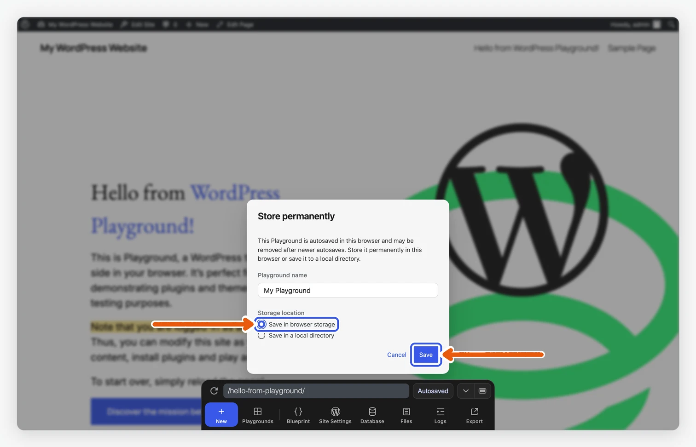
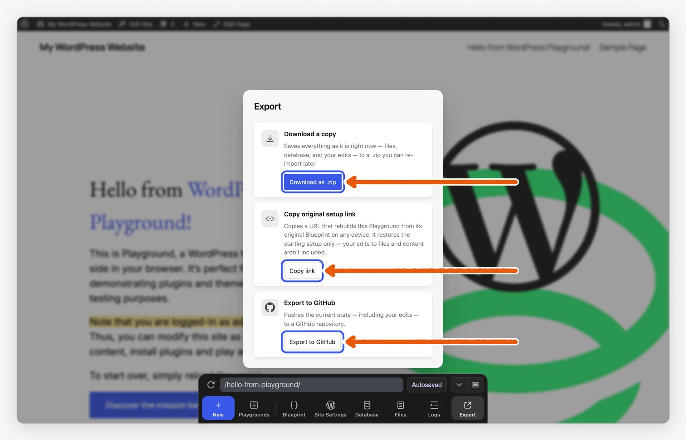
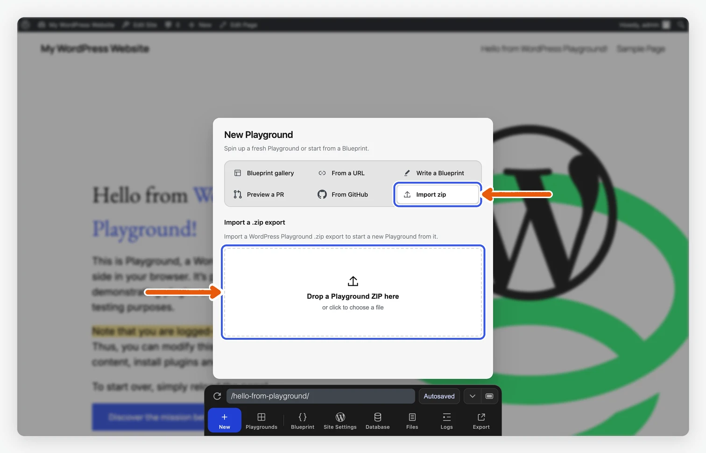
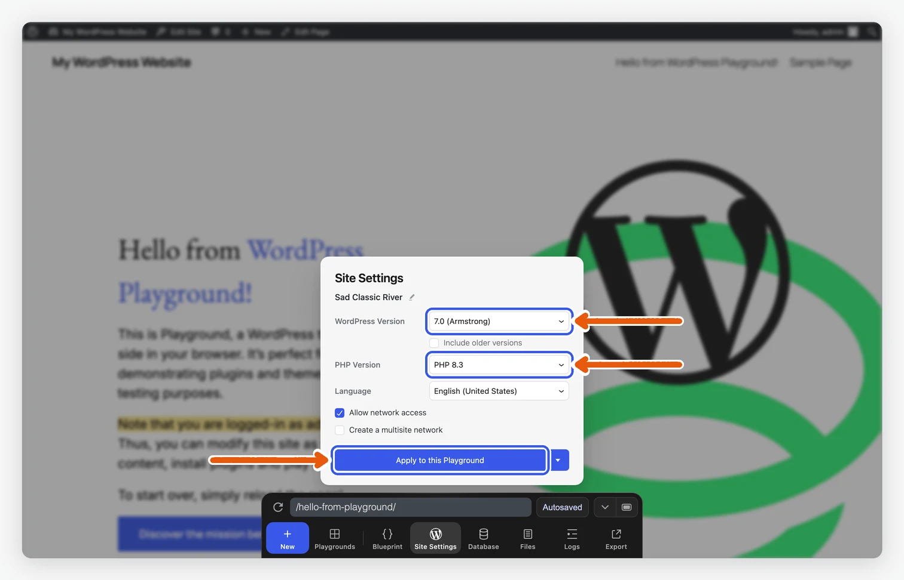

# 5 分で WordPress Playground を使い始める

<!--
# Start using WordPress Playground in 5 minutes
 -->

WordPress Playground は、次のような場合に役に立ちます。

<!--
WordPress Playground can help you with any of the following:
 -->

import TOCInline from '@theme/TOCInline';

<TOCInline toc={toc} />

このページでは、それぞれの項目について順を追って説明します。また、視覚的に理解したいという方のために、動画も用意しました。動画内のインターフェースには「Dock」が導入される以前の仕様が含まれている箇所があります。現在のUIについては、以下の手順（テキスト）を参照してください。

<!--
This page will guide you through each of these. Oh, and if you're a visual learner – here's a video. Some interface details in the video predate the Dock; follow the written steps below for the current UI.
 -->

<iframe width="752" height="423.2" title="Getting started with WordPress Playground" src="https://video.wordpress.com/v/3UBIXJ9S?autoPlay=false&amp;height=1080&amp;width=1920&amp;fill=true" class="editor-media-modal-detail__preview is-video" allowFullScreen></iframe>

## 新しい WordPress サイトを始める

<!--
## Start a new WordPress site
 -->

[playground.wordpress.net](https://playground.wordpress.net/) の公式デモを開いて、ブラウザ上で WordPress を起動しましょう。

<!--
Open the [official demo on playground.wordpress.net](https://playground.wordpress.net/) to start WordPress in your browser.
 -->

ページの作成、プラグインのアップロード、テーマのインストール、コンテンツのインポートなど、一般的な WordPress サイトで行えることのほとんどが可能です。

<!--
You can create pages, upload plugins, install themes, import content, and do most things you would do on a regular WordPress site.
 -->

ブラウザストレージが利用可能な場合、新しい Playground は自動的に保存されます。ドック（Dock）内の「Your Playgrounds」から、最近の自動保存データを最大5件まで確認できます。ページを更新した際にデータが破棄されるような環境が必要な場合は、`?storage=temp` を指定してPlaygroundを開いてください。

<!--
When browser storage is available, new Playgrounds are autosaved. You can find
up to five recent autosaves in **Your Playgrounds** from the Dock. If you need a
site that is discarded on refresh, open Playground with `?storage=temp`.
 -->

**WordPress Playground はプライベートです**

Playground は、お使いのブラウザ上でローカルに動作します。**GitHub へエクスポート**といった操作を選択しない限り、サイトがアップロードされることはありません。作業が完了したら、Playground を永続的に保存したり、ZIP 形式でエクスポートしたり、あるいは「新しい Playground 」から最初からやり直したりすることができます。

<!--

**WordPress Playground is private**

The Playground runs locally in your browser. It does not upload your site
unless you choose an action such as **Export to GitHub**. Once you're finished,
you can store the Playground permanently, export it as a ZIP, or start over
from **New Playground**.

 -->

## ブロック、テーマ、プラグインを試す

<!--
## Try a block, a theme, or a plugin
 -->

[/wp-admin/](https://playground.wordpress.net/?url=/wp-admin/) に必要なプラグインやテーマをアップロードできます。

<!--
You can upload any plugin or theme you want in [/wp-admin/](https://playground.wordpress.net/?url=/wp-admin/).
 -->

どのプラグインやテーマを使用すればよいかわからない場合は、次の公式ディレクトリを参照してください。

<!--
If you're not sure which plugin or theme to use, you can explore the official directories here:
 -->

- [WordPress プラグイン ディレクトリ](https://wordpress.org/plugins/)
- [WordPress テーマ ディレクトリ](https://wordpress.org/themes/)

<!--
-   [WordPress Plugin Directory](https://wordpress.org/plugins/)
-   [WordPress Theme Directory](https://wordpress.org/themes/)
 -->

URL のプラグインまたはテーマのスラッグを使用して、Playground 経由でそれらをプリインストールします。

<!--
Use the plugin or theme slug from the URL to preinstall theme via Playground.
 -->

クリック数を減らすために、URL に`plugin`または`theme`パラメータを追加することで、 WordPress プラグインディレクトリからプラグインやテーマをプリインストールできます。例えば、coblocks 　プラグインをインストールするには、次の URL を使用します。

<!--
To save a few clicks, you can preinstall plugins or themes from the WordPress plugin directory by adding a `plugin` or `theme` parameter to the URL. For example, to install the coblocks plugin, you can use this URL:
 -->

https://playground.wordpress.net/?plugin=coblocks

または、`pendant` テーマをプリインストールするには、次の URL を使用します。

<!--
Or this URL to preinstall the `pendant` theme:
 -->

https://playground.wordpress.net/?theme=pendant

<!--
In case you would like to install multiple themes and plugins, it is possible to repeat the `theme` or `plugin` parameters:
 -->

複数のテーマとプラグインをインストールしたい場合は、`theme`または`plugin`パラメータを繰り返すことができます:

https://playground.wordpress.net/?theme=pendant&theme=acai

これらのパラメータを組み合わせたり、複数のプラグインを追加したりすることもできます。

<!--
You can also mix and match these parameters and even add multiple plugins:
 -->

https://playground.wordpress.net/?plugin=coblocks&plugin=friends&theme=pendant

This is called [Query API](/developers/apis/query-api/) and you can learn more about it [here](/developers/apis/query-api/).

## ブラウザストレージに Playground を保存する

<!--
## Store a Playground in browser storage
 -->

Dock 内の**自動保存済み (Autosaved)**または**未保存 (Unsaved)**というステータスをクリックして **永続的に保存 (Store permanently)** を開き、**ブラウザストレージに保存 (Save in browser storage)**を選択します。

<!--
Click the **Autosaved** or **Unsaved** status in the Dock to open **Store
permanently**, then choose **Save in browser storage**.
 -->

<!--

 -->

保存されたブラウザ上の Playground は、**あなたの Playground (Your Playgrounds)**に表示されます。自動保存されたものもそこに表示されますが、Playground では直近の自動保存データを最大5つまで保持します。自動保存の保持期間を超えて残しておきたい場合は、その Playground を永続的に保存してください。

<!--
A saved browser Playground appears in **Your Playgrounds**. Autosaves also
appear there, but Playground keeps up to five recent autosaves. Store a
Playground permanently when you want to keep it beyond the autosave lifecycle.
 -->

ブラウザのストレージは引き続きブラウザに属します。後で移動、アーカイブ、または復元できるファイルが必要な場合は、ZIP をエクスポートします。

<!--
Browser storage still belongs to the browser. Export a ZIP when you need a file you can move, archive, or restore later.
 -->

## ポータブル ZIP をエクスポートする

<!--
## Export a portable ZIP
 -->

Dockから**エクスポート**を開き、**.zipとしてダウンロード**を使用します。

<!--
Open **Export** from the Dock and use **Download as .zip**.
 -->

<!--

 -->

エクスポートされたファイルには、現在のファイル、データベース、プラグイン、テーマ、アップロード済みデータ、および編集内容が含まれています。このファイルは、Playground で復元するか、PHP と SQLite に対応したサーバー上でホストすることができます。

<!--
The exported file contains the current files, database, plugins, themes, uploads, and edits. You can restore it in Playground or host it on a server that supports PHP and SQLite.
 -->

SQLite データベースは `wp-content/database/` ディレクトリ内に格納されています。このディレクトリに `db-path.php` が存在する場合、そのファイルはランダム化されたサブディレクトリ内にあるデータベースへのパスを返します。古いサイトでは、`wp-content/database/.ht.sqlite` というファイルが使用されています。サイトをコピーする際は、`database` ディレクトリ全体をまとめて扱うようにしてください。ドットで始まるファイルは、ほとんどのオペレーティングシステムにおいてデフォルトで非表示となっているため、ファイルマネージャーの設定で隠しファイルを表示するよう変更する必要があるかもしれません。

<!--
The SQLite database is included in `wp-content/database/`. When this directory contains `db-path.php`, that file returns the database path inside a randomized subdirectory. Older sites use `wp-content/database/.ht.sqlite`. Keep the whole `database` directory together when copying a site. Files starting with a dot are hidden by default on most operating systems, so you may need to enable hidden files in your file manager.
 -->

## ZIP を復元する

<!--
## Restore a ZIP
 -->

Dock から**新しい Playground （New Playground）**を開き、**ZIP をインポート （Import zip）**を選択して、ZIP ファイルを選びます。

<!--
Open **New Playground** from the Dock, choose **Import zip**, and select the ZIP file.
 -->

<!--

 -->

これにより、ZIP 内のファイルとデータベースが新しい Playground に復元されます。

<!--
This restores the files and database from the ZIP into a new Playground.
 -->

## 特定の WordPress または PHP バージョンを使用する

<!--
## Use a specific WordPress or PHP version
 -->

Dock から**サイト設定 (Site Settings)**を開き、WordPress、PHP、言語、マルチサイト、ネットワークに関するオプションを選択します。

<!--
Open **Site Settings** from the Dock to choose WordPress, PHP, language, multisite, and networking options.
 -->

<!--

 -->

**プラグインまたはテーマをテストする**

数多くの WordPress および PHP バージョンとの互換性テストは、いつも面倒でした。 WordPress Playground を使えば、このプロセスが楽になります。ぜひご活用ください !

<!--

**Test your plugin or theme**

Compatibility testing with so many WordPress and PHP versions was always a pain. WordPress Playground makes this process effortless – use it to your advantage!

 -->

また、`wp` および `php` [クエリパラメータ](/developers/apis/query-api) を使用して、適切なバージョンがすでにロードされた状態で Playground を開くこともできます。

<!--
You can also use the `wp` and `php` [query parameters](/developers/apis/query-api) to open Playground with the right versions already loaded:
 -->

- https://playground.wordpress.net/?wp=6.5
- https://playground.wordpress.net/?php=8.3
- https://playground.wordpress.net/?php=8.2&wp=6.2
- https://playground.wordpress.net/?php=next

これは[Query API](/developers/apis/query-api/)と呼ばれており、詳細については[こちら](/developers/apis/query-api/)で確認できます。

<!--
This is called [Query API](/developers/apis/query-api/) and you can learn more about it [here](/developers/apis/query-api/).
 -->

`php=next` を使用すると、php-src 開発ブランチからビルドされた次期 PHP バージョンをプレビューできます。例として、[PHP 8.6 機能プレビュー](https://playground.wordpress.net/php-8-6.html)をご覧ください。

<!--
Use `php=next` to preview the next PHP version built from the php-src development branch. For example, see the [PHP 8.6 feature preview](https://playground.wordpress.net/php-8-6.html).
 -->

デモのコンテンツ準備の詳細については、[デモのコンテンツ提供ガイド](/guides/providing-content-for-your-demo)を参照してください。

<!--
To learn more about preparing content for demos, see the [providing content for your demo guide](/guides/providing-content-for-your-demo).
 -->

**メジャーバージョンのみ**

`wp=6.2` や `php=8.1` のようにメジャーバージョンを指定すると、その系列における最新のリリースが取得されます。ただし、古いマイナーバージョンを指定することはできないため、`wp=6.1.2` や `php=7.4.9` といった指定は機能しません。なお、`latest` や `next` といった汎用的なエイリアスは例外です。

<!--

**Major versions only**

You can specify major versions like `wp=6.2` or `php=8.1` and expect the most recent release in that line. You cannot, however, request older minor versions so neither `wp=6.1.2` nor `php=7.4.9` will work. Generic aliases like `latest` and `next` are exceptions.

 -->

## WXR ファイルをインポートする

<!--
## Import a WXR file
 -->

[/wp-admin/](https://playground.wordpress.net/?url=/wp-admin/import.php) に WXR ファイルをアップロードすることで、WordPress エクスポートファイルをインポートできます。

<!--
You can import a WordPress export file by uploading a WXR file in [/wp-admin/](https://playground.wordpress.net/?url=/wp-admin/import.php).
 -->

[JSON ブループリント](/blueprints)も使用できます。詳しくは[ブループリントの使い方](/blueprints/getting-started)をご覧ください。

<!--
You can also use [JSON Blueprints](/blueprints). See [getting started with Blueprints](/blueprints/getting-started) to learn more.
 -->

これは、Playground ZIP を復元する場合とは異なります。WXR ファイルは、WordPress のコンテンツを既存のサイトにインポートするものです。一方、Playground ZIP は、ファイルとデータベースを新しい Playground に復元するものです。

<!--
This is different from restoring a Playground ZIP. A WXR file imports WordPress content into an existing site. A Playground ZIP restores files and the database into a new Playground.
 -->

## WordPress Playground でアプリを構築する

<!--
## Build apps with WordPress Playground
 -->

WordPress Playground はプログラム可能であり、[WordPress アプリの構築](https://developer.wordpress.org/playground/developers/build-an-app/)やプラグインのデモ環境のセットアップができるほか、セットアップ不要の[ローカル開発環境](/developers/local-development/)として利用することも可能です。

<!--
WordPress Playground is programmable, which means you can [build WordPress apps](https://developer.wordpress.org/playground/developers/build-an-app/), set up plugin demos, and even use it as a zero-setup [local development environment](/developers/local-development/).
 -->

WordPress Playground を活用した開発について詳しくは、[開発クイックスタート](https://developer.wordpress.org/playground/developers/build-an-app/) のセクションをご覧ください。

<!--
To learn more about developing with WordPress Playground, check out the [development quick start](https://developer.wordpress.org/playground/developers/build-an-app/) section.
 -->
