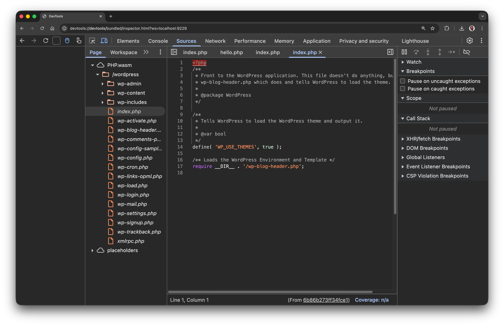
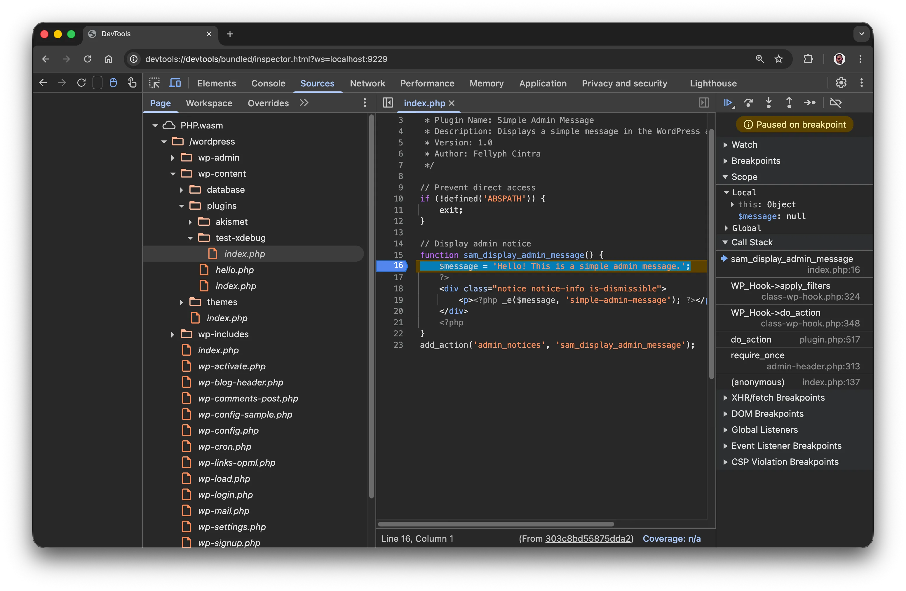
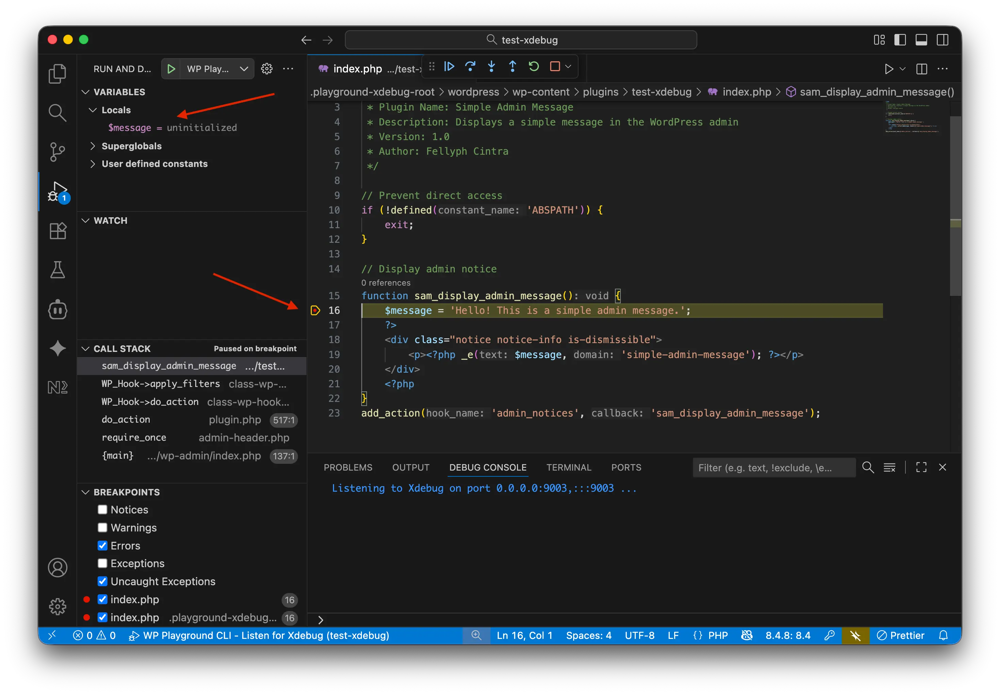

<!-- # Getting Started with Xdebug -->

# Primeiros Passos com Xdebug

<!-- This guide shows you how to enable Xdebug in WordPress Playground and start debugging your code. -->

Este guia mostra como habilitar o Xdebug no WordPress Playground e começar a depurar seu código.

<!-- ## PHP WASM CLI vs Playground CLI -->

## PHP WASM CLI vs Playground CLI

<!-- First, Xdebug is present in two different CLIs: -->

Primeiramente, o Xdebug está presente em dois CLI diferentes:

- **`@php-wasm/cli`**: Execute scripts PHP independentes. Use isso quando estiver depurando código PHP, sem precisar de um ambiente WordPress.
- **`@wp-playground/cli`**: Execute uma instalação completa do WordPress. Útil para depurar plugins WordPress, temas ou funcionalidades do núcleo.

<!-- For this guide, we'll use `@wp-playground/cli`. If you're not familiar with the tool, we recommend reading the [`@wp-playground/cli` guide](/developers/local-development/wp-playground-cli), but the same process can also be applied to debugging PHP applications with `@php-wasm/cli`. -->

Para este guia, vamos utilizar o `@wp-playground/cli`. Se você não estiver familiarizado com a ferramenta, recomendamos ler o guia do [`@wp-playground/cli`](/developers/local-development/wp-playground-cli), mas o mesmo processo também pode ser aplicado à depuração de aplicações PHP com o `@php-wasm/cli`.

<!-- ## Quick start with `npx` -->

## Início rápido com `npx`

<!-- The fastest way to get started is using npx, which doesn't require installation: -->

A forma mais rápida de começar é usando npx, que não requer instalação:

```bash
npx @wp-playground/cli@latest server --xdebug
```

<!-- The CLI prints the WordPress URL after starting the server with Xdebug enabled. You can now connect a debugger. -->

O Playground CLI exibe a URL do WordPress após iniciar o servidor com o Xdebug habilitado. Agora você pode conectar um depurador.

<!-- Before starting another example, stop the previous Playground server with `Ctrl+C` and disconnect its debugger. -->

Antes de começar outro exemplo, pare o servidor anterior do Playground com `Ctrl+C` e desconecte o depurador.

<!-- ## Create the sample plugin -->

## Criar o plugin de exemplo

<!-- Create a directory named `test-xdebug` and save the following code as `test-xdebug.php` inside it. Both walkthroughs use this plugin. -->

Crie uma pasta chamada `test-xdebug` e salve nela o código a seguir em um arquivo chamado `test-xdebug.php`. Os dois exemplos de depuração usam este plugin.

```PHP
<?php
/**
 * Plugin Name: Simple Admin Message
 * Description: Displays a simple message in the WordPress admin
 * Version: 1.0
 * Author: Playground Team
 */

// Prevent direct access
if (!defined('ABSPATH')) {
    exit;
}

// Display admin notice
function sam_display_admin_message() {
    $message = 'Hello! This is a simple admin message.';
    ?>
    <div class="notice notice-info is-dismissible">
        <p><?php _e($message, 'simple-admin-message'); ?></p>
    </div>
    <?php
}
add_action('admin_notices', 'sam_display_admin_message');
```

<!-- ## Starting with DevTools -->

## Iniciando com DevTools

<!-- To debug with Chrome DevTools, add the `--experimental-devtools` flag: -->

Para depurar com Chrome DevTools, adicione a flag `--experimental-devtools`:

```bash
npx @wp-playground/cli@latest server --xdebug --experimental-devtools
```

<!-- Open the URL printed by the bridge in Chrome on the same computer. DevTools connects to the Chrome DevTools Protocol (CDP) listener at `127.0.0.1:9229`. -->

No mesmo computador, abra no Chrome a URL exibida pela ponte do Xdebug. O DevTools se conecta ao endereço `127.0.0.1:9229` pelo Chrome DevTools Protocol (CDP).

```text
Starting XDebug Bridge...
Connect Chrome DevTools to CDP at:
devtools://devtools/bundled/inspector.html?ws=127.0.0.1:9229
```

<!-- Once DevTools connects, the bridge starts listening for Xdebug (DBGp) connections at `127.0.0.1:9003`. Both listeners use IPv4 loopback by default. -->

Assim que o DevTools se conecta, a ponte começa a escutar conexões do Xdebug (DBGp) em `127.0.0.1:9003`. Por padrão, a ponte escuta no endereço de loopback IPv4 para os dois protocolos.

```text
Chrome connected! Initializing Xdebug receiver...
XDebug receiver running on 127.0.0.1:9003
Running a PHP script with Xdebug enabled...
```



<!-- If you ran the previous command, close its DevTools window and stop the server with `Ctrl+C`. Run the following command from the `test-xdebug` directory. -->

Se executou o comando anterior, feche a janela do DevTools e pare o servidor com `Ctrl+C`. Execute o comando a seguir na pasta `test-xdebug`.

```bash
npx @wp-playground/cli@latest server --xdebug --experimental-devtools --auto-mount
```

<!-- The Playground CLI automatically mounts and activates the plugin. Open the DevTools URL from the terminal and set a breakpoint inside `sam_display_admin_message()`. Append `/wp-admin/plugins.php` to the WordPress URL printed by the CLI and open the resulting URL in your browser to hit the breakpoint. If WordPress asks you to sign in, use `admin` as the username and `password` as the password. -->

O Playground CLI monta e ativa o plugin automaticamente. Abra a URL do DevTools exibida no terminal e adicione um ponto de interrupção em `sam_display_admin_message()`. Para atingir o ponto de interrupção, acrescente `/wp-admin/plugins.php` à URL do WordPress exibida pelo Playground CLI e abra o endereço resultante no navegador. Se o WordPress solicitar que você acesse sua conta, use `admin` como nome de usuário e `password` como senha.



<!-- ## Starting with IDE integration -->

## Iniciando com integração IDE

<!-- To debug the sample plugin with VS Code, use the `--experimental-unsafe-ide-integration=vscode` flag. For PhpStorm, open `test-xdebug` as a PhpStorm project first and make sure it contains an `.idea/` directory. In the command below, replace the VS Code flag with `--experimental-unsafe-ide-integration=phpstorm`. -->

Para depurar o plugin de exemplo com o VS Code, use a opção `--experimental-unsafe-ide-integration=vscode`. Se estiver usando o PhpStorm, abra primeiro a pasta `test-xdebug` como um projeto do PhpStorm e verifique se ela contém a pasta `.idea/`. No comando a seguir, substitua a opção do VS Code por `--experimental-unsafe-ide-integration=phpstorm`.

<!-- To debug in VSCode you'll need the following prerequisites: -->

Para depurar no VSCode você precisará dos seguintes pré-requisitos:

1. Instale uma extensão de depuração de PHP compatível com o Xdebug, como o [PHP Debug](https://marketplace.visualstudio.com/items?itemName=xdebug.php-debug).
2. Uma pasta `.vscode/`. Se o arquivo `launch.json` não existir, não se preocupe, o `@wp-playground/cli` o criará.
3. Habilite os pontos de interrupção (breakpoints) em seu IDE. Alguns IDEs vêm com este recurso desativado, então preste atenção a este detalhe.

<!-- Run the following command from the plugin directory. -->

Execute o comando a seguir na pasta do plugin.

```bash
npx @wp-playground/cli@latest server --xdebug --experimental-unsafe-ide-integration=vscode --auto-mount
```

<!-- Start the **WP Playground CLI - Listen for Xdebug** configuration in your IDE and set a breakpoint inside `sam_display_admin_message()`. Append `/wp-admin/plugins.php` to the WordPress URL printed by the CLI and open the resulting URL in your browser to hit the breakpoint. If WordPress asks you to sign in, use `admin` as the username and `password` as the password. -->

Inicie a configuração **WP Playground CLI - Listen for Xdebug** no seu IDE e adicione um ponto de interrupção em `sam_display_admin_message()`. Para atingir o ponto de interrupção, acrescente `/wp-admin/plugins.php` à URL do WordPress exibida pelo Playground CLI e abra o endereço resultante no navegador. Se o WordPress solicitar que você acesse sua conta, use `admin` como nome de usuário e `password` como senha.



<!-- ### PhpStorm troubleshooting -->

### Solução de problemas no PhpStorm

<!-- If PhpStorm pauses on the first line of unmapped files or scripts outside your project, you can disable these optional settings under **Settings > PHP > Debug > Xdebug**: -->

Se o PhpStorm pausa na primeira linha de arquivos sem mapeamento de caminho ou de scripts fora do seu projeto, você pode desativar estas configurações opcionais em **Settings > PHP > Debug > Xdebug**:

- **Force break at first line when no path mapping specified**.
- **Force break at first line when a script is outside the project**.

<!-- If requests that do not hit a breakpoint produce unwanted notifications, disable **Notify if debug session was finished without being paused** under **Settings > PHP > Debug > Settings** (called **Advanced settings** in the current JetBrains documentation). When this setting is disabled and no breakpoint is hit, PhpStorm runs the script without pausing or establishing a debugging session. -->

Se as requisições que não atingem um ponto de interrupção geram notificações indesejadas, desative **Notify if debug session was finished without being paused** em **Settings > PHP > Debug > Settings** (chamado de **Advanced settings** na documentação atual da JetBrains). Quando essa configuração está desativada e nenhum ponto de interrupção é atingido, o PhpStorm executa o script sem pausar nem iniciar uma sessão de depuração.

<!-- These options suppress unwanted pauses or notifications. They do not fix path mappings or configure breakpoints: you still need correct path mappings and enabled breakpoints in the code you want to debug. -->

Essas opções evitam pausas ou notificações indesejadas. Elas não corrigem os mapeamentos de caminhos nem configuram os pontos de interrupção: você ainda precisa de mapeamentos de caminhos corretos e pontos de interrupção ativados no código que deseja depurar.

<!-- For more details, see [JetBrains' debug settings reference](https://www.jetbrains.com/help/phpstorm/debug.html) and the [PhpStorm examples](https://github.com/WordPress/wordpress-playground/blob/trunk/examples/xdebug/ide/README.md#phpstorm). -->

Para mais detalhes, consulte a [referência de configurações de depuração da JetBrains](https://www.jetbrains.com/help/phpstorm/debug.html) e os [exemplos para PhpStorm](https://github.com/WordPress/wordpress-playground/blob/trunk/examples/xdebug/ide/README.md#phpstorm).

<!-- This feature is in experimental mode. Until it is completed, we will need your feedback. Please connect with us in the [#playground Slack channel](https://wordpress.slack.com/archives/C04EWKGDJ0K) and share your thoughts. -->

Esta funcionalidade está em modo experimental. Até que seja concluída, precisaremos do seu feedback. Por favor, conecte-se conosco no [canal Slack #playground](https://wordpress.slack.com/archives/C04EWKGDJ0K) e compartilhe seus pensamentos.
