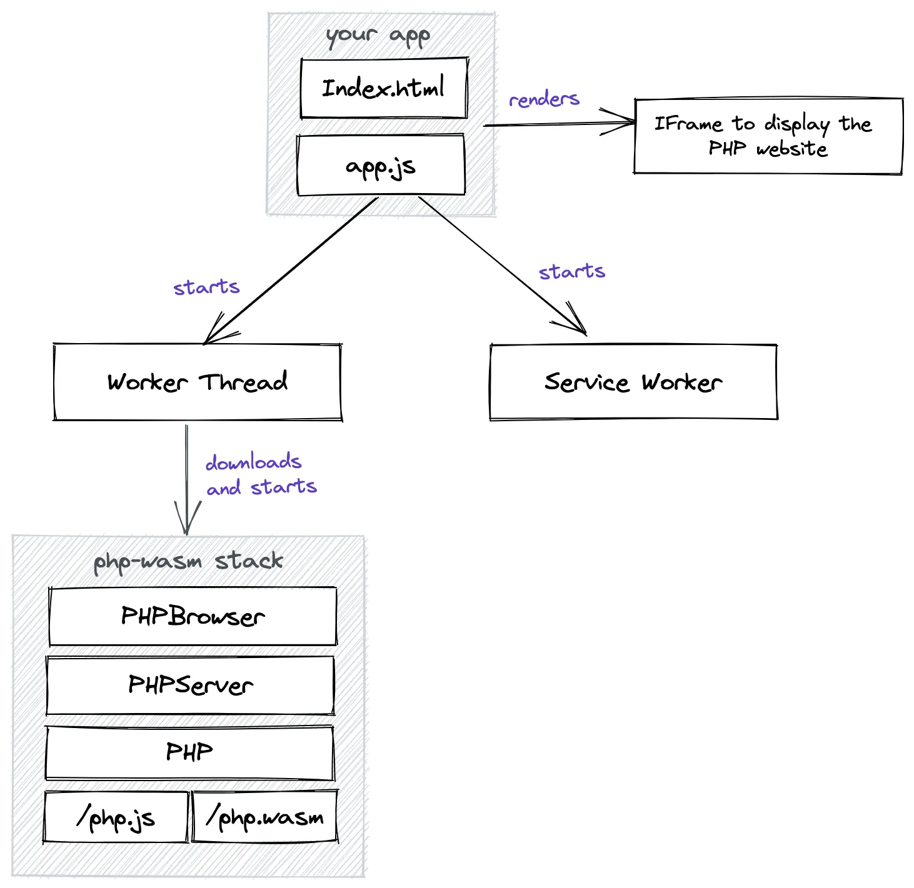
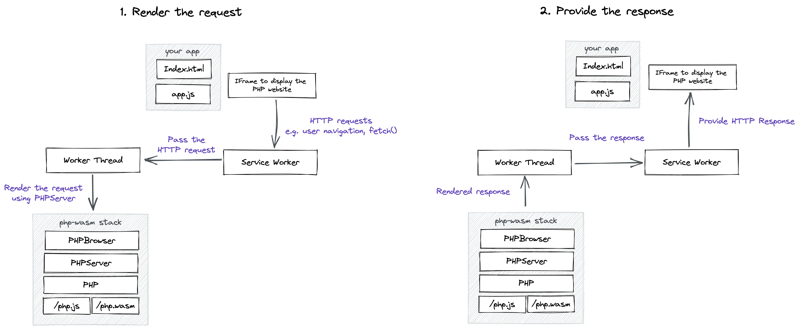

<!-- # Browser tab orchestrates the execution -->

# A aba do navegador orquestra a execução

<!--
The main `index.html` ties the entire application together. It starts all the concurrent processes and displays the PHP responses. The app only lives as long as the main `index.html`.
-->

O `index.html` principal amarra toda a aplicação. Ele inicia todos os processos concorrentes e exibe as respostas do PHP. A aplicação só existe enquanto o `index.html` principal existir.

<!--
Keep this point in mind as you read through the rest of the docs. At this point it may seem obvious, by the lines may get blurry later on. This package runs code outside of the browser tab using Web Workers, Service Workers, and, in the future, Shared Workers. Some of these workers may keep running even after the browser tab with `index.html` is closed.
-->

Tenha isso em mente ao ler o restante da documentação. Agora pode parecer óbvio, mas os limites podem ficar menos claros mais adiante. Este pacote executa código fora da aba do navegador usando Web Workers, Service Workers e, no futuro, Shared Workers. Alguns desses workers podem continuar em execução mesmo depois que a aba do navegador com o `index.html` for fechada.

<!-- ## Boot sequence -->

## Sequência de inicialização {#boot-sequence}

<!-- Here's what a boot sequence for a minimal app looks like: -->

Veja como é a sequência de inicialização de uma aplicação mínima:

<!--  -->


<!--
The main app initiates the Iframe, the Service Worker, and the Worker Thread. Note how the main app doesn't use the PHP stack directly – it's all handled in the Worker Thread.
-->

A aplicação principal inicia o iframe, o Service Worker e o Worker Thread. Repare que a aplicação principal não usa a pilha do PHP diretamente: tudo é tratado no Worker Thread.

<!-- Here's what that boot sequence looks like in code: -->

Veja como essa sequência de inicialização fica em código:

**/index.html**:

```js
<script src="/app.ts"></script>
<iframe id="my-app"></iframe>
```

**/app.ts**:

```ts
import { consumeAPI, PHPClient, registerServiceWorker, spawnPHPWorkerThread } from '@php-wasm/web';

const workerUrl = '/worker-thread.js';

export async function startApp() {
	const phpClient = consumeAPI<PlaygroundWorkerEndpoint>(
		await spawnPHPWorkerThread(
			workerUrl, // Valid Worker script URL
			{
				wpVersion: 'latest',
				phpVersion: '8.3', // Startup options
			}
		)
	);

	// Await the two-way communication channel
	await phpClient.isReady();

	// Must point to a valid Service Worker script:
	await registerServiceWorker(
		phpClient,
		'default', // PHP instance scope, keep reading to learn more.
		'/sw.js', // Valid Service Worker script URL.
		'1' // Service worker version, used for reloading the script.
	);

	// Create a few PHP files to browse:
	await workerThread.writeFile('/index.php', '<a href="page.php">Go to page.php</a>');
	await workerThread.writeFile('/page.php', '<?php echo "Hello from PHP!"; ?>');

	// Navigate to index.php:
	document.getElementById('my-app').src = playground.pathToInternalUrl('/index.php');
}
startApp();
```

<!-- Keep reading to learn how all these pieces fit together. -->

Continue lendo para entender como todas essas peças se encaixam.

<!-- ### Data flow -->

### Fluxo de dados {#data-flow}

<!-- Here's what happens whenever the iframe issues a same-domain request: -->

Veja o que acontece sempre que o iframe faz uma requisição para o mesmo domínio:

<!--  -->


<!-- A step-by-step breakdown: -->

Passo a passo:

<!--
1.  The request is intercepted by the Service Worker
2.  The Service Worker passes it to the Worker Thread
3.  The Worker Thread calls `PHP.request` to convert that request to a response
4.  The Worker Thread passes the response to the Service Worker
5.  The Service Worker provides the browser with a response
-->

1.  A requisição é interceptada pelo Service Worker
2.  O Service Worker a repassa para o Worker Thread
3.  O Worker Thread chama `PHP.request` para converter essa requisição em uma resposta
4.  O Worker Thread repassa a resposta para o Service Worker
5.  O Service Worker entrega a resposta ao navegador

<!--
At this point, if the request was triggered by user clicking on a link, the browser will render PHPRequestHandler's response inside the iframe.
-->

Nesse ponto, se a requisição foi disparada pelo usuário ao clicar em um link, o navegador renderiza a resposta do PHPRequestHandler dentro do iframe.
