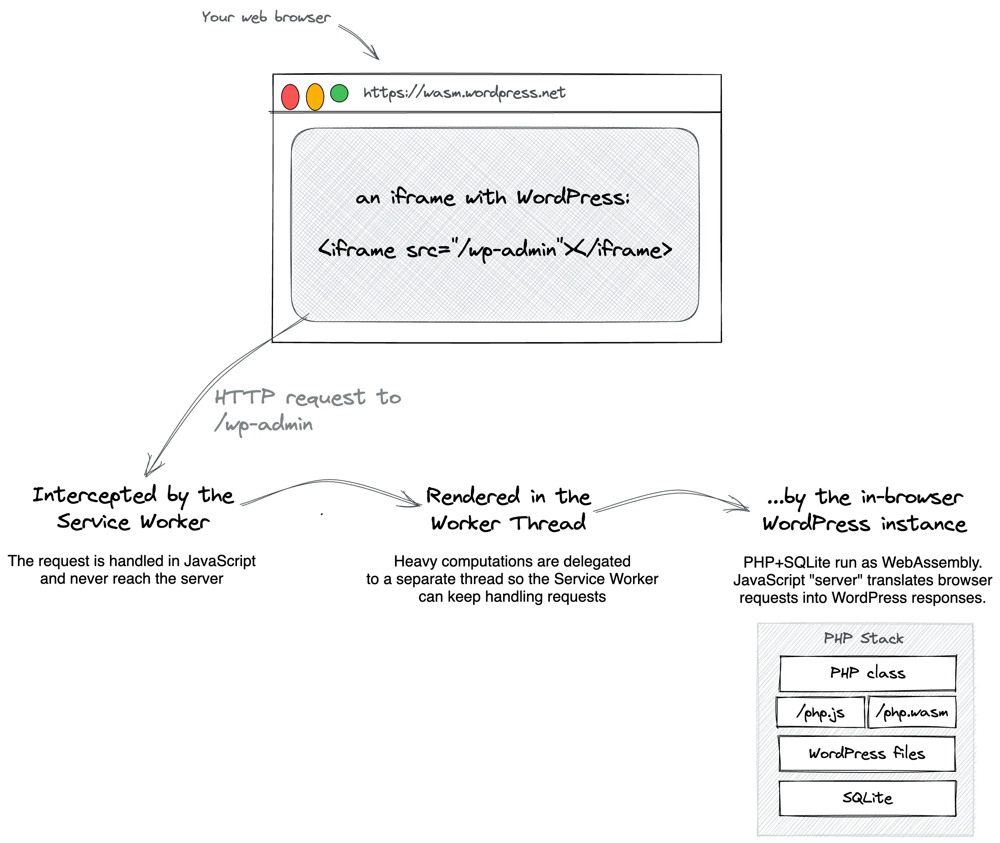

<!-- # Service Workers -->

# Service Workers

<!--
[A Service Worker](https://developer.mozilla.org/en-US/docs/Web/API/Service_Worker_API/Using_Service_Workers) is used to handle the HTTP traffic using the in-browser [`PHPRequestHandler`](/developers/architecture/browser-concepts).
-->

[Um Service Worker](https://developer.mozilla.org/en-US/docs/Web/API/Service_Worker_API/Using_Service_Workers) é usado para tratar o tráfego HTTP com o [`PHPRequestHandler`](/developers/architecture/browser-concepts) que roda no navegador.

<!--
Imagine your PHP script renders the following page [in the iframe viewport](/developers/architecture/browser-iframe-rendering):
-->

Imagine que o seu script PHP renderiza a seguinte página [na área visível do iframe](/developers/architecture/browser-iframe-rendering):

```html
<html>
	<head>
		<title>John's Website</title>
	</head>
	<body>
		<a href="/">Homepage</a>
		<a href="/blog">Blog</a>
		<a href="/contact">Contact</a>
	</body>
</html>
```

<!--
When the user clicks, say the `Blog` link, the browser would normally send a HTTP request to the remote server to fetch the `/blog` page and then display it instead of the current iframe contents. However, our app isn't running on the remote server. The browser would just display a 404 page.
-->

Quando o usuário clica, por exemplo, no link `Blog`, o navegador normalmente enviaria uma requisição HTTP ao servidor remoto para buscar a página `/blog` e então exibi-la no lugar do conteúdo atual do iframe. Porém, a nossa aplicação não está rodando no servidor remoto. O navegador simplesmente exibiria uma página 404.

<!--
Enter [Service Workers](https://developer.mozilla.org/en-US/docs/Web/API/Service_Worker_API/Using_Service_Workers) – a tool to intercept the HTTP requests and handle them inside the browser:
-->

É aí que entram os [Service Workers](https://developer.mozilla.org/en-US/docs/Web/API/Service_Worker_API/Using_Service_Workers), uma ferramenta para interceptar as requisições HTTP e tratá-las dentro do navegador:

<!--  -->


<!-- ### Service Worker setup -->

### Configuração do Service Worker {#service-worker-setup}

<!-- The main application living in `/index.html` is responsible for registering the service worker. -->

A aplicação principal, que fica em `/index.html`, é responsável por registrar o Service Worker.

<!-- Here's the minimal setup: -->

Esta é a configuração mínima:

**/app.js:**

```js
import { registerServiceWorker } from '@php-wasm/web';

function main() {
	await registerServiceWorker(
		phpClient,
		"default", // PHP instance scope
		"/sw.js",  // Must point to a valid Service Worker implementation.
		"1"        // Service worker version, used for reloading the script.
	);

}
```

<!--
You will also need a separate `/service-worker.js` file that actually intercepts and routes the HTTP requests. Here's what a minimal implementation looks like:
-->

Você também vai precisar de um arquivo `/service-worker.js` separado, que de fato intercepta e encaminha as requisições HTTP. Veja como é uma implementação mínima:

**/service-worker.js**:

```js
import { initializeServiceWorker } from '@php-wasm/web';

// Intercepts all HTTP traffic on the current domain and
// passes it to the Worker Thread.
initializeServiceWorker();
```
