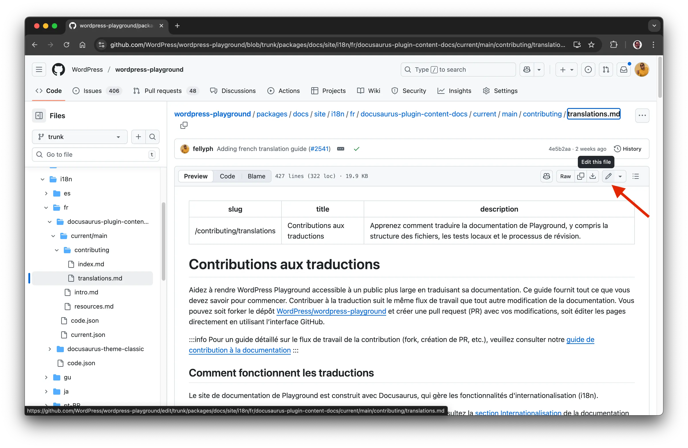
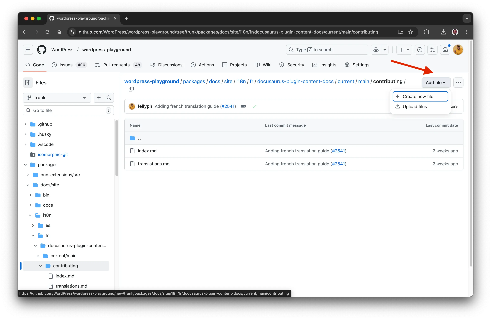
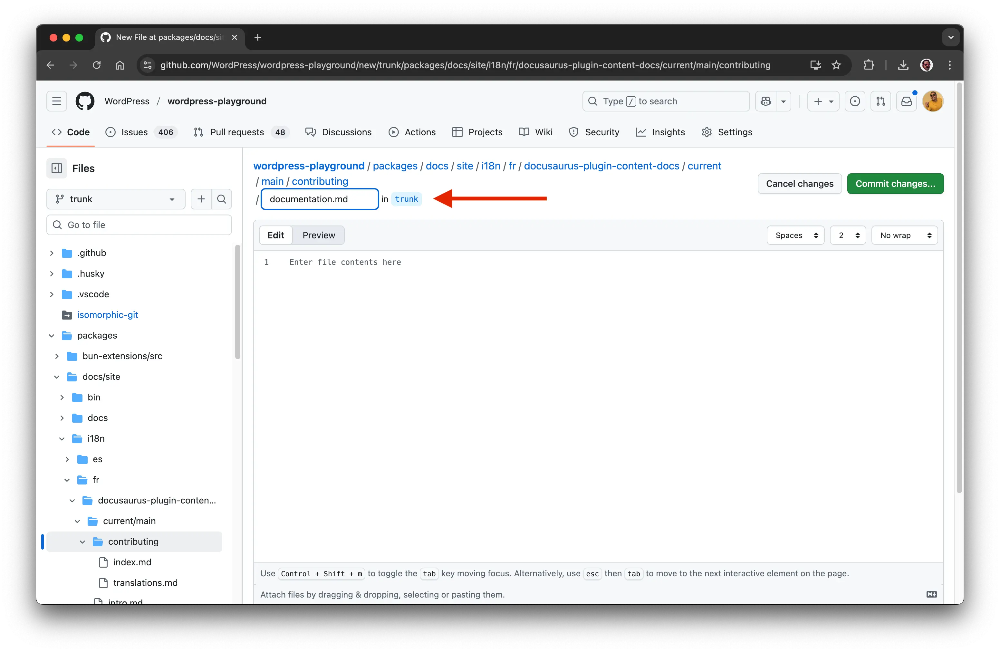

<!-- # Contribute with the GitHub web interface -->

# Contribua pela interface web do GitHub

<!--
You can improve Playground documentation directly on GitHub. This is useful for typo fixes, small clarifications, and translation updates when you do not want to clone the repository or set up a local development environment.
-->

Você pode melhorar a documentação do Playground diretamente no GitHub. Isso é útil para corrigir erros de digitação, fazer pequenos esclarecimentos e atualizar traduções quando você não quer clonar o repositório nem configurar um ambiente de desenvolvimento local.

<!--
Before you start, sign in to GitHub and identify the documentation page you want to change.
-->

Antes de começar, faça login no GitHub e identifique a página da documentação que você quer alterar.

<!-- ## When to use this workflow -->

## Quando usar este fluxo de trabalho

<!-- The GitHub web interface is a good fit for: -->

A interface web do GitHub é uma boa opção para:

<!--
- Fixing typos.
- Clarifying a sentence or paragraph.
- Updating links.
- Improving an existing translation.
- Adding a short documentation page.
-->

- Corrigir erros de digitação.
- Esclarecer uma frase ou um parágrafo.
- Atualizar links.
- Melhorar uma tradução existente.
- Adicionar uma página curta de documentação.

<!--
For larger changes, updates that need local preview, or changes that affect code, use the local workflow in [Documentation contributions](/contributing/documentation) or [Code contributions](/contributing/code).
-->

Para alterações maiores, atualizações que precisam de pré-visualização local ou mudanças que afetam o código, use o fluxo de trabalho local descrito em [Contribuições para a documentação](/contributing/documentation) ou [Contribuições de código](/contributing/code).

<!-- ## Find the documentation file -->

## Encontre o arquivo da documentação

<!--
Most English documentation pages live in the [`packages/docs/site/docs`](https://github.com/WordPress/wordpress-playground/tree/trunk/packages/docs/site/docs) directory.
-->

A maioria das páginas da documentação em inglês fica no diretório [`packages/docs/site/docs`](https://github.com/WordPress/wordpress-playground/tree/trunk/packages/docs/site/docs).

<!--
Translated documentation lives in [`packages/docs/site/i18n`](https://github.com/WordPress/wordpress-playground/tree/trunk/packages/docs/site/i18n). For more details about translation file paths, see [Contributions to translations](/contributing/translations).
-->

A documentação traduzida fica em [`packages/docs/site/i18n`](https://github.com/WordPress/wordpress-playground/tree/trunk/packages/docs/site/i18n). Para mais detalhes sobre os caminhos dos arquivos de tradução, consulte [Contribuições para traduções](/contributing/translations).

<!--
For existing pages, the fastest way to find the source file is from the documentation site:
-->

Para páginas existentes, a forma mais rápida de encontrar o arquivo-fonte é a partir do site da documentação:

<!--
1. Open the documentation page you want to update.
2. Select the **Edit this page** link near the bottom of the page.
3. GitHub opens the source file for that page.
-->

1. Abra a página da documentação que você quer atualizar.
2. Selecione o link **Editar esta página**, perto do final da página.
3. O GitHub abre o arquivo-fonte dessa página.

<!-- You can also browse the repository directly: -->

Você também pode navegar diretamente pelo repositório:

<!--
1. Open the [WordPress Playground repository](https://github.com/WordPress/wordpress-playground).
2. Browse to the relevant documentation directory.
3. Select the file that matches the page you want to update.
-->

1. Abra o [repositório do WordPress Playground](https://github.com/WordPress/wordpress-playground).
2. Navegue até o diretório de documentação correspondente.
3. Selecione o arquivo que corresponde à página que você quer atualizar.

<!--
The screenshots below use translation files as examples, but the same GitHub controls apply to English documentation files.
-->

As capturas de tela abaixo usam arquivos de tradução como exemplo, mas os mesmos controles do GitHub se aplicam aos arquivos da documentação em inglês.

<!-- ## Edit an existing page -->

## Edite uma página existente

<!--
1. Open the file in GitHub.
2. Select the pencil icon to edit the file.
3. If GitHub asks you to fork the repository, follow the prompt. This creates a copy under your GitHub account.
4. Make your changes in the editor.
-->

1. Abra o arquivo no GitHub.
2. Selecione o ícone de lápis para editar o arquivo.
3. Se o GitHub pedir para você fazer um fork do repositório, siga as instruções. Isso cria uma cópia na sua conta do GitHub.
4. Faça suas alterações no editor.

<!--  -->


<!--
GitHub's web editor is best for small, focused changes. If your update is large or needs local preview, use the local workflow in [Documentation contributions](/contributing/documentation).
-->

O editor web do GitHub é mais indicado para alterações pequenas e focadas. Se a sua atualização for grande ou precisar de pré-visualização local, use o fluxo de trabalho local descrito em [Contribuições para a documentação](/contributing/documentation).

<!-- ## Add a new page -->

## Adicione uma nova página

<!--
1. Open the directory where the new page should live.
2. Select **Add file** and then **Create new file**.
3. Enter the file name. You can create folders by typing the folder name followed by `/`.
4. Add the page content.
5. Mention where the page should appear in the documentation sidebar when you open the pull request.
   If you are comfortable editing another file, you can also add the page to
   [`packages/docs/site/sidebars.js`](https://github.com/WordPress/wordpress-playground/blob/trunk/packages/docs/site/sidebars.js).
-->

1. Abra o diretório onde a nova página deve ficar.
2. Selecione **Add file** e depois **Create new file**.
3. Digite o nome do arquivo. Você pode criar pastas digitando o nome da pasta seguido de `/`.
4. Adicione o conteúdo da página.
5. Ao abrir o pull request, mencione onde a página deve aparecer na barra lateral da documentação.
   Se você se sentir à vontade para editar outro arquivo, também pode adicionar a página em
   [`packages/docs/site/sidebars.js`](https://github.com/WordPress/wordpress-playground/blob/trunk/packages/docs/site/sidebars.js).

<!--  -->


<!-- For new English documentation pages, add front matter at the top of the file: -->

Para novas páginas da documentação em inglês, adicione o front matter no início do arquivo:

```markdown
---
slug: /example-page
title: Example page
description: A short description of the page.
---
```

<!--
For new translated pages, mirror the English file path in the matching language directory. For example,
a French translation of `packages/docs/site/docs/main/contributing/documentation.md` belongs in
`packages/docs/site/i18n/fr/docusaurus-plugin-content-docs/current/main/contributing/documentation.md`.
Keep the original English content in a comment above the translation so reviewers can compare the text.
-->

Para novas páginas traduzidas, reproduza o caminho do arquivo em inglês dentro do diretório do idioma correspondente. Por exemplo,
uma tradução para o francês de `packages/docs/site/docs/main/contributing/documentation.md` deve ficar em
`packages/docs/site/i18n/fr/docusaurus-plugin-content-docs/current/main/contributing/documentation.md`.
Mantenha o conteúdo original em inglês em um comentário acima da tradução, para que os revisores possam comparar os textos.

<!-- ## Review your changes -->

## Revise suas alterações

<!--
Before submitting, use the **Preview** tab in GitHub to check basic Markdown formatting. This is not
a full Docusaurus preview, so also review links and images carefully. Site-relative paths such as
`/img/contributing/example.webp` may not behave the same way in GitHub's Markdown preview.
-->

Antes de enviar, use a aba **Preview** do GitHub para verificar a formatação básica do Markdown. Essa não é
uma pré-visualização completa do Docusaurus, então revise também os links e as imagens com atenção. Caminhos relativos ao site, como
`/img/contributing/example.webp`, podem não funcionar da mesma forma na pré-visualização de Markdown do GitHub.

<!--  -->


<!-- Look for: -->

Verifique se há:

<!--
- Headings in the right order.
- Working links.
- Lists and code blocks that render correctly.
- A focused change that is easy to review.
-->

- Títulos na ordem correta.
- Links funcionando.
- Listas e blocos de código renderizados corretamente.
- Uma alteração focada e fácil de revisar.

<!-- ## Propose the change -->

## Proponha a alteração

<!--
1. Scroll to the **Commit changes** section.
2. Add a short commit message, such as `Fix typo in documentation guide`.
3. Add a short description if the change needs context.
4. Select the option to create a new branch for the commit.
5. Select **Propose changes**.
6. On the next page, select **Create pull request**.
-->

1. Role até a seção **Commit changes**.
2. Adicione uma mensagem de commit curta, como `Fix typo in documentation guide`.
3. Adicione uma breve descrição se a alteração precisar de contexto.
4. Selecione a opção para criar um novo branch para o commit.
5. Selecione **Propose changes**.
6. Na próxima página, selecione **Create pull request**.

<!-- ## What happens next -->

## O que acontece depois

<!--
A maintainer will review your pull request. They may ask for changes before merging it.
-->

Um mantenedor vai revisar seu pull request. Ele pode pedir alterações antes de fazer o merge.

<!--
If you are contributing translations, you can also request a review in the `#polyglots` or `#playground` channel in [Make WordPress Slack](https://make.wordpress.org/chat/).
-->

Se você estiver contribuindo com traduções, também pode pedir uma revisão nos canais `#polyglots` ou `#playground` do [Slack do Make WordPress](https://make.wordpress.org/chat/).
