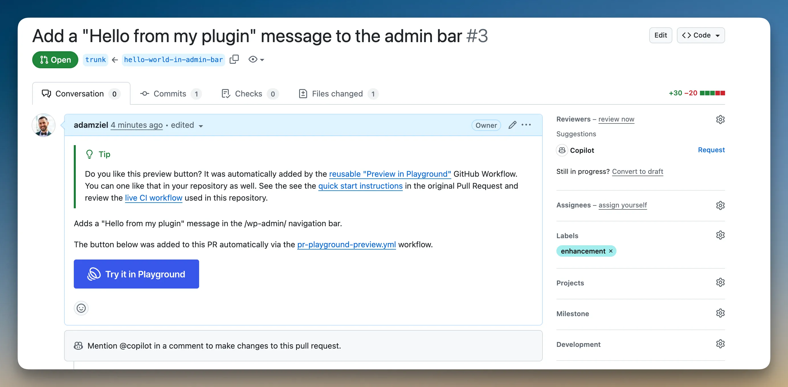

<!--
The Playground PR Preview action adds a preview button to your pull requests. Clicking the button launches Playground with your plugin or theme installed from the PR branch:
-->

A ação Playground PR Preview adiciona um botão de pré-visualização aos seus pull requests. Ao clicar no botão, o Playground é iniciado com seu plugin ou tema instalado a partir da branch do PR:

<!--

-->


<!--
Start with the setup that matches your repository:
-->

Comece pela configuração que corresponde ao seu repositório:

<!--
| Your repository                                                           | Use this setup                                                                  |
| ------------------------------------------------------------------------- | ------------------------------------------------------------------------------- |
| Plugin or theme works directly from the repository checkout               | [No build step](#no-build-step)                                                 |
| Plugin or theme needs Composer, npm, Vite, or another build command first | [With a build step](#with-a-build-step)                                         |
| Public fork PRs need working previews                                     | [With a build step](#with-a-build-step)                                         |
| Private repository                                                        | The default setup is not enough; Playground needs public, unauthenticated URLs. |
-->

| Seu repositório                                                                               | Use esta configuração                                                                               |
| --------------------------------------------------------------------------------------------- | --------------------------------------------------------------------------------------------------- |
| O plugin ou tema funciona diretamente com os arquivos do repositório                          | [Sem etapa de compilação](#no-build-step)                                                           |
| O plugin ou tema precisa executar Composer, npm, Vite ou outro comando de compilação primeiro | [Com etapa de compilação](#with-a-build-step)                                                       |
| PRs de forks públicos precisam de pré-visualizações funcionais                                | [Com etapa de compilação](#with-a-build-step)                                                       |
| Repositório privado                                                                           | A configuração padrão não basta; o Playground precisa de URLs públicas que não exijam autenticação. |

<!--
If you are not sure, use the no-build setup only when the files committed to the pull request are exactly the files WordPress should run. If CI must generate anything first, use the build-step setup.
-->

Em caso de dúvida, use a configuração sem compilação somente quando os arquivos incluídos no pull request forem exatamente os que o WordPress deve executar. Se a integração contínua (CI) precisar gerar algum arquivo antes, use a configuração com etapa de compilação.

<!--
For complete configuration options, recipes, and reference tables, see the [action-wp-playground-pr-preview documentation](https://wordpress.github.io/action-wp-playground-pr-preview/).
-->

Para consultar todas as opções de configuração, exemplos de uso e tabelas de referência, veja a [documentação de action-wp-playground-pr-preview](https://wordpress.github.io/action-wp-playground-pr-preview/).

<!--
## How it works
-->

## Como funciona

<!--
Playground runs WordPress in the browser. Anything Playground installs, such as a plugin ZIP, theme ZIP, or WXR file, must be available at a public URL when someone clicks the preview button.
-->

O Playground executa o WordPress no navegador. Tudo o que ele instala, como um ZIP de plugin, um ZIP de tema ou um arquivo WXR, precisa estar disponível em uma URL pública quando alguém clicar no botão de pré-visualização.

<!--
The action uses two URL strategies:
-->

A ação usa duas estratégias de URL:

<!--
- `git:directory`: Playground fetches the repository at the pull request ref. Use this for the no-build setup.
- Release assets: CI builds ZIP files and uploads them to a public `ci-artifacts` prerelease. Use this when the preview needs Composer dependencies, npm output, compiled assets, or any other generated files.
-->

- `git:directory`: o Playground busca o repositório na referência do pull request. Use esta opção na configuração sem compilação.
- Arquivos de versões: a CI gera arquivos ZIP e os envia para um pré-lançamento público chamado `ci-artifacts`. Use esta opção quando a pré-visualização precisar de dependências do Composer, arquivos gerados pelo npm, recursos compilados ou outros arquivos gerados.

<div class="callout callout-warning">

<!--
**Use the action and reusable workflows in different places**
-->

**Use a ação e os fluxos de trabalho reutilizáveis em locais diferentes**

<!--
The direct action, `WordPress/action-wp-playground-pr-preview@v4`, is a regular GitHub Action. Reference it as a step under `jobs.<job_id>.steps[].uses`.
-->

A ação direta, `WordPress/action-wp-playground-pr-preview@v4`, é uma ação comum do GitHub. Referencie-a como uma etapa em `jobs.<job_id>.steps[].uses`.

<!--
The build-step setup uses reusable workflows, `preview-build.yml@v4` and `preview-publish.yml@v4`. Reference those at the job level under `jobs.<job_id>.uses`.
-->

A configuração com compilação usa os fluxos de trabalho reutilizáveis `preview-build.yml@v4` e `preview-publish.yml@v4`. Referencie-os no nível do job, em `jobs.<job_id>.uses`.

</div>

<!--
## No build step
-->

## Sem etapa de compilação {#no-build-step}

<!--
Use this setup when your plugin or theme can run directly from the repository checkout, with no Composer install, npm build, or asset pipeline.
-->

Use esta configuração quando seu plugin ou tema puder funcionar diretamente com os arquivos do repositório, sem instalar dependências do Composer, executar uma compilação com npm ou processar recursos.

<!--
Create `.github/workflows/pr-preview.yml`:
-->

Crie `.github/workflows/pr-preview.yml`:

```yaml
name: PR Preview
on:
    pull_request:
        types: [opened, synchronize, reopened, edited]

jobs:
    preview:
        runs-on: ubuntu-latest
        permissions:
            contents: read
            pull-requests: write
        steps:
            - uses: WordPress/action-wp-playground-pr-preview@v4
              with:
                  plugin-path: .
                  github-token: ${{ secrets.GITHUB_TOKEN }}
```

<!--
Use `theme-path: .` instead of `plugin-path: .` for a theme:
-->

Para um tema, use `theme-path: .` no lugar de `plugin-path: .`:

```yaml
with:
    theme-path: .
    github-token: ${{ secrets.GITHUB_TOKEN }}
```

<!--
Use a subdirectory when the plugin or theme is not at the repository root:
-->

Use um subdiretório quando o plugin ou tema não estiver na raiz do repositório:

```yaml
with:
    plugin-path: plugins/my-plugin
    github-token: ${{ secrets.GITHUB_TOKEN }}
```

<!--
You do not need to create `secrets.GITHUB_TOKEN`; GitHub provides it automatically. The `permissions` block gives that token the access this action needs.
-->

Você não precisa criar `secrets.GITHUB_TOKEN`; o GitHub o fornece automaticamente. O bloco `permissions` concede ao token o acesso necessário para esta ação.

<!--
Open a pull request. The action updates the PR description with a managed Preview button block. Clicking the button opens Playground with your plugin or theme installed and activated from the pull request ref.
-->

Abra um pull request. A ação atualiza a descrição do PR com um bloco gerenciado que contém o botão de pré-visualização. Ao clicar nele, o Playground é aberto com seu plugin ou tema instalado e ativado a partir da referência do pull request.

<div class="callout callout-warning">

<!--
**Fork PR note**
-->

**Observação sobre PRs de forks**

<!--
This one-workflow setup is simplest for same-repository PRs. Public fork PRs usually receive a read-only `GITHUB_TOKEN`, so the action may be unable to edit the PR description. If fork contributors need working previews, use the [build-step setup](#with-a-build-step) even when the build command only creates a ZIP.
-->

Esta configuração com um único fluxo de trabalho é mais simples para PRs do mesmo repositório. PRs de forks públicos geralmente recebem um `GITHUB_TOKEN` somente para leitura, então a ação pode não conseguir editar a descrição do PR. Se as pessoas que contribuem por forks precisarem de pré-visualizações funcionais, use a [configuração com etapa de compilação](#with-a-build-step), mesmo que o comando apenas crie um ZIP.

<!--
Do not switch this workflow to `pull_request_target` to run PR code with write permissions.
-->

Não altere este fluxo de trabalho para `pull_request_target` para executar código do PR com permissões de gravação.

</div>

<!--
## With a build step
-->

## Com etapa de compilação {#with-a-build-step}

<!--
Use this setup when the preview needs generated files, such as Composer dependencies, npm or Vite bundles, or another build output. It also gives public fork PRs a safe path to working previews.
-->

Use esta configuração quando a pré-visualização precisar de arquivos gerados, como dependências do Composer, pacotes do npm ou Vite, ou outros resultados de compilação. Ela também oferece uma forma segura de disponibilizar pré-visualizações para PRs de forks públicos.

<!--
Create two workflow files:
-->

Crie dois arquivos de fluxo de trabalho:

<!--
- A build workflow that runs on `pull_request` with read-only permissions, runs your build command, and uploads ZIP files as a GitHub Actions artifact.
- A publish workflow that runs on `workflow_run` after the build succeeds, uploads those ZIP files to a public release URL, builds a Blueprint, and posts the preview button.
-->

- Um fluxo de compilação que é executado em `pull_request` com permissões somente para leitura, executa seu comando de compilação e envia arquivos ZIP como um artefato do GitHub Actions.
- Um fluxo de publicação que é executado em `workflow_run` após a compilação ser concluída com sucesso, envia esses ZIPs para uma URL pública de versão, cria um Blueprint e publica o botão de pré-visualização.

<!--
### Build workflow
-->

### Fluxo de compilação

<!--
Create `.github/workflows/pr-preview-build.yml`:
-->

Crie `.github/workflows/pr-preview-build.yml`:

```yaml
name: PR Preview - Build
on:
    pull_request:
        types: [opened, synchronize, reopened, edited]

jobs:
    build:
        uses: WordPress/action-wp-playground-pr-preview/.github/workflows/preview-build.yml@v4
        with:
            artifacts: my-plugin=build/my-plugin.zip
            node-version: '20'
            build-command: |
                npm ci
                npm run build:plugin-zip
```

<!--
In `artifacts: my-plugin=build/my-plugin.zip`, `my-plugin` is the artifact name and `build/my-plugin.zip` is the ZIP file your `build-command` must create. The ZIP should extract to a plugin or theme slug folder, such as `my-plugin/my-plugin.php`, not directly to files at the ZIP root.
-->

Em `artifacts: my-plugin=build/my-plugin.zip`, `my-plugin` é o nome do artefato e `build/my-plugin.zip` é o arquivo ZIP que seu `build-command` deve criar. Ao extrair o ZIP, os arquivos devem ficar em uma pasta com o slug do plugin ou tema, como `my-plugin/my-plugin.php`, e não diretamente na raiz.

<!--
### Publish workflow
-->

### Fluxo de publicação

<!--
Create `.github/workflows/pr-preview-publish.yml`:
-->

Crie `.github/workflows/pr-preview-publish.yml`:

```yaml
name: PR Preview - Publish
on:
    workflow_run:
        workflows: ['PR Preview - Build']
        types: [completed]

permissions:
    contents: write
    pull-requests: write

jobs:
    publish:
        permissions:
            contents: write
            pull-requests: write
        uses: WordPress/action-wp-playground-pr-preview/.github/workflows/preview-publish.yml@v4
        with:
            kind: plugin
```

<!--
Use `kind: theme` for one theme ZIP. For multiple ZIPs or extra setup steps, use a custom `blueprint:` as shown in [Built artifacts with a custom blueprint](#built-artifacts-with-a-custom-blueprint).
-->

Use `kind: theme` para um único ZIP de tema. Para vários ZIPs ou etapas extras de configuração, use um `blueprint:` personalizado, como mostrado em [Artefatos compilados com um Blueprint personalizado](#built-artifacts-with-a-custom-blueprint).

<!--
Open a pull request. The build workflow runs your build command. After it succeeds, the publish workflow creates or updates the `ci-artifacts` prerelease, uploads the built ZIP, and adds a Preview button to the PR description.
-->

Abra um pull request. O fluxo de compilação executa seu comando de compilação. Após a conclusão com sucesso, o fluxo de publicação cria ou atualiza o pré-lançamento `ci-artifacts`, envia o ZIP gerado e adiciona um botão de pré-visualização à descrição do PR.

<div class="callout callout-info">

<!--
**Why two workflow files?**
-->

**Por que dois arquivos de fluxo de trabalho?**

<!--
GitHub does not allow one workflow to safely run untrusted code from a fork PR and write to releases or PR descriptions. The build workflow runs PR code with read-only permissions. The publish workflow runs later from the default branch with write permissions and never checks out or runs PR code.
-->

O GitHub não permite que um único fluxo de trabalho execute com segurança código não confiável de um PR de fork e grave em versões ou descrições de PRs. O fluxo de compilação executa o código do PR com permissões somente para leitura. O fluxo de publicação é executado depois, a partir da branch padrão, com permissões de gravação, e nunca faz checkout nem executa o código do PR.

</div>

<!--
## Custom blueprints
-->

## Blueprints personalizados

<!--
Use Blueprints to configure the Playground environment. You can install companion plugins, set WordPress options, import content, pin PHP and WordPress versions, open a specific page, or log in as an admin user.
-->

Use Blueprints para configurar o ambiente do Playground. Você pode instalar plugins complementares, definir opções do WordPress, importar conteúdo, fixar versões do PHP e do WordPress, abrir uma página específica ou entrar com uma conta de administrador.

<!--
For a no-build preview, provide a full Blueprint with the direct action:
-->

Para uma pré-visualização sem compilação, forneça um Blueprint completo à ação direta:

```yaml
- uses: WordPress/action-wp-playground-pr-preview@v4
  with:
      blueprint: |
          {
            "$schema": "https://playground.wordpress.net/blueprint-schema.json",
            "preferredVersions": { "php": "8.3", "wp": "6.6" },
            "steps": [
              {
                "step": "installPlugin",
                "pluginData": {
                  "resource": "git:directory",
                  "url": "https://github.com/${{ github.repository }}.git",
                  "ref": "${{ github.event.pull_request.head.ref }}",
                  "path": "/"
                },
                "options": { "activate": true }
              },
              {
                "step": "installPlugin",
                "pluginData": {
                  "resource": "wordpress.org/plugins",
                  "slug": "woocommerce"
                },
                "options": { "activate": true }
              },
              { "step": "login", "username": "admin" }
            ]
          }
      github-token: ${{ secrets.GITHUB_TOKEN }}
```

<!--
Or reference a hosted Blueprint:
-->

Ou referencie um Blueprint hospedado:

```yaml
- uses: WordPress/action-wp-playground-pr-preview@v4
  with:
      blueprint-url: https://example.com/path/to/blueprint.json
      github-token: ${{ secrets.GITHUB_TOKEN }}
```

<!--
Choose the Blueprint input based on where the JSON comes from:
-->

Escolha o parâmetro do Blueprint de acordo com a origem do JSON:

<!--
- Use `blueprint` when the direct action or publish workflow can include the full JSON string.
- Use `blueprint-url` with the direct action when the JSON is already hosted at a public URL.
- Use `blueprint-from-build` in `preview-build.yml` together with `blueprint-from-artifact: true` in `preview-publish.yml` when the build workflow generates `blueprint.json` dynamically.
-->

- Use `blueprint` quando a ação direta ou o fluxo de publicação puder incluir a string JSON completa.
- Use `blueprint-url` com a ação direta quando o JSON já estiver hospedado em uma URL pública.
- Use `blueprint-from-build` em `preview-build.yml` junto com `blueprint-from-artifact: true` em `preview-publish.yml` quando o fluxo de compilação gerar `blueprint.json` dinamicamente.

<!--
See [Blueprints documentation](/blueprints) for all available steps and configuration options.
-->

Veja a [documentação de Blueprints](/blueprints) para consultar todas as etapas e opções de configuração disponíveis.

<!--
## Built artifacts with a custom blueprint
-->

## Artefatos compilados com um Blueprint personalizado {#built-artifacts-with-a-custom-blueprint}

<!--
Use a custom Blueprint in the publish workflow when a built preview needs more than the default “install and activate” behavior. Common reasons include installing multiple ZIP files, opening a specific admin page, installing PHP extension bundles, or logging in automatically.
-->

Use um Blueprint personalizado no fluxo de publicação quando uma pré-visualização compilada precisar de mais do que o comportamento padrão de “instalar e ativar”. Alguns motivos comuns são instalar vários arquivos ZIP, abrir uma página específica do painel, instalar pacotes de extensões PHP ou entrar automaticamente.

<!--
Put `artifacts` and `build-command` under `jobs.build.with` in `.github/workflows/pr-preview-build.yml`:
-->

Coloque `artifacts` e `build-command` em `jobs.build.with`, no arquivo `.github/workflows/pr-preview-build.yml`:

```yaml
jobs:
    build:
        uses: WordPress/action-wp-playground-pr-preview/.github/workflows/preview-build.yml@v4
        with:
            artifacts: my-plugin=build/my-plugin.zip
            php-version: '8.2'
            build-command: |
                set -euo pipefail
                composer install --no-dev --optimize-autoloader --no-interaction
                mkdir -p build/my-plugin
                rsync -a --delete \
                    --exclude='.git' \
                    --exclude='.github' \
                    --exclude='build' \
                    ./ build/my-plugin/
                ( cd build && zip -qr my-plugin.zip my-plugin )
```

<!--
Then put `blueprint` under `jobs.publish.with` in `.github/workflows/pr-preview-publish.yml`:
-->

Depois, coloque `blueprint` em `jobs.publish.with`, no arquivo `.github/workflows/pr-preview-publish.yml`:

```yaml
jobs:
    publish:
        permissions:
            contents: write
            pull-requests: write
        uses: WordPress/action-wp-playground-pr-preview/.github/workflows/preview-publish.yml@v4
        with:
            blueprint: |
                {
                  "$schema": "https://playground.wordpress.net/blueprint-schema.json",
                  "landingPage": "/wp-admin/admin.php?page=my-plugin",
                  "steps": [
                    { "step": "login", "username": "admin", "password": "password" },
                    {
                      "step": "installPlugin",
                      "pluginData": {
                        "resource": "url",
                        "url": "{{ARTIFACT_URL:my-plugin}}"
                      },
                      "options": { "activate": true }
                    }
                  ]
                }
```

<!--
`{{ARTIFACT_URL:my-plugin}}` is replaced with the public URL of the matching ZIP. The name must match the left side of the corresponding `artifacts` entry.
-->

`{{ARTIFACT_URL:my-plugin}}` é substituído pela URL pública do ZIP correspondente. O nome deve corresponder ao lado esquerdo da entrada em `artifacts`.

<!--
For a theme ZIP, use `installTheme` with `themeData`. Custom Blueprints must use `pluginData` or `themeData` to satisfy the current Blueprint schema; the older `pluginZipFile` and `themeZipFile` fields are deprecated.
-->

Para um ZIP de tema, use `installTheme` com `themeData`. Blueprints personalizados devem usar `pluginData` ou `themeData` para atender ao esquema atual de Blueprints; os campos antigos `pluginZipFile` e `themeZipFile` estão obsoletos.

<!--
For a monorepo with multiple plugins or themes, add one `artifacts` entry per ZIP and reference each one with `{{ARTIFACT_URL:<name>}}` in the Blueprint.
-->

Para um monorepositório com vários plugins ou temas, adicione uma entrada em `artifacts` para cada ZIP e referencie cada um com `{{ARTIFACT_URL:<name>}}` no Blueprint.

<!--
## Button placement and templates
-->

## Posicionamento do botão e modelos

<!--
By default, the action updates the PR description (`mode: append-to-description`). To post as a comment instead:
-->

Por padrão, a ação atualiza a descrição do PR (`mode: append-to-description`). Para publicar como comentário:

```yaml
with:
    plugin-path: .
    mode: comment
    github-token: ${{ secrets.GITHUB_TOKEN }}
```

<!--
In the build-step setup, pass `mode: comment` to `preview-publish.yml` instead.
-->

Na configuração com compilação, passe `mode: comment` para `preview-publish.yml`.

<!--
Customize the PR description with `description-template`:
-->

Personalize a descrição do PR com `description-template`:

```yaml
with:
    plugin-path: .
    description-template: |
        ### Test this PR in WordPress Playground

        {{PLAYGROUND_BUTTON}}

        **Branch:** {{PR_HEAD_REF}} · **Plugin:** `{{PLUGIN_SLUG}}`
    github-token: ${{ secrets.GITHUB_TOKEN }}
```

<!--
Available variables include `{{PLAYGROUND_BUTTON}}`, `{{PLAYGROUND_URL}}`, `{{PR_NUMBER}}`, `{{PR_TITLE}}`, `{{PR_HEAD_REF}}`, `{{PLUGIN_SLUG}}`, and `{{THEME_SLUG}}`.
-->

As variáveis disponíveis incluem `{{PLAYGROUND_BUTTON}}`, `{{PLAYGROUND_URL}}`, `{{PR_NUMBER}}`, `{{PR_TITLE}}`, `{{PR_HEAD_REF}}`, `{{PLUGIN_SLUG}}` e `{{THEME_SLUG}}`.

<!--
The action restores the button if it is removed from the PR description. To prevent restoration:
-->

A ação restaura o botão se ele for removido da descrição do PR. Para impedir a restauração:

```yaml
with:
    plugin-path: .
    restore-button-if-removed: false
    github-token: ${{ secrets.GITHUB_TOKEN }}
```

<!--
## Checklist for using a coding agent
-->

## Lista de verificação para usar um agente de programação

<!--
If you ask an LLM or coding agent to add PR previews to a repository, tell it to inspect the repository before choosing a setup.
-->

Se você pedir a um LLM ou agente de programação para adicionar pré-visualizações de PR a um repositório, peça que ele examine o repositório antes de escolher uma configuração.

<!--
Suggested prompt:
-->

Sugestão de prompt:

<!--
```text
Add WordPress/action-wp-playground-pr-preview@v4 to this repository.
First inspect whether the WordPress plugin or theme can run directly from the repository checkout, or whether CI must build files first.
If no build step is needed, add one pull_request workflow using plugin-path or theme-path.
If a build step is needed, add the two-workflow preview-build.yml / preview-publish.yml setup.
Use the smallest working configuration. Preserve existing CI. Do not use pull_request_target.
After editing, verify that any artifacts path listed in artifacts: is actually created by build-command.
```
-->

```text
Adicione WordPress/action-wp-playground-pr-preview@v4 a este repositório.
Primeiro, verifique se o plugin ou tema WordPress pode funcionar diretamente com os arquivos do repositório ou se a CI precisa gerar arquivos antes.
Se não for necessário compilar, adicione um fluxo de trabalho pull_request usando plugin-path ou theme-path.
Se for necessário compilar, adicione a configuração com os dois fluxos preview-build.yml / preview-publish.yml.
Use a menor configuração funcional. Preserve a CI existente. Não use pull_request_target.
Após a edição, verifique se cada caminho de artefato listado em artifacts: é realmente criado por build-command.
```

<!--
When reviewing the result, check that:
-->

Ao revisar o resultado, verifique se:

<!--
- `secrets.GITHUB_TOKEN` is referenced but not created manually.
- Direct action usage appears under `jobs.<job_id>.steps[].uses`.
- Reusable workflow usage appears under `jobs.<job_id>.uses`.
- Build and publish workflows use the same version, for example `@v4`.
- Every `artifacts` entry has the form `name=path/to/file.zip`, and the build command creates that exact ZIP path.
- Plugin and theme ZIPs extract to slug-named folders, not directly to files at the ZIP root.
- The workflow does not use `pull_request_target`.
-->

- `secrets.GITHUB_TOKEN` é referenciado, mas não criado manualmente.
- A ação direta aparece em `jobs.<job_id>.steps[].uses`.
- Os fluxos de trabalho reutilizáveis aparecem em `jobs.<job_id>.uses`.
- Os fluxos de compilação e publicação usam a mesma versão, por exemplo, `@v4`.
- Cada entrada de `artifacts` segue o formato `name=path/to/file.zip`, e o comando de compilação cria o ZIP exatamente nesse caminho.
- Os ZIPs de plugins e temas são extraídos para pastas com o nome do slug, e não diretamente para arquivos na raiz.
- O fluxo de trabalho não usa `pull_request_target`.

<!--
## Troubleshooting
-->

## Solução de problemas

<!--
**`Invalid workflow file` or `jobs.<id>.uses` error:** Check whether you are using the direct action or a reusable workflow. `WordPress/action-wp-playground-pr-preview@v4` belongs under `jobs.<job_id>.steps[].uses`. `WordPress/action-wp-playground-pr-preview/.github/workflows/preview-build.yml@v4` and `preview-publish.yml@v4` belong under `jobs.<job_id>.uses`.
-->

**Erro `Invalid workflow file` ou `jobs.<id>.uses`:** Verifique se você está usando a ação direta ou um fluxo de trabalho reutilizável. `WordPress/action-wp-playground-pr-preview@v4` deve ficar em `jobs.<job_id>.steps[].uses`. `WordPress/action-wp-playground-pr-preview/.github/workflows/preview-build.yml@v4` e `preview-publish.yml@v4` devem ficar em `jobs.<job_id>.uses`.

<!--
**The publish workflow run is `startup_failure` with no logs:** The reusable publish workflow needs `contents: write` and `pull-requests: write`. Grant those permissions to the publish job, either with a top-level `permissions:` block that the job inherits or with `jobs.publish.permissions:`. The example above includes both so later workflow edits cannot accidentally narrow the publish job permissions.
-->

**O fluxo de publicação apresenta `startup_failure` sem registros:** O fluxo de publicação reutilizável precisa de `contents: write` e `pull-requests: write`. Conceda essas permissões ao job de publicação com um bloco `permissions:` no nível superior, que o job herda, ou com `jobs.publish.permissions:`. O exemplo acima inclui ambos para evitar que edições posteriores reduzam acidentalmente as permissões do job de publicação.

<!--
**Button not appearing:** The workflow file must exist on the default branch before it runs on PRs. Check the Actions tab for errors and confirm the calling workflow grants `pull-requests: write`.
-->

**O botão não aparece:** O arquivo do fluxo de trabalho precisa existir na branch padrão antes de ser executado em PRs. Verifique se há erros na aba Actions e confirme que o fluxo que chama a ação concede `pull-requests: write`.

<!--
**`Resource not accessible by integration`:** The workflow calling the action cannot write to the pull request. For same-repository PRs, add `permissions: pull-requests: write`. For public fork PRs, use the two-workflow build-step setup.
-->

**`Resource not accessible by integration`:** O fluxo que chama a ação não pode gravar no pull request. Para PRs do mesmo repositório, adicione `permissions: pull-requests: write`. Para PRs de forks públicos, use a configuração com dois fluxos de trabalho e etapa de compilação.

<!--
**Button appears but preview fails to load or 404s:** For built-artifact workflows, check that the build uploaded the expected ZIP and that the `ci-artifacts` release is a prerelease, not a draft. New v4 setups create a prerelease automatically, but older draft releases may need to be converted once.
-->

**O botão aparece, mas a pré-visualização não carrega ou retorna 404:** Para fluxos com artefatos compilados, verifique se a compilação enviou o ZIP esperado e se a versão `ci-artifacts` é um pré-lançamento, e não um rascunho. Novas configurações v4 criam um pré-lançamento automaticamente, mas versões antigas em rascunho podem precisar ser convertidas uma vez.

<!--
**Plugin needs Composer or npm build output and shows up empty:** The workflow is probably using `plugin-path:` directly. That path uses `git:directory`, so Playground receives the repository files without running a build step. Switch to the build-step setup.
-->

**O plugin precisa de arquivos do Composer ou de uma compilação com npm e aparece vazio:** O fluxo provavelmente usa `plugin-path:` diretamente. Esse caminho usa `git:directory`, então o Playground recebe os arquivos do repositório sem executar uma etapa de compilação. Mude para a configuração com compilação.

<!--
**Plugin or theme is missing after install:** Check the ZIP shape. Plugin and theme ZIPs should extract to a slug-named folder, such as `my-plugin/my-plugin.php`, not directly to files at the ZIP root.
-->

**O plugin ou tema não aparece após a instalação:** Verifique a estrutura do ZIP. Os ZIPs de plugins e temas devem ser extraídos para uma pasta com o nome do slug, como `my-plugin/my-plugin.php`, e não diretamente para arquivos na raiz.

<!--
**`git diff origin/$GITHUB_BASE_REF...HEAD` fails with “no merge base”:** The default checkout is shallow. Set `fetch-depth: 0` on the build reusable workflow input.
-->

**`git diff origin/$GITHUB_BASE_REF...HEAD` falha com “no merge base”:** O checkout padrão tem histórico limitado. Defina `fetch-depth: 0` no parâmetro do fluxo de compilação reutilizável.

<!--
**`plugin-path` or `theme-path` resolves to an empty directory:** The path is relative to the repository root, not to the workflow file. Use `.` for repo-root plugins or themes, or a path like `plugins/my-plugin` for subdirectories.
-->

**`plugin-path` ou `theme-path` aponta para um diretório vazio:** O caminho é relativo à raiz do repositório, não ao arquivo do fluxo de trabalho. Use `.` para plugins ou temas na raiz, ou um caminho como `plugins/my-plugin` para subdiretórios.

<!--
**Preview fails with `PHP.run()` exit code 255 and no stderr:** This is usually a fatal error during plugin activation, often from missing Composer dependencies. Switch to the build-step setup or check what your `build-command` produces. The build workflow logs `unzip -l` for the final artifact.
-->

**A pré-visualização falha com código de saída 255 em `PHP.run()` e sem stderr:** Geralmente, isso indica um erro fatal durante a ativação do plugin, muitas vezes por falta de dependências do Composer. Mude para a configuração com compilação ou verifique o que seu `build-command` produz. O fluxo de compilação registra a saída de `unzip -l` para o artefato final.

<!--
More: [action-wp-playground-pr-preview documentation](https://wordpress.github.io/action-wp-playground-pr-preview/)
-->

Saiba mais na [documentação de action-wp-playground-pr-preview](https://wordpress.github.io/action-wp-playground-pr-preview/).

<!--
## Other ways of previewing a git repository
-->

## Outras formas de pré-visualizar um repositório Git

<!--
<iframe width="800" src="https://www.youtube.com/embed/2VQkCPYyabQ?si=g5zkAZelHZ9bkN1X" title="Previewing GitHub branches with WordPress Playground" frameborder="0" allow="accelerometer; autoplay; clipboard-write; encrypted-media; gyroscope; picture-in-picture; web-share" referrerpolicy="strict-origin-when-cross-origin" allowfullscreen></iframe>
-->

<iframe width="800" src="https://www.youtube.com/embed/2VQkCPYyabQ?si=g5zkAZelHZ9bkN1X" title="Pré-visualizando branches do GitHub com o WordPress Playground" frameborder="0" allow="accelerometer; autoplay; clipboard-write; encrypted-media; gyroscope; picture-in-picture; web-share" referrerpolicy="strict-origin-when-cross-origin" allowfullscreen></iframe>

<!--
## Examples
-->

## Exemplos

<!--
- [action-wp-playground-pr-preview examples](https://wordpress.github.io/action-wp-playground-pr-preview/#see-it-live) - Live repositories using the v4 workflows
- [WordPress/blueprints](https://github.com/WordPress/blueprints/pull/155) - Blueprint previews
-->

- [Exemplos de action-wp-playground-pr-preview](https://wordpress.github.io/action-wp-playground-pr-preview/#see-it-live) - Repositórios que usam os fluxos de trabalho v4
- [WordPress/blueprints](https://github.com/WordPress/blueprints/pull/155) - Pré-visualizações de Blueprints

<!--
## Next steps
-->

## Próximos passos

<!--
- Add demo content ([guide](/guides/providing-content-for-your-demo))
- Create custom blueprints ([docs](/blueprints))
-->

- Adicione conteúdo de demonstração ([guia](/guides/providing-content-for-your-demo))
- Crie Blueprints personalizados ([documentação](/blueprints))
